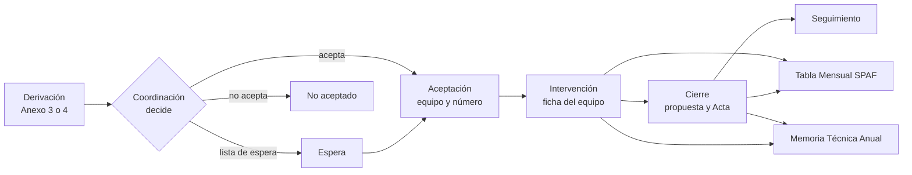

# Expedientes ETF

Aplicación web para administraciones que gestionan expedientes de tratamiento familiar para llevar los expedientes de las familias atendidas por los Equipos de Tratamiento Familiar (ETF). Cubre el recorrido completo, desde que llega una derivación hasta el cierre y el seguimiento posterior, y saca de la propia ficha del expediente los documentos Word y las cifras que hoy se montan a mano.

Cada administración designa a su responsable del producto y valida la puesta en servicio.

## Descargas

- Instalable de Windows 1.0.5, con usuarios y datos inventados: [versión 1.0.5](https://github.com/aavidad/expedientes-etf/releases/tag/v1.0.5). La descarga principal es el asistente `Expedientes-ETF-1.0.5-instalador.exe`, que instala la aplicación para tu usuario sin permiso de administrador; el ZIP con instalar.cmd queda como alternativa. La [guía para probar en casa](docs/windows/PROBAR-EN-CASA.md) explica cómo instalarlo desde un Windows sin preparar.
- Curso de la aplicación en web, SCORM y eXeLearning, y los 12 vídeos de recorridos: [curso 1.0.2](https://github.com/aavidad/expedientes-etf/releases/tag/curso-1.0.2).

## Documentación

Informática dispone del [manual de sistemas](docs/sistemas/LEEME.md), con arquitectura, instalación en servidor y Windows, configuración, copias cifradas, restauración, auditoría, conservación y resolución de problemas. Incluye [PDF para imprimir](docs/sistemas/sistemas.pdf) y [la comprobación del manual](docs/sistemas/MANSIS.md).

El [manual de programadores](docs/desarrollo/LEEME.md) explica la arquitectura, PostgreSQL, API, interfaz, paquetes, lectores, cálculos y pruebas. Incluye recetas de ampliación, capturas de la demo y [PDF](docs/desarrollo/programadores.pdf).

Los manuales de usuario de [profesionales de los ETF](docs/manuales/profesionales.md) ([PDF](docs/manuales/profesionales.pdf)) y [Coordinación](docs/manuales/coordinacion.md) ([PDF](docs/manuales/coordinacion.pdf)) siguen las tareas de cada perfil: acceso, avisos, ficha, documentos, cierre, traslado, seguimiento, Tabla SPAF, Memoria y carga histórica desde actas. Incluyen capturas con datos inventados y [ayuda común, glosario y preguntas frecuentes](docs/manuales/comun.md). El [manual completo de Administración funcional](docs/manuales/administracion.md) conserva sus instrucciones propias.

La [formación](docs/formacion/LEEME.md) incluye una sesión de 150 minutos por perfiles, ejercicios y soluciones, preparación del aula y recursos. El vídeo [Del Anexo a la Memoria](docs/recorridos/guiones/11-ciclo-completo.md) sigue un único caso inventado; se repite con `make video RECORRIDO=11-ciclo-completo`. El MP4 queda en la carpeta `ETF_VIDEOS_SALIDA`; [revisión y capítulos](docs/recorridos/EVIDENCIA-11.md). El [lanzador del aula](docs/formacion/preparar-aula.md) prepara Chrome con sesiones separadas y el calendario de la práctica.

## Licencia y autoría

Copyright © 2026 Expedientes ETF. Proyecto desarrollado con medios propios.

Es software libre: se distribuye con la [Licencia Pública de la Unión Europea, versión 1.2](LICENSE) (EUPL-1.2). Puedes usarlo, estudiarlo, modificarlo y redistribuirlo; si distribuyes una versión modificada o la ofreces como servicio en red, debes publicar sus cambios con la misma licencia o una compatible. La [versión oficial en castellano](https://eur-lex.europa.eu/legal-content/ES/TXT/?uri=CELEX:32017D0863) tiene la misma validez. Las fuentes tipográficas conservan su licencia SIL OFL 1.1; el detalle está en [NOTICE](NOTICE) y [REUSE.toml](REUSE.toml).

El catálogo de municipios incluido es un ejemplo con datos públicos. Todos los expedientes, personas y datos de pruebas, demostraciones y capturas son inventados. Cada administración configura su nombre, sus equipos y sus catálogos.

## Qué es

Los ETF son los equipos (trabajador/a social, educador/a social y psicólogo/a) que atienden a familias con menores en situación de riesgo o desprotección dentro del Programa de Tratamiento a Familias (PTF). Hoy el Programa trabaja con plantillas Word, PDF firmados y recuentos manuales. La aplicación sustituye ese circuito por un único expediente por familia.

El motivo principal es la Memoria Técnica Anual: si la ficha de cada expediente está completa, la Memoria se calcula sola y se puede comprobar cifra a cifra.

Hay ocho equipos hoy y la aplicación está preparada para doce. Se esperan unos 300 expedientes al año.

## Para quién es

| Perfil | Quién es | Para qué usa la aplicación |
| --- | --- | --- |
| Coordinación | Coordinador/a provincial y, más adelante, personal administrativo | Registrar derivaciones, aceptarlas, no aceptarlas o dejarlas en lista de espera, asignar equipo y número, cerrar expedientes, mantener el SMI por año y sacar la Memoria provincial |
| Profesional de ETF | Trabajador/a social, educador/a social o psicólogo/a de un equipo | Completar la ficha de los expedientes de su equipo, generar sus documentos, proponer cierres y sacar la Tabla Mensual y la Memoria de su equipo |
| Consulta | Pocas personas que necesitan estadísticas | Ver sólo cifras de la Memoria y totales, nunca nombres ni textos libres |
| Administración funcional | Una o dos personas | Dar de alta usuarios y perfiles, mantener catálogos, plantillas, idiomas y temas, y exportar la auditoría para el delegado de protección de datos. No ve fichas de expedientes |

El personal de Informática mantiene el servidor y no tiene perfil en la aplicación. Los permisos se dan dentro de la aplicación; el directorio de usuarios de la entidad (Active Directory, AD) sólo comprueba usuario y contraseña.

## Adaptar a una administración

La entidad configura el acceso corporativo, el dominio, los perfiles, los firmantes, los idiomas y las plantillas. `etf.example.org` es un dominio de ejemplo. El nombre visible se define con `entidad.nombre` en `idiomas/<idioma>/textos/comun.json`, con su artículo, como se leería dentro de una frase («la entidad» en la copia pública); los textos que lo necesitan usan `{entidad.nombre}`. Cambia los datos iniciales antes de instalar o publica una versión nueva del paquete de idioma desde Administración. Las plantillas Word se editan y publican desde la misma sección; se distribuyen sin logotipos ni contactos institucionales.

Los catálogos incluidos conservan los municipios y equipos de partida. Su sustitución queda pendiente; cada administración debe revisar esas asignaciones y las referencias normativas de los formularios antes de poner el servicio en uso. El campo `ambito_diputacion` describe el ámbito de atención y conserva su contrato.

## Qué hace

- **Derivaciones.** Coordinación sube el Anexo 3 (lo envían los Servicios Sociales Comunitarios) o el Anexo 4 (lo envía el Servicio de Protección de Menores, SPM). La aplicación lee el anexo en Word, LibreOffice o PDF, propone los datos y una persona los confirma.
- **Aceptación.** Coordinación acepta, no acepta o deja en lista de espera. Al aceptar se asigna equipo y número, y se generan el Acta de Aceptación y los oficios.
- **Ficha del expediente.** Reúne familia y adultos, menores, intervención, consentimiento, evaluación, documentos, salidas, cierre, seguimiento e historial. Es la única fuente de las cifras.
- **Salidas.** Desde la ficha se prepara la derivación al SPM (Anexo 5) o a otro servicio (Anexo 6), con su fecha real de envío y la respuesta del SPM confirmadas por separado.
- **Cierre, traslado y seguimiento.** El equipo propone el cierre y otra persona de Coordinación lo confirma; se puede reabrir con motivo. El traslado cierra el expediente en el equipo de origen y abre uno nuevo, con número propio, en el de destino. El seguimiento tras el cese dura 12 meses y avisa 30 días antes del fin.
- **Documentos Word.** Actas, oficios y anexos se rellenan desde plantillas en castellano o en inglés. Se descargan en el momento; la aplicación no guarda los documentos generados.
- **Tabla Mensual del SPAF.** Cada equipo la obtiene por mes para el Servicio de Prevención y Apoyo a la Familia (SPAF) de la administración competente.
- **Memoria Técnica Anual.** Se calcula por equipo y para toda la provincia, con las reglas vigentes el 31 de diciembre del año, y se puede cerrar para fijar las cifras. Consulta ve sólo las cifras, y las pequeñas se ocultan.
- **Carga histórica de 2026.** Alta asistida de casos, importación desde una hoja de cálculo y lectura de Actas de Aceptación y de Cierre, siempre con revisión de una persona antes de guardar.

La aplicación no firma documentos, no envía correos, no guarda los anexos recibidos y no usa inteligencia artificial. El alcance completo está en [PRD.md](docs/producto/PRD.md).

## Probar la aplicación en local

Ejecuta `make demo` desde la raíz del repositorio. Prepara una demostración con
usuarios inventados y sus perfiles asignados. Consulta los requisitos, las
cuentas, el recorrido del Anexo 3 al Acta y los comandos de parada en
[la guía de demostración](despliegue/demo/LEEME.md).

## Probar en Windows

Descarga el instalador y su suma SHA-256 desde las
[Releases públicas](https://github.com/aavidad/expedientes-etf/releases).
La [guía para probar en casa](docs/windows/PROBAR-EN-CASA.md) explica la
instalación paso a paso. Usa sólo datos inventados. La
[comprobación en Windows](docs/sistemas/WIN1.md) recoge versiones y resultados
de las pruebas.

La versión actual es la 1.0.5:

| Archivo | Tamaño | SHA-256 |
| --- | --- | --- |
| `Expedientes-ETF-1.0.5-instalador.exe` (recomendado) | unos 369 MiB | `d545a2b8fac06fb73182acf808484dcec0de17f84e2246e9995916026a08f09a` |
| `expedientes-etf-windows-1.0.5.zip` (alternativa) | unos 466 MiB | `97c9209d9e49b6d03849d33e62d3c5169ba51ce4fe5cc33c4bd1e57bbe7ee701` |

El asistente instala la aplicación para tu usuario, sin permiso de
administrador, y la deja en Configuración > Aplicaciones para quitarla desde
ahí. Como no está firmado, Windows puede mostrar SmartScreen: si la suma
coincide, pulsa «Más información» y después «Ejecutar de todas formas». Al
terminar se abre la ventana que pone lo que falte: activa WSL2 si hace falta
(pide permiso de administrador una vez y, si Windows tiene que reiniciarse,
continúa solo después), instala Podman para tu usuario, crea su máquina y usa
el Compose incluido. Los accesos del escritorio y de Inicio abren un pequeño
programa en lugar de un script, para que los antivirus no corten la aplicación
al arrancar. Desde la 1.0.5, ese programa, el instalador y el desinstalador son
los únicos que crean y borran los accesos: ningún script los toca, porque
algunos antivirus detienen esa operación y cortaban la instalación o la
desinstalación.

Incluye también lo de versiones anteriores: la pantalla Ayuda con los manuales
de cada perfil y su lectura en voz alta, la derivación a otros servicios
(Anexo 6), el desglose de la Memoria, la ocultación de cifras pequeñas en
Consulta, el cierre de sesión por inactividad, el control de la carga histórica,
la revisión tras restaurar una copia y la actualización de textos, plantillas y
temas.

## Arquitectura en breve

Es un monolito modular con arquitectura hexagonal. Las reglas del Programa (estados, plazos, numeración, cálculo de la Tabla y de la Memoria) viven en un núcleo que no conoce la base de datos, el directorio de usuarios, HTTP ni Word. Todo lo externo entra por un conector, que es un puerto definido por la aplicación más un adaptador que lo implementa.

- **Enganches por módulo.** Cada capacidad aporta sus rutas HTTP y pantallas; la composición es explícita en `cmd/etf/modulos.go` y `web/src/pantallas.ts`. El arranque valida métodos, permisos y duplicados. Cómo añadir una capacidad, en [TRD §2.3](docs/producto/TRD.md#23-módulos).
- **Diez módulos** con sus propias tablas y migraciones: `plataforma`, `identidad`, `catalogo`, `paquete`, `expediente`, `evaluacion`, `documento`, `actividad`, `estadistica` y `auditoria`. Un módulo nunca toca las tablas de otro.
- **Conectores** para el directorio de usuarios (LDAPS), el antivirus (ClamAV), la lectura de anexos, la generación de Word, el registro de salida y la lectura de idiomas y temas.
- **Idiomas y temas fuera del código.** Ningún texto visible está escrito en Go ni en React: el código usa claves, y los textos viven en `idiomas/<código>/`. El aspecto vive en paquetes `temas/<nombre>/` hechos de datos. Cambiar un idioma o un tema es cambiar un directorio.
- **Sin ficheros guardados.** Los anexos recibidos y los documentos generados no se conservan. Sólo se conservan los datos, las plantillas, los idiomas y los temas, siempre por versiones que no se modifican.
- **Seguridad por filas.** PostgreSQL aplica la seguridad por filas (RLS) para que cada equipo vea sólo lo suyo, aunque falle una pantalla.

El detalle está en [TRD.md](docs/producto/TRD.md) y una visión algo más amplia en [docs/README.md](docs/README.md).

## Pila

| Pieza | Tecnología |
| --- | --- |
| Servidor | Go |
| Interfaz | React, TypeScript y Vite, con componentes accesibles de React Aria |
| Base de datos | PostgreSQL 18 |
| Antivirus | ClamAV |
| Ejecución | Docker Compose |

Todo es software libre. Las versiones exactas están fijadas en `go.mod` y `web/package-lock.json`.

## Despliegue en resumen

`compose.yaml` define tres servicios permanentes (`app`, `postgres` y `clamav`) y dos contenedores puntuales: `preparar-roles` sincroniza los roles técnicos desde el entorno privado por socket local, incluso en volúmenes antiguos; `migrar` aplica después las migraciones con sus propias credenciales, de modo que la aplicación nunca migra. La guía de arranque local está en [despliegue/base/LEEME.md](despliegue/base/LEEME.md). Las carpetas `idiomas/` y `temas/` se montan como volúmenes. Lo que sigue es el diseño acordado y aún no está construido: la copia antes de subir una versión con vuelta atrás automática si falla la comprobación, y los tres entornos (desarrollo y preproducción con datos inventados; producción, el único con datos reales). Más detalle en [docs/README.md](docs/README.md) y en el apartado 12 de [TRD.md](docs/producto/TRD.md#12-despliegue).

## Flujo principal



Los recorridos de cada perfil están en [FLUJO_APP.md](docs/producto/FLUJO_APP.md).

## Estructura de carpetas

```
cmd/etf/          arranque de la aplicación
cmd/migrar/       ejecutor de migraciones, separado de la aplicación
internal/
  dominio/        reglas del Programa, por módulo
  aplicacion/     casos de uso, por módulo
  puertos/        interfaces hacia el exterior
  adaptadores/    HTTP, PostgreSQL, LDAP, ClamAV, Word, anexos, ficheros
  plataforma/     configuración y soporte técnico
web/              interfaz React, TypeScript y Vite
idiomas/          textos, catálogos y plantillas por idioma
temas/            paquetes de tema
migraciones/      SQL numerado, una carpeta por módulo
scripts/ci/       comprobaciones de la integración continua
scripts/recorridos/ grabación y montaje de vídeos de demostración
docs/             documentación (ver docs/README.md)
```

## Cómo arrancar en desarrollo

Con Docker Compose: copia `.env.plantilla` a `.env`, rellena las contraseñas y ejecuta `docker compose up -d --build`. Los pasos completos están en [despliegue/base/LEEME.md](despliegue/base/LEEME.md).

Sin Docker hacen falta Go 1.26.9 o posterior, Node 20.19 o posterior con npm, y Make.

```sh
make build        # compila la interfaz y deja bin/etf y bin/migrar
./bin/etf         # escucha en 127.0.0.1:8080
```

Se configura con variables de entorno con prefijo `ETF_` (por ejemplo `ETF_HTTP_DIRECCION`, `ETF_IDIOMAS_RUTA`, `ETF_TEMAS_RUTA`, `ETF_IDIOMA` y `ETF_TEMA`), descritas en [TRD.md](docs/producto/TRD.md). Las funciones que dependen de la base de datos, del directorio de usuarios o del antivirus necesitan esos servicios; por eso lo normal es arrancar con Compose.

Si ejecutas varias demos a la vez, puedes fijar subredes distintas mediante `ETF_DEMO_RED_SUBRED` y `ETF_DEMO_ENTRADA_SUBRED` en `despliegue/demo/.local/entorno.env`. Si la instalación repite muchas copias de dependencias, `npm_config_install_strategy=linked make demo` conserva las versiones e integridades del lock y usa enlaces. Esta misma variable se puede usar con `make ci`. Para recrear una demostración anterior con la siembra nueva: `make demo-limpiar` y `make demo`; el primer comando borra sólo los datos inventados de esa demostración.

## Integración continua en local

```sh
make ci           # la misma puerta que GitHub Actions
make build        # sólo compilar
make recorridos   # entrada, permisos, ficha integrada, salidas, SPAF y Memoria
```

`make ci` comprueba el formato de Go, los enlaces de los documentos, los secretos, los tipos, las pruebas y la compilación. Incluye los ensayos completos de las migraciones de Catálogo y del Expediente ([ensayos recuperados](docs/evidencias/FX6.md)) y el del arranque de PostgreSQL por TCP, con diagnósticos acotados que no muestran credenciales ([arranque por TCP](docs/evidencias/FX5.md)). Necesita Bash, Git, Python 3.9 o posterior, Go, Node con npm, Docker, Chrome del sistema y Gitleaks (ver [scripts/ci/README.md](scripts/ci/README.md)). Existen también `make test`, `make vet` y `make comprobar`.

`make recorridos` prueba con Chrome del sistema, contra `make demo`:

- la entrada y el alta, y todos los métodos del registro de módulos con cada perfil y PostgreSQL ([alcance y requisitos](docs/recorridos/F0.11.md));
- las nueve pestañas de la ficha, un conflicto de edición sin perder el formulario, el aislamiento entre equipos y cuatro cortes históricos ([ficha integrada](docs/recorridos/F2.07.md));
- salidas, cierre, traslado, seguimiento y las seis tablas del SPAF, con datos preparados por API y cifras calculadas a mano ([salidas y SPAF](docs/recorridos/F3.06-F3.07.md));
- los 28 apartados de la Memoria, su Word, cierres, corrección, discrepancia, aislamiento y reapertura ([Memoria integrada](docs/recorridos/F4.09.md)). Se puede ejecutar por separado con `python3 -B scripts/recorridos/memoria_integrada.py`.

Cuando un recorrido detecta un fallo de producto, lo registra y termina con error. Sólo el primero se ejecuta también en `make ci`.

## Estado del proyecto

A 15/10/2026 están integradas en `main` todas las fases del plan: entrada y aceptación de derivaciones, ficha completa, documentos Word, salidas, cierre, traslado y seguimiento, Tabla Mensual del SPAF, Memoria con su desglose, carga histórica de 2026, administración, auditoría, conservación, accesibilidad, manuales, curso, lector de voz y paquete de Windows.

Lo que falta no depende del código:

- La evaluación de impacto en protección de datos de cada entidad, con su delegado de protección de datos, antes de usar datos reales.
- Lo que tiene que preparar Informática: el proxy HTTPS, la conexión cifrada con el directorio (LDAPS), las copias cifradas y el sellado diario de la auditoría.
- La puesta en producción y la carga de los expedientes reales.
- Las dudas que el Programa aún no ha respondido: el uso de dos de los motivos de cierre, el fin del seguimiento tras el cese, el total y los porcentajes del apartado 24 de la Memoria, el recuento de derivaciones a otros servicios y si cabe el Anexo 6 mientras se espera respuesta del SPM. El [PRD](docs/producto/PRD.md) recoge las reglas vigentes.

Los cuestionarios oficiales de las escalas de evaluación esperan una decisión del responsable del producto; mientras tanto las escalas son opcionales y no bloquean documentos, cierre ni Memoria. El orden y los criterios de cada entrega están en [PLAN_IMPLEMENTACION.md](docs/producto/PLAN_IMPLEMENTACION.md).

## Documentos de producto

Son la única fuente de verdad. Si algo contradice a uno de ellos, se corrige en el mismo cambio.

| Documento | Qué contiene |
| --- | --- |
| [PRD.md](docs/producto/PRD.md) | Qué es la aplicación, para quién y con qué prioridad |
| [TRD.md](docs/producto/TRD.md) | Pila, arquitectura, seguridad y despliegue |
| [FLUJO_APP.md](docs/producto/FLUJO_APP.md) | Recorridos y pantallas por perfil |
| [DISENO_UI_UX.md](docs/producto/DISENO_UI_UX.md) | Reglas de diseño, temas y usabilidad |
| [ESQUEMA_BACKEND.md](docs/producto/ESQUEMA_BACKEND.md) | Datos, permisos, migraciones y API |
| [PLAN_IMPLEMENTACION.md](docs/producto/PLAN_IMPLEMENTACION.md) | Qué falta y en qué orden |

Para contribuir, lee los seis documentos de producto en `docs/producto/` y ejecuta `make ci`.

## Curso y vídeos de recorridos

El [curso de la aplicación](curso/LEEME.md), de Alberto Avidad (CC BY-SA 4.0), se construye con `make curso` para eXeLearning 4.0.5, web offline y SCORM 1.2.

`make videos` graba todos los guiones; `make videos RECORRIDOS="05-ficha 06-spaf 08-traslado"` selecciona los tres de ficha, tabla y traslado. `make videos RECORRIDOS="09-memoria 10-carga-2026"` graba Memoria y carga. `make video RECORRIDO=02-coordinacion` graba sólo la recepción y aceptación de una derivación. También están disponibles `01-entrada`, sobre acceso y asignación de perfil; `03-actividad`, sobre comisiones, informes y consulta provincial; `04-plantillas`, sobre revisión y activación de una plantilla Word; `05-ficha`, sobre avisos, menores, intervención, consentimiento y evaluación; `06-spaf`, sobre la tabla mensual con cifras de menores; `07-cierre`, sobre propuesta, confirmación y Acta de Cierre; `08-traslado`, sobre el número nuevo en destino y el seguimiento tras cese del origen; `09-memoria`, sobre revisión, textos, Word, cierre y reapertura de la Memoria; y `10-carga-2026`, sobre alta histórica e importación de una hoja con incidencias por fila. Incluyen una vista previa animada sobre pantallas reales, acciones sincronizadas con la voz, ratón visible y cierre sobre la última pantalla difuminada. Los rótulos breves usan el tema activo. Los resultados se guardan fuera de Git, en la carpeta elegida con `ETF_VIDEOS_SALIDA` (por defecto `~/Videos/Expedientes-ETF`). La herramienta arranca el entorno local de demostración y utiliza sus cuentas inventadas; también permite probar el montaje con imágenes sintéticas. Requisitos, arranque manual y revisión de fotogramas en [la guía de recorridos](docs/recorridos/LEEME.md).

## Lector de voz

`make voz` genera las grabaciones del curso, la ayuda contextual y los manuales con edge-tts 7.3.1 y la voz `es-ES-AlvaroNeural`; la última generación produjo 243 audios. Sólo envía texto redactado por el proyecto, sin datos de expedientes ni de la base. Los audios quedan fuera de Git en `bin/voz/`, con caché por texto. La aplicación reproduce recursos estáticos; si faltan, conserva la lectura sin controles de audio. En inglés el lector permanece oculto.

El menú Ayuda ofrece el manual de los perfiles de la sesión, con índice y capturas. `make curso` incluye escucha de página y secciones tanto en web como en SCORM. Docker y el paquete de Windows incorporan los audios existentes. [Construcción y pruebas](scripts/voz/LEEME.md) y [operación de la generación](docs/sistemas/VOZ.md).

## Detalle de lo construido

Cada apartado enlaza su comprobación, sus capturas con datos inventados y el recorrido que se repite tras `make demo`. Los puertos de los comandos son ejemplos: usa el de tu demostración.

### Entrada de derivaciones

El lector de anexos acepta Word, LibreOffice (ODT) y PDF, también los PDF con firma digital. El PDF usa `dslipak/pdf v0.0.2` en un trabajador efímero, con límite de 10 MB y 20 páginas. Los valores leídos requieren confirmación y los campos no recuperados quedan vacíos. Los escaneados se registran con aviso para teclear sus datos, sin reconocimiento de texto ni ficheros temporales. [Lectura de los ODT y PDF del Programa](docs/recorridos/RESP4.md). El ensayo HTTP con ClamAV se ejecuta con `python3 -B internal/adaptadores/anexos/pdf/probar_subida.py`, con recursos desechables y firmas sintéticas.

La subida pasa por el antivirus y muestra una revisión editable con la propuesta de municipio, centro y equipo. Analizar no crea la derivación: se guarda sólo al confirmar, una sola vez y con auditoría. Descartar elimina la revisión temporal. La pantalla está en `/coordinacion/anexos/nuevo`.

La bandeja de Coordinación (`/coordinacion`) reúne pendientes de revisar, aceptados recientes, no aceptados y lista de espera. Filtra por estado, equipo, municipio y recepción, y busca por número o familia; la lista muestra sólo iniciales. Desde la revisión de una derivación (`/coordinacion/derivaciones/{id}`) se acepta con número confirmado, se rechaza o se deja en lista de espera, se descargan actas y oficios y se anota su registro de salida.

- [Bandeja en escritorio](docs/capturas/bandeja-escritorio.png) y [en móvil](docs/capturas/bandeja-movil.png).
- [Revisión del anexo en escritorio](docs/capturas/anexo-escritorio.png) y [en móvil](docs/capturas/anexo-movil.png).
- Decisión sobre la derivación: [escritorio, 1440 px](docs/capturas/decision-escritorio.png) y [móvil, 390 px](docs/capturas/decision-movil.png).

Recorrido: `node scripts/recorridos/decision.mjs http://127.0.0.1:18186`. Sube y confirma los anexos por API, prepara un destinatario inventado para el SPM si falta y comprueba decisiones, descargas y registros con Coordinación.

Coordinación mantiene el salario mínimo interprofesional (SMI) por año en `/coordinacion/smi`.

### Ficha del expediente

La bandeja del equipo y la ficha comparten el armazón común. Se busca sin mostrar nombres en los resultados y se consultan hitos, emisiones e historial. La ficha muestra los avisos de consentimiento vencido, fase prolongada y datos que faltan para la Memoria. Sus pestañas son Familia, Menores, Intervención, Consentimiento, Evaluación, Documentos, Cierre, Salidas e Historial. Guardan versión e historia con vigencia, comparan los cambios ante un conflicto sin perder el formulario y sólo dejan ver a cada equipo lo suyo. [Validación de la bandeja y la ficha](docs/capturas/EVIDENCIA_F2.06.md).

- Familia y adultos, con historia para las estadísticas.
- Hasta 15 menores, con subprograma propio, centro de protección opcional y excepciones por menor.
- Intervención: fase, coordinación, factores y tipologías. Distingue un dato sin valorar de una lista vacía.
- Consentimiento: descarga el Anexo 1 o 2 y confirma por separado la firma y la fecha del Anexo 7 u 8, sin guardar el DNI.
- Evaluación: instrumentos por adulto y momento, con respuestas por ítem. Las escalas son opcionales: se pueden anotar aquí o rellenar después en el Word de los Anexos 11 y 12, y las casillas sin resultado quedan vacías. No calcula puntuaciones totales sin los baremos del Programa.
- Comisiones e informes del equipo en `/equipo/comisiones`, que alimentan los apartados 15 y 16 de la Memoria.

Capturas:

- [Bandeja en escritorio](docs/capturas/equipo-bandeja-escritorio.png) y [en móvil](docs/capturas/equipo-bandeja-movil.png); [ficha en escritorio](docs/capturas/equipo-ficha-escritorio.png) y [en móvil](docs/capturas/equipo-ficha-movil.png).
- [Familia en escritorio](docs/capturas/equipo-gap1-familia-escritorio.png) y [en móvil](docs/capturas/equipo-gap1-familia-movil.png).
- [Menores en escritorio](docs/capturas/fi1-menores-escritorio.png) y [en móvil](docs/capturas/fi1-menores-movil.png); [Intervención en escritorio](docs/capturas/fi1-intervencion-escritorio.png) y [en móvil](docs/capturas/fi1-intervencion-movil.png).
- [Consentimiento en escritorio](docs/capturas/fi2-consentimiento-escritorio.png) y [en móvil](docs/capturas/fi2-consentimiento-movil.png); [Evaluación en escritorio](docs/capturas/fi2-evaluacion-escritorio.png) y [en móvil](docs/capturas/fi2-evaluacion-movil.png).
- Evaluación sin escalas: [escritorio](docs/capturas/resp3-sin-escalas-escritorio.png) y [móvil](docs/capturas/resp3-sin-escalas-movil.png); con resultados parciales: [escritorio](docs/capturas/resp3-parciales-escritorio.png) y [móvil](docs/capturas/resp3-parciales-movil.png).
- [Comisiones en escritorio](docs/capturas/actividad-comisiones-escritorio.png), [informes en escritorio](docs/capturas/actividad-informes-escritorio.png) e [informes en móvil](docs/capturas/actividad-informes-movil.png).

Recorridos y límites: [bandeja y ficha](docs/capturas/EVIDENCIA_F2.06.md), [familia y cierre](docs/capturas/GAP1.md), [menores e intervención](docs/capturas/FI1.md), [consentimiento y evaluación](docs/capturas/FI2.md), [escalas opcionales](docs/evidencias/RESP3.md) y [comisiones e informes](docs/capturas/actividad.md). Se repiten con `node despliegue/demo/equipo-recorrido.mjs`, `node scripts/recorridos/gap1.mjs`, `node scripts/recorridos/fi1.mjs`, `node scripts/recorridos/fi2.mjs` y `node scripts/recorridos/resp3.mjs`, seguidos de la dirección de la demo (por ejemplo `http://127.0.0.1:18083`). En la demo, Marta Cabrera edita los expedientes de ETF 02 e Inés Moreno consulta.

### Salidas, cierre, traslado y seguimiento

Salidas prepara la derivación al SPM con el Anexo 5 y registra su respuesta con historia. Al enviar el Anexo 5, el expediente pasa a «derivado al SPM»; una respuesta favorable con fecha lo devuelve a intervención. También prepara la derivación a otro servicio con el Anexo 6: destino de catálogo, o escrito a mano si no hay opciones, motivo y versión de plantilla. Administración publica los destinos. Ninguna de las dos salidas cierra el expediente. [Derivación a otros servicios](docs/evidencias/AN6.md).

El equipo guarda la finalización, descarga los Anexos 11 y 12 y propone o retira el cierre; también puede proponerlo desde «aceptado» si falta el consentimiento. Otra persona de Coordinación revisa la propuesta, confirma fecha y cierre y descarga el Acta de Cierre. Si el SPM no ha respondido, el cierre queda bloqueado salvo una excepción motivada y auditada. Para editar un expediente cerrado hay que reabrirlo, y los episodios anteriores se conservan.

El traslado cierra el expediente en el equipo de origen, copia familia, adultos y menores vigentes y lo abre en el de destino con número nuevo y Acta. El seguimiento tras el cese dura 12 meses según el catálogo, avisa 30 días antes del fin y termina solo; el equipo puede terminarlo antes con un motivo y Coordinación puede reabrirlo, incluso vencido, con el plazo completo desde la reapertura.

- Salidas y cierre: [escritorio, 1440 px](docs/capturas/salidas-escritorio.png), [móvil, 390 px](docs/capturas/salidas-movil.png), [cierres propuestos](docs/capturas/salidas-cierres-escritorio.png) y [alto contraste en móvil](docs/capturas/salidas-alto-contraste-movil.png). [Recorrido y revisión](docs/capturas/salidas.md).
- Familia y cierre: [Cierre en escritorio](docs/capturas/equipo-gap1-cierre-escritorio.png) y [en móvil](docs/capturas/equipo-gap1-cierre-movil.png).
- Traslado y seguimiento: [traslado en escritorio](docs/capturas/traslado-escritorio.png), [traslado en móvil](docs/capturas/traslado-movil.png), [seguimiento en escritorio](docs/capturas/traslado-seguimiento-escritorio.png), [seguimiento en móvil](docs/capturas/traslado-seguimiento-movil.png) y [alto contraste en móvil](docs/capturas/traslado-alto-contraste-movil.png). [Recorrido y revisión](docs/capturas/traslado.md); se repite con `node scripts/recorridos/traslado.mjs http://127.0.0.1:18431`.

### Respuestas del Programa

Las respuestas del Programa del 14/10/2026 ya están aplicadas: el SMI de 2026, la lista de espera sólo para el Anexo 3, la aceptación de municipios fuera del ámbito, la columna de municipio en el SPAF, el recuento de pendientes en la Memoria y la fecha y el número reales de la aceptación.

- [Anexo 6 en escritorio (1440 px)](docs/capturas/anexo6-1440.png) y [en móvil (390 px)](docs/capturas/anexo6-390.png).
- [Derivación del SPM en escritorio](docs/capturas/resp1-spm-1440.png) y [en móvil](docs/capturas/resp1-spm-390.png).
- [Tabla SPAF en escritorio](docs/capturas/resp1-spaf-1440.png) y [en móvil](docs/capturas/resp1-spaf-390.png).

Recorrido: `node scripts/recorridos/respuestas_programa.mjs http://127.0.0.1:18083`. Comprueba además el rechazo en el servidor de la lista de espera para el Anexo 4 y los Word del SPAF en castellano e inglés.

### Tabla Mensual del SPAF

La tabla se calcula desde la historia de los expedientes, con permisos por equipo, auditoría y el corte de lo que se sabía en cada fecha. Los campos que todavía no se recogen se muestran como desconocidos. Se descarga en Word, en castellano o inglés. La columna «Municipio / ZTS» recoge sólo el municipio de la familia, como pidió el Programa.

Capturas: [escritorio, 1440 px](docs/capturas/spaf-escritorio.png), [móvil, 390 px](docs/capturas/spaf-movil.png) y [alto contraste en móvil](docs/capturas/spaf-alto-contraste-movil.png). [Recorrido y límites](docs/capturas/spaf.md). La demo incluye septiembre de 2026: en ETF 02, 2 altas, 2 bajas y 3 casos; en ETF 01, 1 alta. Recorrido: `node scripts/recorridos/spaf.mjs http://127.0.0.1:18273`.

### Memoria Técnica Anual

La pantalla Memoria (`/memoria`) tiene cuatro bloques, avisos, textos editables, descarga en Word, estado, cierre y reapertura. Los textos A, D, E, F y G se guardan con versión e historia auditada. El Word de la administración competente se descarga por año, equipo e idioma sin guardar el fichero. El equipo cierra la suya; sólo Coordinación cierra la provincial y reabre, con motivo. Al cerrar se guarda una foto de las cifras; si después cambia un dato, Coordinación recibe un aviso de discrepancia y el Word cerrado sigue usando la foto. Los parámetros iniciales están en `datos/catalogos/memoria/`; las fuentes que aún faltan y los porcentajes sin base validada se muestran como «sin dato».

Consulta ve sólo cifras, la fecha y si son provisionales o definitivas, y descarga un Word numérico. El cálculo para Consulta usa un rol técnico propio sin acceso a tablas personales y necesita `ETF_CALCULO_MEMORIA_CONTRASENA` ([cifras para Consulta](docs/evidencias/F4.07.md)). Las cifras pequeñas se ocultan y la sesión avisa antes de caducar ([protección de cifras y sesión](docs/evidencias/SEG1.md)).

El desglose permite comprobar cada cifra por expediente: número, equipo y aporte, sin nombres. Las comisiones y los informes son actividad del equipo y no se vinculan a expedientes ([desglose de la Memoria](docs/evidencias/MEMDES.md)).

- Memoria: [escritorio](docs/capturas/memoria-escritorio.png), [móvil](docs/capturas/memoria-movil.png) y [foto cerrada](docs/capturas/memoria-cerrada.png). [Recorrido de permisos, edición y descarga](docs/capturas/memoria.md).
- Desglose: [escritorio, 1440 px](docs/capturas/memoria-desglose-1440.png) y [móvil, 390 px](docs/capturas/memoria-desglose-390.png). Recorrido: `node scripts/recorridos/memoria-desglose.mjs http://127.0.0.1:18543`, que también corre en `make ci`.
- Consulta: [1440 px](docs/capturas/seg1-consulta-1440.png) y [390 px](docs/capturas/seg1-consulta-390.png); aviso de sesión a [1440 px](docs/capturas/seg1-sesion-1440.png) y [390 px](docs/capturas/seg1-sesion-390.png); [límite absoluto](docs/capturas/seg1-maxima-390.png) y [entrada tras caducar](docs/capturas/seg1-caducada-390.png). Recorrido: `node scripts/recorridos/seg1.mjs`.

El ensayo de las migraciones de estadística se ejecuta con `python3 -B migraciones/estadistica/ensayar.py` y forma parte de `make ci`.

### Carga histórica de 2026

Permite dar de alta los expedientes históricos que hacen falta para 2026 conservando números, fechas, cierres, reaperturas y vigencias. Los casos cargados quedan señalados para que Coordinación o el equipo los revisen y confirmen uno a uno o por lotes.

- Alta asistida de un caso.
- Importación de una hoja CSV o XLSX de hasta 10 MB y 100 casos por equipo: vista previa sin guardar, antivirus obligatorio, informe por fila en castellano o inglés y lotes que se guardan enteros o no se guardan. La hoja no se conserva. El formato es provisional y su contrato está en [ESQUEMA_BACKEND §7.2](docs/producto/ESQUEMA_BACKEND.md#72-compatibilidad-de-carga-por-hoja-formato-v1-f208b). Hay un CSV inventado para descargar.
- Importación de Actas de Aceptación y de Cierre en PDF, DOCX u ODT, también firmadas, con revisión de una persona, para cargar los expedientes abiertos de años anteriores. Las actas no se guardan ([importación de actas](docs/evidencias/RESP2.md), [actas en ODT](docs/evidencias/RESP5.md)).
- Control de la carga: Administración fija la fecha de cierre y Coordinación revisa y anula lotes intactos dentro del plazo. Las coincidencias con expedientes existentes requieren confirmación expresa, y un lote no puede agotar los números ordinarios del equipo ([pruebas y límites](docs/evidencias/SEG3.md)).

Capturas de la carga ([recorrido y revisión](docs/capturas/carga.md)):

- Alta asistida: [escritorio, 1440 px](docs/capturas/carga-alta-escritorio.png) y [móvil, 390 px](docs/capturas/carga-alta-movil.png).
- Revisión histórica: [escritorio](docs/capturas/carga-revision-escritorio.png) y [móvil](docs/capturas/carga-revision-movil.png).
- Carga de hoja: [escritorio](docs/capturas/carga-hoja-escritorio.png) y [móvil](docs/capturas/carga-hoja-movil.png).
- Incidencias por fila: [escritorio](docs/capturas/carga-incidencias-escritorio.png) y [móvil](docs/capturas/carga-incidencias-movil.png).
- Resultado: [escritorio](docs/capturas/carga-resultado-escritorio.png), [móvil](docs/capturas/carga-resultado-movil.png) y [alto contraste](docs/capturas/carga-alto-contraste-movil.png).
- Revisión de un no aceptado por el equipo: [escritorio](docs/capturas/carga-no-aceptado-profesional-escritorio.png) y [móvil](docs/capturas/carga-no-aceptado-profesional-movil.png). El resultado enlaza a la consulta auditada de cada expediente, también si no tiene número.

Capturas de la importación de actas:

- Elegir equipo y actas: [1440 px](docs/capturas/carga-actas-inicio-1440.png) · [390 px](docs/capturas/carga-actas-inicio-390.png).
- Datos leídos para revisar: [1440 px](docs/capturas/carga-actas-datos-1440.png) · [390 px](docs/capturas/carga-actas-datos-390.png).
- Resultado confirmado: [1440 px](docs/capturas/carga-actas-resultado-1440.png) · [390 px](docs/capturas/carga-actas-resultado-390.png).
- [Alto contraste, 390 px](docs/capturas/carga-actas-contraste-390.png).

Capturas del control de la carga:


| Control de la carga histórica | Escritorio | Móvil |
| --- | --- | --- |
| Fecha de cierre (Administración) | [Ver captura](docs/capturas/carga-seg3-plazo-1440.png) | [Ver captura](docs/capturas/carga-seg3-plazo-390.png) |
| Carga cerrada | [Ver captura](docs/capturas/carga-seg3-cerrada-1440.png) | [Ver captura](docs/capturas/carga-seg3-cerrada-390.png) |
| Coincidencias por revisar | [Ver captura](docs/capturas/carga-seg3-duplicados-1440.png) | [Ver captura](docs/capturas/carga-seg3-duplicados-390.png) |
| Lotes de Coordinación | [Ver captura](docs/capturas/carga-seg3-lotes-1440.png) | [Ver captura](docs/capturas/carga-seg3-lotes-390.png) |
| Confirmar anulación | [Ver captura](docs/capturas/carga-seg3-anular-1440.png) | [Ver captura](docs/capturas/carga-seg3-anular-390.png) |
| Inglés y alto contraste | [Ver captura](docs/capturas/carga-seg3-contraste-en-1440.png) | [Ver captura](docs/capturas/carga-seg3-contraste-en-390.png) |

Recorridos: `node scripts/recorridos/carga.mjs http://127.0.0.1:51481`, con Inés Moreno y Marta Cabrera, que conserva los expedientes de la prueba en la demo, y `node scripts/recorridos/seg3.mjs http://127.0.0.1:18423` para el control de la carga.

### Administración

- **Usuarios y permisos.** Perfiles, vigencias, equipo y baja. Los permisos propios los cambia otra persona de Administración: «Ver mis permisos» abre la configuración en consulta, y el servidor y la base de datos bloquean y auditan el intento. La primera cuenta se concede una sola vez mediante el [alta inicial de sistemas](docs/sistemas/LEEME.md). Capturas: [escritorio, 1440 px](docs/capturas/usuarios-seg2-1440.png) y [móvil, 390 px](docs/capturas/usuarios-seg2-390.png). [Pruebas y revisiones](docs/evidencias/SEG2.md). Recorrido: `node scripts/recorridos/seg2.mjs http://127.0.0.1:18142`.
- **Catálogos, plazos, tramos, firmantes y SMI.** Las etiquetas salen en el idioma activo, idiomas y temas tienen una sola entrada y los importes del SMI no se cortan en móvil. [Recorrido y límites](docs/capturas/UI2.md).
- **Equipos, municipios y centros.** Altas y bajas con vigencia, asignaciones independientes, ámbito y variantes de escritura, sin tocar versiones anteriores, expedientes numerados ni Memorias cerradas. Capturas: [escritorio 1440](docs/capturas/ubicaciones-1440.png), [móvil 390](docs/capturas/ubicaciones-390.png), [alto contraste](docs/capturas/ubicaciones-390-alto-contraste.png) e [inglés](docs/capturas/ubicaciones-390-en.png). Recorrido: `node scripts/recorridos/ubicaciones.mjs http://127.0.0.1:18095`.
- **Plantillas Word** (`/admin/plantillas`). Versión activa e historial por documento e idioma, subida de DOCX de hasta 10 MB con antivirus, detalle de marcadores y activación confirmada con autor y fecha. Se puede volver a una versión anterior sin borrar la historia. Capturas: [escritorio, 1440 px](docs/capturas/plantillas-escritorio.png) y [móvil, 390 px](docs/capturas/plantillas-movil.png). [Recorrido y comprobaciones](docs/capturas/plantillas.md); se repite con `node scripts/recorridos/plantillas.mjs http://127.0.0.1:18231`.
- **Auditoría.** Descarga en CSV o JSON con prueba de integridad, filtros y límites. Se comprueba en local con `go run ./cmd/verificar-exportacion /ruta/autorizada/auditoria.zip`; añade `ID_ANTERIOR HUELLA_ANTERIOR ID_FINAL HUELLA_FINAL` para contrastar los dos puntos custodiados fuera del archivo. Capturas: [escritorio, 1440 px](docs/capturas/auditoria-escritorio.png) y [móvil, 390 px](docs/capturas/auditoria-movil.png). [Recorrido y pruebas](docs/evidencias/AUD1.md).
- **Conservación** (`/admin/conservacion`). 25 años desde el cierre, configurables en Plazos y tramos. Dos personas distintas de Administración revisan y confirman la retirada de datos personales sin abrir fichas. Se mantienen las cifras históricas y la auditoría. El alcance depende de lo que diga el delegado de protección de datos.
- **Revisión tras restaurar una copia.** Hasta decidir los cambios y confirmar la revisión, nadie más puede entrar. Capturas: [escritorio](docs/capturas/restauracion-escritorio.png) y [móvil](docs/capturas/restauracion-movil.png).

| Pantalla | Escritorio (1440 px) | Móvil (390 px) | Alto contraste: escritorio | Alto contraste: móvil |
| --- | --- | --- | --- | --- |
| Usuarios y permisos | [Ver captura](docs/capturas/ui2-usuarios-1440-expedientes-etf.png) | [Ver captura](docs/capturas/ui2-usuarios-390-expedientes-etf.png) | [Ver captura](docs/capturas/ui2-usuarios-1440-alto-contraste.png) | [Ver captura](docs/capturas/ui2-usuarios-390-alto-contraste.png) |
| Catálogos | [Ver captura](docs/capturas/ui2-catalogos-1440-expedientes-etf.png) | [Ver captura](docs/capturas/ui2-catalogos-390-expedientes-etf.png) | [Ver captura](docs/capturas/ui2-catalogos-1440-alto-contraste.png) | [Ver captura](docs/capturas/ui2-catalogos-390-alto-contraste.png) |
| Plazos | [Ver captura](docs/capturas/ui2-reglas-1440-expedientes-etf.png) | [Ver captura](docs/capturas/ui2-reglas-390-expedientes-etf.png) | [Ver captura](docs/capturas/ui2-reglas-1440-alto-contraste.png) | [Ver captura](docs/capturas/ui2-reglas-390-alto-contraste.png) |
| Tramos | [Ver captura](docs/capturas/ui2-tramos-1440-expedientes-etf.png) | [Ver captura](docs/capturas/ui2-tramos-390-expedientes-etf.png) | [Ver captura](docs/capturas/ui2-tramos-1440-alto-contraste.png) | [Ver captura](docs/capturas/ui2-tramos-390-alto-contraste.png) |
| Firmantes y destinatarios | [Ver captura](docs/capturas/ui2-firmantes-1440-expedientes-etf.png) | [Ver captura](docs/capturas/ui2-firmantes-390-expedientes-etf.png) | [Ver captura](docs/capturas/ui2-firmantes-1440-alto-contraste.png) | [Ver captura](docs/capturas/ui2-firmantes-390-alto-contraste.png) |
| Salario mínimo interprofesional | [Ver captura](docs/capturas/ui2-smi-1440-expedientes-etf.png) | [Ver captura](docs/capturas/ui2-smi-390-expedientes-etf.png) | [Ver captura](docs/capturas/ui2-smi-1440-alto-contraste.png) | [Ver captura](docs/capturas/ui2-smi-390-alto-contraste.png) |

### Aplicación instalable

La aplicación se puede instalar en Edge y Chrome como una aplicación más ([cómo instalarla desde Edge](docs/manuales/usuario.md#instalar-la-aplicación-desde-edge)). Necesita conexión con el servidor y no guarda expedientes para trabajar sin conexión. Los iconos se regeneran con `node scripts/pwa1/iconos.mjs`. La prueba de instalación y privacidad es `node scripts/recorridos/pwa1.mjs http://127.0.0.1:18541`: comprueba que la demo es la de esta copia de trabajo y la prepara igual que `make demo`, instalando idiomas, temas e iconos sin perder las versiones publicadas ni lo cambiado a mano.

| Aplicación instalable | Escritorio | Móvil |
| --- | --- | --- |
| Sesión de Coordinación | [Ver captura](docs/capturas/pwa1-escritorio.png) | [Ver captura](docs/capturas/pwa1-movil.png) |
| Sin conexión | [Ver captura](docs/capturas/pwa1-sin-conexion-escritorio.png) | [Ver captura](docs/capturas/pwa1-sin-conexion-movil.png) |

### Aspecto general

Menú por secciones, decisión de derivación, avisos de menores, persona y equipo, y SPAF con casos históricos. Donde el lector todavía no conecta un dato, el SPAF lo muestra como desconocido y la Memoria como «Sin dato». [Recorrido y comprobaciones](docs/capturas/UI3.md); se repite con `node scripts/recorridos/ui3.mjs http://127.0.0.1:18343`.

| Pantalla | Escritorio 1440 | Móvil 390 |
| --- | --- | --- |
| Bandeja y secciones del menú | [Ver captura](docs/capturas/ui3-bandeja-1440.png) | [Ver captura](docs/capturas/ui3-bandeja-390.png) |
| Decisión de derivación | [Ver captura](docs/capturas/ui3-decision-1440.png) | [Ver captura](docs/capturas/ui3-decision-390.png) |
| Avisos de menores | [Ver captura](docs/capturas/ui3-avisos-menores-1440.png) | [Ver captura](docs/capturas/ui3-avisos-menores-390.png) |
| Persona y equipo | [Ver captura](docs/capturas/ui3-equipo-persona-1440.png) | [Ver captura](docs/capturas/ui3-equipo-persona-390.png) |
| SPAF con casos históricos | [Ver captura](docs/capturas/ui3-spaf-1440.png) | [Ver captura](docs/capturas/ui3-spaf-390.png) |

Lector de voz: [recorrido y resultados](docs/capturas/VOZ.md). [Ayuda 1440](docs/capturas/voz-ayuda-1440.png), [Ayuda 390](docs/capturas/voz-ayuda-390.png), [ayuda contextual 1440](docs/capturas/voz-contextual-1440.png), [ayuda contextual 390](docs/capturas/voz-contextual-390.png), [curso 1440](docs/capturas/voz-curso-1440.png) y [curso 390](docs/capturas/voz-curso-390.png).

### Accesibilidad

[Informe por pantalla y perfil](docs/accesibilidad/README.md), con la comprobación automática de axe en castellano e inglés y con ambos temas. Las capturas de escritorio (1440 px) y móvil (390 px) están enlazadas desde cada informe de la [matriz](docs/accesibilidad/matriz.md). La comprobación forma parte de `make recorridos` y exige cero fallos serios o críticos. Quedan las revisiones manuales y de los Word que indica el informe.

| Pantalla | Perfil | Escritorio, 1440 px | Móvil, 390 px |
| --- | --- | --- | --- |
| `/admin/catalogos` | Administración funcional | [Ver captura](docs/capturas/accesibilidad-administracion-admin-catalogos-1440.png) | [Ver captura](docs/capturas/accesibilidad-administracion-admin-catalogos-390.png) |
| `/admin/catalogos/listas` | Administración funcional | [Ver captura](docs/capturas/accesibilidad-administracion-admin-catalogos-listas-1440.png) | [Ver captura](docs/capturas/accesibilidad-administracion-admin-catalogos-listas-390.png) |
| `/admin/firmantes` | Administración funcional | [Ver captura](docs/capturas/accesibilidad-administracion-admin-firmantes-1440.png) | [Ver captura](docs/capturas/accesibilidad-administracion-admin-firmantes-390.png) |
| `/admin/idiomas` | Administración funcional | [Ver captura](docs/capturas/accesibilidad-administracion-admin-idiomas-1440.png) | [Ver captura](docs/capturas/accesibilidad-administracion-admin-idiomas-390.png) |
| `/admin/paquetes` | Administración funcional | [Ver captura](docs/capturas/accesibilidad-administracion-admin-paquetes-1440.png) | [Ver captura](docs/capturas/accesibilidad-administracion-admin-paquetes-390.png) |
| `/admin/plantillas` | Administración funcional | [Ver captura](docs/capturas/accesibilidad-administracion-admin-plantillas-1440.png) | [Ver captura](docs/capturas/accesibilidad-administracion-admin-plantillas-390.png) |
| `/admin/reglas` | Administración funcional | [Ver captura](docs/capturas/accesibilidad-administracion-admin-reglas-1440.png) | [Ver captura](docs/capturas/accesibilidad-administracion-admin-reglas-390.png) |
| `/admin/temas` | Administración funcional | [Ver captura](docs/capturas/accesibilidad-administracion-admin-temas-1440.png) | [Ver captura](docs/capturas/accesibilidad-administracion-admin-temas-390.png) |
| `/admin/usuarios` | Administración funcional | [Ver captura](docs/capturas/accesibilidad-administracion-admin-usuarios-1440.png) | [Ver captura](docs/capturas/accesibilidad-administracion-admin-usuarios-390.png) |
| `/coordinacion` | Coordinación | [Ver captura](docs/capturas/accesibilidad-coordinacion-coordinacion-1440.png) | [Ver captura](docs/capturas/accesibilidad-coordinacion-coordinacion-390.png) |
| `/coordinacion/anexos/nuevo` | Coordinación | [Ver captura](docs/capturas/accesibilidad-coordinacion-coordinacion-anexos-nuevo-1440.png) | [Ver captura](docs/capturas/accesibilidad-coordinacion-coordinacion-anexos-nuevo-390.png) |
| `/coordinacion/carga-2026` | Coordinación | [Ver captura](docs/capturas/accesibilidad-coordinacion-coordinacion-carga-2026-1440.png) | [Ver captura](docs/capturas/accesibilidad-coordinacion-coordinacion-carga-2026-390.png) |
| `/coordinacion/carga-2026` | Profesional de ETF | [Ver captura](docs/capturas/accesibilidad-profesional_etf-coordinacion-carga-2026-1440.png) | [Ver captura](docs/capturas/accesibilidad-profesional_etf-coordinacion-carga-2026-390.png) |
| `/coordinacion/cierres` | Coordinación | [Ver captura](docs/capturas/accesibilidad-coordinacion-coordinacion-cierres-1440.png) | [Ver captura](docs/capturas/accesibilidad-coordinacion-coordinacion-cierres-390.png) |
| `/coordinacion/derivaciones/{id}` | Coordinación | [Ver captura](docs/capturas/accesibilidad-coordinacion-coordinacion-derivaciones-id-1440.png) | [Ver captura](docs/capturas/accesibilidad-coordinacion-coordinacion-derivaciones-id-390.png) |
| `/coordinacion/expedientes/{id}/salidas` | Coordinación | [Ver captura](docs/capturas/accesibilidad-coordinacion-coordinacion-expedientes-id-salidas-1440.png) | [Ver captura](docs/capturas/accesibilidad-coordinacion-coordinacion-expedientes-id-salidas-390.png) |
| `/coordinacion/expedientes/{id}/traslado` | Coordinación | [Ver captura](docs/capturas/accesibilidad-coordinacion-coordinacion-expedientes-id-traslado-1440.png) | [Ver captura](docs/capturas/accesibilidad-coordinacion-coordinacion-expedientes-id-traslado-390.png) |
| `/coordinacion/lista-espera` | Coordinación | [Ver captura](docs/capturas/accesibilidad-coordinacion-coordinacion-lista-espera-1440.png) | [Ver captura](docs/capturas/accesibilidad-coordinacion-coordinacion-lista-espera-390.png) |
| `/coordinacion/smi` | Coordinación | [Ver captura](docs/capturas/accesibilidad-coordinacion-coordinacion-smi-1440.png) | [Ver captura](docs/capturas/accesibilidad-coordinacion-coordinacion-smi-390.png) |
| `/entrar` | Sin sesión | captura retirada | captura retirada |
| `/equipo` | Coordinación | [Ver captura](docs/capturas/accesibilidad-coordinacion-equipo-1440.png) | [Ver captura](docs/capturas/accesibilidad-coordinacion-equipo-390.png) |
| `/equipo` | Profesional de ETF | [Ver captura](docs/capturas/accesibilidad-profesional_etf-equipo-1440.png) | [Ver captura](docs/capturas/accesibilidad-profesional_etf-equipo-390.png) |
| `/equipo/comisiones` | Coordinación | [Ver captura](docs/capturas/accesibilidad-coordinacion-equipo-comisiones-1440.png) | [Ver captura](docs/capturas/accesibilidad-coordinacion-equipo-comisiones-390.png) |
| `/equipo/comisiones` | Profesional de ETF | [Ver captura](docs/capturas/accesibilidad-profesional_etf-equipo-comisiones-1440.png) | [Ver captura](docs/capturas/accesibilidad-profesional_etf-equipo-comisiones-390.png) |
| `/equipo/expediente` | Coordinación | [Ver captura](docs/capturas/accesibilidad-coordinacion-equipo-expediente-1440.png) | [Ver captura](docs/capturas/accesibilidad-coordinacion-equipo-expediente-390.png) |
| `/equipo/expediente` | Profesional de ETF | [Ver captura](docs/capturas/accesibilidad-profesional_etf-equipo-expediente-1440.png) | [Ver captura](docs/capturas/accesibilidad-profesional_etf-equipo-expediente-390.png) |
| `/equipo/expedientes/alta-historica` | Coordinación | [Ver captura](docs/capturas/accesibilidad-coordinacion-equipo-expedientes-alta-historica-1440.png) | [Ver captura](docs/capturas/accesibilidad-coordinacion-equipo-expedientes-alta-historica-390.png) |
| `/equipo/expedientes/alta-historica` | Profesional de ETF | [Ver captura](docs/capturas/accesibilidad-profesional_etf-equipo-expedientes-alta-historica-1440.png) | [Ver captura](docs/capturas/accesibilidad-profesional_etf-equipo-expedientes-alta-historica-390.png) |
| `/equipo/intervencion` | Coordinación | [Ver captura](docs/capturas/accesibilidad-coordinacion-equipo-intervencion-1440.png) | [Ver captura](docs/capturas/accesibilidad-coordinacion-equipo-intervencion-390.png) |
| `/equipo/intervencion` | Profesional de ETF | [Ver captura](docs/capturas/accesibilidad-profesional_etf-equipo-intervencion-1440.png) | [Ver captura](docs/capturas/accesibilidad-profesional_etf-equipo-intervencion-390.png) |
| `/equipo/menores` | Coordinación | [Ver captura](docs/capturas/accesibilidad-coordinacion-equipo-menores-1440.png) | [Ver captura](docs/capturas/accesibilidad-coordinacion-equipo-menores-390.png) |
| `/equipo/menores` | Profesional de ETF | [Ver captura](docs/capturas/accesibilidad-profesional_etf-equipo-menores-1440.png) | [Ver captura](docs/capturas/accesibilidad-profesional_etf-equipo-menores-390.png) |
| `/equipo/seguimiento` | Coordinación | [Ver captura](docs/capturas/accesibilidad-coordinacion-equipo-seguimiento-1440.png) | [Ver captura](docs/capturas/accesibilidad-coordinacion-equipo-seguimiento-390.png) |
| `/equipo/seguimiento` | Profesional de ETF | [Ver captura](docs/capturas/accesibilidad-profesional_etf-equipo-seguimiento-1440.png) | [Ver captura](docs/capturas/accesibilidad-profesional_etf-equipo-seguimiento-390.png) |
| `/equipo/tabla-spaf` | Coordinación | [Ver captura](docs/capturas/accesibilidad-coordinacion-equipo-tabla-spaf-1440.png) | [Ver captura](docs/capturas/accesibilidad-coordinacion-equipo-tabla-spaf-390.png) |
| `/equipo/tabla-spaf` | Profesional de ETF | [Ver captura](docs/capturas/accesibilidad-profesional_etf-equipo-tabla-spaf-1440.png) | [Ver captura](docs/capturas/accesibilidad-profesional_etf-equipo-tabla-spaf-390.png) |
| `/equipo/tabla-spaf/expedientes/{id}` | Coordinación | [Ver captura](docs/capturas/accesibilidad-coordinacion-equipo-tabla-spaf-expedientes-id-1440.png) | [Ver captura](docs/capturas/accesibilidad-coordinacion-equipo-tabla-spaf-expedientes-id-390.png) |
| `/equipo/tabla-spaf/expedientes/{id}` | Profesional de ETF | [Ver captura](docs/capturas/accesibilidad-profesional_etf-equipo-tabla-spaf-expedientes-id-1440.png) | [Ver captura](docs/capturas/accesibilidad-profesional_etf-equipo-tabla-spaf-expedientes-id-390.png) |
| `/memoria` | Consulta | [Ver captura](docs/capturas/accesibilidad-consulta-memoria-1440.png) | [Ver captura](docs/capturas/accesibilidad-consulta-memoria-390.png) |
| `/memoria` | Coordinación | [Ver captura](docs/capturas/accesibilidad-coordinacion-memoria-1440.png) | [Ver captura](docs/capturas/accesibilidad-coordinacion-memoria-390.png) |
| `/memoria` | Profesional de ETF | [Ver captura](docs/capturas/accesibilidad-profesional_etf-memoria-1440.png) | [Ver captura](docs/capturas/accesibilidad-profesional_etf-memoria-390.png) |
| `/pendiente` | Pendiente de alta | [Ver captura](docs/capturas/accesibilidad-pendiente-pendiente-1440.png) | [Ver captura](docs/capturas/accesibilidad-pendiente-pendiente-390.png) |
