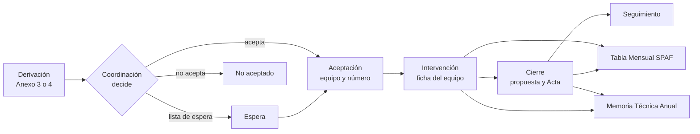

# Expedientes ETF

Aplicación web para administraciones que gestionan expedientes de tratamiento familiar para llevar los expedientes de las familias atendidas por los Equipos de Tratamiento Familiar (ETF). Cubre el recorrido completo, desde que llega una derivación hasta el cierre y el seguimiento posterior, y saca de la propia ficha del expediente los documentos Word y las cifras que hoy se montan a mano.

La aplicación permite el alta asistida de expedientes históricos necesarios para 2026: conserva números, fechas, cierres, reaperturas y vigencias, y señala los casos cargados para revisión. Coordinación o el equipo pueden revisar y confirmar un caso a mano o un lote desde una hoja mediante las pantallas CA1.

F4.07 incorpora navegación de Memoria por año y ámbito en el servidor. Consulta dispone de API y Word exclusivos de cifras: foto definitiva si está cerrada, cálculo al momento si está abierta. El cálculo requiere `ETF_CALCULO_MEMORIA_CONTRASENA`; usa un rol técnico independiente sin acceso a tablas personales. La vista de Consulta en `/memoria` muestra sólo cifras, fecha y carácter provisional o definitivo, y descarga el Word numérico. Contratos, preparación del rol y pruebas en [la evidencia F4.07](docs/evidencias/F4.07.md).

Cada administración designa a su responsable del producto y valida la puesta en servicio.

Informática dispone del [manual de sistemas](docs/sistemas/LEEME.md), con instalación, configuración, operación, copias y restauración ensayada. Cada instalación debe validar seguridad y protección de datos antes de usar expedientes reales.

Los [manuales de usuario](docs/manuales/usuario.md) reúnen las tareas de profesionales de los ETF y Coordinación y una hoja breve de Administración funcional, con capturas reales, glosario, preguntas frecuentes y PDF para imprimir. Incluyen carga de 2026, consulta y cierre de Memoria, los límites actuales de edición y los títulos de los vídeos de demostración disponibles.

La [formación](docs/formacion/LEEME.md) incluye una sesión de 150 minutos por perfiles, ejercicios y soluciones, preparación del aula y recursos. El vídeo [Del Anexo a la Memoria](docs/recorridos/guiones/11-ciclo-completo.md) sigue un único caso inventado; se repite con `make video RECORRIDO=11-ciclo-completo`. El MP4 queda en la carpeta `ETF_VIDEOS_SALIDA`; [revisión y capítulos](docs/recorridos/EVIDENCIA-11.md). El [lanzador del aula](docs/formacion/preparar-aula.md) prepara Chrome con sesiones separadas y el calendario de la práctica.


## Licencia y autoría

Copyright © 2026 Expedientes ETF. Proyecto desarrollado con medios propios.

Es software libre: se distribuye con la [Licencia Pública de la Unión Europea, versión 1.2](LICENSE) (EUPL-1.2). Puedes usarlo, estudiarlo, modificarlo y redistribuirlo; si distribuyes una versión modificada o la ofreces como servicio en red, debes publicar sus cambios con la misma licencia o una compatible. La [versión oficial en castellano](https://eur-lex.europa.eu/legal-content/ES/TXT/?uri=CELEX:32017D0863) tiene la misma validez. Las fuentes tipográficas conservan su licencia SIL OFL 1.1; el detalle está en [NOTICE](NOTICE) y [REUSE.toml](REUSE.toml).

El catálogo de municipios incluido es un ejemplo con datos públicos. Todos los expedientes, personas y datos de pruebas, demostraciones y capturas son inventados. Cada administración configura su nombre, sus equipos y sus catálogos.

## Qué es

Los ETF son los equipos (trabajador/a social, educador/a social y psicólogo/a) que atienden a familias con menores en situación de riesgo o desprotección dentro del Programa de Tratamiento a Familias (PTF). Hoy el Programa trabaja con plantillas Word, PDF firmados y recuentos manuales. La aplicación sustituye ese circuito por un único expediente por familia.

El motivo principal es la Memoria Técnica Anual: si la ficha de cada expediente está completa, la Memoria se calcula sola y se puede comprobar cifra a cifra.

Hay ocho equipos hoy y la aplicación está preparada para doce. Se esperan unos 300 expedientes al año.

## Para quién es

| Perfil | Quién es | Para qué usa la aplicación |
| --- | --- | --- |
| Coordinación | Coordinador/a provincial y, más adelante, personal administrativo | Registrar derivaciones, aceptarlas, no aceptarlas o dejarlas en lista de espera, asignar equipo y número, cerrar expedientes, mantener el SMI por año y sacar la Memoria provincial |
| Profesional de ETF | Trabajador/a social, educador/a social o psicólogo/a de un equipo | Completar la ficha de los expedientes de su equipo, generar sus documentos, proponer cierres y sacar la Tabla Mensual y la Memoria de su equipo |
| Consulta | Pocas personas que necesitan estadísticas | Ver sólo cifras de la Memoria y totales, nunca nombres ni textos libres |
| Administración funcional | Una o dos personas | Dar de alta usuarios y perfiles, mantener catálogos, plantillas, idiomas y temas, y exportar la auditoría para el delegado de protección de datos. No ve fichas de expedientes |

El personal de Informática mantiene el servidor y no tiene perfil en la aplicación. Los permisos se dan dentro de la aplicación; el directorio de usuarios de la entidad (Active Directory, AD) sólo comprueba usuario y contraseña.

## Adaptar a una administración

La entidad configura el acceso corporativo, el dominio, los perfiles, los firmantes, los idiomas y las plantillas. `etf.example.org` es un dominio de ejemplo. El nombre visible se define con `entidad.nombre` en `idiomas/<idioma>/textos/comun.json`; los textos que lo necesitan usan `{entidad.nombre}`. Cambia los datos iniciales antes de instalar o publica una versión nueva del paquete de idioma desde Administración. Las plantillas Word se editan y publican desde la misma sección; se distribuyen sin logotipos ni contactos institucionales.

Los catálogos incluidos conservan los municipios y equipos de partida. Su sustitución queda pendiente; cada administración debe revisar esas asignaciones y las referencias normativas de los formularios antes de poner el servicio en uso. El campo `ambito_diputacion` describe el ámbito de atención y conserva su contrato.

## Qué hace

- **Derivaciones.** Coordinación sube el Anexo 3 (lo envían los Servicios Sociales Comunitarios) o el Anexo 4 (lo envía el Servicio de Protección de Menores, SPM). La aplicación lee el anexo, propone los datos y una persona los confirma.
- **Salida al SPM (servidor).** Genera el Anexo 5, confirma la fecha real por separado y registra la respuesta del SPM con historia. Expone la consulta de cierre ordinario y registra el forzado de Coordinación con motivo auditado. La descarga está comprobada para Coordinación y el profesional del equipo. Pantallas pendientes; cierre confirmado disponible en F3.02b.
- **Aceptación.** Coordinación acepta, no acepta o deja en lista de espera. Al aceptar se asigna equipo y número, y se generan el Acta de Aceptación y los oficios.
- **Traslado y seguimiento (F3.02c y TR1).** Traslado con cierre en origen, copia independiente de familia, adultos y menores vigentes y aceptación con número nuevo y Acta en destino. Seguimiento tras cese con avisos, fin automático e historia. El catálogo fija inicialmente 12 meses y un aviso 30 días antes del fin. El equipo puede terminarlo antes con un motivo; Coordinación puede reabrirlo, incluso tras el vencimiento, con el plazo completo desde la reapertura. Migraciones `expediente/0021` y `catalogo/0013`; instalación nueva y actualización ensayadas con PostgreSQL 18. TR1 añade el traslado desde Salidas de Coordinación y Seguimiento como pestaña de la ficha del equipo.
- **Ficha del expediente.** Reúne datos de la familia y los menores, intervención, evaluaciones, derivaciones de salida, cierre y seguimiento. Es la única fuente de las cifras.
- **Documentos Word.** Actas, oficios y anexos se rellenan desde plantillas. Se descargan en el momento; la aplicación no guarda los documentos generados. El servidor también incorpora emisión mensual SPAF por POST, con plantilla por idioma, versiones e idempotencia; espera el lector persistente de ficha de F2.01.
- **Tabla Mensual del SPAF.** Cada equipo la obtiene por mes para el Servicio de Prevención y Apoyo a la Familia (SPAF) de la administración competente.
- **Memoria Técnica Anual.** Se calcula por equipo y para toda la provincia, con las reglas vigentes el 31 de diciembre del año, y se puede cerrar para fijar las cifras.

La aplicación no firma documentos, no envía correos, no guarda los anexos recibidos y no usa inteligencia artificial. El alcance completo está en [PRD.md](docs/producto/PRD.md).

## Probar la aplicación en local

Ejecuta `make demo` desde la raíz del repositorio. Prepara una demostración con
usuarios inventados y sus perfiles asignados. Consulta los requisitos, las
cuentas, el recorrido del Anexo 3 al Acta y los comandos de parada en
[la guía de demostración](despliegue/demo/LEEME.md).

## Probar en Windows

Descarga el ZIP y su suma SHA-256 desde las
[Releases públicas](https://github.com/aavidad/expedientes-etf/releases).
La [guía para probar en casa](docs/windows/PROBAR-EN-CASA.md) te acompaña desde
un Windows sin preparar: virtualización, WSL2, Podman Desktop, instalación y
primer Acta. Usa sólo datos inventados. La [evidencia WIN1](docs/sistemas/WIN1.md)
recoge versiones y resultados de las pruebas.

## Arquitectura en breve

Es un monolito modular con arquitectura hexagonal. Las reglas del Programa (estados, plazos, numeración, cálculo de la Tabla y de la Memoria) viven en un núcleo que no conoce la base de datos, el directorio de usuarios, HTTP ni Word. Todo lo externo entra por un conector, que es un puerto definido por la aplicación más un adaptador que lo implementa.

- **Enganches por módulo (INT5).** Cada capacidad aporta sus rutas HTTP y pantallas; la composición es explícita en `cmd/etf/modulos.go` y `web/src/pantallas.ts`. El arranque valida métodos, permisos y duplicados. Cómo añadir una capacidad, en [TRD §2.3](docs/producto/TRD.md#23-módulos).
- **Diez módulos** con sus propias tablas y migraciones: `plataforma`, `identidad`, `catalogo`, `paquete`, `expediente`, `evaluacion`, `documento`, `actividad`, `estadistica` y `auditoria`. Un módulo nunca toca las tablas de otro.
- **Conectores** para el directorio de usuarios (LDAPS), el antivirus (ClamAV), la lectura de anexos, la generación de Word, el registro de salida y la lectura de idiomas y temas.
- **Idiomas y temas fuera del código.** Ningún texto visible está escrito en Go ni en React: el código usa claves, y los textos viven en `idiomas/<código>/`. El aspecto vive en paquetes `temas/<nombre>/` hechos de datos. Cambiar un idioma o un tema es cambiar un directorio.
- **Sin ficheros guardados.** Los anexos recibidos y los documentos generados no se conservan. Sólo se conservan los datos, las plantillas, los idiomas y los temas, siempre por versiones que no se modifican.
- **Seguridad por filas.** PostgreSQL aplica la seguridad por filas (RLS) para que cada equipo vea sólo lo suyo, aunque falle una pantalla.

El detalle está en [TRD.md](docs/producto/TRD.md) y una visión algo más amplia en [docs/README.md](docs/README.md).

## Pila

| Pieza | Tecnología |
| --- | --- |
| Servidor | Go |
| Interfaz | React, TypeScript y Vite, con componentes accesibles de React Aria |
| Base de datos | PostgreSQL 18 |
| Antivirus | ClamAV |
| Ejecución | Docker Compose |

Todo es software libre. Las versiones exactas están fijadas en `go.mod` y `web/package-lock.json`.

## Despliegue en resumen

`compose.yaml` define tres servicios permanentes (`app`, `postgres` y `clamav`) y dos contenedores puntuales: `preparar-roles` sincroniza los roles técnicos desde el entorno privado por socket local, incluso en volúmenes antiguos; `migrar` aplica después las migraciones con sus propias credenciales, de modo que la aplicación nunca migra. La guía de arranque local está en [despliegue/base/LEEME.md](despliegue/base/LEEME.md). Las carpetas `idiomas/` y `temas/` se montan como volúmenes. Lo que sigue es el diseño acordado y aún no está construido: la copia antes de subir una versión con vuelta atrás automática si falla la comprobación, y los tres entornos (desarrollo y preproducción con datos inventados; producción, el único con datos reales). Más detalle en [docs/README.md](docs/README.md) y en el apartado 12 de [TRD.md](docs/producto/TRD.md#12-despliegue).

## Flujo principal



Los recorridos de cada perfil están en [FLUJO_APP.md](docs/producto/FLUJO_APP.md).

## Estructura de carpetas

```
cmd/etf/          arranque de la aplicación
cmd/migrar/       ejecutor de migraciones, separado de la aplicación
internal/
  dominio/        reglas del Programa, por módulo
  aplicacion/     casos de uso, por módulo
  puertos/        interfaces hacia el exterior
  adaptadores/    HTTP, PostgreSQL, LDAP, ClamAV, Word, anexos, ficheros
  plataforma/     configuración y soporte técnico
web/              interfaz React, TypeScript y Vite
idiomas/          textos, catálogos y plantillas por idioma
temas/            paquetes de tema
migraciones/      SQL numerado, una carpeta por módulo
scripts/ci/       comprobaciones de la integración continua
scripts/recorridos/ grabación y montaje de vídeos de demostración
docs/             documentación (ver docs/README.md)
```

## Cómo arrancar en desarrollo

Con Docker Compose: copia `.env.plantilla` a `.env`, rellena las contraseñas y ejecuta `docker compose up -d --build`. Los pasos completos están en [despliegue/base/LEEME.md](despliegue/base/LEEME.md).

Sin Docker hacen falta Go 1.26.9 o posterior, Node 20.19 o posterior con npm, y Make.

```sh
make build        # compila la interfaz y deja bin/etf y bin/migrar
./bin/etf         # escucha en 127.0.0.1:8080
```

Se configura con variables de entorno con prefijo `ETF_` (por ejemplo `ETF_HTTP_DIRECCION`, `ETF_IDIOMAS_RUTA`, `ETF_TEMAS_RUTA`, `ETF_IDIOMA` y `ETF_TEMA`), descritas en [TRD.md](docs/producto/TRD.md). Las funciones que dependen de la base de datos, del directorio de usuarios o del antivirus necesitan esos servicios; por eso lo normal es arrancar con Compose.

## Integración continua en local

```sh
make ci           # la misma puerta que GitHub Actions
make build        # sólo compilar
make recorridos   # entrada, permisos, ficha integrada, salidas, SPAF y Memoria
```

`make ci` comprueba el formato de Go, los enlaces de los documentos, los secretos, los tipos, las pruebas y la compilación. Incluye los ensayos completos de Catálogo y del Expediente inicial recuperados en [FX6](docs/evidencias/FX6.md), además de los otros ensayos de migraciones y del arranque definitivo de PostgreSQL por TCP, con diagnósticos acotados sin credenciales ([FX5](docs/evidencias/FX5.md)). Necesita Bash, Git, Python 3.9 o posterior, Go, Node con npm, Docker, Chrome del sistema y Gitleaks (ver [scripts/ci/README.md](scripts/ci/README.md)). Existen también `make test`, `make vet` y `make comprobar`.

`make recorridos` prueba la entrada y el alta con Chrome del sistema contra
`make demo`, y todos los métodos del registro INT5 con cada perfil y PostgreSQL.
Añade [F2.07](docs/recorridos/F2.07.md): nueve pestañas de la ficha, conflicto sin perder el formulario, aislamiento HTTP/RLS y cuatro cortes históricos. Exige también menores y fase al corte en SPAF; termina con error mientras falte su conexión estadística. Después ejecuta salidas, cierre, traslado y seguimiento y las seis tablas
SPAF de F3.06/F3.07, con datos preparados por API y cifras calculadas a mano.
Termina con [F4.09](docs/recorridos/F4.09.md): cálculo de los 28 apartados de
Memoria, Word, cierres, corrección, discrepancia, aislamiento y reapertura.
Se puede ejecutar por separado con `python3 -B scripts/recorridos/memoria_integrada.py`.
Alcance, requisitos y evidencia en [F0.11](docs/recorridos/F0.11.md) y
[F3.06/F3.07](docs/recorridos/F3.06-F3.07.md). Sólo F0.11 se ejecuta también en
`make ci`; los cuatro necesitan Chrome del sistema. F3.06/F3.07 conservan los fallos
de producto detectados y terminan con error mientras no se resuelvan.

## Estado del proyecto

Avance aproximado: un 37 % del plan.

**Funciona hoy en `main`:**

- Docker Compose con la aplicación, PostgreSQL 18 y ClamAV, y el migrador como contenedor aparte.
- Integración continua (`make ci`).
- Idiomas por directorio y temas instalables, con revisión de antivirus al instalar un paquete.
- Auditoría encadenada en PostgreSQL.
- Entrada con Active Directory (LDAPS), sesión y estado «pendiente de alta».
- Perfiles dados desde Administración, con autorización en una sola tabla y denegación por defecto.
- Catálogos versionados (174 municipios, equipos y centros), con edición de catálogos y de firmantes.
- Lector de los Anexos 3 y 4 en Word, LibreOffice (ODT) y PDF, y propuesta de municipio. El PDF usa `dslipak/pdf v0.0.2` en un trabajador efímero, con límite de 10 MB y 20 páginas; los valores leídos requieren confirmación y los campos no recuperados quedan vacíos. Los escaneados se registran con aviso para teclear sus datos, sin OCR ni ficheros temporales. RESP4 confirma derivaciones desde los ODT del Programa y sus PDF con firma digital local; `expediente/0026` admite el formato ODT sin cambiar permisos; [evidencia y límites](docs/recorridos/RESP4.md). El ensayo HTTP con ClamAV de compose se ejecuta con `python3 -B internal/adaptadores/anexos/pdf/probar_subida.py` y usa recursos desechables y firmas sintéticas.
- Subida del Anexo 3 o 4 con antivirus, revisión editable y propuesta de municipio, centro y equipo. El análisis no crea derivación; se guarda sólo al confirmar, con idempotencia y auditoría. Pantalla en `/coordinacion/anexos/nuevo`. Descartar elimina la revisión temporal.
- Aceptación con numeración, no aceptación y lista de espera.
- Emisión de documentos Word sin guardarlos.
- Conservación en `/admin/conservacion` (F5.04): 25 años desde el cierre, configurables en Plazos y tramos. Dos personas distintas de Administración revisan y confirman la retirada de datos personales, sin abrir fichas. La operación incluye textos y recibos de Expediente, Evaluación y Documentos; mantiene cifras históricas y auditoría. Alcance sujeto al DPD en D14 (véase el PRD).
- Plantillas Word para Administración en `/admin/plantillas` (PL1): activa e historial por documento e idioma, subida DOCX de hasta 10 MB con antivirus y detalle de marcadores, y activación confirmada con autor y fecha. Permite restaurar versiones anteriores sin borrar la historia.
- Modelo estadístico de la Memoria (apartados 1, 2, 7, 8, 9, 13 y 25).

**Bandeja de Coordinación (F1.10):** `/coordinacion` reúne pendientes de revisar, aceptados recientes, no aceptados y lista de espera. Puedes filtrar por estado, equipo, municipio y recepción, y buscar por número o familia. La API devuelve sólo iniciales y confirma la auditoría antes de entregar datos. Las filas enlazan a la revisión de P3 y «Subir Anexo» a P2.

**Disponible en esta rama:** F1.09 permite a Coordinación consultar y mantener el salario mínimo interprofesional (SMI) por año en `/coordinacion/smi`. La API es `/api/coordinacion/smi`; las escrituras exigen CSRF.

**Disponible:** F2.04 permite registrar, corregir, retirar y consultar comisiones e informes del equipo; Coordinación consulta todos. Las cifras por año alimentan los apartados 15 y 16 de la Memoria mediante un puerto de consulta. Pantalla en `/equipo/comisiones`, con filtros de fechas, equipo y organismo; Consulta accede sólo a cifras de Memoria. Contrato y ensayo en [migraciones/actividad/LEEME.md](migraciones/actividad/LEEME.md).

**Disponible en el servidor (F3.01b):** se registra la derivación a otro servicio con destino de catálogo y motivo, se descarga el Anexo 6 en castellano o inglés y se confirma su fecha por separado. La emisión no cambia el estado ni bloquea el cierre. Administración publica los destinos de catálogo antes de su uso. Pantalla pendiente. Contrato en [FLUJO_APP.md](docs/producto/FLUJO_APP.md#37-derivar-a-otro-servicio-anexo-6).

**Calculado y probado (F3.04a):** la tabla mensual SPAF dispone de motor puro y API de lectura en `GET /api/estadistica/spaf?anio=&mes=&etf=`, con permisos por equipo y auditoría. El puerto de lectura está conectado a las vistas históricas de expediente, con RLS por equipo y corte de conocimiento; los campos todavía no recogidos se mantienen desconocidos. Pantalla y Word pendientes; ZTS sin dato hasta resolver D19.

**Disponible en esta rama (P3):** revisión de una derivación, aceptación con número confirmado, no aceptación y lista de espera con aceptación posterior. La ficha permite descargar actas y oficios y anotar su registro de salida. La entrada del menú es «Lista de espera»; el detalle está en `/coordinacion/derivaciones/{id}`. La selección del profesional se hace por puesto, según la API actual.

**En curso:** la ficha completa, el armazón visual y un entorno de demostración.

**Disponible en el servidor (F2.03):** servidor de consentimientos y fechas de Anexos 7/8, con firma separada de la emisión y sin guardar DNI. Las plantillas se activan mediante documento/0009. El profesional descarga los anexos de su equipo con el catálogo de idioma activo; confirmar la firma cambia a intervención. FI2 incorpora la pestaña Consentimiento en la ficha del equipo.

**Disponible en el servidor (F3.02a):** el equipo guarda la finalización, descarga los Anexos 11/12 y propone o retira el cierre, también desde ACEPTADA por falta de consentimiento con motivo de catálogo D5. Coordinación dispone de la bandeja de propuestas. Emisiones sin cambios de estado ni hitos; F3.02b añade confirmación por otra persona de Coordinación, Acta oficial es/en por POST independiente y reapertura con episodios conservados. Bloqueo SPM y forzado auditado; edición de datos cerrados exige reapertura. CO2 añade las pantallas de Coordinación para registrar respuestas del SPM, autorizar una excepción motivada, revisar propuestas, confirmar fecha y cierre, descargar el Acta por separado y reabrir. La bandeja y el detalle del expediente enlazan con ellas. TR1 añade el traslado desde estas pantallas y el seguimiento tras cese desde la ficha del equipo. La vista de pendientes del SPM sigue fuera de CO2: la bandeja aún no ofrece ese filtro.

F2.06 ofrece la bandeja del equipo y la ficha desde el armazón común. Permite buscar sin mostrar nombres en los resultados, filtrar y consultar hitos, emisiones e historial. Muestra los avisos calculados de consentimiento, duración de fase y datos pendientes de la Memoria. Cierre conecta con la finalización y las propuestas de F3.02a; Salidas permite preparar la derivación al Servicio de Protección de Menores, descargar el Anexo 5 y confirmar por separado su fecha y respuesta. Las pestañas de capacidades pendientes se ocultan. La demostración incluye dos expedientes inventados de ETF2 y uno de ETF4.

### Capturas de la bandeja y la ficha

- [Bandeja en escritorio](docs/capturas/equipo-bandeja-escritorio.png)
- [Bandeja en móvil](docs/capturas/equipo-bandeja-movil.png)
- [Ficha en escritorio](docs/capturas/equipo-ficha-escritorio.png)
- [Ficha en móvil](docs/capturas/equipo-ficha-movil.png)
- [Menores FI1 en escritorio](docs/capturas/fi1-menores-escritorio.png)
- [Menores FI1 en móvil](docs/capturas/fi1-menores-movil.png)
- [Intervención FI1 en escritorio](docs/capturas/fi1-intervencion-escritorio.png)
- [Intervención FI1 en móvil](docs/capturas/fi1-intervencion-movil.png)

El recorrido se repite con `node despliegue/demo/equipo-recorrido.mjs http://127.0.0.1:18083` después de `make demo`; sustituye el puerto si la demostración usa otro.

FI1 añade edición de Menores e Intervención, vigencias, excepciones por menor y comparación ante conflictos sin perder el formulario. Marta Cabrera edita los expedientes de ETF 02; Inés Moreno consulta. El recorrido se repite con `node scripts/recorridos/fi1.mjs http://127.0.0.1:18341` después de `make demo`; ajusta el puerto. [Recorrido y límites de FI1](docs/capturas/FI1.md).

La [evidencia de validación](docs/capturas/EVIDENCIA_F2.06.md) describe los recorridos y sus límites.


**Disponible en el servidor (F2.08b):** CSV/XLSX de 2026 sobre el alta asistida histórica: vista previa sin guardar datos, ClamAV obligatorio, informe por fila en es/en y lotes atómicos e idempotentes. Hasta 10 MB y 100 casos por equipo; no se conserva la hoja. Formato provisional D21 y API en [ESQUEMA_BACKEND §7.2](docs/producto/ESQUEMA_BACKEND.md#72-compatibilidad-de-carga-por-hoja-formato-v1-f208b). Migración carga/0001. CA1 añade las pantallas de alta asistida y hoja, con revisión y resultado, y un CSV inventado descargable.

**Pendiente:** completar la ficha del expediente, el resto de la Memoria y sus pantallas, el despliegue en producción. Cierre, seguimiento y Tabla Mensual del SPAF ya tienen pantallas. Las rutas de pantalla y de API que describen los documentos son previstas salvo las ya entregadas.

El orden y los criterios de cada entrega están en [PLAN_IMPLEMENTACION.md](docs/producto/PLAN_IMPLEMENTACION.md).

## Documentos de producto

Son la única fuente de verdad. Si algo contradice a uno de ellos, se corrige en el mismo cambio.

| Documento | Qué contiene |
| --- | --- |
| [PRD.md](docs/producto/PRD.md) | Qué es la aplicación, para quién y con qué prioridad |
| [TRD.md](docs/producto/TRD.md) | Pila, arquitectura, seguridad y despliegue |
| [FLUJO_APP.md](docs/producto/FLUJO_APP.md) | Recorridos y pantallas por perfil |
| [DISENO_UI_UX.md](docs/producto/DISENO_UI_UX.md) | Reglas de diseño, temas y usabilidad |
| [ESQUEMA_BACKEND.md](docs/producto/ESQUEMA_BACKEND.md) | Datos, permisos, migraciones y API |
| [PLAN_IMPLEMENTACION.md](docs/producto/PLAN_IMPLEMENTACION.md) | Qué falta y en qué orden |

Para contribuir, lee los seis documentos de producto en `docs/producto/` y ejecuta `make ci`.

## Vídeos de recorridos

`make videos` graba todos los guiones; `make videos RECORRIDOS="05-ficha 06-spaf 08-traslado"` selecciona los tres de ficha, tabla y traslado. `make videos RECORRIDOS="09-memoria 10-carga-2026"` graba Memoria y carga. `make video RECORRIDO=02-coordinacion` graba sólo la recepción y aceptación de una derivación. También están disponibles `01-entrada`, sobre acceso y asignación de perfil; `03-actividad`, sobre comisiones, informes y consulta provincial; `04-plantillas`, sobre revisión y activación de una plantilla Word; `05-ficha`, sobre avisos, menores, intervención, consentimiento y evaluación; `06-spaf`, sobre la tabla mensual con cifras de menores; `07-cierre`, sobre propuesta, confirmación y Acta de Cierre; `08-traslado`, sobre el número nuevo en destino y el seguimiento tras cese del origen; `09-memoria`, sobre revisión, textos, Word, cierre y reapertura de la Memoria; y `10-carga-2026`, sobre alta histórica e importación de una hoja con incidencias por fila. Incluyen una vista previa animada sobre pantallas reales, acciones sincronizadas con la voz, ratón visible y cierre sobre la última pantalla difuminada. Los rótulos breves usan el tema activo. Los resultados se guardan fuera de Git, en la carpeta elegida con `ETF_VIDEOS_SALIDA` (por defecto `~/Videos/Expedientes-ETF`). La herramienta arranca el entorno local de demostración y utiliza sus cuentas inventadas; también permite probar el montaje con imágenes sintéticas. Requisitos, arranque manual y revisión de fotogramas en [la guía de recorridos](docs/recorridos/LEEME.md).

**Servidor de Memoria (F4.05):** GET/PUT `/api/estadistica/memoria/narrativas?anio=&etf=` guardan A, D, E, F y G con versión e historia auditada. POST `/api/estadistica/memoria/word`, con `Idempotency-Key`, descarga el Word de la administración competente por año, equipo e idioma, sin guardar el fichero ni cerrar la Memoria. Coordinación y el equipo autorizado acceden a sus textos; Consulta y Administración no acceden a la Memoria completa. Parámetros iniciales versionados en `datos/catalogos/memoria/`; fuentes todavía ausentes y porcentajes sin base validada se muestran como «sin dato». El lector reconstruye familia, adultos, menores e intervención por vigencia y fecha de conocimiento. FX1 conecta las vistas de `expediente/0022`, distingue listas sin valorar de listas vacías y aplica exclusiones por menor. SPAF recibe menores, nacimientos, códigos de protección y fase históricos; nombres históricos y otras columnas sin fuente siguen pendientes. La fecha del Anexo 5 desde intervención cambia el estado a `derivada_spm`; una respuesta habilitante fechada lo devuelve a `en_intervencion`, con versión e historia en la transacción auditada. F4.06 añade cierre, reapertura con motivo, revisiones inmutables, estado e instantáneas y discrepancias en `/api/estadistica/memoria/`. El equipo cierra la suya; sólo Coordinación cierra la provincial y reabre. Cerrar y reabrir llevan versión, CSRF e idempotencia. Una corrección estadística genera avisos para Coordinación en la misma transacción; el Word cerrado usa la foto conservada. F4.02 conecta la pantalla Memoria: cuatro bloques, avisos, edición narrativa, Word, estado, cierre y reapertura. F4.07 conecta Consulta a cifras al momento o a la foto cerrada, con fecha y carácter provisional o definitivo; el desglose por números está disponible en el servidor para Equipo/Coordinación. Ensayo: `python3 -B migraciones/estadistica/ensayar.py`, incluido en `make ci`.

Servidor F2.01a: edición de familia y adultos con historia estadística, versión, idempotencia y RLS por equipo. La pantalla sigue pendiente; el contrato HTTP y el puerto de adultos para evaluación están en [ESQUEMA_BACKEND.md](docs/producto/ESQUEMA_BACKEND.md).

## Capturas de la interfaz

PWA1 permite instalar la aplicación en Edge y Chrome. [Cómo instalarla desde Edge](docs/manuales/usuario.md#instalar-la-aplicación-desde-edge). Necesita conexión al servidor; no guarda expedientes para trabajar sin conexión. Iconos reproducibles: `node scripts/pwa1/iconos.mjs`. Prueba de instalación y privacidad: `node scripts/recorridos/pwa1.mjs http://127.0.0.1:18541`, tras `make demo` con ese puerto (o ajustando la URL). El recorrido comprueba que es la demo de este worktree y renueva sólo sus textos e iconos PWA1; reconstruir la imagen no sustituye los volúmenes de una demo anterior.

| PWA1 | Escritorio | Móvil |
| --- | --- | --- |
| Sesión de Coordinación | [Ver captura](docs/capturas/pwa1-escritorio.png) | [Ver captura](docs/capturas/pwa1-movil.png) |
| Sin conexión | [Ver captura](docs/capturas/pwa1-sin-conexion-escritorio.png) | [Ver captura](docs/capturas/pwa1-sin-conexion-movil.png) |


Memoria: [escritorio](docs/capturas/memoria-escritorio.png), [móvil](docs/capturas/memoria-movil.png) y [foto cerrada](docs/capturas/memoria-cerrada.png). El [recorrido de Memoria](docs/capturas/memoria.md) recoge permisos, edición y descarga.

UI3: [recorrido y comprobaciones](docs/capturas/UI3.md). Capturas con datos inventados:

| Pantalla | Escritorio 1440 | Móvil 390 |
| --- | --- | --- |
| Bandeja y secciones del menú | [Ver captura](docs/capturas/ui3-bandeja-1440.png) | [Ver captura](docs/capturas/ui3-bandeja-390.png) |
| Decisión de derivación | [Ver captura](docs/capturas/ui3-decision-1440.png) | [Ver captura](docs/capturas/ui3-decision-390.png) |
| Avisos de menores | [Ver captura](docs/capturas/ui3-avisos-menores-1440.png) | [Ver captura](docs/capturas/ui3-avisos-menores-390.png) |
| Persona y equipo | [Ver captura](docs/capturas/ui3-equipo-persona-1440.png) | [Ver captura](docs/capturas/ui3-equipo-persona-390.png) |
| SPAF con casos históricos | [Ver captura](docs/capturas/ui3-spaf-1440.png) | [Ver captura](docs/capturas/ui3-spaf-390.png) |

Para recrear una demostración anterior con la nueva siembra: `make demo-limpiar` y `make demo`. El primer comando elimina sólo los datos locales inventados de esa demostración. Recorrido: `node scripts/recorridos/ui3.mjs http://127.0.0.1:18343`, ajustando el puerto. SPAF conserva datos desconocidos donde su lector todavía no conecta la información. Memoria usa la lectura histórica de menores e intervención de FX1 mediante F4.02; los campos sin fuente siguen como «Sin dato».

Los retoques de UI2 muestran las etiquetas de Catálogos en el idioma activo, una
sola entrada para idiomas y temas y los importes del SMI sin cortes en móvil.
El recorrido, las comprobaciones y sus límites están en [UI2](docs/capturas/UI2.md).

| Pantalla | Escritorio (1440 px) | Móvil (390 px) | Alto contraste: escritorio | Alto contraste: móvil |
| --- | --- | --- | --- | --- |
| Usuarios y permisos | [Ver captura](docs/capturas/ui2-usuarios-1440-expedientes-etf.png) | [Ver captura](docs/capturas/ui2-usuarios-390-expedientes-etf.png) [Ver captura](docs/capturas/ui2-usuarios-1440-alto-contraste.png) | [Ver captura](docs/capturas/ui2-usuarios-390-alto-contraste.png) |
| Catálogos | [Ver captura](docs/capturas/ui2-catalogos-1440-expedientes-etf.png) | [Ver captura](docs/capturas/ui2-catalogos-390-expedientes-etf.png) [Ver captura](docs/capturas/ui2-catalogos-1440-alto-contraste.png) | [Ver captura](docs/capturas/ui2-catalogos-390-alto-contraste.png) |
| Plazos | [Ver captura](docs/capturas/ui2-reglas-1440-expedientes-etf.png) | [Ver captura](docs/capturas/ui2-reglas-390-expedientes-etf.png) [Ver captura](docs/capturas/ui2-reglas-1440-alto-contraste.png) | [Ver captura](docs/capturas/ui2-reglas-390-alto-contraste.png) |
| Tramos | [Ver captura](docs/capturas/ui2-tramos-1440-expedientes-etf.png) | [Ver captura](docs/capturas/ui2-tramos-390-expedientes-etf.png) [Ver captura](docs/capturas/ui2-tramos-1440-alto-contraste.png) | [Ver captura](docs/capturas/ui2-tramos-390-alto-contraste.png) |
| Firmantes y destinatarios | [Ver captura](docs/capturas/ui2-firmantes-1440-expedientes-etf.png) | [Ver captura](docs/capturas/ui2-firmantes-390-expedientes-etf.png) [Ver captura](docs/capturas/ui2-firmantes-1440-alto-contraste.png) | [Ver captura](docs/capturas/ui2-firmantes-390-alto-contraste.png) |
| Salario mínimo interprofesional | [Ver captura](docs/capturas/ui2-smi-1440-expedientes-etf.png) | [Ver captura](docs/capturas/ui2-smi-390-expedientes-etf.png) [Ver captura](docs/capturas/ui2-smi-1440-alto-contraste.png) | [Ver captura](docs/capturas/ui2-smi-390-alto-contraste.png) |

### Coordinación

La bandeja y la subida y revisión de anexos se han diseñado para escritorio y
móvil. Las capturas contienen datos inventados.

Pantallas P3 con datos inventados: [escritorio, 1440 px](docs/capturas/decision-escritorio.png) y [móvil, 390 px](docs/capturas/decision-movil.png).

Con la demo arrancada, el recorrido se ejecuta con `node scripts/recorridos/decision.mjs http://127.0.0.1:18186` (ajusta el puerto). Sube y confirma los anexos por API, prepara un destinatario inventado para el SPM si falta y comprueba decisiones, descargas y registros. Las decisiones se prueban con Coordinación y se generan las capturas.

Si ejecutas varias demos a la vez, puedes fijar subredes distintas mediante `ETF_DEMO_RED_SUBRED` y `ETF_DEMO_ENTRADA_SUBRED` en `despliegue/demo/.local/entorno.env`. Si la instalación repite muchas copias de dependencias, `npm_config_install_strategy=linked make demo` conserva las versiones e integridades del lock y usa enlaces. Esta misma variable se puede usar con `make ci`.

- [Bandeja de Coordinación en escritorio](docs/capturas/bandeja-escritorio.png).
- [Bandeja de Coordinación en móvil](docs/capturas/bandeja-movil.png).
- [Revisión del anexo en escritorio](docs/capturas/anexo-escritorio.png).
- [Revisión del anexo en móvil](docs/capturas/anexo-movil.png).

### Comisiones e informes

Comisiones e informes, con datos inventados y acceso de Coordinación.
[Recorrido, revisión y límites de la comprobación](docs/capturas/actividad.md):

- [Comisiones en escritorio](docs/capturas/actividad-comisiones-escritorio.png).
- [Informes en escritorio](docs/capturas/actividad-informes-escritorio.png).
- [Informes en móvil](docs/capturas/actividad-informes-movil.png).

Servidor F2.01b: edición de hasta 15 menores, con subprograma propio y centro de protección opcional, vigencias estadísticas, versión e idempotencia. Publica la consulta para evaluación y estadística. Pantalla pendiente; contrato en [ESQUEMA_BACKEND.md](docs/producto/ESQUEMA_BACKEND.md).

Servidor F2.01c: fase del expediente, coordinación, factores y tipologías con exclusiones por menor. Conserva las revisiones con vigencia y publica la consulta histórica para Memoria y avisos; distingue datos desconocidos de listas vacías. Catálogos en español e inglés, sin pantalla. Contrato en [ESQUEMA_BACKEND.md](docs/producto/ESQUEMA_BACKEND.md).

Servidor F2.02: avisos por expediente y recuento por equipo para Profesional de ETF y Coordinación. Calcula consentimiento vencido, fase prolongada y datos faltantes de la ficha para la Memoria; los plazos se publican por Administración sin programar. API y alcance en [ESQUEMA_BACKEND.md](docs/producto/ESQUEMA_BACKEND.md). Sin pantallas.


F2.05 incorpora el servidor de registro de instrumentos y persistencia de respuestas por ítem, con versión, idempotencia, RLS y auditoría. Los cuestionarios oficiales siguen pendientes: el catálogo enumera instrumentos y rechaza escalas sin definición de ítems. No calcula totales sin baremos del Programa. Menores pendientes de F2.01b; FI2 añade Evaluación a la ficha del equipo, con instrumentos por adulto y momento y respuestas por ítem preparadas para las definiciones publicadas.

Plantillas Word (PL1), con datos inventados ([recorrido y comprobaciones](docs/capturas/plantillas.md)): [escritorio, 1440 px](docs/capturas/plantillas-escritorio.png) y [móvil, 390 px](docs/capturas/plantillas-movil.png). El recorrido se ejecuta con `node scripts/recorridos/plantillas.mjs http://127.0.0.1:18231` tras `make demo`; ajusta el puerto si hace falta.

FI2 añade Consentimiento y Evaluación a la ficha del equipo. La integración con FI1 usa un registro común para Familia, Menores, Intervención, Consentimiento, Evaluación, Documentos, Cierre, Salidas e Historial; conserva la última ficha durante el refresco y bloquea las acciones de FI2 hasta recibir la nueva versión. Consentimiento descarga el Anexo 1 o 2 y confirma por separado la firma y la fecha del Anexo 7 u 8. Evaluación registra instrumentos por adulto y momento; las respuestas por ítem dependen de los cuestionarios oficiales pendientes de D17. No calcula puntuaciones totales.

Capturas con datos inventados: [Consentimiento en escritorio](docs/capturas/fi2-consentimiento-escritorio.png), [Consentimiento en móvil](docs/capturas/fi2-consentimiento-movil.png), [Evaluación en escritorio](docs/capturas/fi2-evaluacion-escritorio.png) y [Evaluación en móvil](docs/capturas/fi2-evaluacion-movil.png). [Recorrido, revisión y límites](docs/capturas/FI2.md).

Con la demo arrancada, ejecuta `node scripts/recorridos/fi2.mjs http://127.0.0.1:18242` (ajusta el puerto). Usa Coordinación y Marta Cabrera, registra adultos inventados si faltan y crea un expediente de Reunificación con el Anexo 4 de pruebas. El empaquetado de la demo incluye el catálogo de tramos necesario para dar de alta los adultos.

Tabla Mensual para el SPAF (SP1), con datos inventados: [escritorio, 1440 px](docs/capturas/spaf-escritorio.png), [móvil, 390 px](docs/capturas/spaf-movil.png) y [alto contraste en móvil](docs/capturas/spaf-alto-contraste-movil.png). [Recorrido y límites](docs/capturas/spaf.md). La demo incluye septiembre de 2026 para ETF 02: 2 altas, 2 bajas y 3 casos; ETF 01: 1 alta. Ejecuta `node scripts/recorridos/spaf.mjs http://127.0.0.1:18273` con la demo arrancada y ajusta el puerto si hace falta.

Pantallas CO2 de salidas y cierre ([recorrido y revisión](docs/capturas/salidas.md)): [escritorio, 1440 px](docs/capturas/salidas-escritorio.png), [móvil, 390 px](docs/capturas/salidas-movil.png), [cierres propuestos](docs/capturas/salidas-cierres-escritorio.png) y [alto contraste en móvil](docs/capturas/salidas-alto-contraste-movil.png).

RESP2 amplía CA1 con lectura de Actas de Aceptación y de Cierre (PDF/DOCX, PDF firmado), revisión humana y carga de todos los abiertos de años anteriores. No persiste actas; reutiliza la numeración por equipo/año y la confirmación histórica. [Contrato y evidencia](docs/evidencias/RESP2.md).

Capturas de carga desde actas:

- Elegir equipo y actas: [1440 px](docs/capturas/carga-actas-inicio-1440.png) · [390 px](docs/capturas/carga-actas-inicio-390.png).
- Datos leídos para revisar: [1440 px](docs/capturas/carga-actas-datos-1440.png) · [390 px](docs/capturas/carga-actas-datos-390.png).
- Resultado confirmado: [1440 px](docs/capturas/carga-actas-resultado-1440.png) · [390 px](docs/capturas/carga-actas-resultado-390.png).
- [Alto contraste, 390 px](docs/capturas/carga-actas-contraste-390.png).

Pantallas CA1 de carga de 2026 ([recorrido y revisión](docs/capturas/carga.md)):

- Alta asistida: [escritorio, 1440 px](docs/capturas/carga-alta-escritorio.png) y [móvil, 390 px](docs/capturas/carga-alta-movil.png).
- Revisión histórica: [escritorio](docs/capturas/carga-revision-escritorio.png) y [móvil](docs/capturas/carga-revision-movil.png).
- Carga de hoja: [escritorio](docs/capturas/carga-hoja-escritorio.png) y [móvil](docs/capturas/carga-hoja-movil.png).
- Incidencias por fila: [escritorio](docs/capturas/carga-incidencias-escritorio.png) y [móvil](docs/capturas/carga-incidencias-movil.png).
- Resultado: [escritorio](docs/capturas/carga-resultado-escritorio.png), [móvil](docs/capturas/carga-resultado-movil.png) y [alto contraste](docs/capturas/carga-alto-contraste-movil.png).

Tras `make demo`, ejecuta `node scripts/recorridos/carga.mjs http://127.0.0.1:51481` con el puerto elegido. Usa Inés Moreno y Marta Cabrera, datos inventados y Chrome del sistema. Conserva los expedientes de la prueba en la demo.

Revisión de un no aceptado por el equipo: [escritorio](docs/capturas/carga-no-aceptado-profesional-escritorio.png) y [móvil](docs/capturas/carga-no-aceptado-profesional-movil.png). El resultado ofrece un enlace recuperable a la consulta auditada de cada expediente, también sin número.

Pantallas TR1 ([recorrido y revisión](docs/capturas/traslado.md)): [traslado en escritorio, 1440 px](docs/capturas/traslado-escritorio.png), [traslado en móvil, 390 px](docs/capturas/traslado-movil.png), [seguimiento en escritorio](docs/capturas/traslado-seguimiento-escritorio.png), [seguimiento en móvil](docs/capturas/traslado-seguimiento-movil.png) y [alto contraste en móvil](docs/capturas/traslado-alto-contraste-movil.png). El recorrido se repite con `node scripts/recorridos/traslado.mjs http://127.0.0.1:18431` tras `make demo`, ajustando el puerto. Usa sólo datos inventados.

### Accesibilidad F5.03

[Informe por pantalla y perfil](docs/accesibilidad/README.md), con matriz axe en español e inglés y ambos temas. Las capturas de escritorio de 1440 px y móvil de 390 px están enlazadas desde cada informe de la [matriz](docs/accesibilidad/matriz.md). El ejecutor automático se incorpora a `make recorridos` y exige cero infracciones serias o críticas de axe. Permanecen pendientes las revisiones manuales y Word indicadas en el informe.

| Pantalla | Perfil | Escritorio, 1440 px | Móvil, 390 px |
| --- | --- | --- | --- |
| `/admin/catalogos` | Administración funcional | [Ver captura](docs/capturas/accesibilidad-administracion-admin-catalogos-1440.png) | [Ver captura](docs/capturas/accesibilidad-administracion-admin-catalogos-390.png) |
| `/admin/catalogos/listas` | Administración funcional | [Ver captura](docs/capturas/accesibilidad-administracion-admin-catalogos-listas-1440.png) | [Ver captura](docs/capturas/accesibilidad-administracion-admin-catalogos-listas-390.png) |
| `/admin/firmantes` | Administración funcional | [Ver captura](docs/capturas/accesibilidad-administracion-admin-firmantes-1440.png) | [Ver captura](docs/capturas/accesibilidad-administracion-admin-firmantes-390.png) |
| `/admin/idiomas` | Administración funcional | [Ver captura](docs/capturas/accesibilidad-administracion-admin-idiomas-1440.png) | [Ver captura](docs/capturas/accesibilidad-administracion-admin-idiomas-390.png) |
| `/admin/paquetes` | Administración funcional | [Ver captura](docs/capturas/accesibilidad-administracion-admin-paquetes-1440.png) | [Ver captura](docs/capturas/accesibilidad-administracion-admin-paquetes-390.png) |
| `/admin/plantillas` | Administración funcional | [Ver captura](docs/capturas/accesibilidad-administracion-admin-plantillas-1440.png) | [Ver captura](docs/capturas/accesibilidad-administracion-admin-plantillas-390.png) |
| `/admin/reglas` | Administración funcional | [Ver captura](docs/capturas/accesibilidad-administracion-admin-reglas-1440.png) | [Ver captura](docs/capturas/accesibilidad-administracion-admin-reglas-390.png) |
| `/admin/temas` | Administración funcional | [Ver captura](docs/capturas/accesibilidad-administracion-admin-temas-1440.png) | [Ver captura](docs/capturas/accesibilidad-administracion-admin-temas-390.png) |
| `/admin/usuarios` | Administración funcional | [Ver captura](docs/capturas/accesibilidad-administracion-admin-usuarios-1440.png) | [Ver captura](docs/capturas/accesibilidad-administracion-admin-usuarios-390.png) |
| `/coordinacion` | Coordinación | [Ver captura](docs/capturas/accesibilidad-coordinacion-coordinacion-1440.png) | [Ver captura](docs/capturas/accesibilidad-coordinacion-coordinacion-390.png) |
| `/coordinacion/anexos/nuevo` | Coordinación | [Ver captura](docs/capturas/accesibilidad-coordinacion-coordinacion-anexos-nuevo-1440.png) | [Ver captura](docs/capturas/accesibilidad-coordinacion-coordinacion-anexos-nuevo-390.png) |
| `/coordinacion/carga-2026` | Coordinación | [Ver captura](docs/capturas/accesibilidad-coordinacion-coordinacion-carga-2026-1440.png) | [Ver captura](docs/capturas/accesibilidad-coordinacion-coordinacion-carga-2026-390.png) |
| `/coordinacion/carga-2026` | Profesional de ETF | [Ver captura](docs/capturas/accesibilidad-profesional_etf-coordinacion-carga-2026-1440.png) | [Ver captura](docs/capturas/accesibilidad-profesional_etf-coordinacion-carga-2026-390.png) |
| `/coordinacion/cierres` | Coordinación | [Ver captura](docs/capturas/accesibilidad-coordinacion-coordinacion-cierres-1440.png) | [Ver captura](docs/capturas/accesibilidad-coordinacion-coordinacion-cierres-390.png) |
| `/coordinacion/derivaciones/{id}` | Coordinación | [Ver captura](docs/capturas/accesibilidad-coordinacion-coordinacion-derivaciones-id-1440.png) | [Ver captura](docs/capturas/accesibilidad-coordinacion-coordinacion-derivaciones-id-390.png) |
| `/coordinacion/expedientes/{id}/salidas` | Coordinación | [Ver captura](docs/capturas/accesibilidad-coordinacion-coordinacion-expedientes-id-salidas-1440.png) | [Ver captura](docs/capturas/accesibilidad-coordinacion-coordinacion-expedientes-id-salidas-390.png) |
| `/coordinacion/expedientes/{id}/traslado` | Coordinación | [Ver captura](docs/capturas/accesibilidad-coordinacion-coordinacion-expedientes-id-traslado-1440.png) | [Ver captura](docs/capturas/accesibilidad-coordinacion-coordinacion-expedientes-id-traslado-390.png) |
| `/coordinacion/lista-espera` | Coordinación | [Ver captura](docs/capturas/accesibilidad-coordinacion-coordinacion-lista-espera-1440.png) | [Ver captura](docs/capturas/accesibilidad-coordinacion-coordinacion-lista-espera-390.png) |
| `/coordinacion/smi` | Coordinación | [Ver captura](docs/capturas/accesibilidad-coordinacion-coordinacion-smi-1440.png) | [Ver captura](docs/capturas/accesibilidad-coordinacion-coordinacion-smi-390.png) |
| `/entrar` | Sin sesión | captura retirada | captura retirada |
| `/equipo` | Coordinación | [Ver captura](docs/capturas/accesibilidad-coordinacion-equipo-1440.png) | [Ver captura](docs/capturas/accesibilidad-coordinacion-equipo-390.png) |
| `/equipo` | Profesional de ETF | [Ver captura](docs/capturas/accesibilidad-profesional_etf-equipo-1440.png) | [Ver captura](docs/capturas/accesibilidad-profesional_etf-equipo-390.png) |
| `/equipo/comisiones` | Coordinación | [Ver captura](docs/capturas/accesibilidad-coordinacion-equipo-comisiones-1440.png) | [Ver captura](docs/capturas/accesibilidad-coordinacion-equipo-comisiones-390.png) |
| `/equipo/comisiones` | Profesional de ETF | [Ver captura](docs/capturas/accesibilidad-profesional_etf-equipo-comisiones-1440.png) | [Ver captura](docs/capturas/accesibilidad-profesional_etf-equipo-comisiones-390.png) |
| `/equipo/expediente` | Coordinación | [Ver captura](docs/capturas/accesibilidad-coordinacion-equipo-expediente-1440.png) | [Ver captura](docs/capturas/accesibilidad-coordinacion-equipo-expediente-390.png) |
| `/equipo/expediente` | Profesional de ETF | [Ver captura](docs/capturas/accesibilidad-profesional_etf-equipo-expediente-1440.png) | [Ver captura](docs/capturas/accesibilidad-profesional_etf-equipo-expediente-390.png) |
| `/equipo/expedientes/alta-historica` | Coordinación | [Ver captura](docs/capturas/accesibilidad-coordinacion-equipo-expedientes-alta-historica-1440.png) | [Ver captura](docs/capturas/accesibilidad-coordinacion-equipo-expedientes-alta-historica-390.png) |
| `/equipo/expedientes/alta-historica` | Profesional de ETF | [Ver captura](docs/capturas/accesibilidad-profesional_etf-equipo-expedientes-alta-historica-1440.png) | [Ver captura](docs/capturas/accesibilidad-profesional_etf-equipo-expedientes-alta-historica-390.png) |
| `/equipo/intervencion` | Coordinación | [Ver captura](docs/capturas/accesibilidad-coordinacion-equipo-intervencion-1440.png) | [Ver captura](docs/capturas/accesibilidad-coordinacion-equipo-intervencion-390.png) |
| `/equipo/intervencion` | Profesional de ETF | [Ver captura](docs/capturas/accesibilidad-profesional_etf-equipo-intervencion-1440.png) | [Ver captura](docs/capturas/accesibilidad-profesional_etf-equipo-intervencion-390.png) |
| `/equipo/menores` | Coordinación | [Ver captura](docs/capturas/accesibilidad-coordinacion-equipo-menores-1440.png) | [Ver captura](docs/capturas/accesibilidad-coordinacion-equipo-menores-390.png) |
| `/equipo/menores` | Profesional de ETF | [Ver captura](docs/capturas/accesibilidad-profesional_etf-equipo-menores-1440.png) | [Ver captura](docs/capturas/accesibilidad-profesional_etf-equipo-menores-390.png) |
| `/equipo/seguimiento` | Coordinación | [Ver captura](docs/capturas/accesibilidad-coordinacion-equipo-seguimiento-1440.png) | [Ver captura](docs/capturas/accesibilidad-coordinacion-equipo-seguimiento-390.png) |
| `/equipo/seguimiento` | Profesional de ETF | [Ver captura](docs/capturas/accesibilidad-profesional_etf-equipo-seguimiento-1440.png) | [Ver captura](docs/capturas/accesibilidad-profesional_etf-equipo-seguimiento-390.png) |
| `/equipo/tabla-spaf` | Coordinación | [Ver captura](docs/capturas/accesibilidad-coordinacion-equipo-tabla-spaf-1440.png) | [Ver captura](docs/capturas/accesibilidad-coordinacion-equipo-tabla-spaf-390.png) |
| `/equipo/tabla-spaf` | Profesional de ETF | [Ver captura](docs/capturas/accesibilidad-profesional_etf-equipo-tabla-spaf-1440.png) | [Ver captura](docs/capturas/accesibilidad-profesional_etf-equipo-tabla-spaf-390.png) |
| `/equipo/tabla-spaf/expedientes/{id}` | Coordinación | [Ver captura](docs/capturas/accesibilidad-coordinacion-equipo-tabla-spaf-expedientes-id-1440.png) | [Ver captura](docs/capturas/accesibilidad-coordinacion-equipo-tabla-spaf-expedientes-id-390.png) |
| `/equipo/tabla-spaf/expedientes/{id}` | Profesional de ETF | [Ver captura](docs/capturas/accesibilidad-profesional_etf-equipo-tabla-spaf-expedientes-id-1440.png) | [Ver captura](docs/capturas/accesibilidad-profesional_etf-equipo-tabla-spaf-expedientes-id-390.png) |
| `/memoria` | Consulta | [Ver captura](docs/capturas/accesibilidad-consulta-memoria-1440.png) | [Ver captura](docs/capturas/accesibilidad-consulta-memoria-390.png) |
| `/memoria` | Coordinación | [Ver captura](docs/capturas/accesibilidad-coordinacion-memoria-1440.png) | [Ver captura](docs/capturas/accesibilidad-coordinacion-memoria-390.png) |
| `/memoria` | Profesional de ETF | [Ver captura](docs/capturas/accesibilidad-profesional_etf-memoria-1440.png) | [Ver captura](docs/capturas/accesibilidad-profesional_etf-memoria-390.png) |
| `/pendiente` | Pendiente de alta | [Ver captura](docs/capturas/accesibilidad-pendiente-pendiente-1440.png) | [Ver captura](docs/capturas/accesibilidad-pendiente-pendiente-390.png) |

GAP1 completa Familia y la descarga de documentos de finalización desde Cierre. Con datos inventados: [Familia en escritorio](docs/capturas/equipo-gap1-familia-escritorio.png), [Familia en móvil](docs/capturas/equipo-gap1-familia-movil.png), [Cierre en escritorio](docs/capturas/equipo-gap1-cierre-escritorio.png) y [Cierre en móvil](docs/capturas/equipo-gap1-cierre-movil.png). [Recorrido y límites](docs/capturas/GAP1.md). Repite el recorrido con `node scripts/recorridos/gap1.mjs http://127.0.0.1:18513` tras `make demo`, ajustando el puerto.

RESP3 aplica la decisión de escalas opcionales: puedes anotarlas en Evaluación o rellenarlas después en el Word de los Anexos 11 y 12. Las casillas sin resultados quedan vacías y no bloquean documentos, cierre o Memoria. Capturas con datos inventados: [sin escalas en escritorio](docs/capturas/resp3-sin-escalas-escritorio.png), [sin escalas en móvil](docs/capturas/resp3-sin-escalas-movil.png), [resultados parciales en escritorio](docs/capturas/resp3-parciales-escritorio.png) y [resultados parciales en móvil](docs/capturas/resp3-parciales-movil.png). [Evidencia y límites de RESP3](docs/evidencias/RESP3.md). Repite el recorrido con `node scripts/recorridos/resp3.mjs http://127.0.0.1:18133` tras `make demo`, ajustando el puerto.
