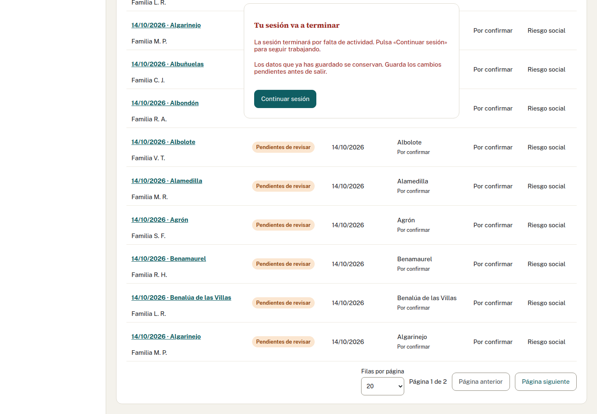
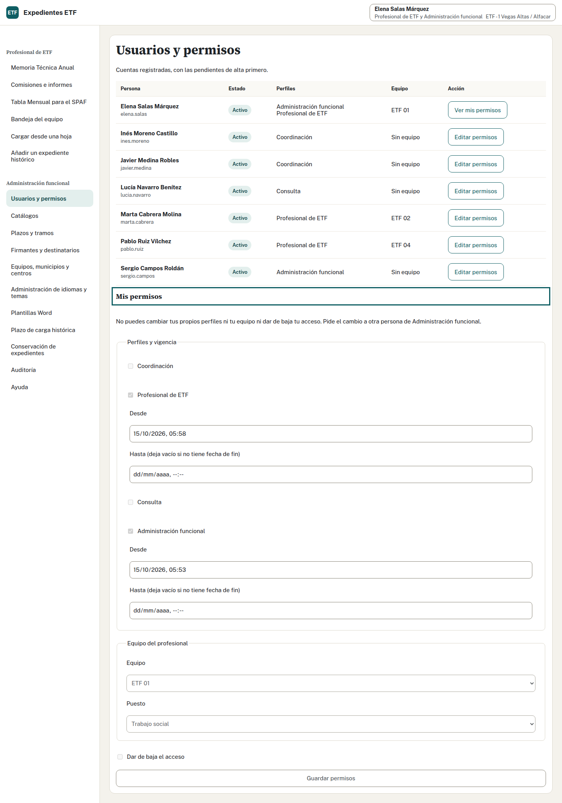

## Antes de entrar

Este módulo forma parte del curso «Expedientes ETF: el Programa, la normativa y la aplicación». Autor: Alberto Avidad. Licencia: CC BY-SA 4.0. Las capturas y los vídeos muestran datos inventados.

1. Abre la dirección facilitada por Informática desde la red corporativa, la red provincial autorizada o la VPN.
2. Introduce el usuario y la contraseña de tu entidad.
3. Comprueba tu nombre, perfiles y equipo en la cabecera.
4. Si aparece «Pendiente de alta», pide a Administración funcional que te asigne el acceso autorizado. Una cuenta válida por sí sola no permite consultar expedientes.
5. Al terminar, cierra la sesión, sobre todo si compartes el equipo.

## Qué puedes hacer según tu perfil

| Perfil | Tareas | Alcance |
| --- | --- | --- |
| Profesional de ETF | Completar fichas, registrar actividad, preparar documentos, proponer cierres, consultar SPAF y cerrar la Memoria del equipo | Expedientes de tu único equipo |
| Coordinación | Recibir y decidir derivaciones, confirmar cierres, reabrir, trasladar, mantener SMI y cerrar la Memoria provincial | Todos los equipos |
| Consulta | Consultar cifras y descargar la Memoria de cifras | Sin nombres, números de expediente ni textos narrativos |
| Administración funcional | Preparar accesos, opciones, plazos, firmantes, plantillas, idiomas y temas | Sin acceso a fichas por este perfil |

Una persona puede reunir varios perfiles. Comprueba las tareas que te corresponden; no uses la cuenta de otra persona para realizarlas. Si eres profesional, perteneces a un equipo en cada momento.

## Si administras los accesos

1. Pide a la persona que entre una vez para aparecer pendiente de alta.
2. Abre «Usuarios y permisos» y localízala por su nombre.
3. Asigna los perfiles autorizados y, para un profesional, su equipo.
4. Guarda y comprueba el resultado con una sesión nueva de esa persona.
5. Para retirar el acceso, revisa y guarda la nueva selección de perfiles y equipo.

Para situar las tareas en un mismo expediente, puedes ver el recorrido completo.

Puedes ampliar los pasos en el manual de Administración funcional.

## Duración de la sesión

La sesión se cierra tras 30 minutos sin actividad y, como máximo, a las 8 horas desde la entrada. Estos plazos pueden configurarse. Dos minutos antes aparece un aviso. Guarda lo que estés editando y usa la opción de continuar si vas a seguir trabajando. Continuar no amplía el máximo de 8 horas. Si caduca, vuelve a entrar: lo guardado permanece; los cambios sin guardar pueden perderse.

## Cambios de tus propios permisos

Si eres de Administración, consulta tu fila con «Ver mis permisos». Para cambiar tus perfiles, fechas, equipo o baja, pide la intervención de otra persona de Administración. Nadie puede concederse perfiles a sí mismo.

