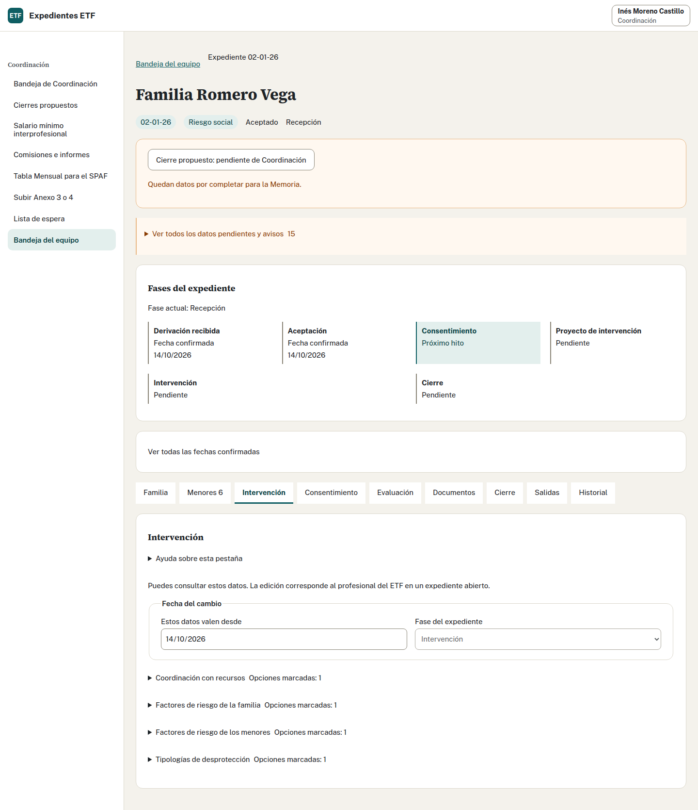

## Antes de editar · Profesional de ETF

Busca el número de tu caso y abre la ficha. Revisa su estado, avisos y fechas. Coordinación puede consultar los datos; la edición del equipo corresponde a profesionales autorizados.

## Familia y personas adultas

1. Abre «Familia» mientras el expediente esté aceptado o en intervención.
2. Indica desde cuándo son válidos los datos; la fecha debe estar entre la aceptación y hoy.
3. Completa contacto, convivencia, familia numerosa, vivienda e ingresos comprobados. Deja los desconocidos sin indicar.
4. Si conoces ingresos netos anuales, introduce el importe. Si sólo conoces el tramo del salario mínimo interprofesional (SMI), elígelo. Importe y tramo son alternativas: introducir uno borra el otro.
5. Pulsa «Guardar datos familiares».
6. Revisa las personas adultas: identidad, papel, sexo, nacimiento o edad conocida, educación, trabajo, tutoría y contacto. Guarda este apartado por separado.

Retirar una persona adulta exige confirmar y guardar. Se retiran sus datos personales de la ficha y se conserva su participación estadística anterior.

## Menores

Abre «Menores», revisa cada persona y completa nacimiento, sexo, subprograma, escolarización, Atención Temprana y centro de protección cuando corresponda. Puedes añadir hasta 15 menores. Guarda con la fecha real de vigencia. Retirar un menor del formulario y guardar lo excluye de los datos vigentes desde esa fecha; conserva su historia.

## Intervención

Indica vigencia y fase del expediente. Despliega recursos, factores y tipologías. «Sin indicar» significa desconocido. «Datos conocidos» sin opciones marcadas confirma que no hay ninguna. En «Ver a qué menores se aplica», revisa las excepciones para cada opción. Guarda y espera la confirmación.

## Consentimiento y proyecto

Descarga el Anexo 1 para Riesgo o el 2 para Reunificación. Tramita la firma fuera y confirma después su fecha real. El DNI del representante queda en blanco en el Word y no se guarda. Elabora fuera el proyecto de intervención, Anexo 7 u 8, y confirma su fecha en esta pestaña.

## Evaluación

Las escalas son opcionales en los momentos inicial, intermedio y final. Puedes anotarlas en la aplicación o completarlas después en el Word de los Anexos 11 y 12. No necesitas todas las escalas ni sus tres momentos para descargar documentos, cerrar un expediente o preparar la Memoria.

Si vas a registrar una evaluación, selecciona persona adulta, momento inicial, intermedio o final, instrumento y fecha. Completa respuestas sólo cuando exista un cuestionario publicado. Si falta el cuestionario validado, no puedes obtener respuestas ni una puntuación total. Guarda y comprueba persona, momento e instrumento en el listado.

## Salidas, cierre, seguimiento y documentos

En «Salidas», guarda la propuesta al SPM, descarga el Anexo 5 y completa fuera los apartados 5 a 8. Tras tramitarlo, confirma el envío real; al recibir respuesta, guarda su opción y fecha. Para otro servicio, sigue la preparación del Anexo 6 descrita en la página de documentos de este módulo.

«Cierre» reúne la finalización, los Anexos 11 o 12 y la propuesta del equipo. «Seguimiento tras cese» corresponde al seguimiento de Reunificación. «Documentos» permite comprobar emisiones; no es un archivo de Word firmados. Consulta los pasos de cierre y documentos.

Fuente adaptada: manual para profesionales.
