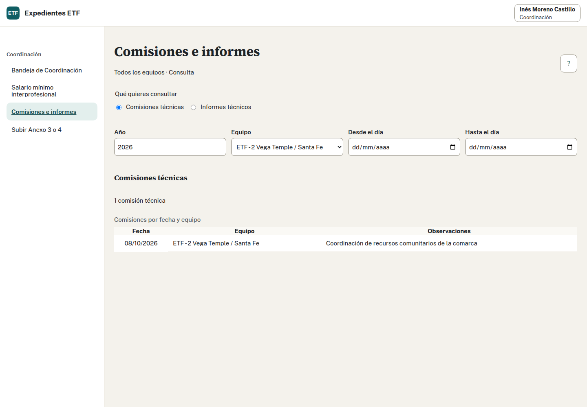

## Registrar una comisión técnica · Profesional de ETF

1. Abre «Comisiones e informes» y elige registrar comisión técnica.
2. Indica la fecha real y unas observaciones sobre el trabajo realizado, sin copiar nombres de las familias.
3. Guarda y comprueba la comisión mediante los filtros de año y fecha.

## Registrar un informe técnico

1. Abre la sección de informes.
2. Indica fecha y organismo destinatario.
3. Guarda y comprueba el registro; puedes filtrar por organismo.
4. Si necesitas corregir o borrar, usa la acción de tu registro y revisa el resultado. Sólo puedes modificar tus registros dentro de tu equipo.

Comisiones e informes pertenecen al equipo y alimentan los apartados 15 y 16 de la Memoria. No están vinculados individualmente a un expediente. Registrar un informe no envía su contenido ni lo conserva como fichero. Una corrección posterior no cambia una Memoria cerrada.

Coordinación puede consultar los registros por equipo y año; no debe atribuir toda la actividad a una única familia.

Fuente adaptada: manual para profesionales.
