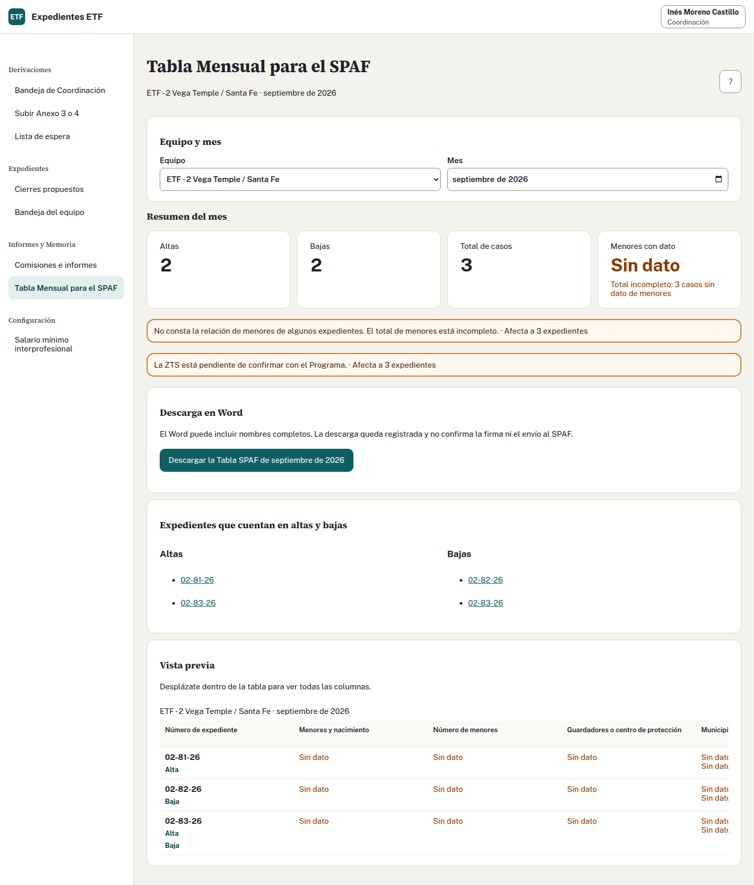

## Consultar · Profesional de ETF o Coordinación

El Servicio de Prevención y Apoyo a la Familia (SPAF) recibe la tabla mensual del equipo.

1. Abre «Tabla Mensual para el SPAF» y elige un mes ya terminado.
2. Comprueba el equipo. Coordinación puede seleccionar distintos equipos; el profesional consulta el suyo.
3. Revisa altas, bajas, total de casos y total de menores.
4. Pulsa los números de altas o bajas para comprobar movimientos. Al volver se mantienen equipo y mes.
5. Desplázate dentro de la tabla para ver las 14 columnas. Comprueba los «Sin dato» y los datos de origen antes de descargar.
6. Descarga el Word y tramita su envío fuera de la aplicación.

## Qué casos entran

Entran los aceptados hasta el final del mes que siguen abiertos y los cerrados dentro de ese mes. Un caso cerrado antes del primer día queda fuera. Un caso aceptado y cerrado en el mismo mes puede aparecer como alta y baja y seguir siendo un único caso.

Si otra persona cambia datos mientras revisas, consulta de nuevo antes de descargar. «Sin dato» puede deberse al periodo de vigencia o a una incorporación pendiente al cálculo; no lo conviertas en cero.

La ubicación de la Tabla SPAF corresponde al municipio del expediente. No incluye Zona de Trabajo Social (ZTS). Comprueba el municipio antes de descargar; no lo sustituyas por el centro ni por el equipo.

Fuente adaptada: manual para profesionales.
