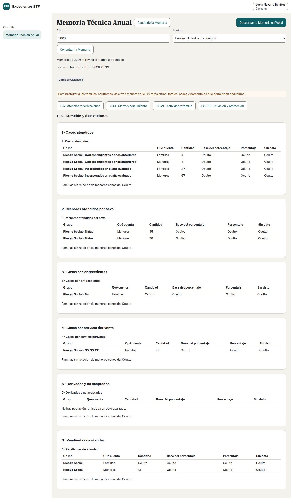

## Revisar la Memoria del equipo · Profesional de ETF

1. Revisa fichas del año, vigencias, fechas confirmadas, menores, intervención, cierres y actividad.
2. Abre «Memoria Técnica Anual», elige año y consulta tu equipo.
3. Recorre sus cuatro bloques: apartados 1 a 6, 7 a 13, 14 a 21 y 22 a 28. Lee qué cuenta cada tabla y la base del porcentaje.
4. Abre los avisos y comprueba «Sin dato» en su origen. Pulsa una cantidad, base o «Sin dato» para ver los expedientes que la forman, su equipo y cuánto aporta cada uno, sin nombres. Abre la ficha sólo si tienes acceso. «Volver a la Memoria» conserva año, equipo y bloque.
5. Completa datos generales, metodología, dificultades, propuestas y valoración global. Respeta los límites de 25 líneas o 30 donde se indiquen.
6. Pulsa «Guardar los textos». Descarga y cierre quedan bloqueados si hay cambios sin guardar.
7. Descarga el Word y revísalo. Cuando hayas revisado cifras y textos con el Programa, pulsa «Cerrar la Memoria», lee el diálogo y confirma. Comprueba ámbito, año, estado y fecha.

## Provincial y reapertura · Coordinación

Comprueba con los equipos los datos pendientes y el SMI del año. En «Equipo», selecciona el ámbito provincial, consulta y revisa cifras y textos. Sólo Coordinación cierra la provincial. Se calcula directamente desde los expedientes; no se obtiene sumando las Memorias cerradas de los equipos.

Una Memoria cerrada conserva cifras y textos. Los cambios posteriores en expedientes o actividad no cambian esa revisión. Para corregir, Coordinación pulsa «Reabrir la Memoria», escribe el motivo y confirma. Se conserva la revisión cerrada anterior. Revisa de nuevo, guarda y confirma un nuevo cierre.

Coordinación mantiene el SMI en «Salario mínimo por año»: selecciona año, introduce el mensual confirmado, revisa el anual y guarda. Administración mantiene los tramos. No cambies el SMI para conseguir un porcentaje deseado.

## Consulta: sólo cifras

Selecciona año y ámbito permitido y consulta los totales. Tu vista y tu descarga de Word excluyen nombres, identificadores de expediente y textos narrativos. No puedes abrir fichas, editar metodología ni cerrar o reabrir Memorias con este perfil.

Las cifras inferiores al umbral de privacidad aparecen como «Oculto». El umbral inicial es 3 casos y Administración puede aumentarlo. También se ocultan otras cifras, márgenes o porcentajes cuando permitirían deducir una cifra protegida: es la supresión secundaria. Se aplica en pantalla y Word, incluso a revisiones cerradas. «Oculto» no significa cero ni «Sin dato». Consulta no tiene desglose por expedientes.

> **Importante:** Un estado cerrado no acredita por sí solo que todos los datos estén completos ni que el Programa haya validado el cálculo.

[Validar con el Programa: D24, total y base de los porcentajes del apartado 24; criterio de la valoración global, apartado G, cuando corresponda.]

Fuentes adaptadas: profesionales, Coordinación y recursos de formación.

## Comprobar el origen de una cifra

El desglose de una Memoria cerrada corresponde a su revisión, aunque después cambie la ficha. Si una revisión antigua no conserva desglose, verás un aviso. Las comisiones y los informes son actividad del equipo sin vínculo individual con expedientes.

La lista de espera de Servicios Sociales Comunitarios cuenta en el apartado 6. El SPM, que deriva con el Anexo 4, no tiene lista de espera. Para los tramos de ingresos usa el SMI del año de la Memoria: en 2026, 1.221 € mensuales × 14 pagas = 17.094 € anuales.
