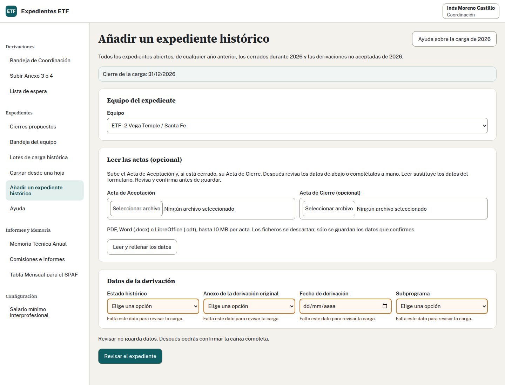
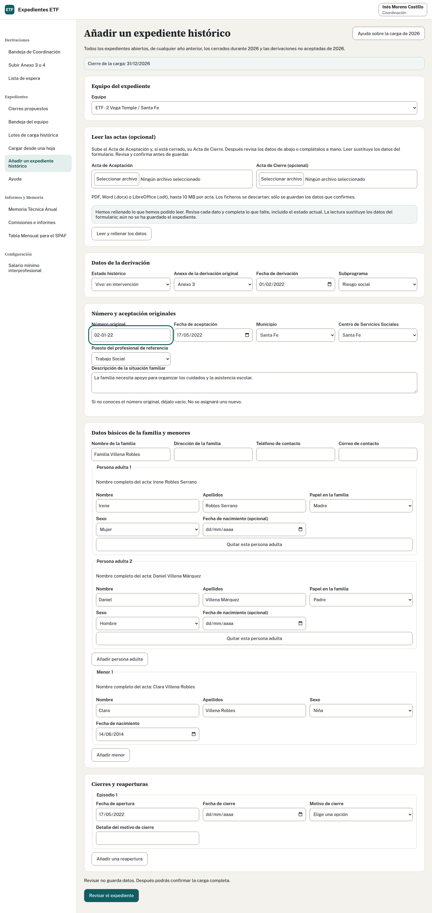
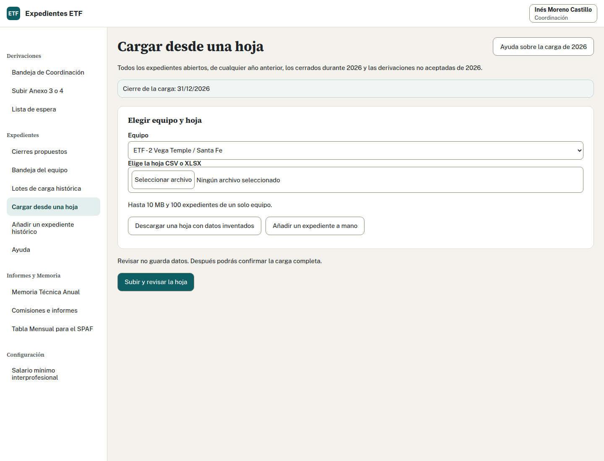
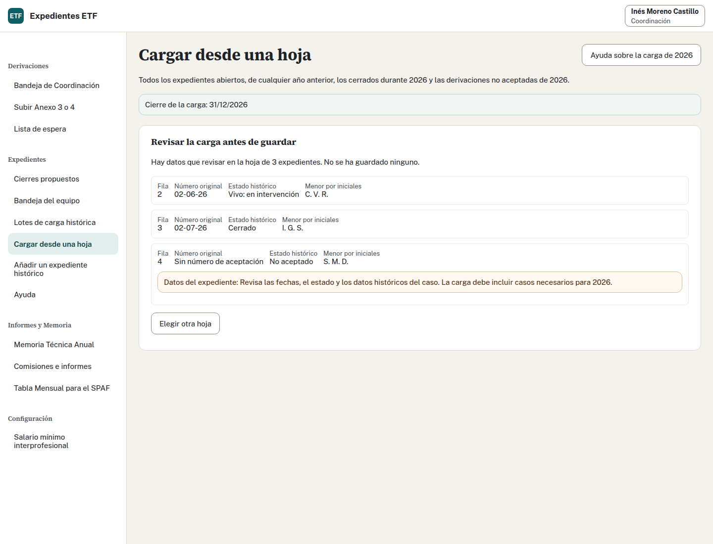
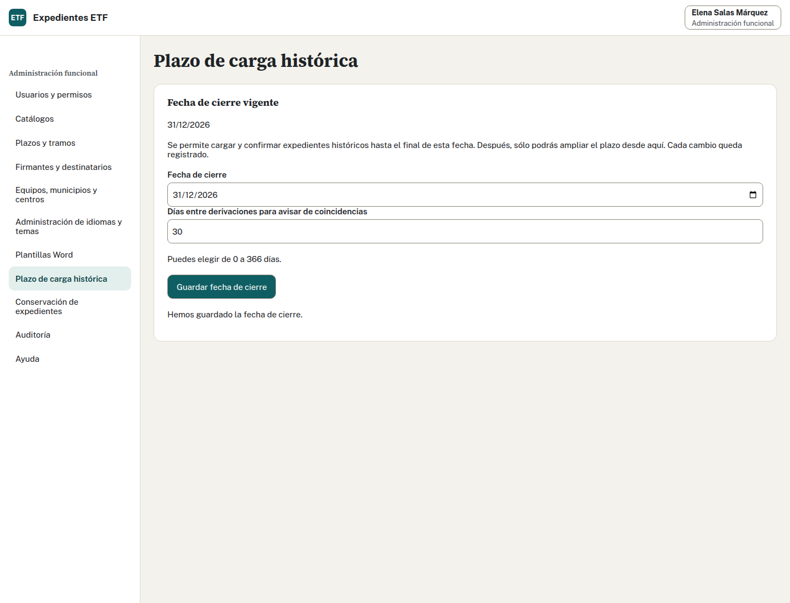
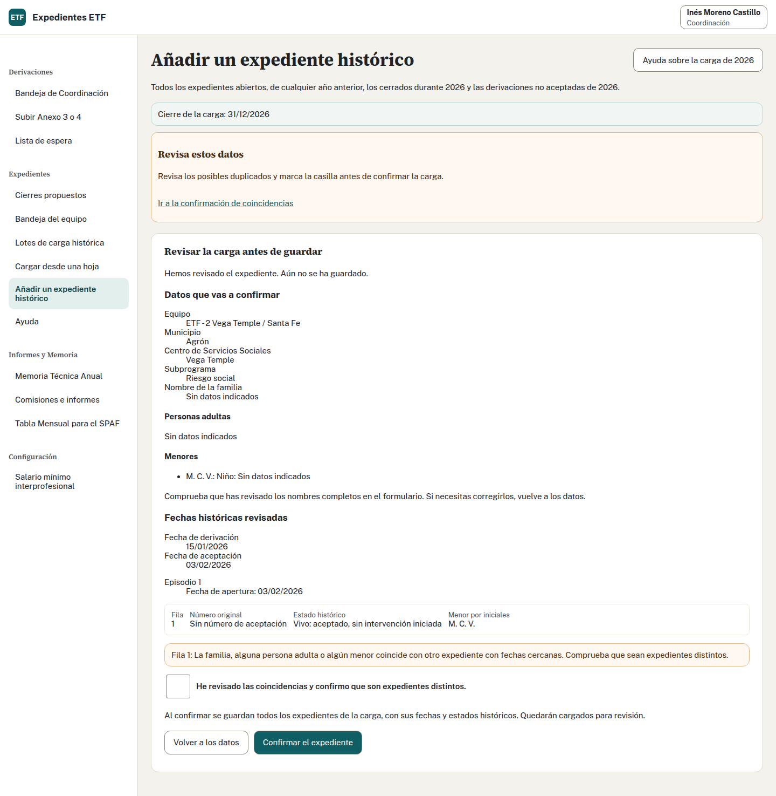
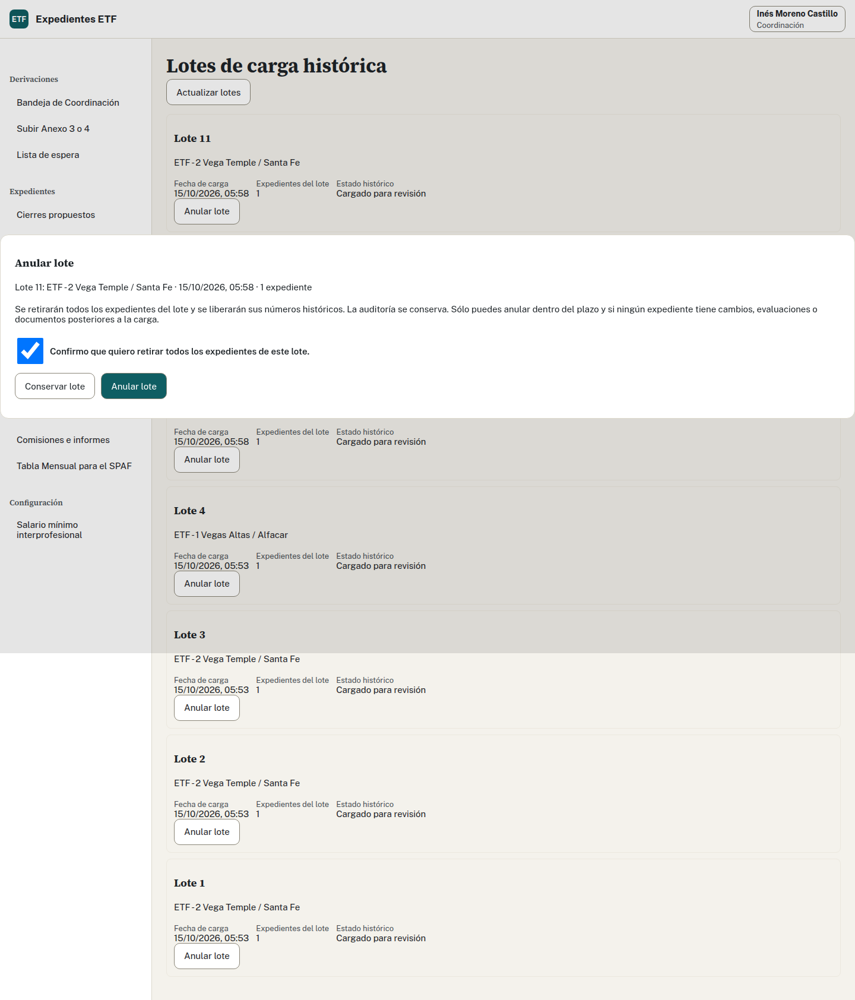

## Antes de cargar

Incluye todos los casos que siguen abiertos, también los iniciados en años anteriores, los cerrados durante 2026 y los no aceptados durante 2026. Un caso de 2022 o 2023 que siga activo también se carga. El Programa no dispone de hoja: la vía habitual es desde actas o a mano. La carga conserva números y fechas originales, no consume correlativos nuevos ni genera documentos. No uses la recepción ordinaria de un anexo para reconstruir una aceptación antigua.

> **Importante:** Los datos reales se introducen sólo en producción, cuando la dirección confirme evaluación de impacto aprobada, revisión de seguridad superada y restauración de copias probada. En el curso trabajas sólo con datos inventados.

## Añadir un caso desde actas o a mano

1. Abre «Añadir un expediente histórico». Coordinación elige equipo; el profesional sólo carga el suyo.
2. Si tienes actas, sube el Acta de Aceptación y, para un caso cerrado, el Acta de Cierre. Admite PDF, también firmado, DOCX u ODT, hasta 10 MB por acta. Pulsa «Leer y rellenar los datos»: sustituye el formulario, descarta los ficheros y todavía no guarda. Si no tienes actas, sigue a mano. Revisa estado, anexo original y fecha de derivación. Para un no aceptado, introduce fecha y causa y deja sin número de aceptación.
3. En un aceptado, conserva el número original si lo conoces. Si no lo conoces, déjalo vacío: no se asigna uno nuevo.
4. Completa aceptación, municipio, centro, subprograma, puesto de referencia, descripción, contacto, personas adultas y menores. Separa nombre y apellidos cuando se hayan leído juntos. No deduzcas el sexo del nombre. Si leíste cierre, confirma fecha y motivo de catálogo, además del texto del acta.
5. Añade los episodios de reapertura con sus fechas y motivos, conservando cierres anteriores.
6. Pulsa «Revisar el expediente», corrige errores y comprueba los datos. Revisar todavía no guarda.
7. Pulsa «Confirmar el expediente». Comprueba «Carga completada», datos guardados y marca «Cargado para revisión».

Leer un PDF firmado no valida su firma. Si sólo contiene una imagen, completa los datos a mano. Confirma las fechas propuestas mirando el original.

## Cargar una hoja

1. Abre «Cargar expedientes de 2026» y comprueba el equipo. La hoja CSV o XLSX admite de 1 a 100 casos del mismo equipo y hasta 10 MB.
2. Descarga la hoja con datos inventados si necesitas la estructura. Mantén sus 18 cabeceras y usa fechas como 2026-10-14. Pide ayuda para listas e historia.
3. Pulsa «Subir y revisar la hoja» y espera una revisión antivirus válida. Aún no se ha guardado el lote.
4. Corrige las incidencias por fila, selecciona otra hoja y revisa de nuevo. Comprueba números, estados, fechas y episodios antes de confirmar.
5. Pulsa «Confirmar el lote completo»: entra todo el lote o ninguno.
6. Comprueba el resultado y acuerda con el equipo la revisión de cada caso guardado.

El fichero y la revisión sin confirmar no se conservan. Si sales antes de confirmar, prepara la carga otra vez. Si se pierde la conexión después de confirmar, usa «Recuperar el resultado» antes de iniciar otra carga.

La hoja CSV/XLSX se mantiene por compatibilidad; no es un documento que el Programa tenga que preparar para la carga habitual.

Fuentes adaptadas: Coordinación y profesionales.

## Plazo, coincidencias y lotes

Administración fija la fecha en «Plazo de carga histórica». Puedes cargar hasta el final de ese día. Sin fecha, o fuera del plazo, no puedes cargar ni confirmar. Si necesitas ampliación, pídela a Administración.

Ante un aviso de coincidencias, compara familia, personas y fechas. La ventana inicial de proximidad es de 30 días y Administración puede configurarla. Confirma expresamente que son expedientes distintos sólo tras comprobarlo. Un número ya ocupado sigue bloqueado; el aviso no demuestra que dos casos sean la misma familia.

Coordinación puede anular un lote erróneo completo dentro del plazo si no tiene cambios, evaluaciones ni documentos posteriores. Las consultas no impiden anular. Revisa el lote y confirma su anulación: se retiran sus fichas, se liberan los números históricos y se conserva la auditoría. Si no se puede acreditar que un lote antiguo esté intacto, no se permite anularlo.

