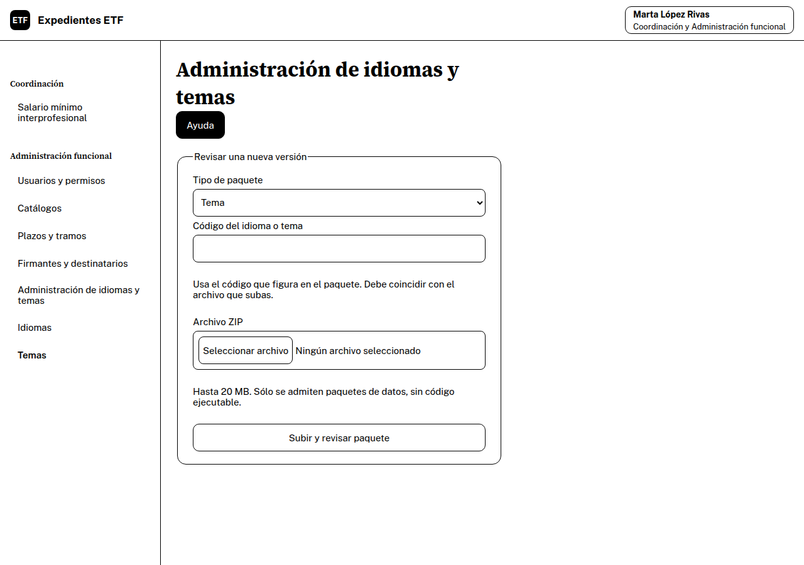
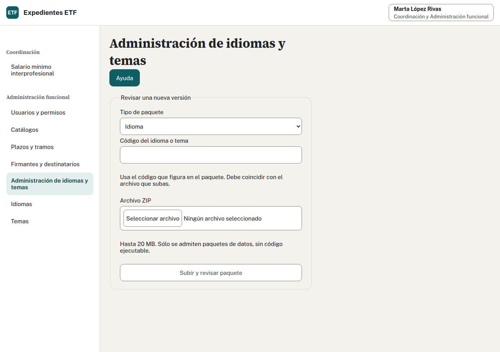
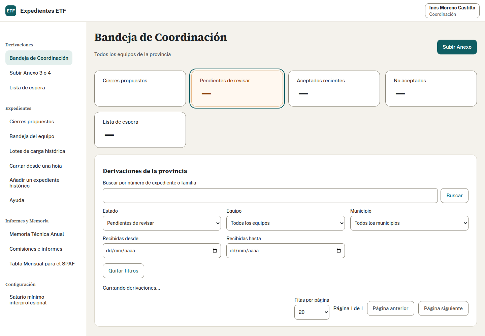
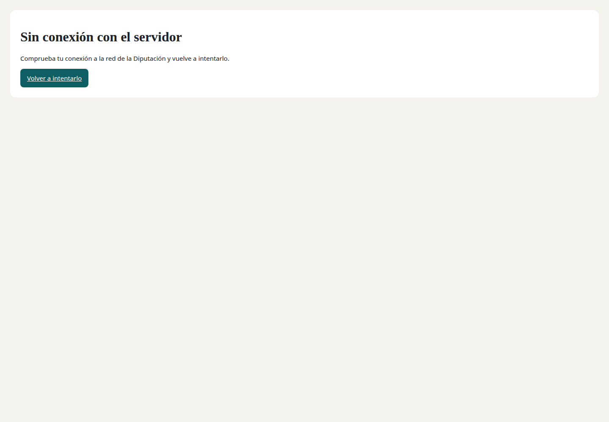
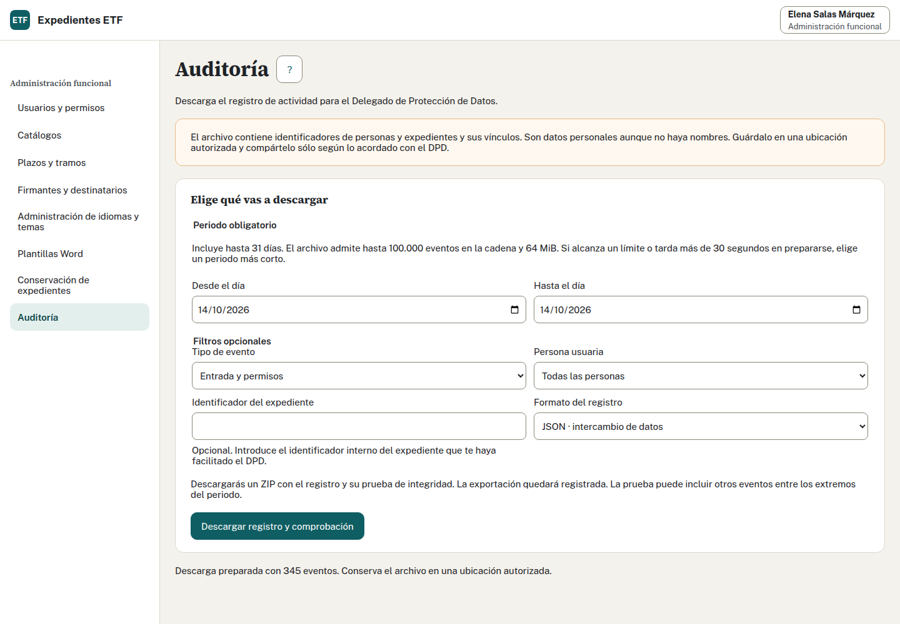

## Preferencias, temas e idiomas

Comprueba el idioma y las preferencias disponibles en la cabecera. En una pantalla estrecha, «Menú» abre la navegación y «Persona» reúne identificación, preferencias y salida. Usa el tema de alto contraste si te facilita la lectura. Antes de cambiar idioma o salir, guarda o resuelve los cambios pendientes que advierta la aplicación.

El selector ofrece idiomas activados; si falta una traducción, se muestra el texto en castellano. Cambiar idioma no traduce los textos libres del expediente ni la metodología que has escrito.

## Publicar idiomas y temas · Administración funcional

1. Abre «Administración de idiomas y temas» y elige el tipo.
2. Introduce el código del paquete preparado por quien mantiene la aplicación y selecciona su ZIP, de hasta 20 MB.
3. Pulsa «Subir y revisar paquete». Si hay errores o falta antivirus, espera o corrige: no se publica.
4. Confirma instalación y activación cuando se ofrezcan. Comprueba la versión disponible.

Las versiones son inmutables y las anteriores se conservan. No prepares los archivos a mano para esta práctica. Si hay conflicto de activación, consulta la versión vigente antes de continuar.

El vídeo siguiente sitúa el acceso y la administración; no presenta un recorrido específico de preferencias ni de paquetes.

## Instalar desde Edge

1. Abre la dirección segura facilitada por Informática.
2. En el menú de Edge, elige «Aplicaciones» y «Instalar este sitio como una aplicación», o usa el icono de instalación si aparece.
3. Comprueba el nombre «Expedientes ETF» y pulsa «Instalar».
4. Abre desde Inicio; puedes anclar la aplicación a la barra de tareas.

Conservas los mismos permisos y preferencias. Necesitas conexión al servidor: los expedientes no están disponibles sin conexión. Si la organización impide instalar, sigue entrando desde el navegador.

No hay un vídeo específico de instalación entre los once vídeos del curso. El vídeo de entrada muestra el acceso que utilizarás también en la ventana instalada.

## Si algo falla

| Situación | Qué debes hacer |
| --- | --- |
| Pendiente de alta | Pide perfil y equipo a Administración funcional |
| Contraseña o servidor inaccesible | Comprueba conexión o VPN y consulta a Informática |
| Conflicto al guardar | Abre «Ver cambios actuales», compara y conserva las aportaciones que correspondan antes de guardar |
| No sabes si se confirmó | Espera; usa recuperar o reintentar la misma operación y consulta estado, fechas o historial |
| Sin dato en SPAF o Memoria | Comprueba dato de origen y vigencia del periodo; comunica el pendiente si continúa |
| Archivo rechazado | Lee el motivo y corrige tipo, tamaño o contenido antes de subirlo otra vez |

Si conservas tu formulario tras un conflicto, «Conservar mi formulario para guardar» permite revisarlo y guardarlo sobre la versión actual. Ese guardado sustituye los datos de la pestaña: incorpora los cambios ajenos que deban mantenerse. «Descartar mi formulario y usar los datos actuales» elimina tu edición. No cierres una pestaña con texto que necesitas conservar.

Si persiste el fallo, anota acción, hora, pantalla y estado y usa el canal de soporte de tu entidad. No copies contraseñas ni envíes datos familiares por canales ajenos al Programa. Puedes acudir a la persona responsable de soporte o al sistema de incidencias GLPI según el procedimiento de la organización.

Fuentes adaptadas: manual de usuario y Administración funcional.

## Mantener equipos, municipios y centros · Administración

Abre «Equipos, municipios y centros» (`/admin/ubicaciones`). Busca la entrada y pulsa «Editar ubicación». Puedes añadir equipos y centros. En municipios, elige centro y equipo por separado, revisa el ámbito y las variantes de escritura. Publica con una fecha posterior a la última versión y comprueba el resultado. Las versiones anteriores se conservan; no cambian los expedientes ya numerados ni las Memorias cerradas.

## Exportar la auditoría · Administración

Abre «Auditoría» (`/admin/auditoria`). Elige hasta 31 días, incluidos ambos extremos en horario UTC, y los filtros necesarios. Selecciona CSV o JSON y pulsa «Descargar registro y comprobación». Guarda el ZIP en una ubicación autorizada: los identificadores y vínculos siguen siendo datos personales. La exportación no permite editar el registro ni abrir fichas. Pide a Informática la comprobación del archivo conforme a sus instrucciones.

Tras restaurar una copia, Informática realiza con Administración la revisión obligatoria antes de reanudar el trabajo.
