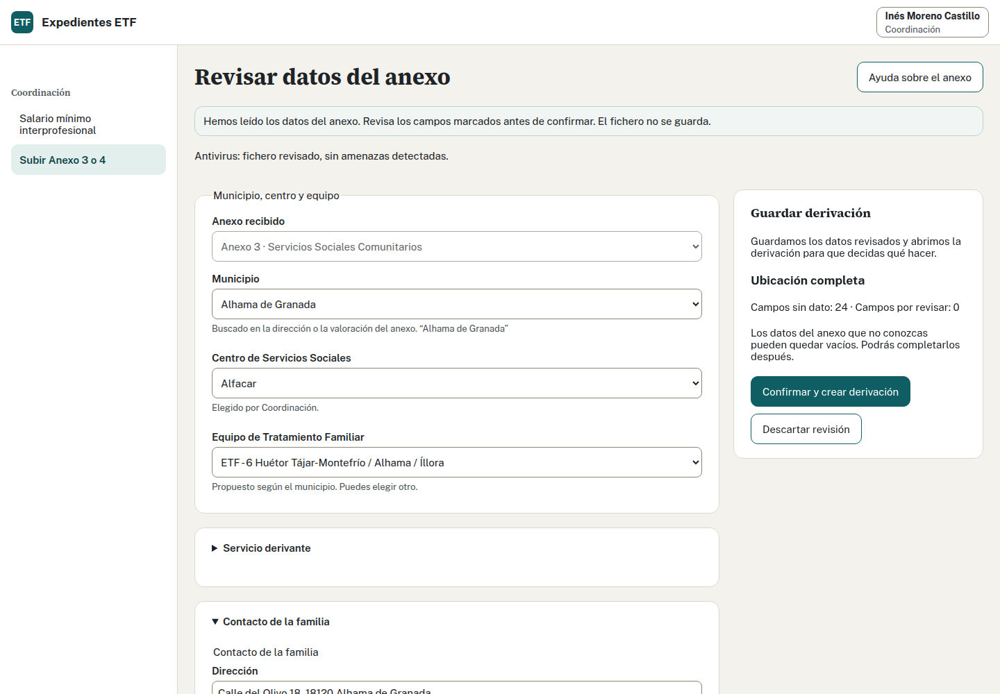

## Realiza la tarea · Coordinación · 20 minutos

1. Entra con Javier y abre «Subir Anexo». Elige el Anexo 3 del caso y espera el antivirus y la lectura.
2. Comprueba Agrón, centro, ETF 02, familia y seis menores. Contrasta con el archivo; no des por correcto un dato sólo porque se haya leído.
3. Confirma la derivación una sola vez. Comprueba que sigue recibida y sin número de aceptación.
4. Selecciona el puesto de trabajo social y revisa Riesgo y la descripción familiar.
5. Completa el sexo de los seis menores según la tabla del caso.
6. Introduce 14/10/2026 como fecha del Acta, lee el diálogo y acepta.
7. Anota tu número y descarga el Acta de Aceptación.
8. Busca ese número en la bandeja y comprueba el estado aceptado.

## Decisiones que debes explicar

- ¿Crear la derivación equivale a aceptarla?
- ¿Qué queda pendiente después de descargar el Acta?
- Si la respuesta se pierde, ¿crearías otra derivación para asegurar el resultado?

Ver solución

Crear guarda una derivación recibida sin número de aceptación. Aceptar el 14/10/2026 asigna el número del equipo 02 y año 26; su correlativo depende de las aceptaciones anteriores. Comprueba el número que has obtenido.

Descargar genera el Word y deja su emisión. La firma, el envío y el registro se tramitan fuera; descargar no los confirma. Conserva el archivo donde indique el Programa.

Si una escritura no tiene resultado claro, usa su recuperación y consulta primero el estado. Crear otra entrada puede duplicar el caso. Distingue familias con las mismas iniciales mediante tu número.

Continúa con la ficha del mismo número. Adaptado del ejercicio y la solución 1 de formación.

## Comprobación adicional: formato y espera

Si quien imparte te facilita el mismo anexo inventado en ODT o PDF firmado, revisa su lectura sin confirmar otra derivación. Comprueba fechas y campos vacíos mirando el original. Explica si una derivación del SPM puede quedar en espera.

Ver solución

Se admiten DOCX, ODT y PDF firmado; leer no valida la firma ni crea el caso. No confirmes una segunda entrada para practicar formatos. El Anexo 4 del SPM no admite espera. La espera de Servicios Sociales Comunitarios cuenta en el apartado 6 de la Memoria.

