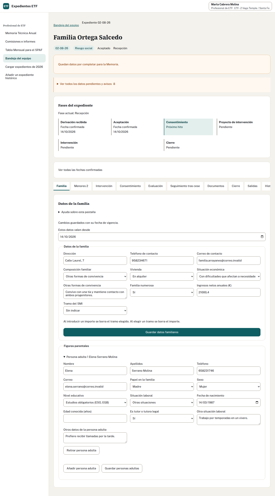

## Realiza la tarea · Profesional de ETF · 15 minutos

1. Sal de Javier y entra con Marta. Busca tu número en ETF 02 y abre la ficha.
2. En «Familia», indica vigencia desde 15/10/2026. Revisa Calle del Olivo 18, familia extensa, familia numerosa y alquiler. Guarda los datos familiares.
3. Añade o revisa las personas adultas conservando sus datos de origen: Lucía, madre y mujer, 39 años; Daniel, padre y hombre, 41; Rosa, abuela y mujer, 67. Guarda este apartado por separado. La opción «Abuelo/a» incluye a la abuela.
4. En «Menores», contrasta las seis personas con la tabla de preparación. Completa nombres, apellidos Pérez Ortega, sexo, nacimientos y escolarización; revisa especialmente el nacimiento de Nerea, 14/02/2016.
5. Indica que no hay propuesta de Atención Temprana en este caso. Guarda con vigencia desde 15/10/2026, manteniendo a los seis menores.
6. En «Intervención», selecciona evaluación y guarda desde 15/10/2026.
7. Abre los avisos pendientes. Muestra un dato guardado y explica dónde comprobarías uno que todavía desconoces.

## Decide antes de quitar un aviso

No conoces los ingresos ni una tipología señalada como pendiente. ¿Introduces cero y marcas que no hay ninguna? ¿Desde qué fecha deben contar los datos comprobados del ejercicio?

Ver solución

Conserva los desconocidos sin indicar y señala dónde comprobarlos. Cero es un importe conocido; una lista conocida sin opciones confirma que no hay ninguna. Ninguna de esas respuestas sustituye a un desconocido.

La vigencia es 15/10/2026. Permite consultar los datos que correspondían a cada periodo. Guardar hoy con esa vigencia no convierte el dato en válido desde la aceptación ni resuelve todos los avisos.

La ficha mantiene seis menores: Nerea, Celia, Mateo e Irene en Primaria; Álvaro en Secundaria; Hugo en Infantil. Nerea conserva 14/02/2016 y la fase del expediente es evaluación. Comprueba los guardados de familia y personas adultas por separado.

## Si aparece un conflicto

Detén el guardado. Abre «Ver cambios actuales» y compara con tu formulario. Habla con quien haya modificado el mismo apartado e incorpora los cambios que deban mantenerse antes de guardar. Descartar el formulario elimina tu edición; conservarlo no incorpora automáticamente las aportaciones ajenas.

Adaptado del ejercicio y la solución 2 de formación.
