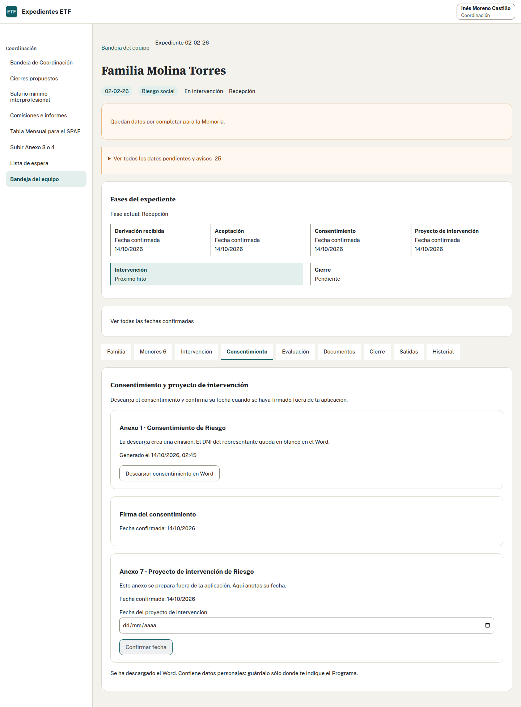

## Realiza la tarea · Profesional de ETF · 15 minutos

1. Con Marta, abre «Consentimiento» y descarga el Anexo 1 de Riesgo.
2. Comprueba que la firma sigue pendiente.
3. Cuando el calendario llegue al 16/10/2026, simula que la familia ha firmado ese día. Confirma la fecha y comprueba el hito guardado.
4. Abre «Evaluación» y comprueba el aviso de que las escalas son opcionales. Para esta práctica, deja las escalas sin anotar.
5. Descarga el Word del Anexo 11 cuando prepares la finalización. Comprueba que las casillas sin resultados quedan vacías y puedes completarlas fuera si lo necesitas.

## Decide y explica

¿La descarga prueba que la familia consiente? ¿Tienes que completar todas las escalas para descargar el Anexo 11 o cerrar?

Ver solución

Después de descargar el Anexo 1 hay una emisión y la firma continúa pendiente. Confirmar 16/10/2026 registra el consentimiento del caso inventado. En un expediente real debes disponer del hecho de la firma antes de confirmar su fecha. La aplicación no firma ni conserva el PDF firmado; tampoco guarda el DNI del representante en el consentimiento.

Las escalas son opcionales en los tres momentos. Puedes anotarlas en la aplicación o después en el Word de los Anexos 11 y 12. Dejarlas vacías no impide descargar, cerrar el expediente ni preparar la Memoria. No inventes respuestas ni puntuaciones. Si se anotan varios sujetos en una casilla, el Word muestra sus iniciales y resultados separados, sin mezclar sus puntuaciones.

El proyecto de intervención de Riesgo, Anexo 7, se elabora fuera y su fecha se confirma cuando exista. El ejercicio no proporciona esa fecha: no la deduzcas de la del consentimiento.

Adaptado del ejercicio y la solución 3 de formación.
