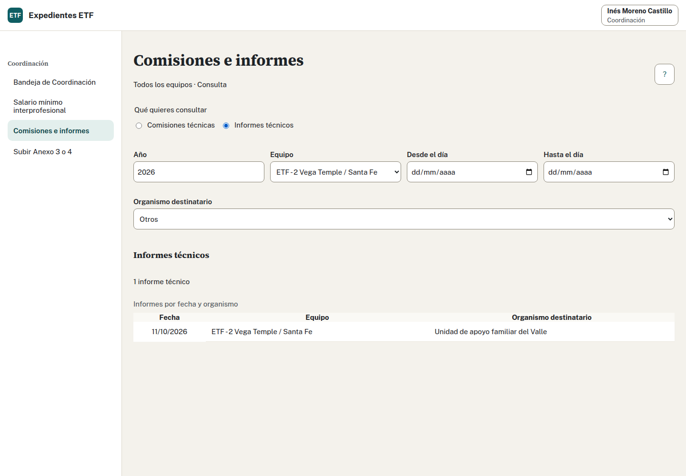

## Realiza la tarea · Equipo y Coordinación · 20 minutos

1. Con Marta, registra una comisión del 22/10/2026. Observaciones: «Reunión con el servicio derivante para revisar las rutinas de cuidado y los acuerdos de asistencia escolar».
2. Registra un informe del 24/10/2026 destinado a Servicios Sociales.
3. Comprueba ambos registros con sus filtros en la actividad del ETF 02.
4. Consulta la Tabla SPAF de septiembre de 2026, el último mes terminado en ese punto del calendario.
5. Comprueba que tu número de octubre no aparece y descarga el Word de septiembre.
6. Compara totales y movimientos con los demás casos del aula. Coordinación puede revisar el equipo seleccionado.

## Decide qué estás contando

¿La comisión queda unida a tu expediente? ¿Puedes descargar octubre el 24 de octubre? ¿Un menor «Sin dato» debe contar como cero para que cuadre la tabla?

Ver solución

La comisión y el informe pertenecen al ETF 02 y alimentan los apartados 15 y 16 de la Memoria. No tienen vínculo individual con el expediente. Registrar el informe no envía su contenido ni lo conserva como fichero.

Septiembre está terminado y permite descargar su tabla. Octubre sigue en curso: lo consultarás después del cierre, al avanzar a noviembre. Tu caso fue aceptado en octubre y queda fuera de septiembre.

La ficha contiene seis menores. Ante un «Sin dato», revisa vigencia al corte y aviso; no lo sustituyas por cero. Los totales pueden incluir otras parejas y prácticas anteriores: comprueba movimientos de tu número.

Comprueba que la ubicación muestra el municipio del expediente, Agrón, sin ZTS. No lo sustituyas por el centro ni por el ETF 02.

Adaptado del ejercicio y la solución 4 de formación.
