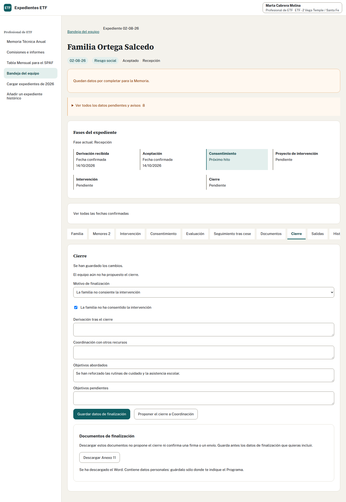
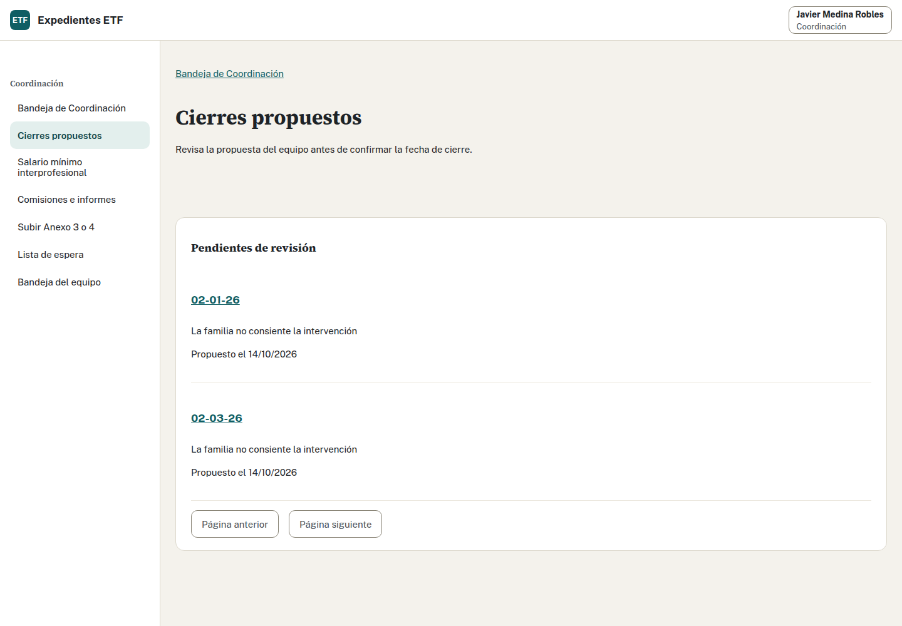

## Realiza la tarea · Equipo y Coordinación · 20 minutos

1. Marta abre «Cierre» y selecciona «Objetivos satisfactoriamente cumplidos».
2. Completa los campos del caso inventado:

| Campo | Texto para la práctica |
| --- | --- |
| Derivación tras el cierre | Seguimiento por Servicios Sociales Comunitarios. |
| Coordinación con recursos | Reunión con el servicio derivante y el centro educativo. |
| Objetivos abordados | Se han reforzado las rutinas de cuidado y la asistencia escolar. |
| Objetivos pendientes | Mantener los acuerdos de seguimiento con el servicio derivante. |

3. Guarda la finalización y descarga el Anexo 11. Comprueba el estado.
4. Propón el cierre a Coordinación y comprueba otra vez el estado. Sal de Marta.
5. Javier abre «Cierres propuestos», localiza tu número y revisa motivo y finalización.
6. El 31/10/2026 simulado, confirma el cierre con esa fecha y revisa el diálogo. Descarga después el Acta de Cierre.
7. Cuando la persona que imparte avance al 01/11/2026, consulta octubre del ETF 02, abre alta y baja de tu número y descarga el Word.

## Decide dónde cambió el estado

¿Qué acción cerró el expediente? ¿Podría Marta confirmar con otra cuenta su propia propuesta? ¿Alta y baja significan dos casos?

Ver solución

Guardar la finalización conserva los textos. Descargar el Anexo 11 añade una emisión; el caso sigue en intervención. Proponer deja una propuesta pendiente que puedes retirar y tampoco cierra.

Marta figura como proponente y Javier como quien confirmó el cierre el 31/10/2026. Debe confirmar una persona distinta, con su propia cuenta. Cambiar de cuenta sin cambiar de persona incumple esa separación. La confirmación cierra; descargar el Acta después no modifica la fecha.

En octubre tu número tiene alta y baja. El incremento atribuible a este caso es una alta, una baja y un caso, no dos casos. Comprueba sus movimientos, porque el total del equipo incluye más familias.

## Decisión adicional

Si en otro caso existiera un Anexo 5 con respuesta «A la espera», ¿confirmarías el cierre ordinario para terminar la práctica?

Ver solución

No. «A la espera» mantiene el bloqueo. Revisa con Coordinación la respuesta fechada que permita cerrar o una excepción autorizada con motivo escrito. El caso común no te pide crear una salida al SPM ni una respuesta inventada.

Adaptado del ejercicio y la solución 5 de formación.
