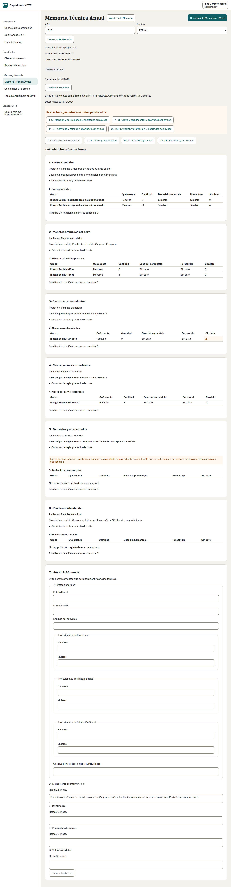
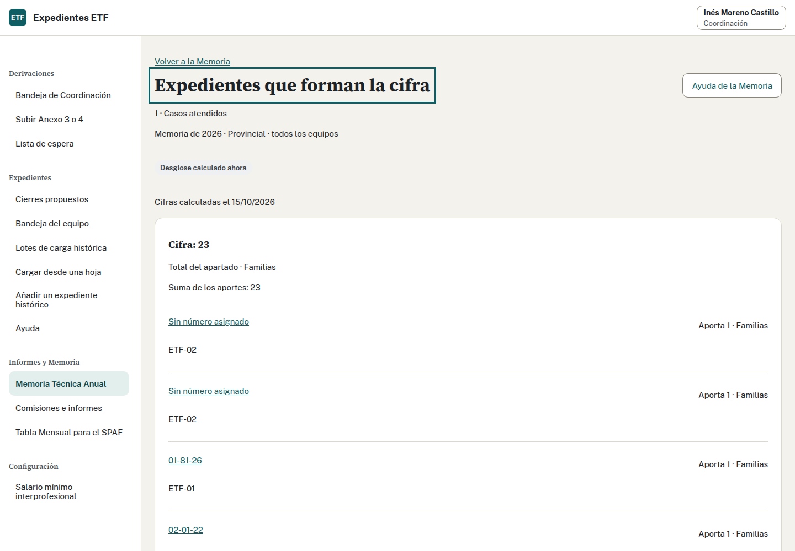
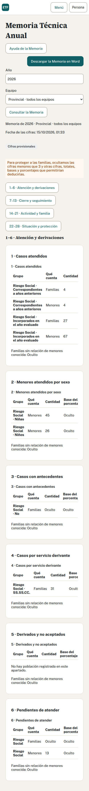

## Antes de empezar

Sólo una pareja cierra las Memorias compartidas. Confirma que la persona que imparte ha preparado la revisión y reabierto con motivo las Memorias de prácticas anteriores. Este ejercicio conserva revisiones inventadas; no acredita la validación del Programa.

## Realiza la tarea · Equipo y Coordinación · 15 minutos

1. Marta consulta la Memoria de 2026 del ETF 02.
2. Revisa los cuatro bloques. Pulsa una cantidad, base o «Sin dato» y comprueba los números de expediente, equipos y aportaciones. Vuelve a la Memoria y comprueba que conserva año, equipo y bloque. Anota un dato pendiente y dónde lo comprobarías.
3. Escribe en Metodología: «Durante el año se han coordinado entrevistas familiares y reuniones con los servicios derivantes. El equipo revisa los acuerdos de seguimiento y los datos pendientes antes del cierre anual».
4. Guarda los textos, descarga el Word y comprueba su narrativa.
5. Lee el diálogo y cierra la Memoria del equipo. Comprueba año, equipo y estado cerrado.
6. Sal de Marta. Inés consulta 2026 con «Todos los equipos», revisa y cierra esa revisión provincial.
7. Comprueba que es un ámbito distinto y explica cómo corregirías una revisión cerrada.

## Decide antes de declarar el trabajo terminado

¿Descargar cerró la Memoria? ¿La provincial es la suma de las revisiones cerradas de equipo? ¿Cerrar prueba que ya se revisaron todos los pendientes?

Ver solución

Guardar conserva la metodología y descargar entrega el Word, sin cerrar. La confirmación del cierre conserva cifras y textos de 2026 del ETF 02. Inés conserva otra revisión provincial; la provincial se calcula directamente desde los expedientes, no sumando Memorias cerradas de equipo.

El número de revisión depende de prácticas anteriores. Comprueba ámbito y estado, sin exigir un número fijo. Puedes señalar un pendiente si explicas dónde comprobarlo; no necesitas quitar los avisos de otras familias para resolver este ejercicio.

Cerrar el expediente fija la finalización de su atención. Cerrar la Memoria fija cifras y textos de un año y ámbito. Un estado cerrado no demuestra que los pendientes estén resueltos ni que el Programa haya validado las cifras. En trabajo real, acuerda la revisión antes de cerrar.

Coordinación puede reabrir con motivo, conservar la revisión anterior, corregir y cerrar otra revisión. Los cambios posteriores de fichas no alteran automáticamente la Memoria ya cerrada.

## Comprobación por perfil

Si accedes con Consulta, ¿deberías encontrar esta metodología y los números de expediente detrás de cada cifra?

Ver solución

No. Consulta recibe sólo cifras, también en su Word. No tiene desglose. Una cifra inferior al umbral inicial de 3 casos aparece como «Oculto». La supresión secundaria oculta otras cifras necesarias para impedir deducirla. No interpretes «Oculto» como cero. No recibe textos narrativos ni identificadores de expedientes y no puede cerrar o reabrir Memorias.

[Validar con el Programa: D24, total y base de los porcentajes del apartado 24; esta práctica no sustituye su validación.]

Adaptado del ejercicio y la solución 6 de formación.

## Comprueba el SMI y el desglose

Con Inés, consulta el SMI de 2026 sin cambiarlo: 1.221 € mensuales y 17.094 € anuales (14 pagas). Si desconoces los ingresos de la familia, mantenlos sin indicar. No los sustituyas por el SMI.

En una revisión cerrada, comprueba el desglose conservado al cerrar. Las comisiones y los informes no tienen expediente individual. Con Consulta, revisa las cifras protegidas en pantalla y Word.

