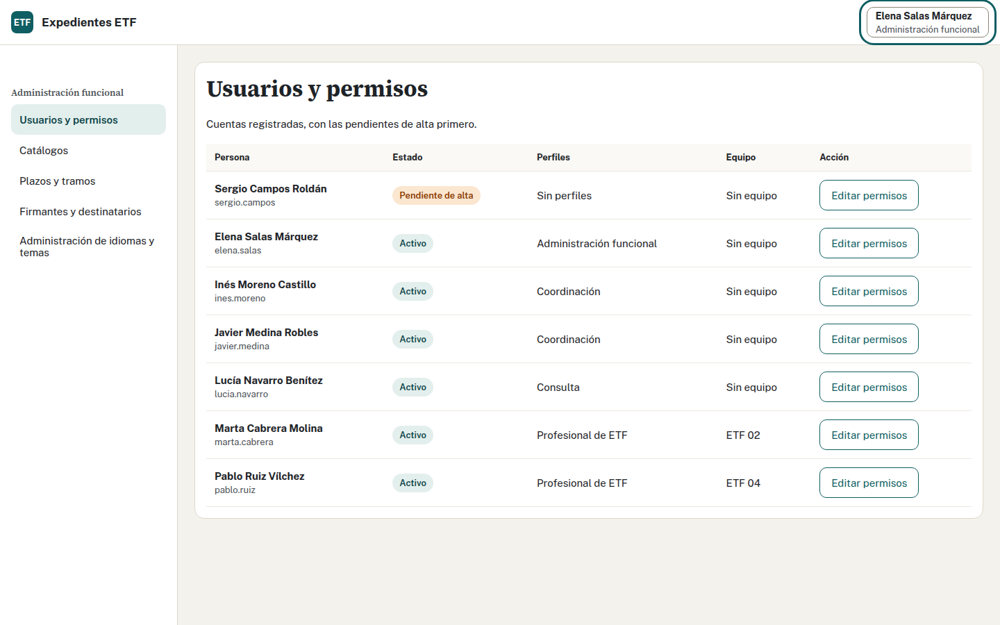
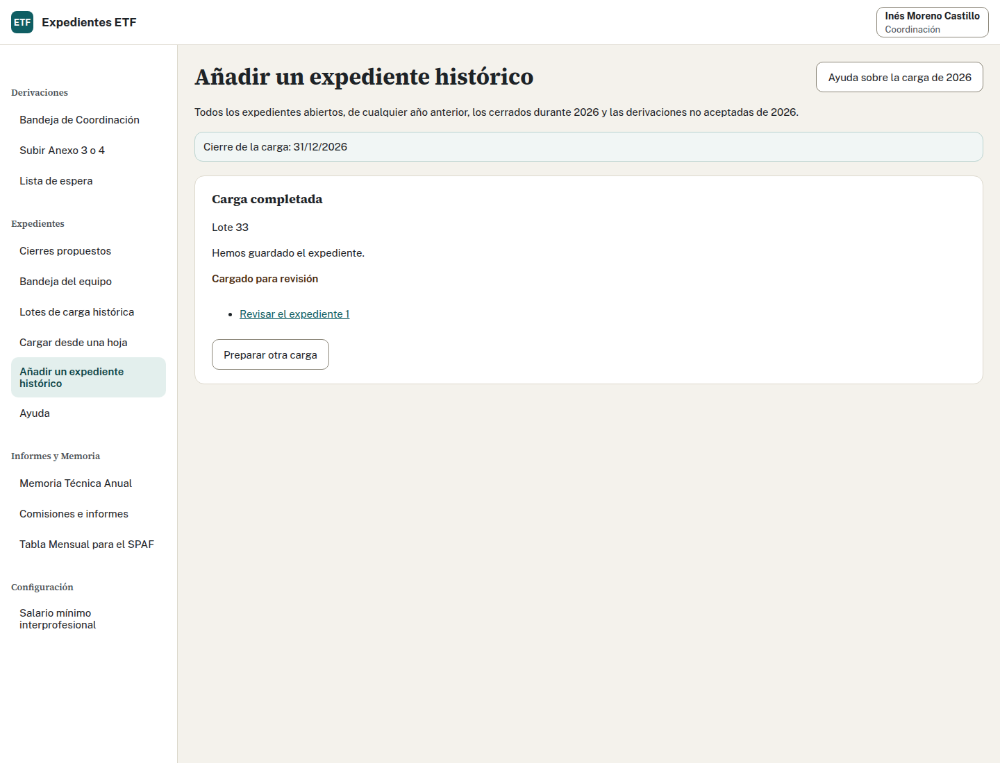
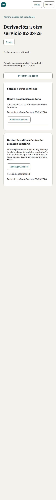
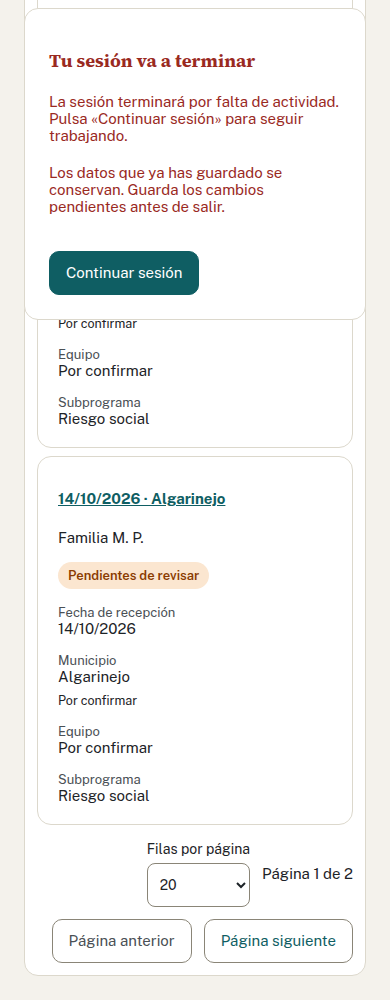

## Realiza la tarea · Administración funcional · 15 minutos

Puedes realizar este ejercicio en paralelo al de Memoria. Usa la ventana de Administración con tiempo real, sin las fechas simuladas del caso.

1. Elena abre «Usuarios y permisos» y busca Sergio Campos. Comprueba que está pendiente de alta, sin perfil ni equipo.
2. Asigna Profesional de ETF y equipo 02, guarda y comprueba la confirmación.
3. Sal de Elena y entra con Sergio en esa ventana. Comprueba menú y bandeja del ETF 02. Si conserva la sesión anterior, sal y entra de nuevo.
4. Vuelve a Elena y consulta una plantilla Word activa y su historial. En este ejercicio no subas ni actives versiones.
5. Al terminar, retira de Sergio el perfil y equipo concedidos. Comprueba el estado y, con una sesión nueva de Sergio, que ya no accede a la bandeja.

## Decide qué necesita ver Elena

¿Necesita leer la ficha Ortega Salcedo para preparar ese acceso? ¿Consultar una plantilla significa activar una nueva versión?

Ver solución

Administración funcional prepara el acceso y la configuración sin leer fichas; este perfil no permite consultarlas. Tras la concesión, Sergio entra en la bandeja del equipo 02. Tras retirar perfil y equipo, comprueba la pérdida de acceso con una sesión nueva.

Consultar la plantilla muestra la activa y su historial; no publica ni activa otra. Para practicar activaciones, usa una copia inventada preparada y el recorrido específico. Esta práctica sólo pide consulta.

## Comprueba lo que deja el caso

| Evidencia | Resultado que debes poder explicar |
| --- | --- |
| Número de tu caso | Equipo 02, aceptación el 14/10/2026 y el correlativo obtenido |
| Ficha | Seis menores y datos comprobados con vigencia desde 15/10/2026 |
| Consentimiento | Fecha confirmada 16/10/2026, separada de la emisión del Word |
| Evaluación | Escalas opcionales sin anotar; casillas del Anexo 11 vacías y editables |
| Actividad | Comisión del 22 e informe del 24, como registros del equipo |
| SPAF | Fuera de septiembre; alta y baja del mismo caso en octubre |
| Cierre | Propuesta de Marta y confirmación de Javier el 31/10/2026 |
| Memorias | Revisión de equipo y provincial cerradas, con sus ámbitos y pendientes |
| Acceso temporal | Concedido y retirado a Sergio, comprobado con nuevas sesiones |

Los Word descargados y los documentos firmados no quedan guardados en la aplicación. Las emisiones y los hitos sí dejan constancia de sus actos respectivos.

## Si tu resultado no coincide

Comprueba cuenta, perfil, equipo, número, año y mes. Conserva cambios pendientes; ante un conflicto, compara los datos antes de guardar. Si una confirmación pierde la respuesta, usa la recuperación de esa operación y consulta el estado antes de enviar otra.

Anota la acción, el estado y la hora sin copiar contraseñas ni datos familiares a canales ajenos al Programa. Pide ayuda a quien imparte y consulta el manual del perfil.

Ver solución: la conexión se perdió al confirmar

No crees otro caso ni repitas desde un formulario nuevo. Usa la opción de recuperar o reintentar que ofrece la pantalla y comprueba estado, fechas o historial. Si el resultado sigue incierto, pide ayuda indicando acción y hora. Esta comprobación evita duplicar la escritura.

Adaptado del ejercicio 7 y las soluciones y comprobaciones.

## Prácticas adicionales con datos inventados

Realízalas en expedientes separados del caso Ortega Salcedo, preparados por quien imparte.

### Cargar un expediente de un año anterior

Con Marta, abre «Añadir un expediente histórico» para el ETF 02. Lee un Acta de Aceptación de 2023 en DOCX, ODT o PDF y, si el caso está cerrado, su Acta de Cierre. Revisa número, fechas, personas y estado antes de confirmar. Ante coincidencias, comprueba si son casos distintos. Con Inés, revisa el lote y explica si se podría anular.

Ver solución

Un expediente de 2023 que siga abierto se incluye en la carga. La lectura propone datos y no guarda ni valida firmas. Administración debe haber fijado un plazo vigente. Un número ocupado no puede repetirse. Coordinación puede anular el lote dentro del plazo si está intacto; un cambio, evaluación o documento posterior lo impide. Una consulta no lo impide.

### Preparar una derivación a otro servicio

En otro expediente aceptado de prácticas, prepara el Anexo 6 desde la ficha. Guarda destino y motivo, descarga el Word y revisa los apartados 1 a 4. Completa los apartados 5 a 8 fuera. Simula el envío sólo si quien imparte te proporciona su fecha y confírmala por separado.

Ver solución

La salida conserva destino, motivo y fecha. La descarga no confirma el envío. Puedes registrar varias salidas; no cambian el estado ni bloquean el cierre. No las confundas con las propuestas protectoras al SPM del Anexo 5.

### Revisar las tareas de Administración

Con Elena, consulta sus propios permisos: para cambiarlos necesita otra persona de Administración. Abre «Equipos, municipios y centros» y comprueba que municipio, centro y equipo son datos distintos. No publiques cambios en esta práctica. En «Auditoría», elige un día del ejercicio y descarga el registro y su comprobación; guarda el ZIP sólo en el lugar autorizado.

Ver solución

Elena no se concede perfiles a sí misma. Administración mantiene ubicaciones y exporta auditoría sin acceder a fichas por ese permiso. La exportación contiene vínculos e identificadores que debes custodiar como datos personales.

### Reconocer el aviso de sesión

Localiza en la captura el aviso previo al cierre. Explica qué harías si aparece mientras editas.

Ver solución

Guarda y continúa si necesitas seguir. El aviso aparece dos minutos antes; los valores iniciales son 30 minutos sin actividad y 8 horas de duración máxima. Continuar no amplía ese máximo. Si caduca, vuelve a entrar y comprueba lo guardado.

