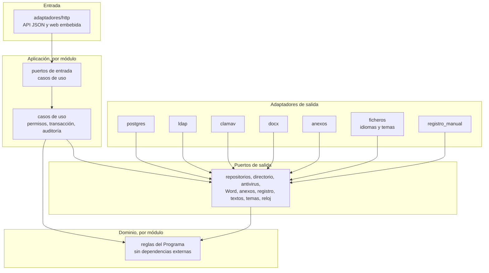

# Guía de la documentación

Esta carpeta reúne todo lo que explica el proyecto. Los seis documentos de `producto/` mandan; el resto explica instalación, uso y comprobaciones locales. Para una primera idea del proyecto, empieza por el [README de la raíz](../README.md).

## Qué hay en cada carpeta

| Ruta | Contenido |
| --- | --- |
| [sistemas/](sistemas/LEEME.md) | Manual para Informática: instalación, operación, copias, restauración e incidentes; incluye evidencia local F5.05 |
| [Pruebas en Windows](../despliegue/windows/LEEME.md) | Paquete WSL2 y Podman Desktop, imágenes y usuarios inventados; instalación y mantenimiento con doble clic; accesos en escritorio e Inicio y ventana propia en Edge o Chrome. Evidencia y límites en [WIN1](sistemas/WIN1.md) |
| [accesibilidad/](accesibilidad/README.md) | Auditoría F5.03 por pantalla y perfil, matriz axe, correcciones de foco y pendientes manuales |
| [Manuales de usuario](manuales/usuario.md) | Profesionales de los ETF, Coordinación y hoja de Administración funcional; tareas con pasos y capturas reales, glosario, dudas habituales, títulos de vídeos y PDF. Carga de 2026 a mano o por hoja; consulta, descarga, cierre y reapertura de Memoria |
| [Formación](formacion/LEEME.md) | Sesión de 150 minutos por perfiles, ejercicios con soluciones, preparación y reinicio de la demo, manuales y títulos de vídeos |
| [producto/](producto/) | Los seis documentos de producto. Son la única fuente de verdad y se actualizan en el mismo cambio que modifique lo que describen |
| [recorridos/](recorridos/LEEME.md) | Once recorridos de demostración: acceso, derivaciones, actividad, plantillas Word, ficha, Tabla SPAF, cierre, traslado, Memoria, carga y ciclo completo; grabación, voz y revisión de fotogramas |
| [Lectura ODT y PDF firmado RESP4](recorridos/RESP4.md) | Muestras sanitizadas de Anexos 3 y 4, valores leídos, campos para revisión manual y capturas 1440/390 |
| [Pruebas F0.11](recorridos/F0.11.md) | Entrada y alta con Chrome; matriz de todos los métodos INT5 por perfil y pruebas de seguridad por filas en PostgreSQL |
| [Vista de Consulta](capturas/memoria-consulta.md) | Capturas de escritorio, móvil y alto contraste; recorrido numérico y perfiles mixtos |
| [Evidencia F4.07](evidencias/F4.07.md) | API de navegación, composición por números y vista de Consulta con cifras y Word; cálculo al momento, fotos cerradas y credencial técnica |
| [Evidencia FX6](evidencias/FX6.md) | Recuperación de los ensayos completos de Catálogo y Expediente inicial, repeticiones y entrada en CI |
| [Evidencia FX5](evidencias/FX5.md) | Fallo intermitente de migraciones, arranque provisional de PostgreSQL, diagnósticos comunes y repeticiones locales y en CI |
| [Recorrido TR1](capturas/traslado.md) | Traslado entre equipos y seguimiento tras cese: pantallas, capturas, permisos, conflicto y recuperación de resultados |
| [Pruebas F2.07](recorridos/F2.07.md) | Nueve pestañas, conflicto sin perder lo escrito, aislamiento HTTP/RLS, lectura histórica y matriz de campos para la Memoria; conexión estadística pendiente |
| [Pruebas F4.09](recorridos/F4.09.md) | Memoria de equipo y provincial: cifras manuales, Word, cierres, corrección, discrepancia, aislamiento y reapertura |
| [Pruebas F3.06/F3.07](recorridos/F3.06-F3.07.md) | Salidas, cierre, reapertura, traslado y seguimiento; seis tablas SPAF con cifras manuales y fallos de producto reproducibles |
| [Evidencia F4.04](evidencias/F4.04.md) | Medición local de Memoria, SPAF y bandejas con 3.000 expedientes; pruebas negativas de Consulta y contratos todavía pendientes |

## Qué leer según lo que vayas a hacer

| Si vas a… | Lee |
| --- | --- |
| Entender de qué va el proyecto | [PRD.md](producto/PRD.md) |
| Decidir qué construir ahora | [PLAN_IMPLEMENTACION.md](producto/PLAN_IMPLEMENTACION.md) |
| Programar el servidor | [TRD.md](producto/TRD.md) y [ESQUEMA_BACKEND.md](producto/ESQUEMA_BACKEND.md) |
| Programar una pantalla | [FLUJO_APP.md](producto/FLUJO_APP.md) y [DISENO_UI_UX.md](producto/DISENO_UI_UX.md) |
| Tocar SQL, permisos o migraciones | [ESQUEMA_BACKEND.md](producto/ESQUEMA_BACKEND.md) y el apartado de seguridad del [TRD.md](producto/TRD.md#10-seguridad) |
| Desplegar o preparar el servidor | El apartado de [despliegue del TRD.md](producto/TRD.md#12-despliegue) |
| Entender un documento Word que se genera | Los originales de `idiomas/` y el apartado de plantillas del [TRD.md](producto/TRD.md#8c-plantillas-word), con la [revisión F3.03 por plantilla y sus comparaciones](../internal/adaptadores/docx/REVISION_PLANTILLAS.md) |
| Saber qué pregunta está pendiente del Programa | dudas.md (véase el PRD) |
| Conocer la puerta de integración continua | [scripts/ci/README.md](../scripts/ci/README.md) |

Los agentes de desarrollo leen siempre el PRD y el plan, y además los documentos que afecten a su tarea (ver los documentos de producto).

## Arquitectura con más detalle

El servidor es un monolito modular con arquitectura hexagonal estricta. Las capas se pueden importar sólo en un sentido, y una prueba automática (`internal/arquitectura_test.go`) falla si alguien rompe la regla. La tabla completa de qué capa puede importar a cuál está en el apartado 2.1 del [TRD.md](producto/TRD.md#21-estilo-y-reglas-de-dependencia).

INT5 reúne handlers y permisos en las rutas de cada módulo y compone las pantallas web por capacidad. El arranque valida el registro; el menú contrasta la lista web con las pantallas permitidas en la sesión. Para añadir un módulo, sigue [TRD §2.3](producto/TRD.md#23-módulos).

Los diez módulos reparten el trabajo así:

| Módulo | Responsabilidad |
| --- | --- |
| `plataforma` | Soporte técnico: migraciones y contexto de seguridad. No es dominio de negocio |
| `identidad` | Usuarios, perfiles, equipo y sesiones |
| `catalogo` | Equipos, centros, municipios, listas, reglas con vigencia, salario mínimo, firmantes y destinatarios |
| `paquete` | Idiomas, temas y referencias a sus versiones activas |
| `expediente` | Derivación, ficha, hitos, salidas, cierre, seguimiento, avisos y carga inicial. Servidores de familia y adultos F2.01a menores F2.01b e intervención F2.01c con vigencias y contratos de lectura para evaluación, estadística y avisos. F2.08a permite altas históricas de 2026 por equipo, con números originales, episodios y marca auditada para revisión. CA1 añade alta asistida y carga CSV/XLSX con revisión, incidencias y resultado. F2.02 publica avisos por expediente y recuento por equipo, con plazos versionados y editables |
| `evaluacion` | Instrumentos y escalas |
| `documento` | Plantillas, emisiones y registro de salida |
| `actividad` | Comisiones e informes técnicos: pantalla F2.04 con filtros, registro, corrección y retirada; RLS, auditoría y puerto de recuentos 15/16 |
| `estadistica` | Tabla del SPAF, Memoria y totales |
| `auditoria` | Eventos encadenados, incluidas las lecturas |

Reglas entre módulos: cada uno es dueño de sus tablas y de su carpeta de migraciones, la comunicación es por llamadas dentro del mismo proceso y la misma transacción, y la Tabla y la Memoria, que leen de casi todos, usan vistas de sólo lectura que cada módulo publica como parte de su contrato. No hay colas ni bandejas de salida. Los detalles están en [TRD.md](producto/TRD.md#23-módulos) y [ESQUEMA_BACKEND.md](producto/ESQUEMA_BACKEND.md).

Otras decisiones que conviene conocer:

- **Textos y temas son datos.** Los directorios `idiomas/<código>/` y `temas/<nombre>/` se leen en tiempo de ejecución. Publicar una versión nueva la escribe sin modificar la anterior y activa su referencia con auditoría en una transacción. Ver los apartados 8 y 8b del [TRD.md](producto/TRD.md#8-textos-e-idiomas).
- **Una configuración que falla sólo desactiva su función.** Si falta el antivirus, el directorio de usuarios o una plantilla, la aplicación arranca igual y avisa en la página de salud. PostgreSQL es la única dependencia imprescindible.
- **Identidad.** El directorio valida la contraseña y devuelve un identificador estable de la cuenta. Los perfiles y el equipo se dan dentro de la aplicación. Ver [TRD.md](producto/TRD.md#4-identidad-y-sesión).

## Despliegue con más detalle

Docker Compose (`compose.yaml`) y la carpeta `despliegue/base/` ya existen y están integrados en `main`: arrancan `app`, `postgres`, `clamav`, `preparar-roles` y `migrar`, y su guía es [despliegue/base/LEEME.md](../despliegue/base/LEEME.md). Siguen siendo diseño, sin construir, los guiones de copia, la subida de versión con vuelta atrás y los entornos de preproducción y producción.

**Contenedores.** `app` (el ejecutable Go, que lleva la interfaz ya compilada y embebida), `postgres` (con volumen de datos propio) y `clamav`. El servicio puntual `preparar-roles` crea o actualiza los roles técnicos desde el entorno privado, por socket local y sin tocar datos, también en volúmenes anteriores a F4.07. Después, `migrar` aplica las migraciones por el orden de sus dependencias y con un rol propio; la aplicación no recibe esas credenciales. Node sólo se usa al compilar la imagen, nunca en producción.

**Volúmenes.** `idiomas/` y `temas/` se montan desde fuera, y incluyen plantillas y paquetes publicados. Los anexos, las hojas de carga y los documentos generados no tienen almacenamiento persistente. Una copia del idioma castellano y del tema por defecto viaja dentro de la imagen para que la aplicación nunca se quede sin textos ni estilo.

**Subir una versión (diseño acordado).** Se hace fuera del horario de 8 a 15 h, con este orden:

1. Copia previa cifrada de la base de datos y de los volúmenes.
2. Descarga de la imagen nueva, etiquetada con su versión.
3. Ejecución de `migrar`; sólo si termina bien arranca la aplicación nueva.
4. Comprobación de la página de salud y de una prueba de humo.
5. Si algo falla, vuelta atrás automática a la imagen anterior y, si la migración lo exige, restauración de la copia. Para que casi nunca haga falta, las migraciones se escriben compatibles con la versión anterior.

**Entornos (diseño acordado).** Desarrollo en el puesto con Docker Compose, preproducción en un entorno de preproducción y producción en el servidor de la entidad. Los dos primeros usan siempre datos inventados; los datos reales existen sólo en producción. Se sube a producción después de probar en preproducción.

**Copias (diseño acordado).** Diarias, cifradas y fuera del servidor, con una pérdida máxima tolerada de un día. Antes de abrir producción se ensaya una restauración.

Queda por decidir con Informática quién termina el HTTPS (un proxy dentro de Compose, la propia aplicación o un proxy de la entidad). El apartado 14 del [TRD.md](producto/TRD.md#14-lo-que-falta-para-producción) recoge lo que falta para producción.

## Flujos por perfil

Cada recorrido está explicado paso a paso, con sus pantallas y sus reglas de acceso, en [FLUJO_APP.md](producto/FLUJO_APP.md). Aquí sólo va una idea de cada uno.

- **Coordinación.** Recibe la derivación, comprueba lo que la aplicación ha leído del anexo y confirma municipio, centro y equipo. Decide si acepta, no acepta o deja en espera, y descarga las actas y los oficios correspondientes. Después atiende los cierres propuestos por los equipos, genera el Acta de Cierre y puede reabrir o trasladar un expediente. Cierra la Memoria provincial y mantiene el salario mínimo interprofesional (SMI) por año. F1.10 dispone de bandeja provincial en `/coordinacion`, con búsqueda enmascarada, cuatro vistas, filtros y paginación. Los enlaces a subir anexos y revisar derivaciones corresponden a P2 y P3. F1.09 dispone de pantalla en `/coordinacion/smi` y API en `/api/coordinacion/smi`, ambas autorizadas sólo para Coordinación mediante la tabla única de rutas; la escritura requiere CSRF. Ver los apartados [2.1](producto/FLUJO_APP.md#21-coordinación) y [3](producto/FLUJO_APP.md#3-recorridos-de-punta-a-punta).
- **Profesional de ETF.** Trabaja la lista de expedientes de su equipo, registra el consentimiento y sigue el plazo de 30 días, completa la ficha, deriva al SPM o a otro servicio cuando toca y propone el cierre. Cada mes saca la Tabla del SPAF y cada año la Memoria de su equipo. Ver el apartado [2.2](producto/FLUJO_APP.md#22-profesional-de-etf).
- **Consulta.** Entra a ver cifras agregadas de la Memoria y totales. No recibe nombres, composición de las cifras ni textos libres. Ver el apartado [2.3](producto/FLUJO_APP.md#23-consulta).
- **Administración funcional.** Da de alta a las personas y les asigna perfil y equipo, mantiene catálogos, plazos, plantillas, firmantes, idiomas y temas, y exporta la auditoría. No ve fichas de expedientes. Quien entra con una cuenta válida pero sin perfil queda pendiente de alta y no ve nada. Ver los apartados [1.2](producto/FLUJO_APP.md#12-pendiente-de-alta) y [2.4](producto/FLUJO_APP.md#24-administración-funcional).

## Cómo mantener esta guía

Esta guía resume y enlaza; no sustituye a los documentos de producto. Si cambia la estructura de `docs/`, la arquitectura o el despliegue, se corrige aquí en el mismo cambio, y las partes previstas se actualizan cuando exista el código.

## Estado de la construcción

F5.04 incorpora conservación y revisión de dos personas en `/admin/conservacion`. El plazo se publica desde Administración; la retirada incluye los textos de Evaluación y los campos libres del registro de salida, sin modificar cifras históricas ni auditoría. El alcance pendiente del DPD se explica en D14 (véase el PRD). Ensayo reproducible: `python3 -B migraciones/expediente/ensayar_conservacion.py`.

F2.06 incorpora la bandeja de lectura por equipo, la ficha con documentos e historial, y los controles de finalización y propuesta de cierre de F3.02a. El profesional sólo ve su equipo; Coordinación consulta la provincia. Los listados se enmascaran en el servidor y las lecturas se entregan tras confirmar la auditoría. Familia consulta los datos vigentes y las personas adultas de F2.01a. Las capturas y el comando del recorrido están en el [README principal](../README.md#capturas-de-la-bandeja-y-la-ficha).

Avance aproximado: un 37 % del plan. Están hechos e integrados en `main` Docker Compose, la integración continua, los idiomas y temas instalables, la auditoría encadenada, la entrada con Active Directory, los perfiles y la autorización, los catálogos con su edición, el lector de anexos, la subida con antivirus, la aceptación con numeración, la emisión de Word y parte del modelo estadístico de la Memoria. Están en curso no aceptar y lista de espera, el salario mínimo, las actas y oficios, y el armazón visual. El detalle por tarea está en [PLAN_IMPLEMENTACION.md](producto/PLAN_IMPLEMENTACION.md).

F3.01b permite registrar una salida a otro servicio, descargar el Anexo 6 en castellano o inglés y confirmar la fecha real por separado. El servicio se elige de catálogo y la salida conserva su motivo. La emisión no cambia el estado del expediente ni confirma el hito. Pantalla pendiente. Contrato y migraciones en [ESQUEMA_BACKEND.md](producto/ESQUEMA_BACKEND.md).
F3.04a añade el cálculo y la API de lectura mensual SPAF, con permisos y auditoría. El puerto de ficha histórica está conectado al adaptador persistente de expediente/0010, con episodios, estados, familia y adultos por vigencia y fecha de conocimiento. SP1 añade la pantalla mensual para equipos y Coordinación, con desglose de altas y bajas y descarga Word. ZTS sigue sin dato mientras el Programa resuelve D19. El contrato está en [ESQUEMA_BACKEND.md](producto/ESQUEMA_BACKEND.md#17-actividad-estadistica-y-auditoria).

F3.05 incorpora descarga Word SPAF por POST, con plantilla oficial por idioma,
control de versiones, idempotencia y emisión auditada. El lector persistente de
ficha está conectado; los campos aún no recogidos se muestran desconocidos. Contrato
en [ESQUEMA_BACKEND.md](producto/ESQUEMA_BACKEND.md#16-documento-plantillas-emisiones-y-registro-de-salida).
F2.03 permite las descargas de los Anexos 1 y 2 y el registro separado de la
fecha de firma del consentimiento. El DNI del representante queda vacío.
El servidor registra también las fechas de los Anexos 7 y 8, sin generarlos.
Las plantillas se activan mediante documento/0009. El profesional
usa las referencias activas del catálogo de idioma mediante paquete/0003. FI2 incorpora la pestaña Consentimiento de la ficha del equipo, con descarga de Word y confirmación separada de fechas.

F3.02a incorpora el servidor de finalización: el equipo guarda el motivo D5 y los datos del informe, genera los Anexos 11/12 y propone o retira el cierre. Permite la propuesta desde ACEPTADA por falta de consentimiento, sin iniciar intervención. Coordinación consulta la bandeja; F3.02b permite confirmar el cierre y su fecha por otra persona de Coordinación, descargar el Acta oficial es/en por acción separada y reabrir con un episodio nuevo sin borrar el cierre anterior. El SPM pendiente exige forzado motivado y auditado. Los datos cerrados requieren reapertura para editarse. Las pantallas esperan a INT5. Contratos y permisos en [ESQUEMA_BACKEND.md](producto/ESQUEMA_BACKEND.md#14-expediente-la-familia-de-la-derivación-al-seguimiento).
F3.02c incorpora el servidor de traslado: cierra en origen con las reglas de F3.02b
y crea una derivación enlazada para aceptar en destino con número nuevo y Acta.
El seguimiento tiene historia, avisos con vigencia y vencimiento automático.
El catálogo inicial fija 12 meses de seguimiento y un aviso 30 días antes del fin;
Administración puede publicar otras reglas. El equipo puede terminarlo antes con
un motivo del catálogo. Coordinación puede reabrirlo, incluso después del vencimiento,
con el plazo completo de la regla vigente desde la fecha de reapertura. Las pruebas
PostgreSQL comprueban el aislamiento entre equipos, la copia de menores vigentes
con sus altas y bajas, los episodios, la idempotencia,
los conflictos y la auditoría atómica. La decisión de Dirección consta en D23 de
dudas.md (véase el PRD). No incluye pantallas.

F3.02c utiliza las reservas `expediente/0021` y `catalogo/0013`. El manifiesto
permite actualizar desde la versión actual de main sin retroceder migraciones.
El ensayo comprueba tanto la instalación desde cero como la actualización con
datos previos y la repetición sin cambios.
`catalogo/0013` rechaza la instalación si las últimas versiones de plazos o listas
empiezan hoy o después. Debe aplicarse cuando esas versiones ya lleven un día de
vigencia; así el seguimiento queda disponible al instalar, sin modificar versiones
publicadas ni utilizar reglas futuras. La instalación desde cero cumple esta condición.

F2.05 incorpora el servidor de registro de instrumentos y persistencia de respuestas por ítem, con versión, idempotencia, RLS y auditoría. Los cuestionarios oficiales siguen pendientes: el catálogo enumera instrumentos y rechaza escalas sin definición de ítems. No calcula totales sin baremos del Programa. Menores pendientes de F2.01b. FI2 añade Evaluación a la ficha del equipo, con instrumentos por adulto y momento y respuestas por ítem preparadas para las definiciones publicadas.

PL1 incorpora la pantalla de Plantillas Word para Administración: activa e historial por documento e idioma, subida revisada sin activar y activación confirmada con autor y fecha. El servidor conserva cada activación mediante `documento/0012` y devuelve el detalle de marcadores faltantes o sobrantes. Recorrido y capturas en el [README](../README.md#capturas-de-la-interfaz).

El servidor F2.08b valida y confirma hojas CSV/XLSX de 2026 mediante el servicio de alta histórica F2.08a. ClamAV es obligatorio; el informe identifica filas y columnas sin exponer valores personales. El formato provisional D21, los límites y la API están en [ESQUEMA_BACKEND §7.2](producto/ESQUEMA_BACKEND.md#72-compatibilidad-de-carga-por-hoja-formato-v1-f208b). CA1 añade las pantallas de alta asistida y hoja, con descarga CSV inventada, confirmación completa y recuperación del mismo envío. [Recorrido y capturas](capturas/carga.md).

El servidor de Memoria (F4.05 y F4.06) guarda narrativas por año y equipo con versión e historia auditada y descarga el Word de la administración competente por POST. El equipo cierra la suya; Coordinación cierra la provincial y reabre con motivo. Las revisiones conservan cifras, fuentes, composición, reglas, narrativas y huella. Corregir un expediente genera avisos de apartados afectados sin alterar la foto cerrada, que también usa el Word. Hay API de estado, cierre, reapertura, instantáneas y discrepancias; pantalla F4.02 conectada. La fuente histórica de expediente, familia, menores e intervención alimenta Memoria y SPAF. FX1 conserva cortes de vigencia y conocimiento, listas sin valorar y exclusiones por menor; confirma también las transiciones del Anexo 5 con historia y auditoría. Los datos aún no disponibles se muestran separados. Contrato en [ESQUEMA_BACKEND](producto/ESQUEMA_BACKEND.md#17-actividad-estadistica-y-auditoria); ensayo en `migraciones/estadistica/ensayar.py`.

SP1 permite revisar la Tabla SPAF en `/equipo/tabla-spaf`: equipo y mes vencido, 14 columnas, resumen y enlaces a los expedientes que cuentan en altas y bajas. La consulta muestra sus movimientos históricos del mes y permite volver al mismo equipo y periodo. Las ausencias se muestran como «Sin dato». La descarga usa versiones de la vista previa y avisa de su contenido y registro. [Recorrido y capturas](capturas/spaf.md).

CO2 incorpora las pantallas de salidas y cierre de Coordinación: respuesta fechada del SPM, excepción motivada, propuestas, cierre por otra persona, Acta por descarga separada y reapertura. El recorrido local se ejecuta con `node scripts/recorridos/salidas.mjs http://127.0.0.1:18242` tras `make demo` (ajusta el puerto). Traslado y vista de pendientes del SPM quedan pendientes de sus contratos.

FI1 incorpora las pestañas Menores e Intervención de la ficha. El profesional del ETF edita con vigencias; Coordinación consulta. Incluye comparación ante conflictos y avisos enlazados al campo. [Recorrido, capturas y límites](capturas/FI1.md).

F4.02 incorpora la pantalla Memoria en `/memoria`: año y equipo, 28 apartados agrupados en cuatro bloques, «sin dato», avisos, edición A/D/E/F/G y descarga Word mediante F4.05. F4.07 añade la vista de Consulta: cifras al momento o foto cerrada, fecha, carácter provisional o definitivo y Word numérico; no hay actualización periódica. Estado, cierre y reapertura están conectados a F4.06; la composición por números de expediente está disponible en el servidor F4.07; su conexión visual para Equipo/Coordinación queda pendiente. Recorrido y capturas en el [README](../README.md#capturas-de-la-interfaz).

Los vídeos [09, Memoria](recorridos/guiones/09-memoria.md), y [10, carga de 2026](recorridos/guiones/10-carga-2026.md), muestran las pantallas reales con datos inventados. Se repiten conservando revisiones y casos anteriores; los comandos y las condiciones están en la [guía de recorridos](recorridos/LEEME.md). La [evidencia de VID6](recorridos/EVIDENCIA-09-10.md) recoge los resultados y sus límites.

F5.07 aporta [Del Anexo a la Memoria](recorridos/guiones/11-ciclo-completo.md), un caso continuo con datos inventados, y [el material de formación](formacion/LEEME.md). El MP4 se conserva fuera de Git; [la revisión](recorridos/EVIDENCIA-11.md) recoge capítulos, tiempos y fotogramas. El [lanzador del aula](formacion/preparar-aula.md) sincroniza el calendario de equipos y Coordinación y conserva el tiempo real de Administración. La sesión queda preparada para impartirla, sin declarar asistencia ni validación del cálculo por el Programa.

RESP2 añade carga desde Acta de Aceptación y cierre opcional: PDF/DOCX, lectura local y datos para confirmar, incluidos todos los abiertos de años anteriores. El Programa confirma que no tiene hoja [D21, 14/10/2026]. [Evidencia y corpus inventado](evidencias/RESP2.md); los manuales de equipos y Coordinación incorporan los pasos.
