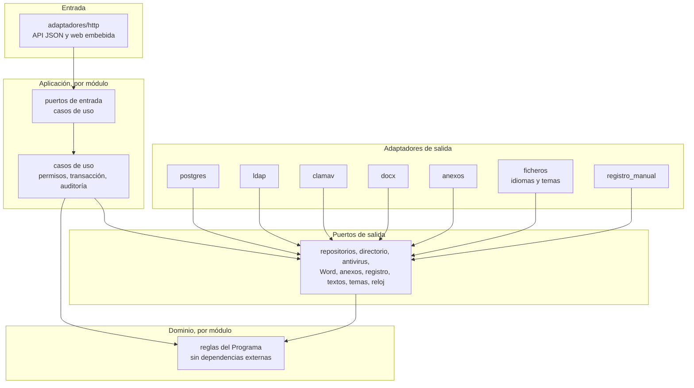

# Guía de la documentación

Esta carpeta reúne todo lo que explica el proyecto. Los seis documentos de `producto/` mandan; el resto explica instalación, uso y comprobaciones locales. Para una primera idea del proyecto, empieza por el [README de la raíz](../README.md).

El [curso de la aplicación](../curso/LEEME.md) incluye fuentes editables y `make curso`: proyecto eXeLearning 4.0.5, web offline y SCORM 1.2.

El [lector de voz](sistemas/VOZ.md) añade grabaciones estáticas al curso y a la ayuda, y un menú Ayuda con manuales por perfil. La construcción y las pruebas sin síntesis están en [scripts/voz](../scripts/voz/LEEME.md).

## Qué hay en cada carpeta

| Ruta | Contenido |
| --- | --- |
| [desarrollo/](desarrollo/LEEME.md) | Manual de programadores: arquitectura, módulos, PostgreSQL y RLS, API, React, idiomas, temas, Word, lectores, Memoria, SPAF, auditoría y pruebas; recetas, capturas nuevas y PDF |
| [sistemas/](sistemas/LEEME.md) | Manual completo para Informática: arquitectura, instalación, configuración, copias cifradas, restauración, auditoría, conservación y diagnóstico. [PDF](sistemas/sistemas.pdf), [comprobación del manual](sistemas/MANSIS.md) y ensayos de copias, restauración y Windows |
| [Pruebas en Windows](../despliegue/windows/LEEME.md) | Paquete con WSL2 y Podman, que instalar.cmd instala si faltan, imágenes y usuarios inventados; instalación y mantenimiento con doble clic; accesos en escritorio e Inicio y ventana propia en Edge o Chrome. Pruebas y límites en [la comprobación en Windows](sistemas/WIN1.md) |
| [accesibilidad/](accesibilidad/README.md) | Auditoría de accesibilidad por pantalla y perfil, matriz axe, correcciones de foco y pendientes manuales |
| [Profesionales de ETF](manuales/profesionales.md) y [Coordinación](manuales/coordinacion.md) | Manuales por orden de trabajo; ficha completa, documentos, cierre, traslado, seguimiento, municipio en SPAF, Memoria con desglose por expedientes y alta desde actas. Capturas reales con datos inventados, PDF y [ayuda común](manuales/comun.md) sobre acceso, Windows, glosario y fallos. |
| [Administración funcional](manuales/administracion.md) | Manual completo de accesos y configuración, plantillas, idiomas y temas, conservación entre dos personas, auditoría y límites de Memoria; [PDF](manuales/administracion.pdf) |
| [Formación](formacion/LEEME.md) | Sesión de 150 minutos por perfiles, ejercicios con soluciones, preparación y reinicio de la demo, manuales y títulos de vídeos |
| [producto/](producto/) | Los seis documentos de producto. Son la única fuente de verdad y se actualizan en el mismo cambio que modifique lo que describen |
| [recorridos/](recorridos/LEEME.md) | Once recorridos de demostración: acceso, derivaciones, actividad, plantillas Word, ficha, Tabla SPAF, cierre, traslado, Memoria, carga y ciclo completo; grabación, voz y revisión de fotogramas |
| [Lectura de ODT y PDF firmados](recorridos/RESP4.md) | Muestras sanitizadas de Anexos 3 y 4, valores leídos, campos para revisión manual y capturas 1440/390 |
| [Pruebas de entrada y permisos](recorridos/F0.11.md) | Entrada y alta con Chrome; matriz de todos los métodos del registro de módulos por perfil y pruebas de seguridad por filas en PostgreSQL |
| [Vista de Consulta](capturas/memoria-consulta.md) | Capturas de escritorio, móvil y alto contraste; recorrido numérico y perfiles mixtos |
| [Navegación de la Memoria y vista de Consulta](evidencias/F4.07.md) | API de navegación, composición por números y vista de Consulta con cifras y Word; cálculo al momento, fotos cerradas y credencial técnica |
| [Exportación de la auditoría](evidencias/AUD1.md) | Exportación de auditoría por Administración: filtros, CSV/JSON, cadena, comprobador local, límites y permisos |
| [Equipos, municipios y centros](evidencias/UBI1.md) | Editor de ubicaciones con vigencia, textos inmutables, permisos y auditoría; ensayos PostgreSQL y capturas Chrome |
| [Respuestas del Programa](evidencias/RESP1.md) | Respuestas del Programa del 14/10/2026, migraciones, pruebas y revisión independiente |
| [Ensayos de migraciones recuperados](evidencias/FX6.md) | Recuperación de los ensayos completos de Catálogo y Expediente inicial, repeticiones y entrada en CI |
| [Arranque de PostgreSQL en los ensayos](evidencias/FX5.md) | Fallo intermitente de migraciones, arranque provisional de PostgreSQL, diagnósticos comunes y repeticiones locales y en CI |
| [Traslado y seguimiento](capturas/traslado.md) | Traslado entre equipos y seguimiento tras cese: pantallas, capturas, permisos, conflicto y recuperación de resultados |
| [Ficha integrada](recorridos/F2.07.md) | Nueve pestañas, conflicto sin perder lo escrito, aislamiento HTTP/RLS, lectura histórica y matriz de campos para la Memoria |
| [Memoria integrada](recorridos/F4.09.md) | Memoria de equipo y provincial: cifras manuales, Word, cierres, corrección, discrepancia, aislamiento y reapertura |
| [Salidas, cierre y SPAF](recorridos/F3.06-F3.07.md) | Salidas, cierre, reapertura, traslado y seguimiento; seis tablas SPAF con cifras manuales y fallos de producto reproducibles |
| [Rendimiento con 3.000 expedientes](evidencias/F4.04.md) | Medición local de Memoria, SPAF y bandejas con 3.000 expedientes; pruebas negativas de Consulta y contratos todavía pendientes |

## Qué leer según lo que vayas a hacer

| Si vas a… | Lee |
| --- | --- |
| Entender de qué va el proyecto | [PRD.md](producto/PRD.md) |
| Decidir qué construir ahora | [PLAN_IMPLEMENTACION.md](producto/PLAN_IMPLEMENTACION.md) |
| Programar el servidor | [TRD.md](producto/TRD.md) y [ESQUEMA_BACKEND.md](producto/ESQUEMA_BACKEND.md) |
| Programar una pantalla | [FLUJO_APP.md](producto/FLUJO_APP.md) y [DISENO_UI_UX.md](producto/DISENO_UI_UX.md) |
| Tocar SQL, permisos o migraciones | [ESQUEMA_BACKEND.md](producto/ESQUEMA_BACKEND.md) y el apartado de seguridad del [TRD.md](producto/TRD.md#10-seguridad) |
| Desplegar o preparar el servidor | El apartado de [despliegue del TRD.md](producto/TRD.md#12-despliegue) |
| Entender un documento Word que se genera | Los originales de `idiomas/` y el apartado de plantillas del [TRD.md](producto/TRD.md#8c-plantillas-word), con la [revisión por plantilla y sus comparaciones](../internal/adaptadores/docx/REVISION_PLANTILLAS.md) |
| Saber qué pregunta está pendiente del Programa | dudas.md (véase el PRD) |
| Conocer la puerta de integración continua | [scripts/ci/README.md](../scripts/ci/README.md) |

Los agentes de desarrollo leen siempre el PRD y el plan, y además los documentos que afecten a su tarea (ver los documentos de producto).

## Arquitectura con más detalle

El servidor es un monolito modular con arquitectura hexagonal estricta. Las capas se pueden importar sólo en un sentido, y una prueba automática (`internal/arquitectura_test.go`) falla si alguien rompe la regla. La tabla completa de qué capa puede importar a cuál está en el apartado 2.1 del [TRD.md](producto/TRD.md#21-estilo-y-reglas-de-dependencia).

El registro de módulos reúne handlers y permisos en las rutas de cada módulo y compone las pantallas web por capacidad. El arranque valida el registro; el menú contrasta la lista web con las pantallas permitidas en la sesión. Para añadir un módulo, sigue [TRD §2.3](producto/TRD.md#23-módulos).

Los diez módulos reparten el trabajo así:

| Módulo | Responsabilidad |
| --- | --- |
| `plataforma` | Soporte técnico: migraciones y contexto de seguridad. No es dominio de negocio |
| `identidad` | Usuarios, perfiles, equipo y sesiones |
| `catalogo` | Equipos, centros, municipios, listas, reglas con vigencia, salario mínimo, firmantes y destinatarios |
| `paquete` | Idiomas, temas y referencias a sus versiones activas |
| `expediente` | Derivación, ficha, hitos, salidas, cierre, seguimiento, avisos y carga inicial. Familia y adultos, menores e intervención con vigencias y contratos de lectura para evaluación, estadística y avisos. Altas históricas de 2026 por equipo, con números originales, episodios y marca auditada para revisión, también desde hoja CSV/XLSX o actas. Avisos por expediente y recuento por equipo, con plazos versionados y editables |
| `evaluacion` | Instrumentos y escalas |
| `documento` | Plantillas, emisiones y registro de salida |
| `actividad` | Comisiones e informes técnicos: pantalla con filtros, registro, corrección y retirada; RLS, auditoría y puerto de recuentos 15/16 |
| `estadistica` | Tabla del SPAF, Memoria y totales |
| `auditoria` | Eventos encadenados, incluidas las lecturas |

Reglas entre módulos: cada uno es dueño de sus tablas y de su carpeta de migraciones, la comunicación es por llamadas dentro del mismo proceso y la misma transacción, y la Tabla y la Memoria, que leen de casi todos, usan vistas de sólo lectura que cada módulo publica como parte de su contrato. No hay colas ni bandejas de salida. Los detalles están en [TRD.md](producto/TRD.md#23-módulos) y [ESQUEMA_BACKEND.md](producto/ESQUEMA_BACKEND.md).

Otras decisiones que conviene conocer:

- **Textos y temas son datos.** Los directorios `idiomas/<código>/` y `temas/<nombre>/` se leen en tiempo de ejecución. Publicar una versión nueva la escribe sin modificar la anterior y activa su referencia con auditoría en una transacción. Ver los apartados 8 y 8b del [TRD.md](producto/TRD.md#8-textos-e-idiomas).
- **Una configuración que falla sólo desactiva su función.** Si falta el antivirus, el directorio de usuarios o una plantilla, la aplicación arranca igual y avisa en la página de salud. PostgreSQL es la única dependencia imprescindible.
- **Identidad.** El directorio valida la contraseña y devuelve un identificador estable de la cuenta. Los perfiles y el equipo se dan dentro de la aplicación. Ver [TRD.md](producto/TRD.md#4-identidad-y-sesión).

## Despliegue con más detalle

Docker Compose (`compose.yaml`) y la carpeta `despliegue/base/` ya existen y están integrados en `main`: arrancan `app`, `postgres`, `clamav`, `preparar-roles` y `migrar`, y su guía es [despliegue/base/LEEME.md](../despliegue/base/LEEME.md). Siguen siendo diseño, sin construir, los guiones de copia, la subida de versión con vuelta atrás y los entornos de preproducción y producción.

**Contenedores.** `app` (el ejecutable Go, que lleva la interfaz ya compilada y embebida), `postgres` (con volumen de datos propio) y `clamav`. El servicio puntual `preparar-roles` crea o actualiza los roles técnicos desde el entorno privado, por socket local y sin tocar datos, también en volúmenes antiguos. Después, `migrar` aplica las migraciones por el orden de sus dependencias y con un rol propio; la aplicación no recibe esas credenciales. Node sólo se usa al compilar la imagen, nunca en producción.

**Volúmenes.** `idiomas/` y `temas/` se montan desde fuera, y incluyen plantillas y paquetes publicados. Los anexos, las hojas de carga y los documentos generados no tienen almacenamiento persistente. Una copia del idioma castellano y del tema por defecto viaja dentro de la imagen para que la aplicación nunca se quede sin textos ni estilo.

**Subir una versión (diseño acordado).** Se hace fuera del horario de 8 a 15 h, con este orden:

1. Copia previa cifrada de la base de datos y de los volúmenes.
2. Descarga de la imagen nueva, etiquetada con su versión.
3. Ejecución de `migrar`; sólo si termina bien arranca la aplicación nueva.
4. Comprobación de la página de salud y de una prueba de humo.
5. Si algo falla, vuelta atrás automática a la imagen anterior y, si la migración lo exige, restauración de la copia. Para que casi nunca haga falta, las migraciones se escriben compatibles con la versión anterior.

**Entornos (diseño acordado).** Desarrollo en el puesto con Docker Compose, preproducción en un entorno de preproducción y producción en el servidor de la entidad. Los dos primeros usan siempre datos inventados; los datos reales existen sólo en producción. Se sube a producción después de probar en preproducción.

**Copias (diseño acordado).** Diarias, cifradas y fuera del servidor, con una pérdida máxima tolerada de un día. Antes de abrir producción se ensaya una restauración.

Queda por decidir con Informática quién termina el HTTPS (un proxy dentro de Compose, la propia aplicación o un proxy de la entidad). El apartado 14 del [TRD.md](producto/TRD.md#14-lo-que-falta-para-producción) recoge lo que falta para producción.

## Flujos por perfil

Cada recorrido está explicado paso a paso, con sus pantallas y sus reglas de acceso, en [FLUJO_APP.md](producto/FLUJO_APP.md). Aquí sólo va una idea de cada uno.

- **Coordinación.** Recibe la derivación, comprueba lo que la aplicación ha leído del anexo y confirma municipio, centro y equipo. Decide si acepta, no acepta o deja en espera, y descarga las actas y los oficios correspondientes. Después atiende los cierres propuestos por los equipos, genera el Acta de Cierre y puede reabrir o trasladar un expediente. Cierra la Memoria provincial y mantiene el salario mínimo interprofesional (SMI) por año. Su bandeja provincial (`/coordinacion`) tiene búsqueda enmascarada, cuatro vistas, filtros y paginación, y enlaza con la subida de anexos y la revisión de derivaciones. El SMI se mantiene en `/coordinacion/smi`, autorizado sólo para Coordinación; la escritura requiere CSRF. Ver los apartados [2.1](producto/FLUJO_APP.md#21-coordinación) y [3](producto/FLUJO_APP.md#3-recorridos-de-punta-a-punta).
- **Profesional de ETF.** Trabaja la lista de expedientes de su equipo, registra el consentimiento y sigue el plazo de 30 días, completa la ficha, deriva al SPM o a otro servicio cuando toca y propone el cierre. Cada mes saca la Tabla del SPAF y cada año la Memoria de su equipo. Ver el apartado [2.2](producto/FLUJO_APP.md#22-profesional-de-etf).
- **Consulta.** Entra a ver cifras agregadas de la Memoria y totales. No recibe nombres, composición de las cifras ni textos libres. Ver el apartado [2.3](producto/FLUJO_APP.md#23-consulta).
- **Administración funcional.** Da de alta a las personas y les asigna perfil y equipo, mantiene catálogos, plazos, plantillas, firmantes, idiomas y temas, y exporta la auditoría. No ve fichas de expedientes. Quien entra con una cuenta válida pero sin perfil queda pendiente de alta y no ve nada. Ver los apartados [1.2](producto/FLUJO_APP.md#12-pendiente-de-alta) y [2.4](producto/FLUJO_APP.md#24-administración-funcional).

## Cómo mantener esta guía

Esta guía resume y enlaza; no sustituye a los documentos de producto. Si cambia la estructura de `docs/`, la arquitectura o el despliegue, se corrige aquí en el mismo cambio, y las partes previstas se actualizan cuando exista el código.

## Estado de la construcción

A 15/10/2026 están integradas en `main` todas las fases del plan. Lo que falta no depende del código: la evaluación de impacto en protección de datos, lo que prepara Informática (proxy HTTPS, LDAPS, copias cifradas y sellado diario de la auditoría), la puesta en producción con la carga real y las dudas que el Programa aún no ha respondido. El estado completo está en el [README principal](../README.md#estado-del-proyecto) y el detalle por tarea en [PLAN_IMPLEMENTACION.md](producto/PLAN_IMPLEMENTACION.md).

Notas técnicas por área (las capturas y los recorridos están en el [README principal](../README.md#detalle-de-lo-construido)):

- **Ficha y bandeja del equipo.** El profesional sólo ve su equipo; Coordinación consulta la provincia. Los listados se enmascaran en el servidor y las lecturas se entregan tras confirmar la auditoría. Menores e Intervención se editan con vigencias y comparación ante conflictos ([recorrido, capturas y límites](capturas/FI1.md)).
- **Consentimiento.** Descarga de los Anexos 1 y 2 y registro separado de la firma y de las fechas de los Anexos 7 y 8, sin generarlos. El DNI del representante queda vacío.
- **Evaluación.** Instrumentos y respuestas por ítem con versión, idempotencia, RLS y auditoría. El catálogo rechaza escalas sin definición de ítems y no se calculan totales sin baremos del Programa.
- **Salidas.** La derivación a otro servicio (Anexo 6) se elige de catálogo o se escribe si no hay opciones, conserva su motivo y no cambia el estado del expediente ([recorrido y revisiones](evidencias/AN6.md)). La respuesta fechada del SPM y la excepción motivada se registran desde las pantallas de Coordinación; el recorrido local es `node scripts/recorridos/salidas.mjs http://127.0.0.1:18242` tras `make demo`.
- **Cierre, traslado y seguimiento.** El cierre lo confirma otra persona de Coordinación, el Acta se descarga aparte y la reapertura crea un episodio nuevo sin borrar el anterior. El traslado cierra en origen y crea una derivación enlazada para aceptar en destino con número nuevo. El seguimiento tiene historia, avisos y vencimiento automático. La migración `catalogo/0013` rechaza la instalación si las últimas versiones de plazos o listas empiezan hoy o después: debe aplicarse cuando esas versiones lleven un día de vigencia. La instalación desde cero cumple esta condición.
- **Tabla SPAF.** Pantalla en `/equipo/tabla-spaf` con equipo y mes vencido, 14 columnas, resumen y enlaces a los expedientes que cuentan en altas y bajas; las ausencias se muestran como «Sin dato». La descarga Word usa plantilla oficial por idioma, versiones e idempotencia ([recorrido y capturas](capturas/spaf.md); contrato en [ESQUEMA_BACKEND.md](producto/ESQUEMA_BACKEND.md#17-actividad-estadistica-y-auditoria)).
- **Memoria.** Pantalla en `/memoria` con 28 apartados en cuatro bloques, textos A, D, E, F y G con versión e historia, Word de la administración competente, cierre, reapertura con motivo y discrepancias. Las revisiones conservan cifras, fuentes, composición, reglas, textos y huella; el Word cerrado usa la foto. Consulta recibe sólo cifras, al momento o de la foto cerrada. El desglose por expedientes muestra número, equipo y aporte, sin nombres ([pruebas y límites del desglose](evidencias/MEMDES.md)). Ensayo en `migraciones/estadistica/ensayar.py`.
- **Carga histórica.** Hojas CSV/XLSX de 2026 con antivirus obligatorio y un informe que identifica filas y columnas sin mostrar datos personales; formato y API en [ESQUEMA_BACKEND §7.2](producto/ESQUEMA_BACKEND.md#72-compatibilidad-de-carga-por-hoja-formato-v1-f208b) ([recorrido y capturas](capturas/carga.md)). También carga desde Actas de Aceptación y de Cierre en PDF, DOCX u ODT, con lectura local y datos para confirmar; el Programa confirmó el 14/10/2026 que no tiene hoja ([importación de actas](evidencias/RESP2.md), [actas en ODT](evidencias/RESP5.md)).
- **Plantillas Word.** Administración ve la versión activa y el historial por documento e idioma, sube versiones sin activarlas y las activa con autor y fecha; el servidor detalla los marcadores que faltan o sobran.
- **Conservación.** Revisión de dos personas en `/admin/conservacion`. La retirada incluye los textos de Evaluación y los campos libres del registro de salida, sin tocar cifras históricas ni auditoría. El alcance depende del delegado de protección de datos. Ensayo: `python3 -B migraciones/expediente/ensayar_conservacion.py`.
- **Vídeos y formación.** Los vídeos [de la Memoria](recorridos/guiones/09-memoria.md) y [de la carga de 2026](recorridos/guiones/10-carga-2026.md) muestran pantallas reales con datos inventados ([resultados y límites](recorridos/EVIDENCIA-09-10.md)). [Del Anexo a la Memoria](recorridos/guiones/11-ciclo-completo.md) sigue un caso continuo y acompaña al [material de formación](formacion/LEEME.md); el MP4 se conserva fuera de Git y [la revisión](recorridos/EVIDENCIA-11.md) recoge capítulos, tiempos y fotogramas. El [lanzador del aula](formacion/preparar-aula.md) sincroniza el calendario de equipos y Coordinación.
