# Capturas de la aplicación

Pantallas reales de la demostración, con personas y datos inventados. Casi todas están en dos tamaños: escritorio (1440 px) y móvil (390 px); algunas también con alto contraste. Los vídeos con voz están en [videos/](../../videos/README.md).

## Una vuelta rápida

| | |
| --- | --- |
| 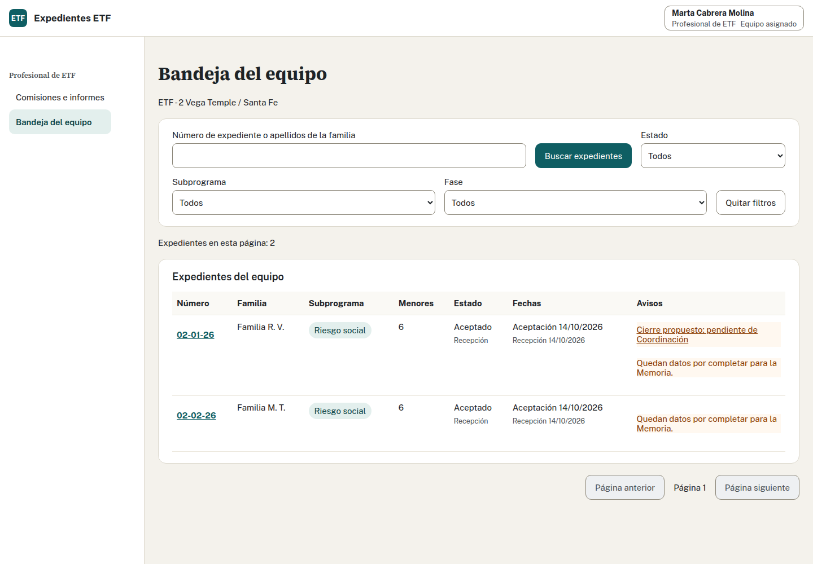 Bandeja del equipo | 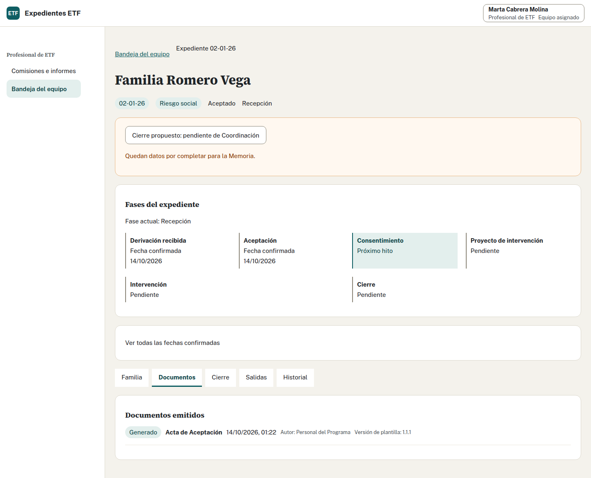 Ficha del expediente |
| 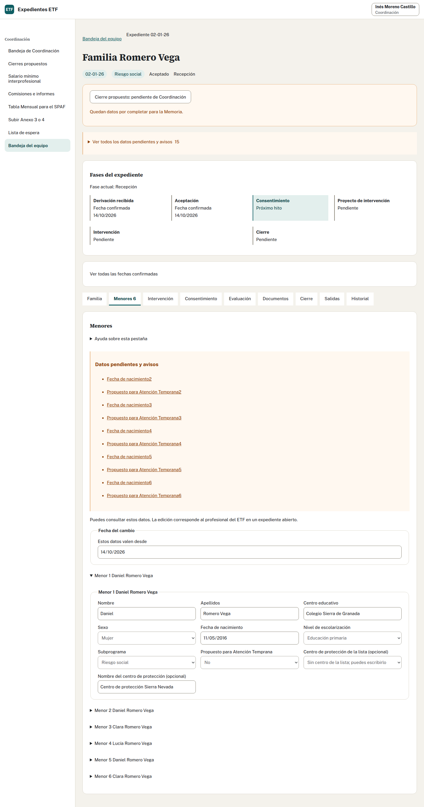 Menores | 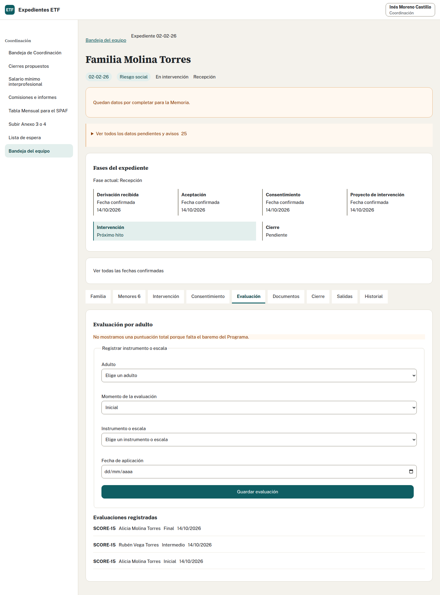 Evaluación |
| 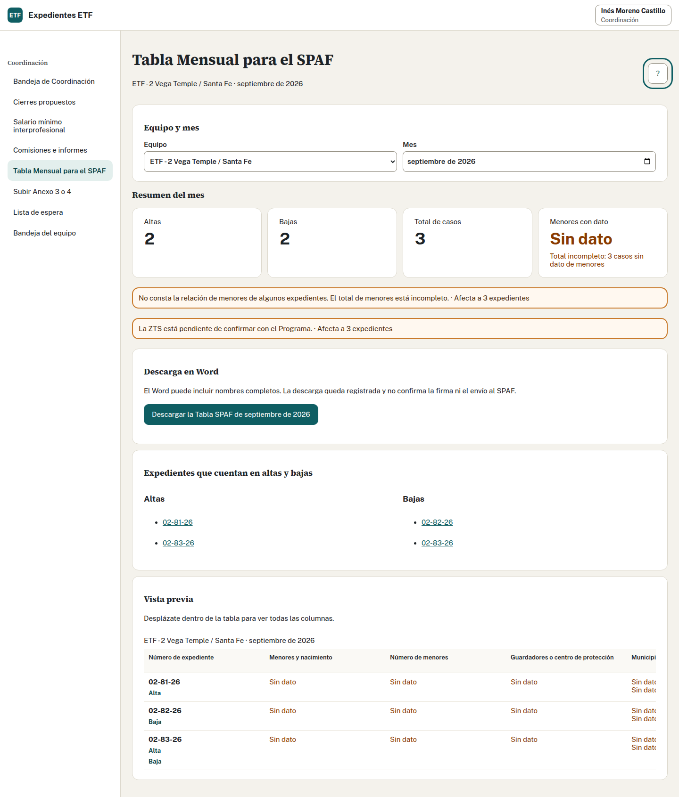 Tabla mensual SPAF | 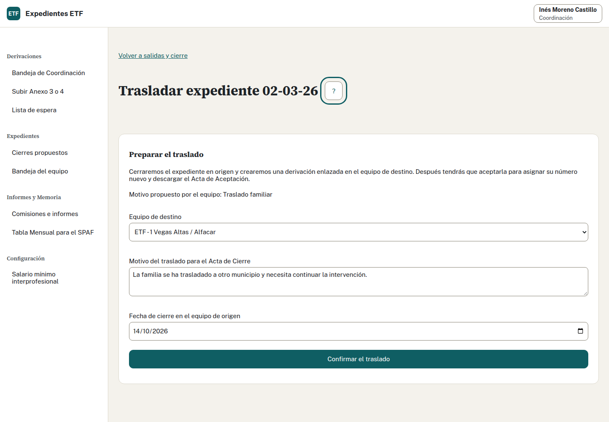 Traslado entre equipos |
| 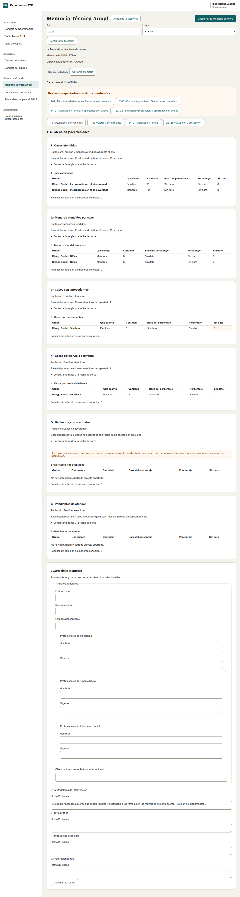 Memoria Técnica Anual | 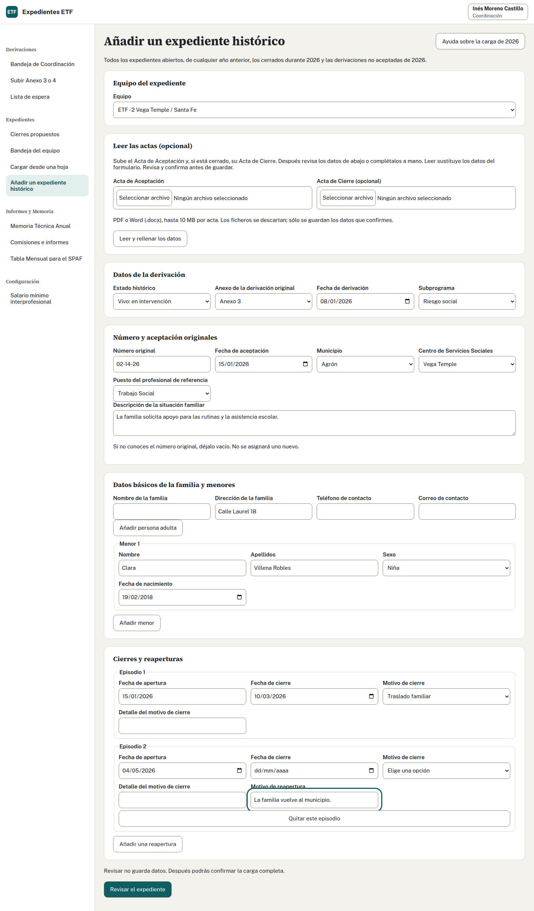 Carga de expedientes de 2026 |
| 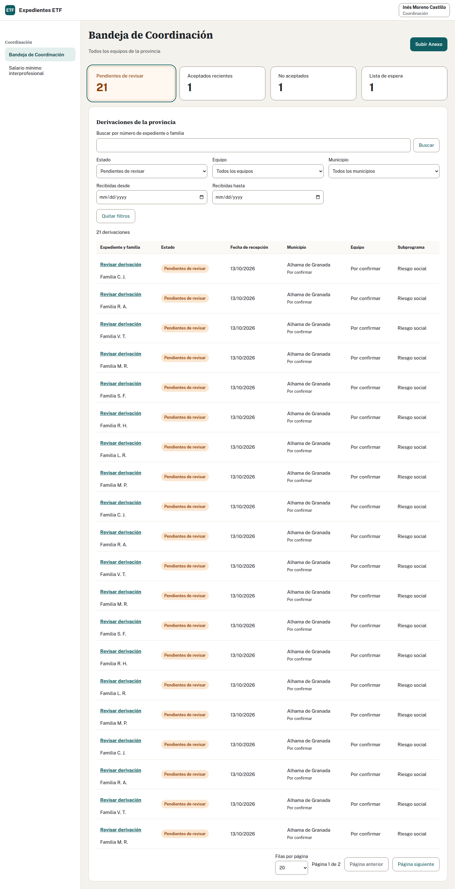 Bandeja de Coordinación | 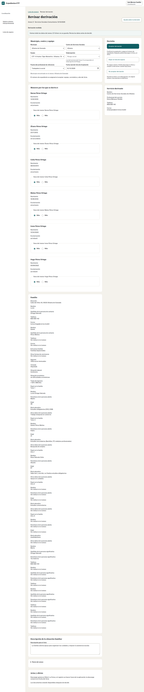 Decisión sobre una derivación |
| 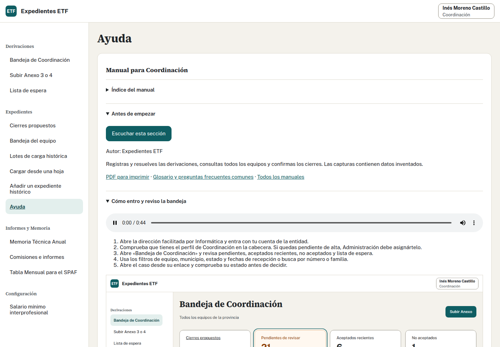 Ayuda con lector de voz | 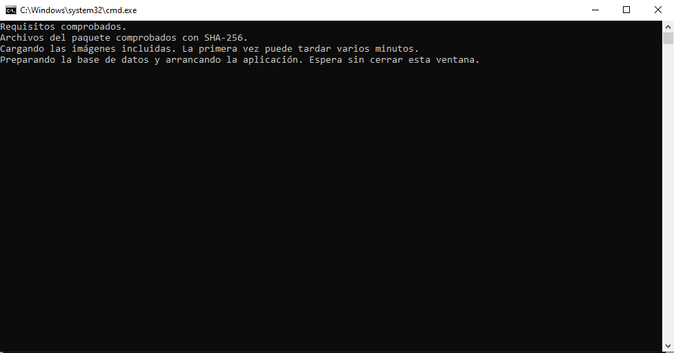 Instalación en Windows |

## Por tema

Cada página explica qué se comprobó y enlaza sus capturas.

| Tema | Página |
| --- | --- |
| Entrada, usuarios, catálogos y estructura general de las pantallas | [estructura general](UI1.md), [retoques de presentación](UI2.md) y [retoques de la demostración](UI3.md) |
| Bandeja del equipo y ficha | [validación de la bandeja](EVIDENCIA_F2.06.md) |
| Menores e intervención | [menores e intervención](FI1.md) |
| Consentimiento y evaluación | [consentimiento y evaluación](FI2.md) |
| Familia y documentos de finalización | [familia y finalización](GAP1.md) |
| Comisiones e informes técnicos | [comisiones e informes](actividad.md) |
| Salidas y cierre en Coordinación | [salidas y cierre](salidas.md) |
| Tabla mensual SPAF | [tabla SPAF](spaf.md) |
| Traslado y seguimiento tras el cese | [traslado](traslado.md) |
| Memoria Técnica Anual | [Memoria](memoria.md) y [vista de consulta](memoria-consulta.md) |
| Carga de expedientes de 2026 | [carga](carga.md) |
| Plantillas Word | [plantillas](plantillas.md) |
| Lector de voz | [lector de voz](VOZ.md) |

Las capturas `accesibilidad-*` recorren todas las pantallas por perfil y tamaño; las `windows-*` muestran la instalación y el uso en Windows.
