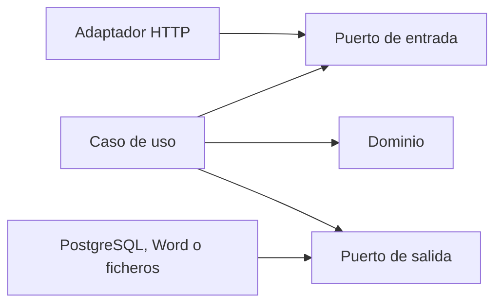

# 1. Arquitectura y módulos

Expedientes ETF es un monolito modular: el servidor reúne las capacidades en un proceso Go, con PostgreSQL como almacenamiento. Las capas separan las reglas de los sistemas que las ejecutan. Un cambio de lector, directorio de usuarios o motor Word se realiza en el adaptador que implementa su puerto.

## Capas y dependencias

| Carpeta | Responsabilidad | Dependencias permitidas |
| --- | --- | --- |
| `internal/dominio/<modulo>/` | Entidades, valores, estados, cálculos y errores | Biblioteca estándar sin acceso a sistemas externos; fechas y datos recibidos como valores |
| `internal/aplicacion/<modulo>/puertos/entrada/` | Contratos que consume HTTP | Dominio |
| `internal/aplicacion/<modulo>/` | Casos de uso, autorización, transacción y auditoría | Dominio y puertos |
| `internal/puertos/salida/<modulo>/` | Interfaces hacia repositorios, lectores y otros sistemas | Dominio |
| `internal/adaptadores/http/` | Peticiones, límites de entrada y respuestas | Puertos de entrada; sin importar la implementación del caso de uso |
| `internal/adaptadores/postgres/`, `ficheros/`, `docx/`, `ldap/`, `clamav/`, `anexos/` | Implementaciones de los puertos externos | Dominio y puertos de salida, con las excepciones técnicas acotadas por la prueba de arquitectura |
| `cmd/etf/` | Crear dependencias e inyectarlas | Todas las capas necesarias para componer |
| `cmd/migrar/` | Ejecutar el plan de migraciones y terminar | Infraestructura de migraciones; separado del servidor |

Las flechas indican dependencias del código. El caso de uso recibe implementaciones de sus puertos al arrancar. El dominio recibe la fecha como dato; el reloj de ejecución es un puerto de salida. Evita leer la hora, el entorno o un fichero desde una regla de dominio.

La prueba [TestArquitectura](../../internal/arquitectura_test.go) inspecciona las importaciones de producción, incluidas variantes de plataforma. Consulta sus reglas antes de añadir una dependencia. Los dobles en memoria permiten probar casos de uso; una prueba con ellos no acredita persistencia ni RLS.

## Fronteras de los módulos

| Módulo | Datos y capacidades que posee |
| --- | --- |
| `plataforma` | Contexto técnico, transacciones y control de migraciones |
| `identidad` | Usuarios, perfiles, adscripción a equipo y sesiones |
| `catalogo` | Códigos, vigencias, equipos, municipios, centros, SMI, firmantes y destinatarios |
| `paquete` | Versiones y referencias activas de idiomas y temas; referencias a textos de catálogo |
| `expediente` | Derivación, aceptación, ficha, vigencias, hitos, salidas, cierre, traslado, seguimiento, carga y conservación |
| `evaluacion` | Instrumentos, momentos, sujetos y respuestas |
| `documento` | Plantillas, activaciones, emisiones y registro de salida |
| `actividad` | Comisiones e informes técnicos |
| `estadistica` | Tabla SPAF, Memoria, narrativas, revisiones y cifras |
| `auditoria` | Registro, cadena, historial y exportación de eventos |

El directorio de migraciones incluye también `carga`, utilizado por la capacidad de importación de hojas. Esa carpeta técnica no añade un módulo al mapa de producto. Respeta su manifiesto y dependencias cuando trabajes en importación.

Cada módulo es dueño de sus tablas. Si otro necesita datos, consume su puerto o una proyección de lectura publicada por el propietario. El adaptador de estadística lee contratos históricos publicados por Expediente y Actividad; no sustituye esos contratos por consultas libres a las tablas internas. Las dependencias SQL se declaran por migración.

La comunicación entre capacidades ocurre dentro del mismo proceso. No hay colas ni bandejas de salida. El caso de uso que dirige la operación delimita una transacción común; las llamadas de colaboración pasan el mismo contexto.

## Composición al arrancar

[cmd/etf/modulos.go](../../cmd/etf/modulos.go) reúne la base ordinaria, la base técnica de cálculo, el antivirus, los paquetes de disco, la configuración y el registro técnico. Cada fichero de capacidad construye sus servicios y devuelve un módulo HTTP. `componerModulos` fija su orden explícitamente.

Los módulos HTTP aportan `Rutas() []Ruta`. [componerMux](../../internal/adaptadores/http/modulos.go) añade plataforma, valida el registro y conecta las rutas de las pantallas con la página de la aplicación. No registres capacidades mediante `init()`: la lista de composición debe permitir ver qué entra en el servidor.

En la web, [pantallas.ts](../../web/src/pantallas.ts) compone las listas de cada capacidad. Sus rutas y perfiles se contrastan con las pantallas publicadas por el servidor. Añadir un componente sin registrar su pantalla deja la capacidad fuera de la navegación autorizada.

## Transacción compartida

El puerto [Transacciones](../../internal/puertos/salida/plataforma/transacciones.go) recibe una identidad validada y una operación. [Base.Ejecutar](../../internal/adaptadores/postgres/base.go) abre la transacción, fija el contexto RLS y pasa un contexto con el ejecutor a los repositorios y a auditoría. Confirma sólo cuando la operación termina sin error.

Las transacciones anidadas se rechazan. Un colaborador llamado dentro de una operación debe usar su variante de trabajo en la transacción existente. No abras otra conexión para registrar la auditoría de un cambio que aún puede revertirse. Tampoco devuelvas datos o empieces una descarga antes de confirmar.

Fuentes: [TRD, arquitectura](../producto/TRD.md#21-estilo-y-reglas-de-dependencia), [mapa de datos](../producto/ESQUEMA_BACKEND.md#1-mapa-de-datos-por-módulo) y [prueba de arquitectura](../../internal/arquitectura_test.go).
