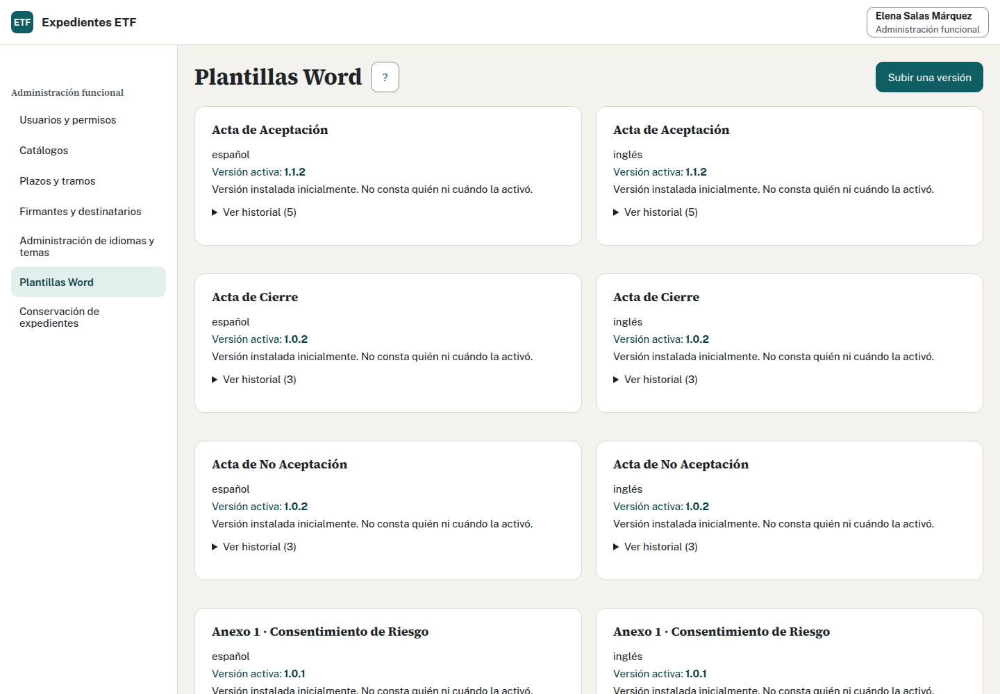
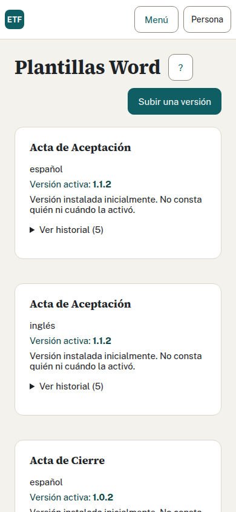

# 4. Interfaz React

La interfaz usa React, TypeScript y Vite, con controles accesibles de React Aria. Las capacidades se organizan por carpeta y publican su pantalla en un registro común. Los textos se leen de la API de idiomas y el aspecto procede de los tokens del tema.

## Archivos que conectan la aplicación

| Archivo o carpeta | Función |
| --- | --- |
| [main.tsx](../../web/src/main.tsx) | Montaje, carga de idiomas y temas, proveedor de localización y estado general |
| [sesion.tsx](../../web/src/sesion.tsx) | Entrada, sesión, pendiente de alta y elección de ruta autorizada |
| [pantallas.ts](../../web/src/pantallas.ts) | Lista explícita de pantallas de las capacidades |
| [registro-pantallas.ts](../../web/src/registro-pantallas.ts) | Contrato, validación, coincidencia de rutas y permisos de navegación |
| [armazon.tsx](../../web/src/armazon.tsx) | Cabecera, menú, persona conectada y preferencias |
| [cambios.tsx](../../web/src/cambios.tsx) | Protección de formularios con cambios sin guardar |
| [plantillas/](../../web/src/plantillas/) | Pantalla, API, pruebas y estructura visual de Plantillas Word |
| [equipo/](../../web/src/equipo/) | Bandeja y ficha integrada del equipo |

Una `Pantalla` declara `ruta`, `perfiles`, `clave` y `componente`. Puede declarar `menuDe` para una ruta subordinada y `conservarAlNavegar` para conservar el formulario. `PropsPantalla` entrega traducción, idioma, CSRF y funciones de actualización y navegación. Reutiliza ese contrato antes de crear un estado global paralelo.

El menú exige coincidencia entre el registro web y las pantallas autorizadas por la sesión del servidor. Ocultar un enlace mejora el recorrido, pero las peticiones siguen necesitando autorización HTTP, aplicación y RLS.

## Datos y formularios

Cada capacidad mantiene su cliente API y tipos cerca de la pantalla. [plantillas/api.ts](../../web/src/plantillas/api.ts) muestra cómo enviar credenciales del mismo origen, interpretar la clave de error y mandar CSRF. Evita convertir un fallo HTTP en una lista vacía: carga, vacío y error deben tener estados distintos.

En un formulario, separa el borrador de los datos confirmados. Muestra un recibo al guardar y recupera la versión. Si llega un conflicto, conserva lo escrito y ofrece comparar. La protección de cambios sin guardar debe cubrir navegación, pestañas y salida de sesión cuando afecten al formulario.

Las fechas de firma, registro o cierre se confirman por sus acciones propias. Un botón de descarga no debe rellenar esas fechas. Para guardar o generar, conserva la clave de idempotencia mientras la respuesta sea incierta.

Usa controles con etiqueta, ayuda y error asociado. Devuelve el foco al resultado o al campo que requiere corrección. Comprueba el recorrido con teclado y a 390 píxeles: la persona debe poder leer un error, alcanzar la acción principal y comparar sin desplazamiento horizontal de toda la página.

## Traducción y tema

`t(clave)` busca el texto cargado. Las etiquetas, botones, títulos, `aria-label`, ayudas y mensajes deben usar claves presentes en los dos idiomas mantenidos. No escribas texto visible en JSX ni en errores JavaScript. Los nombres y narrativas introducidos por una persona son datos del expediente, sujetos a sus permisos.

`main.tsx` obtiene idiomas y textos desde `/api/idiomas` y cambia `document.documentElement.lang` y el título con esos datos. El proveedor de React Aria recibe la localización. Usa `Intl` para fechas y números según el idioma seleccionado.

Los estilos de estructura pueden distribuir columnas y controles, pero los valores de tema se expresan con variables semánticas. Colores, fuentes, espaciado, radios y alturas salen de `temas/<nombre>/`. La hoja del tema se sirve desde `/api/temas/{nombre}/tokens`. No copies valores de color del diseño a un CSS de componente.

## Una misma capacidad en dos tamaños

Las capturas muestran la pantalla de Plantillas Word de una demo local. El listado y el historial proceden de los mismos contratos en ambos tamaños. El cambio de disposición mantiene los controles de publicación separados de la activación.

## Comprobaciones de interfaz

Al cambiar una capacidad, ejecuta sus pruebas y la compilación TypeScript. Añade una prueba de comportamiento cuando haya nueva lógica de guardado, conflicto o navegación. El recorrido real debe usar Chrome del sistema contra la demo, con datos inventados. Para accesibilidad, consulta el [alcance F5.03](../accesibilidad/README.md); las comprobaciones automáticas no sustituyen el uso con teclado y lector de pantalla.

Fuentes: [TRD, textos](../producto/TRD.md#8-textos-e-idiomas), [diseño de interfaz](../producto/DISENO_UI_UX.md), [registro web](../../web/src/registro-pantallas.ts) y [estructura de pruebas](../../web/package.json).
