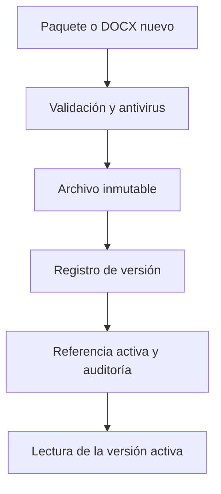

# 5. Idiomas, catálogos, temas y Word

Los textos y el aspecto son paquetes de datos. PostgreSQL conserva códigos, metadatos y referencias activas; los archivos contienen los textos, los recursos y las plantillas. Publicar una versión y activarla son operaciones distintas cuando el contrato de la capacidad las separa.

## Directorio de un idioma

```text
idiomas/<codigo>/
  idioma.json
  textos/
  catalogos/
  plantillas/
```

`idioma.json` declara código, nombre y versión. En [el castellano de distribución](../../idiomas/es/idioma.json), la versión del paquete es `0.1.0`. Ese número no es la versión de cada plantilla Word.

`textos/` contiene JSON de pantalla, ayudas, errores y avisos, separados por capacidad. El código sólo conoce claves. Toda clave nueva necesita sus textos en los idiomas mantenidos y debe superar `make textos`. Las claves deben ser únicas dentro de un idioma.

`catalogos/` contiene etiquetas de opciones. La base guarda el código de municipio, motivo, equipo o lista y la referencia a sus versiones; no guarda traducciones. La aplicación resuelve la etiqueta del código en el idioma seleccionado, con respaldo del predeterminado cuando corresponde.

`plantillas/` contiene DOCX por tipo e idioma. Las emisiones conservan la versión y huella utilizadas. Los idiomas y las plantillas históricas referenciadas entran en las copias y deben sobrevivir a una actualización.

Los textos libres de la ficha y las narrativas de Memoria sí son datos de negocio en PostgreSQL. La prohibición de textos en el código no desplaza esos datos al paquete de idioma.

## Publicación inmutable



La escritura crea una ruta nueva, sin sobrescribir un archivo activo. Después se registra su metadato y, al activar, se compara la versión previa de la referencia. La activación y su auditoría se confirman juntas. Si falla, sigue activa la versión anterior. Un archivo huérfano no se sirve y se limpia según el resultado confirmado de la operación.

El acceso a una versión publicada no debe depender de que el paquete actual de idioma mantenga el mismo archivo. Una emisión antigua necesita sus bytes y contratos originales para reproducirse.

## Catálogos con vigencia

Los catálogos mantienen borradores y versiones publicadas con vigencia. Las reglas de cálculo se reciben como datos: plazos, tramos, equivalencias, SMI y motivos no se convierten en constantes Go. Las etiquetas se publican en los directorios de idioma mediante las capacidades de paquetes.

Una opción nueva exige dos piezas: código y regla en Catálogo; etiqueta en cada idioma. Para una lista con relación estadística, define también su equivalencia y tratamiento de desconocidos. No cambies el significado de un código histórico para reutilizarlo.

El cálculo de un año elige las reglas vigentes al corte que establece el contrato. Un catálogo publicado hoy no debe alterar una revisión cerrada de Memoria. Consulta [las versiones de catálogo](../../internal/dominio/catalogo/) y [sus ensayos PostgreSQL](../../migraciones/catalogo/ensayar.py).

## Temas

Cada tema vive en `temas/<nombre>/`, con `tema.json`, tokens semánticos y los recursos admitidos. El adaptador genera variables CSS después de validar tipos, rangos y contraste. El paquete no trae CSS libre, JavaScript ni SVG. Los recursos admitidos son PNG y fuentes WOFF2, con límites y controles de archivo.

Administración instala una versión, activa su referencia y puede retirarla mediante las capacidades existentes. La aplicación conserva un tema de reserva. Al añadir un token, revisa todos los temas mantenidos, su validador y el uso en la web; `make temas` comprueba coherencia y contraste.

La capacidad de instalación en escritorio utiliza manifiesto e iconos derivados de textos y tokens. [scripts/pwa1/iconos.mjs](../../scripts/pwa1/iconos.mjs) regenera los iconos. El service worker no conserva respuestas de expedientes y ofrece un aviso traducido cuando falla la conexión.

## Plantillas y marcadores

El motor [internal/adaptadores/docx](../../internal/adaptadores/docx/) valida y rellena DOCX. Comprueba el ZIP y XML, rechaza macros y contenido activo y limita recursos externos conforme a su lista cerrada. Los valores se escapan al escribir XML. Los marcadores divididos por Word entre fragmentos de texto también forman parte de la validación.

Para una versión nueva del mismo tipo, conserva el contrato esperado de campos y bloques. La publicación informa de marcadores que faltan o sobran. Un tipo nuevo necesita contrato, generador, permisos y pruebas además del archivo; subir un DOCX no crea una capacidad documental.

La ruta de publicación actual es:

```text
idiomas/<codigo>/plantillas/<tipo>/.versiones/<UUID>/v<version>.docx
```

`POST /api/admin/plantillas/versiones` recibe el DOCX como cuerpo, con su Content-Type y parámetros `tipo`, `idioma`, `version` y `version_previa`. ClamAV debe confirmar que está limpio. Se guarda sin activar. `POST /api/admin/plantillas/{id}/activar` recibe `idioma` y `version_previa`, valida la versión elegida y cambia la referencia tras la confirmación de la persona.

El historial conserva autor, fecha y activaciones, incluidas restauraciones de una versión previa. La restauración cambia la referencia; no reescribe el archivo anterior. La migración inicial o una actualización de distribución debe preservar las publicaciones y decisiones administrativas existentes.

La emisión conserva metadatos y huella, pero no guarda el Word generado. Una recuperación idempotente regenera con datos y plantillas fijados y comprueba que los bytes coinciden; si no puede reproducirlos, devuelve el recibo y el conflicto correspondiente. Generar de nuevo con otros datos crea otra emisión.

Fuentes: [TRD, plantillas](../producto/TRD.md#8c-plantillas-word), [publicación de archivos](../../internal/adaptadores/ficheros/documento/publicacion.go), [gestión PostgreSQL](../../internal/adaptadores/postgres/documento/gestion_plantillas.go) y [revisión por plantilla](../../internal/adaptadores/docx/REVISION_PLANTILLAS.md).
