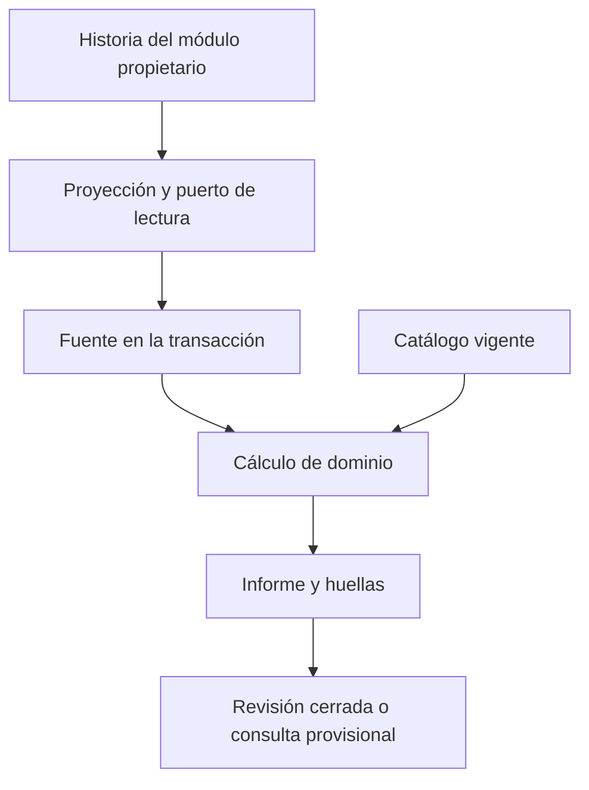
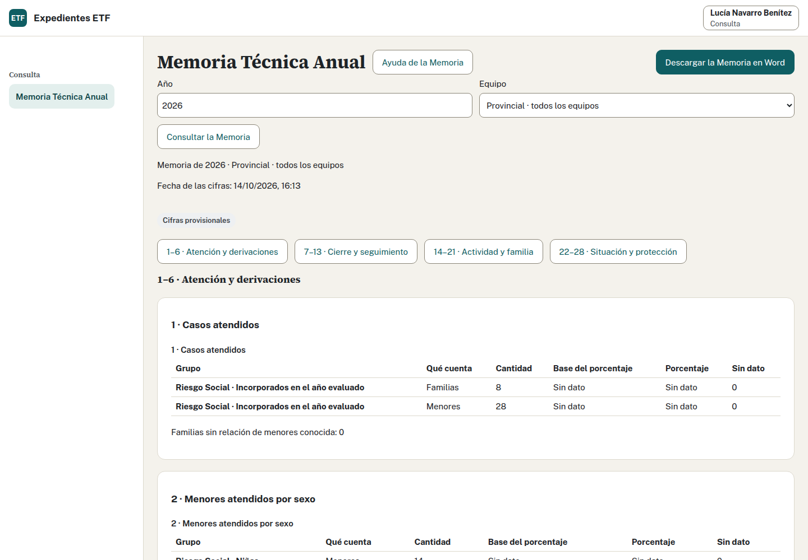
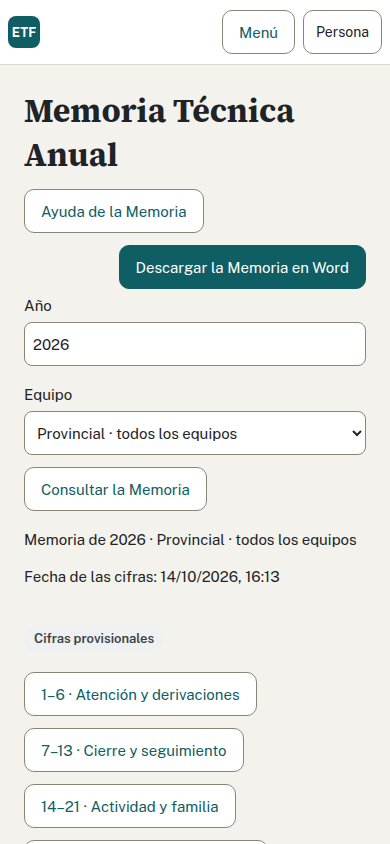

# 7. Memoria, SPAF y auditoría

Memoria y SPAF calculan a partir de datos confirmados y sus vigencias. Cada cálculo tiene un contrato de población, fecha, unidad y tratamiento de desconocidos. Añadir un campo a la ficha no lo incorpora por sí solo a una cifra: debe atravesar la proyección histórica y la entrada del cálculo.

## De la ficha al cálculo

[FuenteMemoria](../../internal/aplicacion/estadistica/memoria.go) reúne lectores de Expediente, reglas, Actividad, narrativas históricas y equipos. Usa la identidad autorizada y el contexto de una transacción compartida. El dominio [internal/dominio/estadistica](../../internal/dominio/estadistica/) recibe esos datos como valores y no consulta PostgreSQL.

El [contrato por apartado](../producto/ESQUEMA_BACKEND.md#110-contrato-estadístico-por-apartado) fija población, denominador, desconocidos, fecha de datos y regla. [contrato.go](../../internal/dominio/estadistica/contrato.go) conserva las claves de apartados y unidades. Comprueba el contrato antes de tocar una fórmula; un total aparentemente correcto puede mezclar poblaciones o cortes distintos.

Los recuentos y porcentajes conservan por separado si el denominador es conocido. `CalcularPorcentaje` devuelve `estadistica.denominador_pendiente` cuando falta la base y `estadistica.divisor_cero` cuando es cero. Con base positiva, redondea `numerador / denominador × 10000` y devuelve centésimas de porcentaje. Rechaza negativos y desbordamiento. El motor no sustituye una base pendiente por el total visible de otra fila; conserva las pruebas de esos estados cuando añadas una base.

Para cambios retroactivos, distingue la vigencia del dato del momento en que se conoció. El lector histórico conserva episodios de cierre y reapertura y las revisiones de familia, adultos, menores e intervención. El traslado tiene origen y destino independientes. La Memoria cerrada debe poder reproducir el corte que utilizó.

## Cálculo y cierre de Memoria

La consulta abierta calcula al momento y se presenta como provisional. El cierre fija una revisión con cifras, reglas, huellas y narrativas. Reabrir conserva las revisiones anteriores; una corrección requiere un cierre posterior para convertirse en otra foto definitiva.

El cierre de equipo corresponde a su profesional autorizado; Coordinación cierra o reabre dentro de su ámbito, incluida la provincial. El cierre provincial comprueba las revisiones de equipos exigidas por el contrato. Mantén la comprobación de discrepancias entre una foto cerrada y los datos corregidos después.

Las narrativas A, D, E y F son datos de negocio. Se guardan con versión y permisos. El Word completo combina cifras y narrativas con su plantilla; generar el Word crea una emisión y no cierra la Memoria.

## Consulta recibe sólo cifras

F4.07 tiene un tipo de salida propio para Consulta. Una Memoria cerrada devuelve su foto numérica; una abierta usa el ejecutor técnico con `etf_calculo_memoria`. La credencial se configura con `ETF_CALCULO_MEMORIA_CONTRASENA` y el adaptador valida que el rol no tenga privilegios o membresías indebidos.

El resultado de Consulta excluye nombres, UUID de expedientes, composición y textos libres. Su Word es exclusivamente numérico. No reutilices el JSON del informe completo quitando campos en React: el límite se aplica en servidor y en los permisos de PostgreSQL.

Coordinación y el equipo pueden consultar la composición autorizada de una cifra por números de expediente mediante el contrato de navegación. Eso no concede la misma capacidad a Consulta. Revisa [la evidencia F4.07](../evidencias/F4.07.md) y las pruebas negativas antes de ampliar cualquiera de estas salidas.

## Tabla Mensual SPAF

SPAF utiliza [un modelo propio](../../internal/dominio/estadistica/spaf.go) con datos personales autorizados y episodios confirmados. Sus cuatro recuentos son altas, bajas, casos y menores, con fechas al corte y reglas de catálogo. Un caso aceptado y cerrado en el mes debe probarse expresamente.

| Recuento | Cómo lo obtiene `CalcularSPAF` |
| --- | --- |
| Casos | Un expediente cuenta una vez si tiene un episodio aceptado y abierto antes o durante el mes, cuyo cierre no sea anterior al primer día del mes |
| Altas | La aceptación inicial cae dentro del mes, incluidos sus dos extremos |
| Bajas | Existe al menos un cierre de episodio dentro del mes; varios cierres del mismo expediente no multiplican su baja |
| Menores | Suma el número conocido de menores de la ficha histórica al fin del mes; los casos sin ese dato se conservan en un recuento y aviso separados |

El mes debe haber terminado antes de la fecha de cálculo. Las reglas y la ficha se seleccionan al último día del mes y según el instante de conocimiento solicitado. Por eso el total de casos no equivale sólo a los expedientes que siguen abiertos al terminar el mes.

La vista previa y el Word fijan las versiones necesarias. Descargar exige POST, CSRF e idempotencia y confirma emisión y auditoría. El traslado no borra el movimiento de origen. La plantilla actual muestra el municipio según el contrato; evita introducir datos ajenos a sus marcadores.

Para añadir una dimensión, modifica el puerto de lectura y su productor, el dato de entrada del dominio, las reglas y la salida, y sólo después la plantilla. Comprueba que los menores y la fase recuperados sean los vigentes en el mes elegido. El recorrido [F3.06/F3.07](../recorridos/F3.06-F3.07.md) conserva los fallos detectados; su ejecución puede exigir corregir capacidades que la CI general no cubre aún.

## Auditoría encadenada

La tabla `auditoria.evento` se escribe mediante `auditoria.registrar`. La función toma un bloqueo asesor de transacción, obtiene la huella anterior, calcula SHA-256 de esa huella y la forma canónica del evento e inserta el siguiente. [El dominio de cadena](../../internal/dominio/auditoria/cadena.go) permite comprobar la misma representación.

`etf_app` no inserta, cambia ni elimina eventos directamente. La exportación y la verificación tienen funciones y permisos propios. El historial del expediente es una proyección limitada, con ámbito comprobado y máximo de acciones recientes.

El cambio y su evento comparten transacción. Para lecturas, se confirma el evento antes de entregar el resultado. Los intentos fallidos se registran después de revertir la operación, en otra transacción. Si también falla ese registro, la respuesta no entrega datos y el registro técnico conserva sólo el diagnóstico mínimo.

El detalle lleva identificadores, códigos de acción, nombres de campos y claves de error. No añadas nombres, direcciones, contraseñas ni narrativas. Los identificadores y sus vínculos siguen requiriendo protección; que una auditoría omita nombres no permite publicarla.

## Pruebas de cálculo

Calcula el resultado esperado aparte, con familias inventadas y pequeñas. Prueba divisor cero, datos desconocidos, mayoría de edad durante el año, corte al cierre, reapertura, traslado y corrección conocida después del cierre. Un dato desconocido no es cero ni una lista vacía.

Los casos de [estadistica/pruebas](../../internal/dominio/estadistica/pruebas/) conservan resultados independientes. La lectura PostgreSQL necesita ensayos de las mismas vigencias y aislamiento entre equipos. [F4.09](../recorridos/F4.09.md) añade el recorrido de los 28 apartados, Word, cierres, corrección y reapertura.

Fuentes: [consistencia del TRD](../producto/TRD.md#7-consistencia-de-datos), [Estadística y Auditoría](../producto/ESQUEMA_BACKEND.md#17-actividad-estadistica-y-auditoria) y [auditoría en datos](../producto/ESQUEMA_BACKEND.md#5-auditoría-en-datos).
