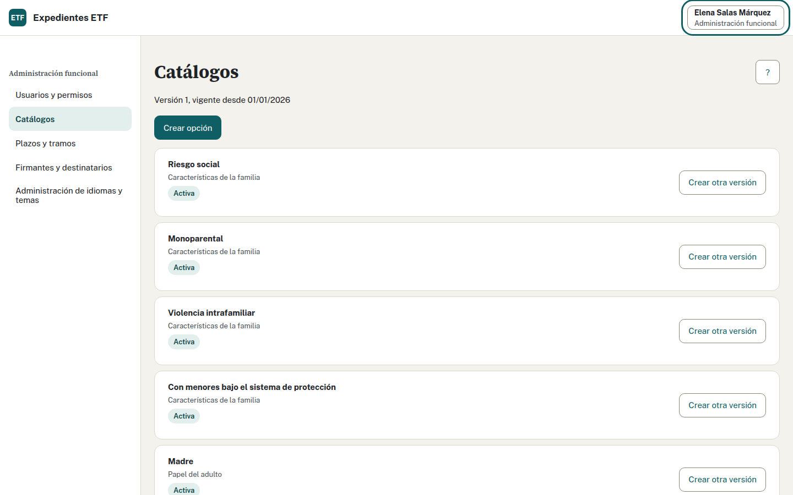
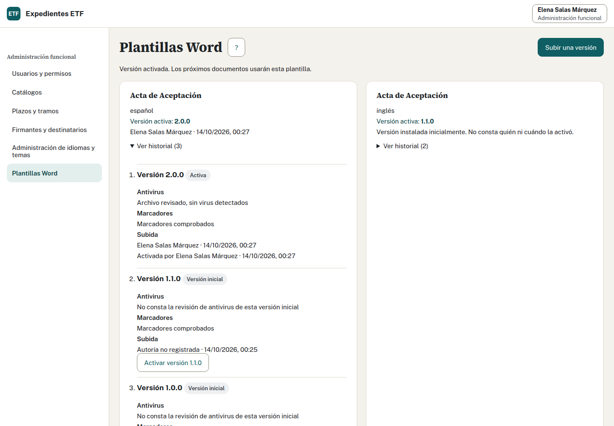

# Hoja de Administración funcional

Mantienes accesos y configuración. Este perfil no permite consultar fichas de expedientes. Coordinación mantiene el salario mínimo por año.

[PDF para imprimir](administracion.pdf) · [Glosario y preguntas frecuentes](usuario.md) · [Todos los manuales](usuario.md)

## Cómo doy acceso a una persona

1. Pídele que entre una vez con su cuenta de la entidad. Quedará pendiente de alta si todavía no tiene perfil.
2. Abre «Usuarios y permisos» y localízala por su nombre.
3. Asígnale los perfiles autorizados. Para un profesional, indica también su único equipo.
4. Guarda y comprueba la confirmación. Para cambiar o retirar el acceso, revisa los perfiles actuales y guarda la nueva selección.

Vídeo: «Entrar y dar acceso a un profesional» ([guion](../recorridos/guiones/01-entrada.md)). Pide el MP4 por ese título.

## Cómo cambio opciones, plazos o firmantes

1. Abre «Catálogos», «Plazos y tramos» o «Firmantes y destinatarios», según lo que debas mantener.
2. Revisa la entrada actual y desde cuándo es válida. Comprueba con Coordinación el valor autorizado.
3. Introduce el cambio, sus textos cuando se pidan y la fecha desde la que debe aplicarse.
4. Guarda y comprueba la versión y vigencia publicadas. Si aparece conflicto, consulta los cambios actuales antes de repetir.

Una nueva vigencia conserva la anterior para los cálculos históricos. Si falta una opción que la pantalla no permite mantener, comunícalo a quien mantiene la aplicación; no reutilices otra con un significado distinto.

## Cómo publico una plantilla Word

1. Abre «Plantillas Word» y consulta la activa y su historial para el documento e idioma.
2. Pulsa «Subir una versión» y selecciona el Word preparado. Máximo 10 MB.
3. Revisa el resultado del antivirus y los avisos sobre campos de la plantilla. Si se rechaza, corrige el archivo; la versión activa sigue disponible.
4. Activa la versión revisada, confirma y comprueba quién y cuándo la activó. Subirla no la activa por sí solo.

Las próximas descargas usarán la activa. El historial permite activar una versión anterior. Vídeo: «Publicar una plantilla Word nueva» ([guion](../recorridos/guiones/04-plantillas.md)).

## Cómo instalo una versión de idioma o tema

1. Abre «Administración de idiomas y temas» y elige qué vas a revisar.
2. Usa el código indicado en el paquete preparado por quien mantiene la aplicación y selecciona su archivo ZIP. Máximo 20 MB.
3. Pulsa «Subir y revisar paquete». Si falta revisión antivirus o hay errores, no se publica.
4. Tras una revisión válida, confirma la instalación cuando la pantalla lo ofrezca. Comprueba la versión disponible en Idiomas o Temas y, para un tema, su activación.

No necesitas preparar archivos a mano. Para incidencias de instalación o una exportación de auditoría para el delegado de protección de datos, sigue el procedimiento de la organización con Informática. La exportación no tiene todavía una pantalla propia.

## Términos y dudas habituales

Perfil es el conjunto de tareas permitidas; equipo es el ETF al que pertenece un profesional. Vigencia indica desde cuándo se aplica un valor. Una plantilla activa es la que se usará en las próximas descargas.

Si aparece conflicto, consulta los datos actuales antes de guardar. Si no sabes si se ha confirmado, usa la recuperación que ofrece la pantalla y comprueba el resultado; no repitas el alta desde otro formulario.

La aplicación no conserva los anexos recibidos ni los Word generados. Sí conserva las versiones de plantillas, idiomas y temas. Para otras dudas, consulta el [glosario y las preguntas frecuentes](usuario.md#preguntas-frecuentes).
