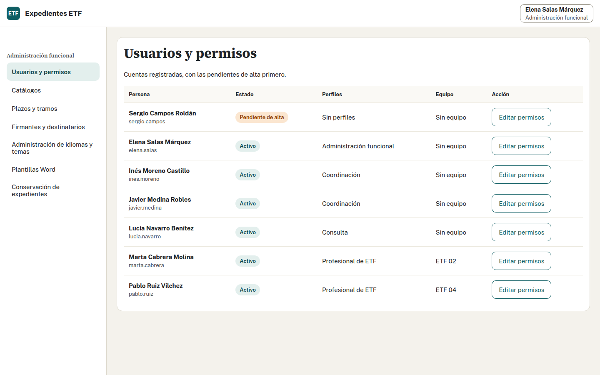
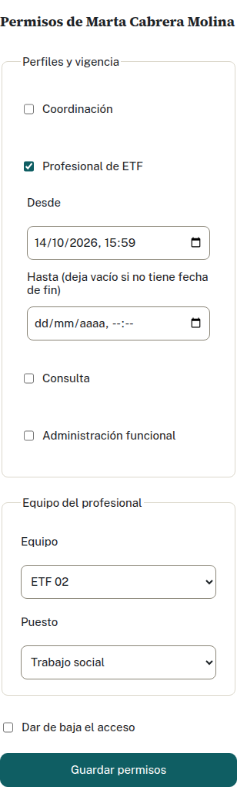
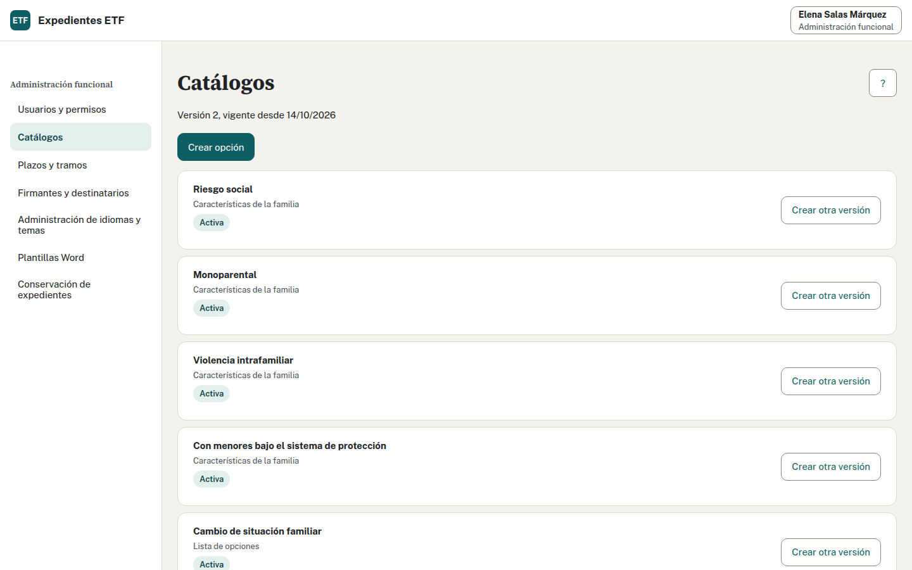
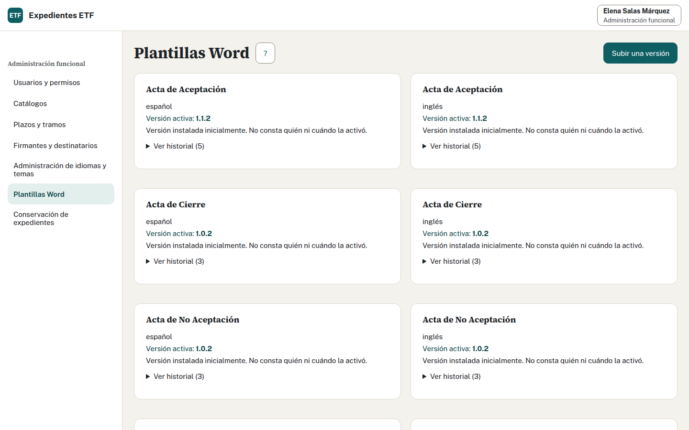
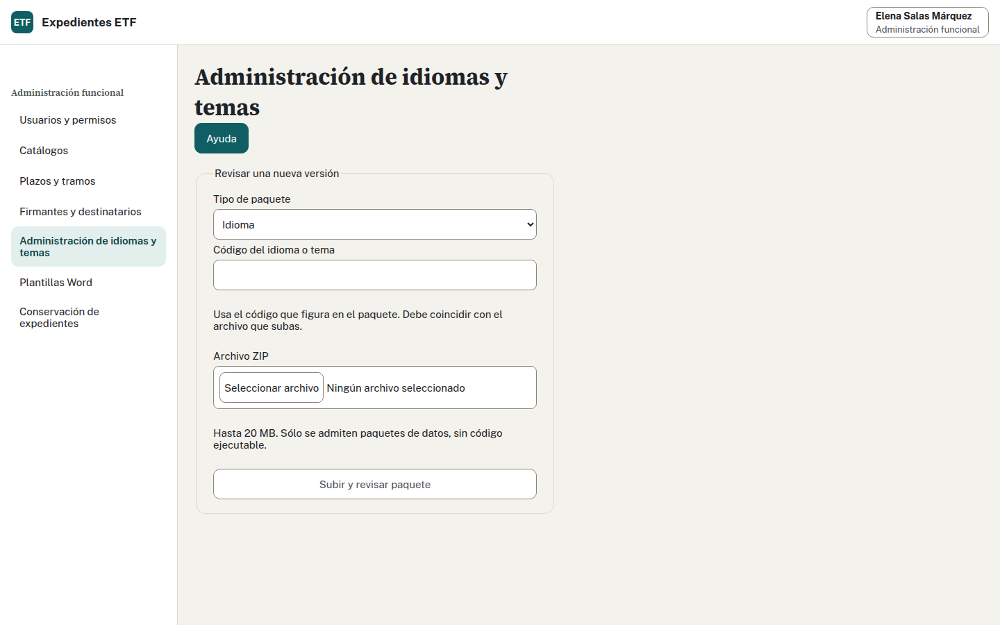
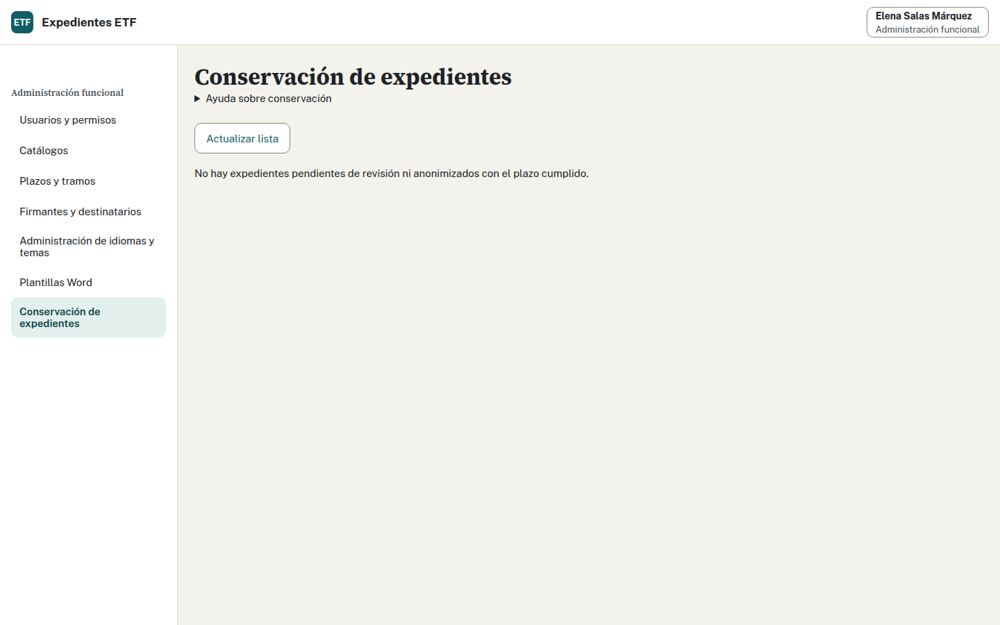

# Manual de Administración funcional

Expedientes ETF · Autor: Expedientes ETF · Edición: 14 de octubre de 2026

[PDF para imprimir](administracion.pdf) · [Todos los manuales](usuario.md)

## Contenido

1. [Acceso, perfiles y límites](#acceso-perfiles-y-límites)
2. [Altas y pendientes de alta](#altas-y-pendientes-de-alta)
3. [Cambios, equipo y bajas](#cambios-equipo-y-bajas)
4. [Equipos, municipios y centros](#equipos-municipios-y-centros)
5. [Catálogos, plazos, tramos y SMI](#catálogos-plazos-tramos-y-smi)
6. [Firmantes y destinatarios](#firmantes-y-destinatarios)
7. [Plantillas Word](#plantillas-word)
8. [Idiomas y temas](#idiomas-y-temas)
9. [Conservación y anonimización](#conservación-y-anonimización)
10. [Registro de auditoría](#registro-de-auditoría)
11. [Memoria: cierre y reapertura](#memoria-cierre-y-reapertura)
12. [Seguridad y sesiones](#seguridad-y-sesiones)
13. [Incidencias y términos de la aplicación](#incidencias-y-términos-de-la-aplicación)

## Acceso, perfiles y límites

Entra con tu cuenta de la entidad. La aplicación comprueba la cuenta y aplica los perfiles que te hayan concedido dentro de Expedientes ETF. Tener una cuenta válida no da acceso a expedientes ni a la configuración.

Administración funcional mantiene accesos y configuración. No permite abrir fichas, consultar la Tabla SPAF ni entrar en Memoria. Informática mantiene el servidor; ese trabajo no le concede un perfil de la aplicación.

| Perfil | Qué ve | Qué puede hacer |
| --- | --- | --- |
| Administración funcional | Usuarios y permisos; catálogos; plazos y tramos; firmantes; plantillas; idiomas y temas; lista de conservación sin nombres | Conceder y retirar accesos, publicar configuración y versiones, proponer y confirmar anonimización entre dos personas. Le corresponde la exportación de auditoría, cuya pantalla está pendiente |
| Coordinación | Expedientes de todos los equipos, derivaciones, actividad y estadísticas | Registrar y decidir derivaciones; asignar equipo; confirmar cierres y reabrir expedientes; mantener SMI; revisar, cerrar y reabrir Memorias de equipo y provincia |
| Profesional de ETF | Expedientes y actividad de su único equipo, Tabla SPAF y Memoria de ese equipo | Completar fichas, generar documentos, anotar actividad y seguimiento, proponer cierre y cerrar la Memoria de su equipo |
| Consulta | Cifras de Memoria y totales por año, equipo o provincia | Consultar y descargar cifras provisionales o definitivas. No recibe nombres, números de expedientes que forman una cifra ni textos narrativos; no edita ni cierra |

Una persona puede tener varios perfiles. Si tiene Administración y Coordinación, el acceso a expedientes procede de Coordinación. Concede esa combinación sólo cuando esté autorizada. No te asignes otro perfil para resolver una incidencia ni uses Consulta como sustituto de un permiso para editar.

El menú depende de los perfiles vigentes. Si una sección no aparece, comprueba el acceso concedido antes de comunicar un fallo. Las fechas de inicio y fin también cuentan: un perfil marcado con inicio futuro aún no permite entrar.

## Altas y pendientes de alta

Antes del alta, necesitas conocer la persona, los perfiles autorizados y, para profesionales, el equipo y el puesto. La aplicación no crea cuentas de la entidad ni cambia sus contraseñas.

1. Pide a la persona que entre una vez con su cuenta. Si aún no tiene perfiles, verá «Pendiente de alta» y no podrá consultar datos.
2. Abre «Usuarios y permisos». Los pendientes aparecen primero. Busca su nombre completo y comprueba también la cuenta para evitar confundir personas.
3. Pulsa «Editar permisos» en su fila. Marca únicamente los perfiles autorizados.
4. Revisa «Desde» y «Hasta» de cada perfil. Deja el fin vacío si no se ha fijado una fecha; cuando exista, debe ser posterior al inicio.
5. Si marcas Profesional de ETF, selecciona su equipo y puesto. El equipo es obligatorio y sólo puede ser uno.
6. Pulsa «Guardar permisos». Comprueba el aviso de guardado y la fila actualizada: estado, perfiles y equipo.
7. Pide a la persona que vuelva a entrar o actualice la aplicación y compruebe su menú.

Si la persona no aparece, comprueba que haya intentado entrar con la cuenta correcta. Un error de contraseña o una cuenta sin acceso al servicio de identidad no se resuelve añadiendo perfiles. Comunica esa incidencia a Informática sin enviar contraseñas.

No confundas pendiente de alta con baja. El primero ha entrado sin tener un acceso concedido; el segundo tiene el acceso retirado. Confirma la autorización antes de reactivar a alguien.

Vídeo de apoyo: «Entrar y dar acceso a un profesional» ([guion](../recorridos/guiones/01-entrada.md)).

## Cambios, equipo y bajas

### Cambiar perfiles o vigencias

Para cambiar tus propios perfiles, sus fechas o tu equipo, o dar de baja tu acceso, pide el cambio a otra persona de Administración funcional. En tu fila, «Ver mis permisos» muestra la configuración sin permitir editarla. La aplicación también rechaza el cambio si se intenta por otra vía y deja constancia en la auditoría.

1. Abre «Usuarios y permisos» y pulsa «Editar permisos» en la persona correcta.
2. Revisa todos sus perfiles. Desmarca los que deban retirarse, marca los autorizados y ajusta sus fechas.
3. Comprueba el equipo si mantienes o añades Profesional de ETF.
4. Guarda y verifica el resultado. Los permisos se consultan en cada petición al servidor: retirarlos afecta a la siguiente petición, aunque la persona mantenga una sesión abierta.

La selección guardada sustituye la configuración de acceso de esa persona. Revisa el conjunto, incluso cuando sólo quieras cambiar un perfil.

### Cambiar equipo o puesto

1. Edita los permisos del profesional.
2. Selecciona el nuevo equipo y, si corresponde, el nuevo puesto.
3. Revisa las fechas del perfil profesional; la adscripción al equipo usa esas fechas.
4. Guarda y comprueba el equipo en la fila. La persona deberá verificar que su bandeja corresponde al destino.

Cambiar el equipo de una persona cambia su acceso. No traslada los expedientes del equipo anterior. Los traslados de expedientes se tramitan desde el recorrido de Coordinación.

### Dar de baja el acceso

1. Edita la persona y marca «Dar de baja el acceso».
2. Lee la consecuencia: al guardar se retiran todos los perfiles y el equipo.
3. Pulsa «Guardar permisos» y comprueba el estado de baja en el listado.

La cuenta de la entidad sigue igual. Tampoco se borran sus actuaciones anteriores. Si retiras únicamente un perfil, la persona conserva los demás que sigan vigentes. Para devolver el acceso tras una baja, edita de nuevo, deja desmarcada la baja, concede los perfiles autorizados y guarda.

Antes de retirar Administración, comprueba que otra persona autorizada pueda mantener los accesos. Quitar todos los administradores no vuelve a conceder automáticamente el perfil del primer administrador; su recuperación requiere una operación expresa de Informática.

Si aparece un conflicto, pulsa «Ver los permisos actuales» y vuelve a revisar. Esa consulta carga la configuración guardada por la otra persona; tendrás que introducir de nuevo los cambios que sigan procediendo.

## Equipos, municipios y centros

1. Abre «Equipos, municipios y centros» y elige qué quieres mantener. Busca una entrada por su nombre y pulsa «Editar ubicación». Para dar de alta un equipo o un centro, pulsa el botón de añadir.
2. Escribe las denominaciones en castellano e inglés. En equipos y centros indica la fecha de alta y, cuando corresponda, la de baja: desde el día de baja dejan de estar activos.
3. En un municipio o entidad local autónoma elige el centro y el equipo por separado. Revisa si pertenece al ámbito de la entidad. Las variantes de escritura sirven para reconocer el municipio al leer anexos; escribe una por línea.
4. Indica desde cuándo se aplica el cambio y pulsa «Publicar cambio». Esa fecha debe ser posterior a la última publicación. La versión anterior se conserva; los expedientes ya numerados y las Memorias cerradas no cambian.
5. Si otra persona ha publicado antes, consulta la versión actual. Compara sus valores con tus campos y confirma la revisión antes de volver a publicar. Si falla la conexión, consulta de nuevo para comprobar si el cambio llegó a publicarse.

El centro y el equipo son independientes. Íllora pertenece al centro Pinos Puente-Moclín y la atiende el ETF 6. Un municipio fuera del ámbito de la entidad sigue el mismo trámite: Coordinación elige el equipo.

## Catálogos, plazos, tramos y SMI

### Publicar una opción o una nueva vigencia

1. Abre «Catálogos» y localiza la opción. Para cambiarla, pulsa «Crear otra versión»; para una nueva, pulsa «Crear opción».
2. Revisa lista, código, orden, estado activo y si admite texto adicional. Los identificadores de una opción existente no se cambian al editarla.
3. Introduce los textos en castellano e inglés cuando se pidan. Usa una denominación que las personas reconozcan en el formulario.
4. Indica la fecha de vigencia y pulsa «Publicar nueva versión».
5. Comprueba la confirmación, la versión y la fecha publicadas.

Publicar conserva las versiones anteriores. Una opción inactiva no debe reutilizarse para otro significado. Las equivalencias entre opciones afectan a recuentos históricos; si no hay un campo para mantenerlas, solicita el cambio a quien mantiene la aplicación.

Los textos de las opciones se publican como datos de idioma, con versiones inmutables. No basta con crear un código sin su denominación. Si ves «Etiqueta pendiente», comunica qué opción y qué idioma faltan.

### Mantener plazos y tramos

1. Abre «Plazos y tramos» y elige la sección correspondiente.
2. Localiza la regla. Revisa su clave, valor y unidad; en un tramo, comprueba también orden, límite inferior y superior.
3. Introduce el valor autorizado y su fecha de vigencia. Un plazo en años no equivale a uno en días; no cambies la unidad para compensar un valor incorrecto.
4. Publica y comprueba versión, vigencia y unidad.

La regla de conservación se identifica como `conservacion` y usa años. Su valor inicial es 25 años desde el cierre. Un cambio de ese plazo puede invalidar propuestas de anonimización anteriores; vuelve a consultar la lista antes de confirmar.

Las reglas históricas no se sustituyen por las actuales. La Memoria de un año usa las reglas vigentes al 31 de diciembre de ese año. Antes de publicar una vigencia que afecte a un año ya revisado, informa a Coordinación para que compruebe sus consecuencias.

### Fijar el cierre de la carga histórica

Entra en «Plazo de carga histórica». Elige la fecha de cierre y guarda. La carga se admite hasta el final de ese día; después, los equipos y Coordinación no pueden cargar ni confirmar más expedientes históricos. Si hace falta más tiempo, amplía la fecha desde esta pantalla. Cada cambio conserva la fecha anterior, su versión, quién lo hizo y cuándo. Si otra persona acaba de cambiarla, pulsa «Ver fecha vigente» y revisa antes de guardar.

Sin fecha de cierre, la carga permanece cerrada. La demostración con datos inventados fija el 31 de diciembre de 2026; producción necesita la fecha que autorices. Puedes ajustar cuántos días entre derivaciones se consideran cercanos para avisar de coincidencias; el valor inicial es 30 y se admite de 0 a 366.

Coordinación puede anular un lote erróneo dentro del plazo, siempre que ninguno de sus expedientes tenga cambios, evaluaciones o documentos posteriores. Se liberan los números históricos y se conserva la auditoría. Las consultas no impiden anular. Los lotes anteriores a este control quedan protegidos si no podemos comprobar que estén intactos. Administración gestiona la fecha y exporta la auditoría; la anulación corresponde a Coordinación.

La regla «Umbral de privacidad de Consulta» usa casos y parte de 3. Puedes aumentarla; no admite menos de 3 ni otra unidad. Consulta ve «Oculto» en las cifras inferiores al umbral y en otras cifras necesarias para impedir deducirlas. Pantalla, descarga Word y API aplican la misma protección. Se usa la regla vigente en el momento de consultar, también para Memorias de años anteriores o cerradas. Equipos y Coordinación conservan sus cifras completas. Publica una fecha posterior a la última versión y comprueba cuándo entra en vigor.

### SMI por año: tarea de Coordinación

Administración no mantiene el SMI. Coordinación abre su tabla, revisa el año, introduce el importe mensual con dos decimales y guarda esa fila. La aplicación calcula el importe anual; si falta un valor, lo muestra como pendiente. Un conflicto obliga a revisar el importe actual antes de repetir el cambio.

Si necesitas corregir el SMI, indica a Coordinación el año y el importe que debe revisar. No te concedas Coordinación para modificarlo. Un cambio de SMI tampoco reabre una Memoria cerrada.

## Firmantes y destinatarios

1. Abre «Firmantes y destinatarios» y localiza el registro o inicia uno nuevo.
2. Comprueba si es firmante o destinatario. Revisa nombre, cargo, organismo y dirección, cuando corresponda.
3. Introduce los textos del cargo que pida el formulario y la fecha de inicio; añade fecha de fin cuando se conozca.
4. Publica y verifica la vigencia.

Los documentos toman estos datos de la configuración. No escribas el nombre de un firmante dentro de una plantilla para resolver un cambio de persona: impediría que la plantilla sirviera con la siguiente vigencia.

## Plantillas Word

### Consultar la activa y las versiones anteriores

Abre «Plantillas Word». Cada documento e idioma tiene una referencia activa y versiones conservadas. Revisa el tipo, idioma y número de versión antes de subir o activar. El historial muestra las activaciones, su fecha y autor; algunas versiones iniciales pueden aparecer sin autor de publicación.

Una versión publicada es inmutable: su archivo no se sobrescribe. Corregirla exige una versión nueva. La plantilla activa se usa en las próximas descargas; activar otra no cambia documentos ya descargados ni hitos del expediente.

### Subir y revisar una nueva versión

1. Pulsa «Subir una versión».
2. Selecciona el documento y el idioma correctos. Introduce un número de versión nuevo con tres partes, como `1.2.0`.
3. Selecciona el archivo `.docx`, de hasta 10 MiB. Conserva los marcadores que permiten rellenarlo; no añadas macros, objetos activos ni recursos externos.
4. Envía el archivo y espera la revisión. El antivirus debe responder y confirmar que está limpio.
5. Revisa el resultado. Si faltan o sobran marcadores, corrige el Word y vuelve a subirlo con una versión válida. Si se rechaza, la activa sigue disponible.
6. Comprueba que la nueva versión aparece en el listado. Subirla no la activa.

### Activar o volver a una versión anterior

1. Localiza la versión revisada del documento e idioma.
2. Pulsa su acción de activación y lee el diálogo de confirmación.
3. Confirma y comprueba que figura como activa, con la nueva entrada del historial.
4. Coordina una descarga de prueba con el perfil que genera ese documento para comprobar el resultado. Administración no necesita acceso a una ficha para publicar la plantilla.

Para volver atrás, activa una versión anterior conservada del mismo documento e idioma y comprueba el historial. Esa restauración también queda registrada; no borres la versión que acabas de sustituir.

Si otra persona ha activado una versión mientras trabajabas, consulta la referencia actual antes de confirmar otra activación. Si la conexión se interrumpe tras confirmar, revisa primero el listado y el historial para saber qué quedó activo.

Vídeo de apoyo: «Publicar una plantilla Word nueva» ([guion](../recorridos/guiones/04-plantillas.md)).

## Idiomas y temas

Un paquete de idioma contiene textos y recursos de ese idioma; un tema contiene la configuración visual. Usa el ZIP preparado para la aplicación. No necesitas modificar sus archivos a mano.

1. Abre «Idiomas» o «Temas», o selecciona el tipo en «Administración de idiomas y temas».
2. Escribe el código que corresponde al paquete y selecciona su ZIP, de hasta 20 MiB.
3. Pulsa «Subir y revisar paquete». Espera la subida, revisión de formato y antivirus.
4. Comprueba el código y la versión del paquete revisado. Una revisión válida prepara la publicación; aún debes confirmar la activación.
5. Abre la confirmación de activación, revisa sus datos y confirma.
6. Comprueba el aviso final y la referencia publicada. Revisa la aplicación con el idioma o tema afectado.

Los archivos se guardan por versión y huella; la referencia activa y el apunte de auditoría se confirman juntos. Si falla la publicación, no debe sustituirse la referencia anterior. Las versiones anteriores se conservan.

La preparación caduca a los diez minutos y admite un máximo de dos paquetes simultáneos. Si caduca, revisa otra vez el paquete. Ante conflicto o resultado incierto, usa «Ver la versión actual» antes de preparar otra activación. No confirmes repetidamente el mismo cambio.

La pantalla no ofrece una prueba de tema sólo para tu sesión, retirada de paquetes ni un recuento de claves pendientes. Tampoco ofrece el historial de restauración de Plantillas Word. Si necesitas recuperar una versión de paquete, pide a quien lo prepara que indique el archivo y el procedimiento compatibles; no sobrescribas archivos publicados.

## Conservación y anonimización

La lista de «Conservación» muestra números de expediente, cierre, fin del plazo y estado. No muestra nombres ni permite abrir fichas. El plazo inicial es de 25 años desde el cierre y se puede configurar en «Plazos y tramos». Un seguimiento activo impide la anonimización.

La retirada requiere dos personas distintas con Administración funcional. Su alcance y uso con datos reales siguen pendientes de validación por el delegado de protección de datos. No confirmes una retirada real hasta que esté autorizada.

### Primera persona: proponer

1. Abre «Conservación» y pulsa «Actualizar lista».
2. Revisa el número, fecha de cierre y fin de conservación de un expediente pendiente.
3. Pulsa la acción de revisión de la propuesta.
4. Lee el diálogo y marca la casilla de revisión sólo si los datos y la autorización corresponden.
5. Confirma la propuesta y comprueba el aviso y el estado actualizado. La propuesta aún no elimina datos.

### Segunda persona: confirmar

1. Entra con tu propia cuenta de Administración; debe ser distinta de la que propuso.
2. Actualiza la lista y localiza la propuesta que debes revisar.
3. Pulsa la revisión de anonimización y comprueba número, fechas y consecuencia final.
4. Marca la casilla de revisión y confirma «Anonimizar» sólo cuando proceda. La acción es irreversible: retira los datos personales del expediente y conserva los datos estadísticos.
5. Comprueba el aviso y el estado final. No queda una ficha personal que pueda recuperarse desde esta pantalla.

La misma persona no puede completar ambos pasos. Si no aparece la acción final, comprueba que hayas entrado con otra cuenta autorizada y que la propuesta siga vigente. Si hay conflicto, actualiza la lista: el expediente o el plazo pueden haber cambiado. No recrees la propuesta para eludir un bloqueo.

## Registro de auditoría

La aplicación registra accesos y actuaciones, también lecturas, con actor, fecha, acción y referencia del objeto. Los eventos forman una cadena de huellas: cada evento depende del anterior. Administración puede exportar el registro y no puede editarlo, borrarlo ni abrir fichas de expedientes por ese permiso.

### Descargar y custodiar una exportación

1. Abre «Auditoría» en el menú de Administración.
2. Elige el primer y el último día, ambos incluidos en horario UTC. Puedes incluir hasta 31 días.
3. Si lo necesitas, elige el tipo de evento o la persona usuaria. Para un expediente, introduce el identificador interno que te haya facilitado el DPD.
4. Elige CSV para una hoja de cálculo o JSON para intercambio de datos. Revisa el aviso: identificadores y vínculos siguen siendo datos personales aunque no haya nombres.
5. Pulsa «Descargar registro y comprobación». Espera a que termine la comprobación de la cadena. Si alcanza el límite de tamaño, eventos o tiempo, elige un periodo más corto.
6. Guarda el ZIP en una ubicación autorizada. La exportación queda registrada antes de recibir el archivo. Un registro sin coincidencias se descarga vacío, con su comprobación.

El ZIP contiene el registro filtrado, `cadena.json`, `manifiesto.json` y las instrucciones `LEEME.txt`. La prueba incluye los eslabones intermedios entre los extremos del periodo, aunque no cumplan los filtros; puede contener identificadores de otros eventos. No edites los archivos para quitar filas. Conserva el original y aplica los plazos y el alcance acordados con el DPD en la EIPD.

### Comprobar el archivo

Pide a Informática que ejecute el comprobador local `verificar-exportacion`, siguiendo `LEEME.txt`. Comprueba las huellas, la cadena y que el registro contiene la selección completa dentro del tramo. No abre conexiones ni modifica el archivo.

Para acreditar el origen, Informática debe aportar los puntos anterior y final custodiados fuera del ZIP. Copiarlos del mismo archivo sólo comprueba su coherencia interna. Si la comprobación falla, conserva el original y pide a Informática que investigue; no lo retoques para hacer desaparecer el fallo. La prueba cubre el tramo exportado y sus límites, no el resto de la cadena ni las horas técnicas de registro.

Los pasos de restauración y contraste con sellos están en el [manual de sistemas](../sistemas/LEEME.md).

## Memoria: cierre y reapertura

Administración no consulta ni modifica Memoria. Puede mantener las opciones, reglas y plantillas de las que depende, pero esas tareas no autorizan a corregir cifras, textos narrativos o cierres.

El profesional revisa y cierra la Memoria de su equipo. Coordinación revisa todos los equipos, cierra la provincial y puede cerrar o reabrir cualquiera. Consulta recibe sólo cifras y no interviene en el cierre.

1. Antes de cambiar una configuración que afecte a la Memoria, comunica a Coordinación el dato y la vigencia.
2. Coordinación selecciona año y equipo o provincia y revisa cifras, avisos y textos antes de cerrar.
3. El cierre conserva una revisión con sus cifras. Una corrección posterior en una ficha no cambia esa revisión cerrada.
4. Si hace falta corregir una Memoria cerrada, Coordinación la reabre con motivo, revisa y vuelve a cerrarla. La reapertura queda auditada y las revisiones anteriores se conservan.

La Memoria provincial se calcula directamente desde los datos; no suma Memorias de equipo. Ante una diferencia con una Memoria cerrada, Coordinación debe revisar el aviso. No intentes resolverla cambiando un catálogo o concediéndote un perfil sin autorización. Recorrido de pantalla en el [manual de Coordinación](coordinacion.md#cómo-preparo-y-cierro-la-memoria-provincial).

## Seguridad y sesiones

Usa tu cuenta personal y concede sólo accesos autorizados. No compartas contraseñas ni sesiones, y no te autoconcedas perfiles para consultar información o corregir datos. La segunda persona de conservación debe trabajar con su propia cuenta.

Cierra sesión desde la aplicación al terminar; cerrar una pestaña no sustituye esa acción. La sesión caduca tras 30 minutos sin actividad y tiene además un límite máximo configurado en la instalación. Si caduca mientras editas, vuelve a entrar y comprueba el estado guardado antes de repetir la operación.

Si el servicio de cuentas no responde, no se pueden iniciar nuevas sesiones; las abiertas siguen hasta caducar. La aplicación no guarda contraseñas. Un cambio de contraseña o una baja de la cuenta corporativa se tramita con Informática; la baja de acceso descrita aquí retira los permisos dentro de Expedientes ETF.

Revisa las altas pendientes y los accesos que deban finalizar. Antes de dar Administración a otra persona, comprueba la autorización; antes de retirar el último acceso administrativo, asegura la continuidad de la gestión. Conserva los documentos descargados y exportaciones sólo en los lugares autorizados.

## Incidencias y términos de la aplicación

| Situación | Qué hacer |
| --- | --- |
| Conflicto al guardar | Consulta la versión actual, compara lo que cambió y vuelve a preparar sólo el cambio que siga autorizado |
| No sabes si se guardó | Revisa listado, versión, referencia activa o historial antes de repetir. No crees una segunda alta para compensar la duda |
| Antivirus no disponible | Plantillas y paquetes no se publican. Solicita la recuperación del servicio y revisa de nuevo el archivo |
| Archivo rechazado | Lee el motivo, pide la corrección a quien lo preparó y vuelve a revisar. La versión activa anterior sigue disponible |
| No aparece una acción | Revisa perfil, vigencias, equipo y estado. No pidas otro perfil sin comprobar si la acción corresponde a tu tarea |
| Falta un editor | Comunica el cambio concreto a quien mantiene la aplicación; equipos, ubicaciones y exportación de auditoría tienen los límites indicados en este manual |

Al comunicar una incidencia, indica pantalla, acción, hora y mensaje recibido. Evita adjuntar contraseñas, exportaciones o datos personales innecesarios.

Perfil es el conjunto de acciones permitidas. Equipo es la adscripción de un profesional. Vigencia es la fecha desde la que se aplica una configuración. Versión inmutable es un contenido publicado que se conserva sin sobrescribir. Referencia activa señala qué versión se usa ahora. Huella permite comprobar que un archivo o evento no ha cambiado. Propuesta de anonimización es el primer paso de una revisión entre dos personas; no equivale a la retirada final.

La aplicación descarta los anexos recibidos tras leerlos y no conserva los Word generados. Sí conserva los datos, las versiones publicadas, sus referencias y el historial de auditoría que corresponde a cada operación.
