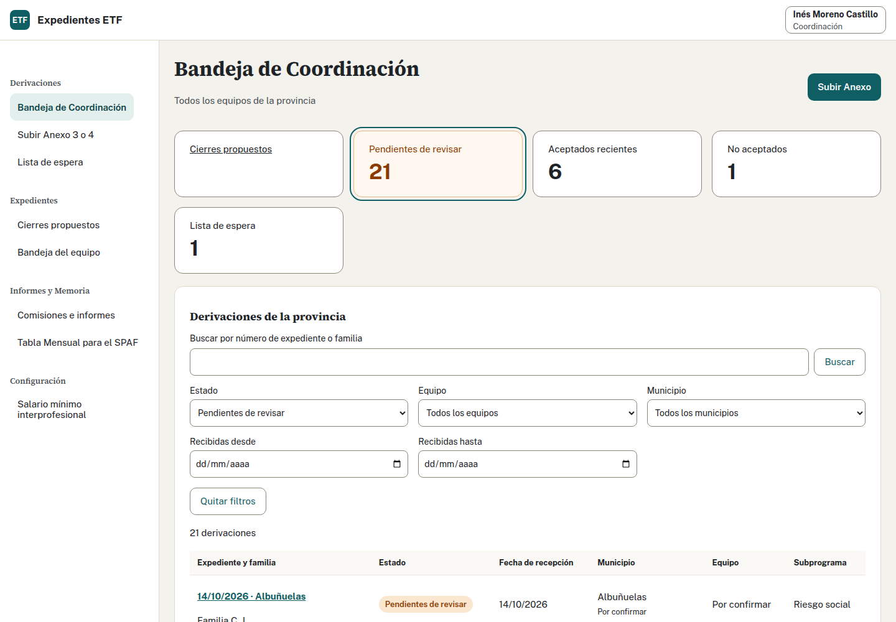
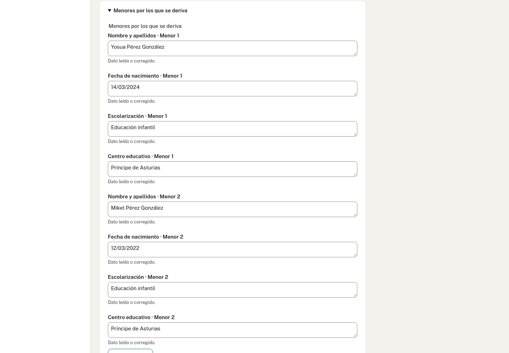
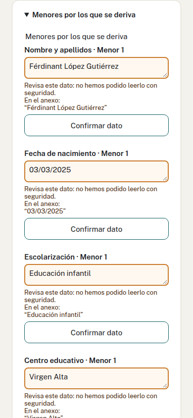
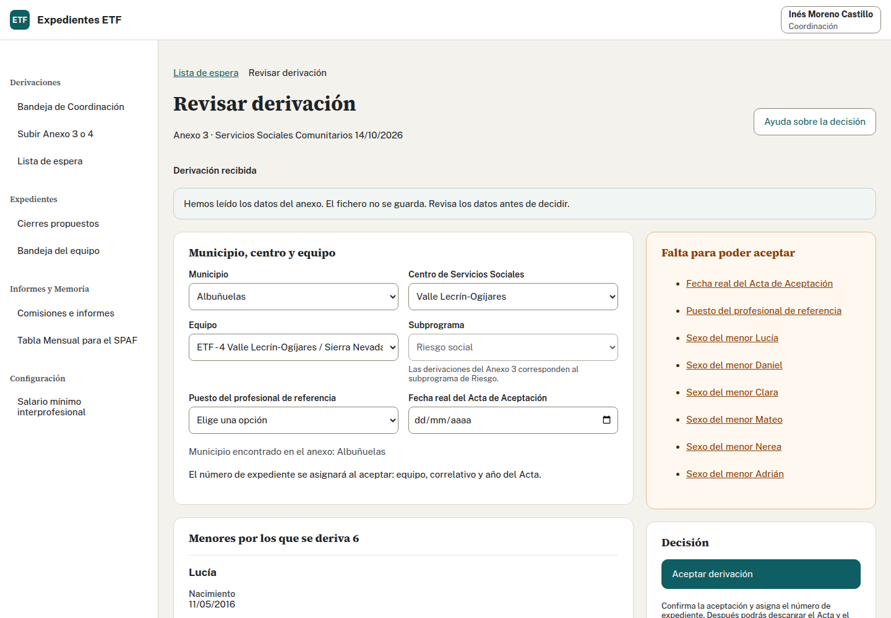
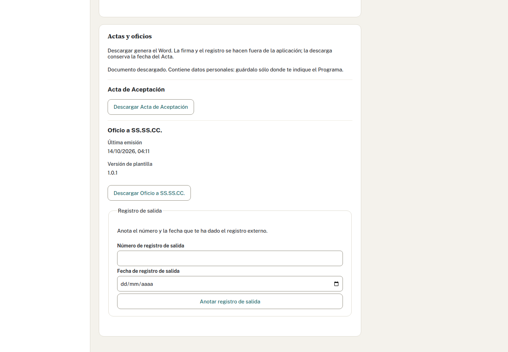
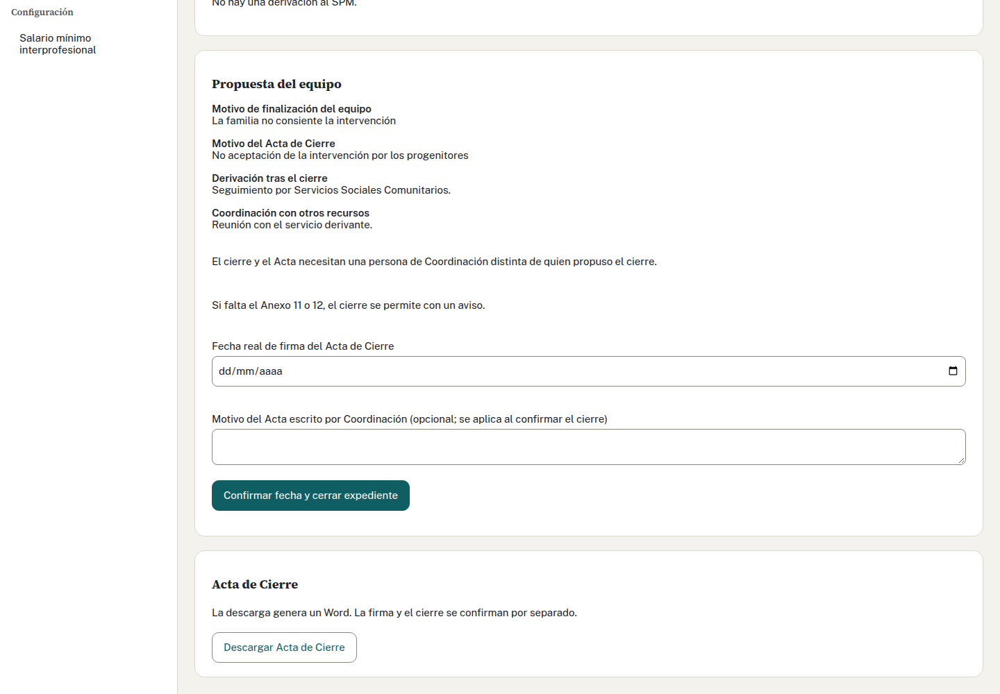
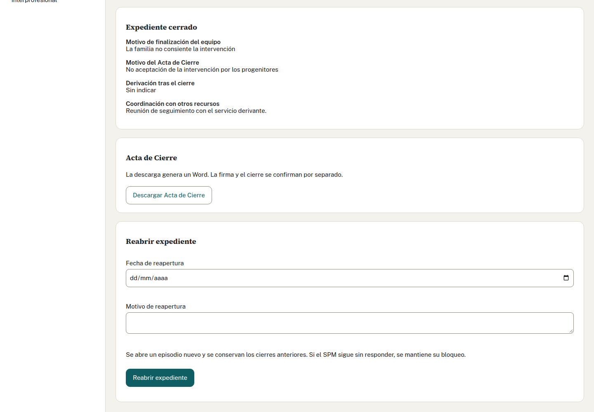
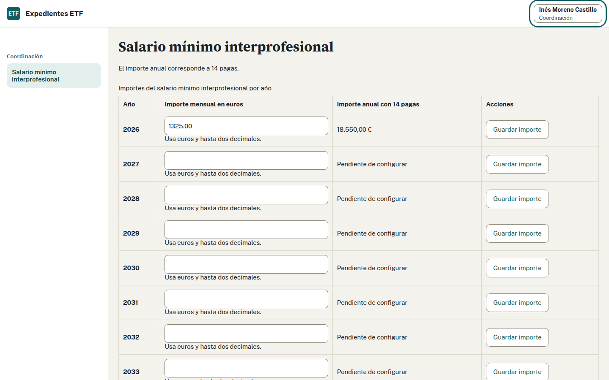
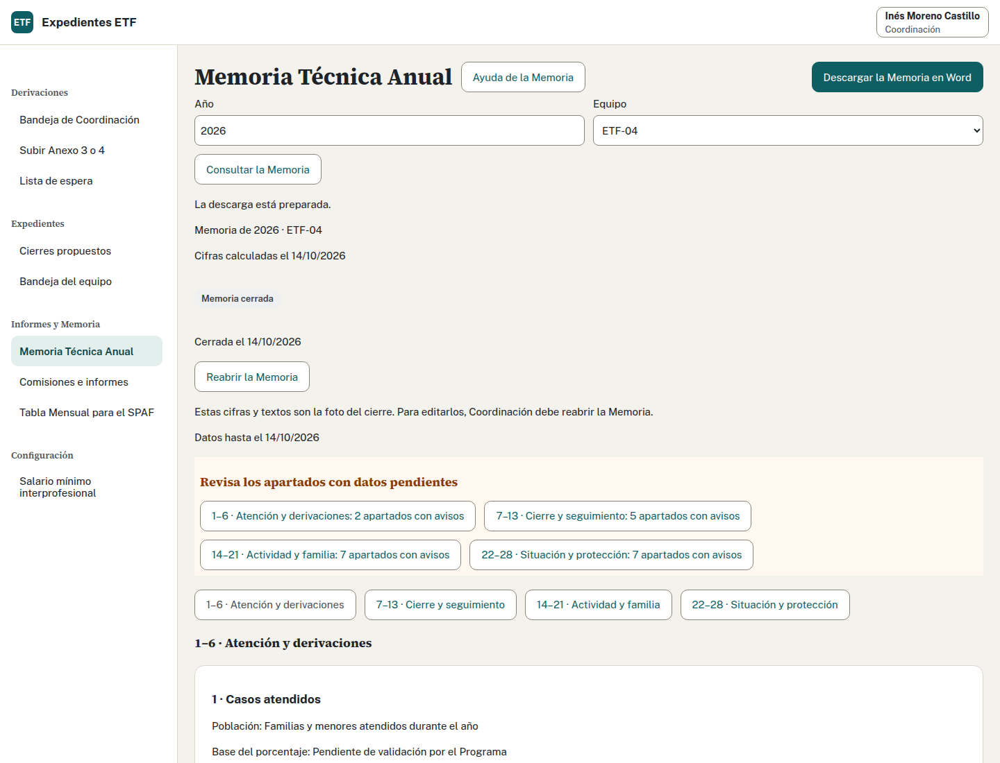

# Manual para Coordinación

Registras y resuelves las derivaciones, consultas todos los equipos y confirmas los cierres. Las capturas contienen datos inventados.

[PDF para imprimir](coordinacion.pdf) · [Glosario y preguntas frecuentes](usuario.md#glosario-del-programa) · [Todos los manuales](usuario.md)

## Cómo entro y reviso la bandeja

1. Abre la dirección facilitada por Informática y entra con tu cuenta de la entidad.
2. Comprueba que tienes el perfil de Coordinación en la cabecera. Si quedas pendiente de alta, Administración debe asignártelo.
3. Abre «Bandeja de Coordinación» y revisa pendientes, aceptados recientes, no aceptados y lista de espera.
4. Usa los filtros de equipo, municipio, estado y fechas de recepción o busca por número o familia.
5. Abre el caso desde su enlace y comprueba su estado antes de decidir.

Vídeo de acceso: «Entrar y dar acceso a un profesional» ([guion](../recorridos/guiones/01-entrada.md)). Para la bandeja, «Recibir una derivación y aceptarla» ([guion](../recorridos/guiones/02-coordinacion.md)). Pide los MP4 por su título.

## Cómo subo un Anexo 3 o un Anexo 4

1. Abre «Subir Anexo 3 o 4». El Anexo 3 procede de Servicios Sociales Comunitarios; el Anexo 4, del Servicio de Protección de Menores (SPM).
2. Elige el documento y pulsa «Subir y leer anexo». Se admiten Word DOCX, LibreOffice ODT y PDF de hasta 10 MB; el PDF tiene un máximo de 20 páginas.
3. Espera la revisión del antivirus y la lectura. Si se rechaza el fichero, revisa el motivo antes de intentarlo otra vez. Si el antivirus no responde, puede continuar con un aviso de que no se ha revisado.
4. Revisa los datos leídos, incluidos los campos dudosos. Abre los apartados plegados. Un PDF escaneado puede requerir que teclees los datos.
5. Confirma municipio, centro y equipo por separado. Comprueba de qué frase salió la propuesta de municipio; si no hay una propuesta clara, debes elegirlo.
6. Pulsa «Confirmar y crear derivación». Comprueba que se abre el caso para decidir sobre él.

Puedes subir, revisar y confirmar el ODT de LibreOffice o el PDF firmado que te envíe el servicio. La aplicación lee el texto del PDF, pero no comprueba su firma. Revisa las fechas completas, la escolarización, el tramo de ingresos y, en el Anexo 4, el equipo y el subprograma. Las filas sin rellenar no aparecen como personas.

Si una casilla o un texto no se puede leer, queda vacío para que lo completes mirando el original. En los PDF recibidos del Programa esto afecta a crisis, actitud de la familia, documentación obligatoria y situación económica. El tramo de ingresos sí se lee.

La revisión previa no equivale a haber creado el caso. El anexo se descarta tras su lectura: conserva el original donde indique el Programa. Los datos que no conoces pueden quedar pendientes, salvo los obligatorios para confirmar.

Vídeo: «Recibir una derivación y aceptarla» ([guion](../recorridos/guiones/02-coordinacion.md)).

## Cómo acepto una derivación

1. Abre la derivación pendiente o la que vas a sacar de la lista de espera.
2. Revisa municipio, centro y equipo. Completa el sexo de cada menor, porque no viene en el anexo.
3. Selecciona el puesto del profesional de referencia y revisa el subprograma. El Anexo 3 corresponde a Riesgo.
4. Revisa la descripción de la situación familiar que llevará el Acta. Ajusta el texto recibido para que describa el caso.
5. Indica la fecha real del Acta de Aceptación y confirma «Aceptar» en el diálogo.
6. Comprueba el número asignado y descarga el Acta y el oficio que corresponda: a Servicios Sociales Comunitarios o al SPM.

El número se asigna al aceptar. Sus tres pares indican equipo, correlativo del equipo en el año y año del Acta. No lo escribas ni lo reserves a mano. La elección por nombre del profesional está pendiente; la pantalla actual pide el puesto.

Firma, envío y registro se tramitan fuera. Descargar el documento no confirma esos actos. El expediente debe aparecer en «Aceptados recientes» y en la bandeja del equipo.

Vídeo: «Recibir una derivación y aceptarla» ([guion](../recorridos/guiones/02-coordinacion.md)).

## Cómo dejo un caso en lista de espera o no lo acepto

1. Abre el caso y revisa el servicio que lo deriva. La lista de espera está prevista para derivaciones de Servicios Sociales Comunitarios.
2. Para dejarlo en espera, elige «Dejar en lista de espera», revisa la confirmación y descarga el oficio.
3. Consulta después «Lista de espera», ordenada por recepción. Cuando proceda, abre el caso y acepta o no acepta.
4. Para no aceptarlo, indica la fecha, el motivo y el subprograma que correspondan, y confirma «No aceptar».
5. Descarga el Acta de No Aceptación y comprueba el estado guardado.

Espera y no aceptación no consumen número de expediente. Mientras espera, el caso no cuenta en la Memoria; una no aceptación cuenta en su apartado 5. Si una familia no aceptada vuelve a ser derivada, registra una derivación nueva.

## Cómo anoto el registro de salida de un documento

1. Descarga el oficio desde la decisión del caso y tramita su firma y registro fuera.
2. Vuelve al oficio emitido en esa pantalla. La anotación disponible corresponde al oficio.
3. Introduce el número y la fecha reales del registro.
4. Pulsa «Anotar registro de salida» y comprueba el mensaje con el número anotado.
5. Si hay que corregirlo, consulta antes el registro actual y conserva la referencia al documento que corresponde.

La aplicación anota el registro que tú introduces; todavía no registra el documento automáticamente en otro sistema.

## Cómo confirmo el cierre de un expediente

1. Abre «Cierres propuestos» y pulsa el número del expediente.
2. Revisa el motivo y los datos de finalización del equipo. Si no estás de acuerdo, habla con el equipo; puede retirar la propuesta y corregirla.
3. Comprueba la situación del Anexo 5. Si sigue pendiente, registra una respuesta fechada que permita cerrar. Para una excepción, escribe el motivo en la autorización de cierre sin respuesta y guárdala antes de cerrar.
4. Comprueba que eres una persona distinta de quien propuso el cierre. Usa tu propia cuenta.
5. Indica la fecha real de firma del Acta de Cierre. Si corresponde, escribe el motivo que debe aparecer en el Acta.
6. Confirma la fecha y el cierre, revisa el diálogo y comprueba que el expediente queda cerrado. Descarga el Acta en su acción separada.

«A la espera» mantiene el bloqueo ordinario. La excepción necesita un motivo escrito. Si falta la emisión del Anexo 11 o 12, la pantalla avisa y permite cerrar. El Acta descargada antes de confirmar un motivo nuevo utiliza el motivo que ya estaba guardado; comprueba el documento después de confirmar.

Vídeo: «Cerrar un expediente» ([guion](../recorridos/guiones/07-cierre.md)).

## Cómo reabro un expediente

1. Abre «Salidas y cierre» del expediente cerrado.
2. Comprueba con el equipo qué corrección o actuación requiere reabrirlo.
3. Indica la fecha y el motivo de reapertura.
4. Revisa y confirma la operación.
5. Comprueba el estado resultante y consulta el historial. La aplicación conserva el cierre anterior y recupera el estado que corresponde a los hechos ya confirmados.

Reabrir no inventa un consentimiento ni una respuesta del SPM. Si la familia vuelve con una nueva derivación, registra un caso nuevo enlazado al anterior. Una Memoria cerrada conserva sus cifras aunque reabras el expediente.

## Cómo traslado un caso a otro equipo

1. Acuerda el traslado con los equipos y comprueba que existe la propuesta de cierre del equipo de origen.
2. Desde «Salidas y cierre», abre el traslado. Elige el equipo de destino, indica el motivo para el Acta y confirma la fecha de cierre.
3. Revisa la confirmación: se cerrará el caso de origen y se creará una derivación en destino. Debe confirmar una persona distinta de quien propuso el cierre.
4. Guarda y abre el enlace a la derivación de destino.
5. Acéptala con su fecha real y descarga el Acta. Comprueba el número nuevo y el enlace al expediente de origen.

Elegir un destino por sí solo no cierra. El caso nuevo copia los datos vigentes de familia, adultos y menores; no hereda número, consentimiento ni otras fechas confirmadas del origen.

## Cómo reviso la Tabla SPAF y la actividad de los equipos

1. Para la Tabla, abre «Tabla Mensual para el SPAF», elige equipo y mes terminado y revisa el resumen.
2. Abre los números de altas y bajas para comprobar sus movimientos. Vuelve a la tabla y revisa sus 14 columnas y avisos.
3. Descarga el Word cuando hayas revisado los «Sin dato». Tramita el envío fuera.
4. Para la actividad, abre «Comisiones e informes» y filtra por equipo, año y fechas; en informes puedes elegir también el organismo.
5. Si detectas un error de actividad, pide la corrección al profesional que lo registró. Coordinación consulta estos registros, no los edita.

Vídeos: «Preparar la Tabla SPAF del mes» ([guion](../recorridos/guiones/06-spaf.md)) y «Registrar una comisión técnica y un informe» ([guion](../recorridos/guiones/03-actividad.md)).

## Cómo mantengo el salario mínimo por año

1. Abre «Salario mínimo interprofesional».
2. Localiza el año que vas a revisar.
3. Introduce el importe mensual confirmado para ese año y comprueba el anual que muestra la pantalla.
4. Guarda y espera la confirmación. Si otra persona ha cambiado la tabla, vuelve a consultarla y revisa antes de guardar.

Usa el importe que corresponda al año, porque los ingresos de las familias se comparan con ese SMI. Administración mantiene los tramos; Coordinación mantiene estos importes.

## Cómo preparo y cierro la Memoria provincial

1. Acuerda con los equipos la revisión de los casos y datos pendientes del año. Comprueba fechas, cierres, reaperturas, actividad y SMI.
2. Abre «Memoria Técnica Anual», elige año y ámbito provincial en «Equipo», y pulsa «Consultar la Memoria». También puedes consultar cada equipo por separado.
3. Revisa los cuatro bloques de apartados, los avisos y los «Sin dato». Cada tabla explica qué cuenta y la base del porcentaje. La consulta por números de expediente que forman una cifra todavía está pendiente.
4. Completa los datos generales y los textos de metodología, dificultades, propuestas de mejora y valoración global. La pantalla indica los límites de 25 o 30 líneas.
5. Pulsa «Guardar los textos» y después «Descargar la Memoria en Word». Revisa el archivo antes de fijar las cifras.
6. Pulsa «Cerrar la Memoria», revisa el diálogo y pulsa «Confirmar el cierre». Comprueba «Memoria cerrada» y su fecha. Sólo Coordinación puede cerrar la provincial.

[Captura completa de la Memoria](../capturas/memoria-escritorio.png).

La provincial se calcula directamente de los expedientes: no se obtiene sumando las Memorias cerradas de los equipos. Una Memoria cerrada fija cifras y textos; una corrección posterior puede generar diferencias que debes revisar. La descarga no confirma el cierre. No hay un vídeo de Memoria entre los recorridos disponibles.

## Cómo reabro una Memoria para corregirla

1. Abre «Memoria Técnica Anual», selecciona el año y equipo o provincia que corresponda, y consulta la Memoria cerrada.
2. Pulsa «Reabrir la Memoria» y escribe el motivo de la corrección en el diálogo.
3. Pulsa «Confirmar la reapertura». Comprueba que vuelves a tener un borrador editable. La revisión cerrada anterior se conserva.
4. Revisa las cifras y textos afectados, guarda los textos y descarga de nuevo si lo necesitas. Confirma un nuevo cierre cuando termines la revisión.

[Captura completa de la Memoria cerrada](../capturas/memoria-cerrada.png).

Sólo Coordinación reabre Memorias. Si se pierde la respuesta, usa la recuperación de la misma operación que ofrece la pantalla; consulta el estado antes de iniciar otra.

## Cómo cargo los casos de 2026 desde una hoja

El Programa confirma que no existe hoja de cálculo. La vía habitual es
«Añadir un expediente histórico»: elige equipo, sube el Acta de Aceptación y,
para un caso cerrado, el Acta de Cierre, o introduce los datos a mano. Sigue
[los pasos del alta desde actas](profesionales.md#cómo-cargo-un-caso-de-2026-a-mano).
Coordinación puede elegir cualquier equipo; cada profesional carga sólo el suyo.

Reúne todos los expedientes que siguen abiertos, de cualquier año anterior,
los cerrados durante 2026 y las derivaciones no aceptadas de 2026. Conserva el
número y las fechas originales. Un expediente iniciado en 2022 o 2023 que sigue
activo también se carga. La lectura de un acta no guarda el fichero ni confirma
por sí sola el estado: corrige los datos, revisa el expediente y confirma.

Antes de introducir datos reales, confirma con la dirección que producción está
preparada, la evaluación de impacto en protección de datos está aprobada,
la revisión de seguridad está superada y la restauración de copias está probada.
En demostración sólo se usan datos inventados.

### Compatibilidad con CSV y XLSX

Si dispones de una hoja preparada, la carga anterior sigue disponible:

1. Abre «Cargar desde una hoja» y elige el equipo. La hoja contiene entre 1 y 100 expedientes del mismo equipo, hasta 10 MB.
2. Pulsa «Descargar una hoja con datos inventados» si necesitas sus cabeceras. La ayuda explica fechas y listas; pide apoyo para preparar las columnas especiales.
3. Elige CSV o XLSX y pulsa «Subir y revisar la hoja». Espera la revisión del antivirus. Todavía no se guarda ningún expediente.
4. Revisa las incidencias por fila. Corrige la hoja y usa «Elegir otra hoja» cuando haga falta. Comprueba estados, números originales y episodios.
5. Pulsa «Confirmar el lote completo». Entra todo o no entra ninguno. Revisa los datos guardados con el equipo.

El fichero y la revisión sin confirmar no se conservan. Un no aceptado no recibe
número de aceptación. Si se pierde la conexión después de confirmar, pulsa
«Recuperar el resultado» antes de empezar otra carga.
