# Manual para profesionales de los ETF

Autor: Expedientes ETF

Trabajas con los expedientes de tu equipo. Coordinación acepta las derivaciones y confirma los cierres que propones. Las capturas contienen datos inventados.

[PDF para imprimir](profesionales.pdf) · [Glosario y preguntas frecuentes comunes](comun.md#glosario-de-la-aplicación) · [Todos los manuales](usuario.md)

## Cómo entro y encuentro un expediente

1. Abre la dirección que te haya facilitado Informática y entra con tu cuenta de la entidad.
2. Comprueba tu nombre, perfil y equipo en la cabecera. Si aparece «Pendiente de alta», pide el acceso a Administración funcional. Elige idioma y tema en «Preferencias»; consulta la [ayuda de acceso](comun.md#entrada-preferencias-y-ayuda).
3. Abre «Bandeja del equipo». Busca por número o familia y usa los filtros para acotar los resultados.
4. Pulsa el número del expediente. El nombre completo se consulta dentro de la ficha; la apertura queda registrada.
5. Revisa los avisos y las fechas confirmadas antes de cambiar datos.

Vídeo: «Entrar y dar acceso a un profesional» ([guion](../recorridos/guiones/01-entrada.md)). Pide la grabación por ese título.

## Cómo reviso la bandeja y los avisos

Revisa la bandeja al empezar la jornada. Busca por número o familia y combina los filtros de estado, municipio y fechas que muestre la pantalla. Los listados muestran iniciales; abre la ficha para consultar el nombre completo.

1. Revisa los avisos de consentimiento, duración de fase, datos pendientes para la Memoria, propuestas de cierre y respuestas pendientes del SPM.
2. Pulsa el aviso que tenga enlace. La aplicación abre la pestaña y, cuando corresponde, el campo que necesitas revisar.
3. Comprueba la actuación y su fecha antes de guardar. Un aviso informativo sin enlace no tiene una acción que puedas resolver desde él.
4. Vuelve a la bandeja para comprobar el resultado. Un aviso de duración no cambia la fase por sí solo ni cierra el expediente.

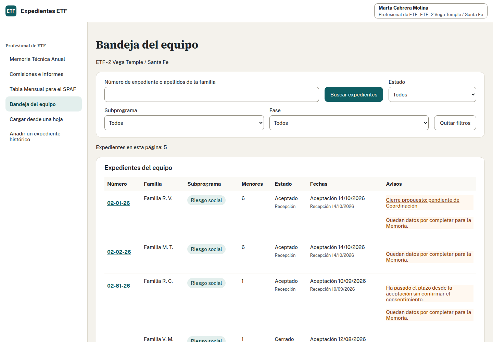

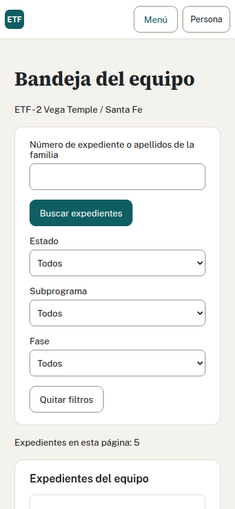

## Cómo me oriento en todas las pestañas

La cabecera de la ficha muestra número, estado y fechas confirmadas.

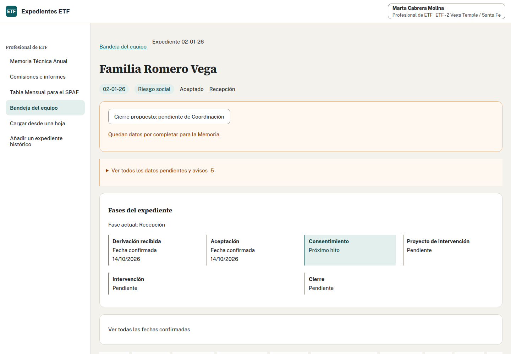

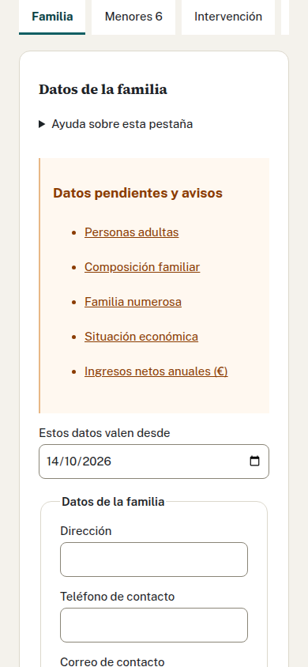

Usa las pestañas para trabajar en este orden:

| Pestaña | Qué haces |
| --- | --- |
| Familia | Revisa contacto, situación familiar, ingresos y personas adultas. |
| Menores | Registra las personas menores, sus datos y subprogramas. |
| Intervención | Anota fase, coordinación con recursos, factores y tipologías. |
| Consentimiento | Descarga el consentimiento y confirma su fecha y la del proyecto. |
| Evaluación | Anota instrumentos y resultados opcionales por adulto y momento. |
| Documentos | Consulta las emisiones, sus fechas y referencias. |
| Cierre | Guarda la finalización, descarga Anexo 11 o 12 y propone el cierre. |
| Salidas | Prepara el Anexo 5 y confirma envío y respuesta. |
| Seguimiento tras cese | Consulta y registra el seguimiento cuando corresponde. |
| Historial | Comprueba actuaciones, cierres, reaperturas y cambios anteriores. |

Guardar una pestaña no guarda las demás. Antes de cambiar, termina el guardado o usa el diálogo para seguir editando o descartar. En un expediente cerrado sólo puedes actuar sobre el seguimiento; pide a Coordinación la reapertura si necesitas corregir otros datos.

## Cómo edito la familia y las personas adultas
Abre un expediente de tu equipo y entra en «Familia». Puedes editar los datos mientras el expediente esté aceptado o en intervención. Coordinación puede consultarlos.

1. Indica la «fecha desde la que son válidos» los datos. Debe estar entre la aceptación y hoy.
2. Completa dirección, teléfono y correo de contacto; composición familiar, familia numerosa, vivienda y situación económica. Si eliges otras formas de convivencia, describe la situación.
3. Introduce los ingresos netos anuales en euros, sin separador de miles; puedes usar coma decimal. La aplicación calcula el tramo comparando los ingresos con el SMI anual del año consultado, que es el mensual multiplicado por 14. Los tramos son menos del 50 %, del 50 al 100 %, del 100 al 150 %, del 150 al 200 % y más del 200 %. Si sólo conoces el tramo, elígelo. Introducir un importe borra el tramo elegido y elegir un tramo borra el importe.
4. Pulsa «Guardar datos familiares» antes de pasar a las personas adultas.
5. Completa cada persona adulta: nombre, apellidos, papel en la familia y sexo; fecha de nacimiento o edad conocida, nivel educativo, situación laboral, condición de tutor o tutora y contacto. «Añadir persona adulta» abre otra ficha. Si eliges otra situación laboral, descríbela.
6. Pulsa «Guardar personas adultas». Si necesitas retirar una persona, pulsa «Retirar persona adulta», confirma y guarda. Se retiran sus datos personales de la ficha; su participación anterior se conserva en el historial estadístico.

Los avisos de datos pendientes llevan al campo correspondiente y abren el desplegable cuando hace falta. Deja «Sin indicar» cuando no conozcas un dato opcional.

Si otra persona ha guardado cambios, tu formulario se conserva. Pulsa «Ver cambios actuales» y compara. Puedes conservar tu formulario para revisarlo y guardarlo con la versión actual, o usar los datos guardados por la otra persona. Cambiar de pestaña con cambios pendientes te permite seguir editando o descartarlos.

[Ver Familia en móvil](../capturas/equipo-gap1-familia-movil.png).

## Cómo completo la ficha de los menores

1. Abre «Menores» y despliega la persona que vas a revisar.
2. Completa nombre, apellidos, sexo, nacimiento, subprograma y escolarización con los datos comprobados. Revisa Atención Temprana y el centro de protección si corresponde.
3. Si falta alguien, pulsa «Añadir menor». Puedes registrar hasta 15 menores.
4. Indica desde qué fecha valen los cambios. Usa la fecha real: no pongas la de hoy si la situación cambió antes.
5. Pulsa «Guardar cambios» y espera «Cambios guardados con su fecha de vigencia».

Si retiras un menor del formulario y guardas, deja de aparecer entre los datos vigentes desde esa fecha. Su historia se conserva. Revisa bien la fecha antes de hacerlo.

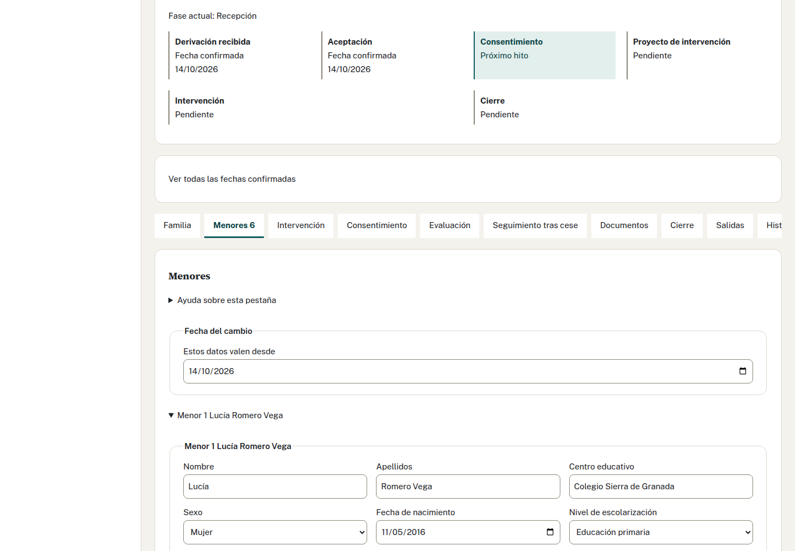

## Cómo consulto la derivación que recibió Coordinación

Coordinación sube y revisa los Anexos 3 y 4, decide la aceptación y asigna equipo y número. El profesional no realiza esas decisiones. Si necesitas comprobar un dato de origen, revisa la ficha y consulta con Coordinación; el anexo recibido no queda archivado en la aplicación.

La valoración VALÓRAME procedente de la derivación es de consulta. No la sustituyas por una escala aplicada después. Las decisiones y los formatos admitidos se explican en el [manual de Coordinación](coordinacion.md#cómo-subo-un-anexo-3-o-un-anexo-4).

## Cómo registro la intervención

1. Abre «Intervención» e indica la fecha desde la que valen los datos.
2. Elige la fase del expediente. Despliega coordinación con recursos, factores y tipologías para revisar cada lista.
3. Si conoces la información, selecciona «Datos conocidos: elige opciones o deja ninguna» y marca lo que proceda. Dejar una lista conocida sin opciones confirma que no hay ninguna. «Sin indicar» mantiene el dato pendiente.
4. En cada opción marcada, abre «Ver a qué menores se aplica». Desmarca a quien quede fuera de esa situación.
5. Pulsa «Guardar cambios» y comprueba la confirmación. Si aparece conflicto, sigue [estos pasos](comun.md#qué-hago-si-otra-persona-ha-guardado-cambios).

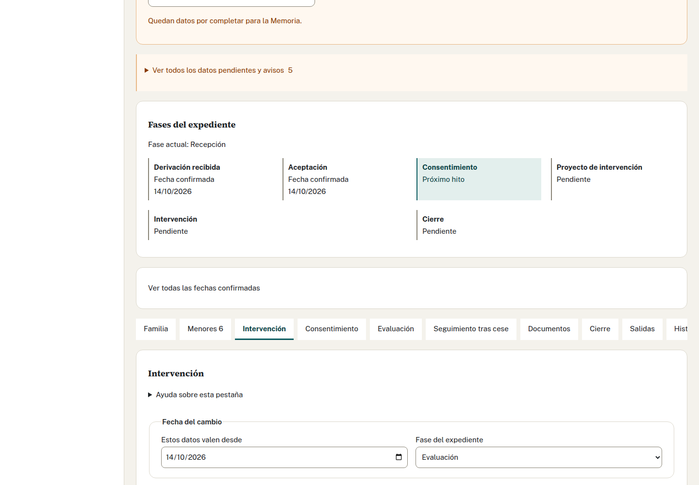

Los avisos de la ficha enlazan con los campos pendientes. Completar un dato puede quitar su aviso; otros «Sin dato» pueden depender de información que todavía no llega a las estadísticas.

## Cómo registro el consentimiento y la fecha del proyecto

1. Abre «Consentimiento» y descarga el Anexo 1 para Riesgo o el Anexo 2 para Reunificación.
2. Tramita la firma fuera de la aplicación. El DNI del representante queda en blanco en el Word y no se guarda.
3. Cuando esté firmado, anota su fecha real y pulsa «Confirmar fecha». Descargar el Word por sí solo no confirma el consentimiento.
4. Elabora fuera de la aplicación el proyecto de intervención: Anexo 7 para Riesgo o Anexo 8 para Reunificación.
5. Anota y confirma la fecha real del proyecto en esta misma pestaña. Comprueba las fechas confirmadas de la ficha.

Tras más de 30 días desde la aceptación sin consentimiento aparece el aviso de pendiente de atender. Si la familia no consiente, puedes proponer el cierre sin inventar una fecha de consentimiento.

## Cómo anoto una evaluación

Las escalas son opcionales. Puedes anotarlas aquí o rellenarlas después en el Word de los Anexos 11 y 12. No necesitas completar todas las escalas ni sus tres momentos para descargar documentos, cerrar un expediente o preparar la Memoria.

1. Abre «Evaluación» y elige el adulto al que se ha aplicado el instrumento.
2. Selecciona el momento: inicial, intermedio o final.
3. Elige el instrumento o escala e indica la fecha de aplicación.
4. Si aparece un cuestionario publicado, puedes completar las respuestas que tengas. Puedes registrar el instrumento aunque su cuestionario todavía no esté publicado. La app no calcula puntuaciones totales.
5. Pulsa «Guardar evaluación» y comprueba que aparece en «Evaluaciones registradas» con la persona, instrumento, momento y fecha correctos.

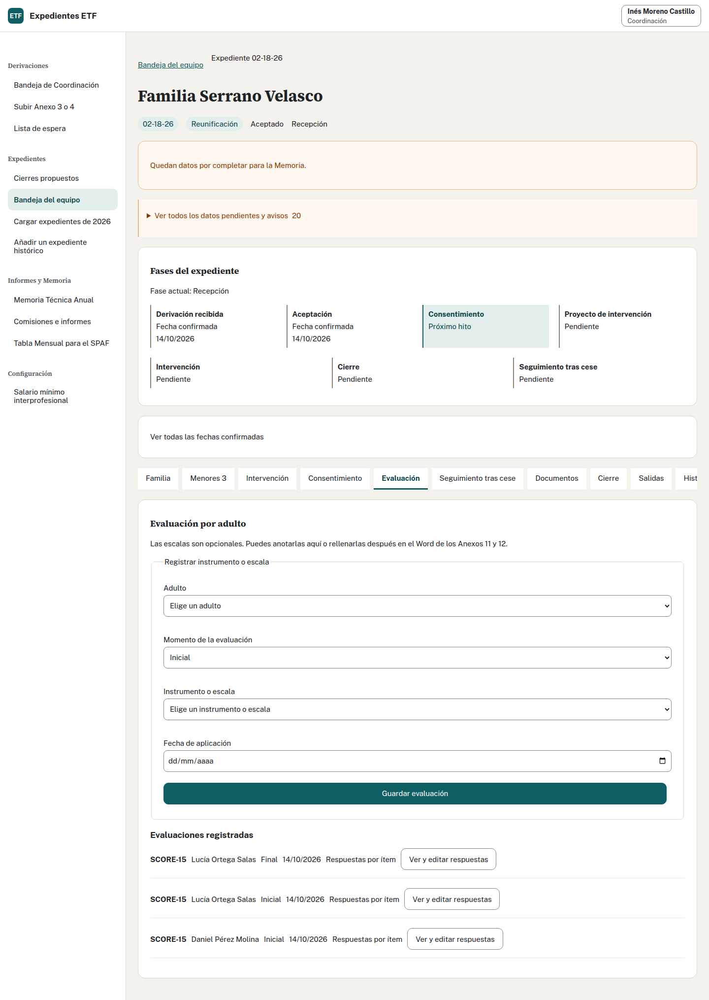

## Cómo registro una comisión técnica o un informe

1. Abre «Comisiones e informes».
2. Para una comisión, elige registrar comisión técnica e indica su fecha y las observaciones que correspondan.
3. Para un informe, abre la sección de informes e indica fecha y organismo destinatario.
4. Guarda y comprueba el registro con los filtros de año y fecha; en informes puedes filtrar también por organismo.
5. Si necesitas corregir o borrar, usa la acción de tu registro y revisa el resultado. Sólo puedes modificar los tuyos dentro de tu equipo.

Son registros del equipo, no de un expediente. Alimentan los apartados 15 y 16 de la Memoria. Un cambio posterior no altera una Memoria ya cerrada.

Vídeo: «Registrar una comisión técnica y un informe» ([guion](../recorridos/guiones/03-actividad.md)).

## Cómo consulto Documentos e Historial

1. En «Documentos», localiza la emisión por tipo y fecha. Comprueba quién la generó y las referencias que aparecen. Una emisión acredita la generación del Word, no su firma.
2. Para generar un documento, usa la acción de su tarea: consentimiento, salida o cierre. Revisa los datos y guarda los cambios antes de descargar.
3. En «Historial», revisa las actuaciones y los episodios de cierre y reapertura. Comprueba fechas antes de solicitar una corrección a Coordinación.
4. Conserva los originales y los Word descargados en la ubicación de trabajo autorizada. La aplicación no archiva los ficheros recibidos ni los documentos generados.

No se suben documentos firmados a una pestaña del expediente. Los Anexos 7 y 8 se preparan fuera y sólo se anota su fecha. Si una descarga falla, sigue la [recuperación de documentos](comun.md#qué-hago-si-falla-una-descarga).

## Cómo preparo una derivación al SPM

1. Abre «Salidas» e indica el motivo y la propuesta de medida para el Servicio de Protección de Menores (SPM).
2. Guarda la propuesta y descarga el Anexo 5. Revisa el Word: lleva los datos disponibles de los apartados 1 a 4; completa fuera los apartados 5 a 8.
3. Firma y tramita el documento fuera de la aplicación.
4. Anota la fecha real de envío y pulsa «Confirmar la fecha de envío». La descarga no confirma ese envío.
5. Cuando llegue respuesta, elige la opción correspondiente, indica su fecha y pulsa «Guardar respuesta».

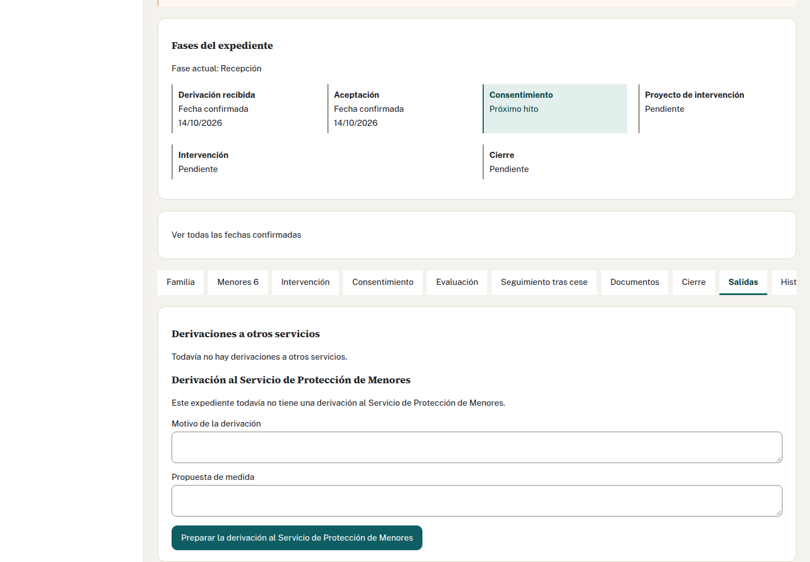

Mientras no haya una respuesta que permita cerrar, el cierre ordinario permanece bloqueado. «A la espera» mantiene el bloqueo. Las respuestas que lo permiten son que se conoce inicio de procedimiento de desamparo o adopción de medida, o que el SPM no valora necesaria la medida. Coordinación puede autorizar una excepción dejando el motivo.

## Cómo preparo una derivación a otro servicio

1. Desde la ficha, pulsa «Derivar a otro servicio · Anexo 6». Coordinación también puede abrirla desde «Salidas/cierre».
2. Elige el servicio de destino, escribe el motivo y pulsa «Guardar propuesta de derivación». Si no hay destinos publicados, escribe el nombre del servicio. Cuando haya opciones, elige una de la lista.
3. Descarga el Anexo 6. Lleva la fecha propuesta de hoy y los datos disponibles de los apartados 1 a 4; recoge los cambios guardados en Familia y Menores. Revisa esos datos y completa los apartados 5 a 8, incluido el motivo, en el Word.
4. Firma y tramita el documento fuera de la aplicación.
5. Indica la fecha real de envío y pulsa «Confirmar la fecha de envío». Comprueba que aparece junto a la salida.

Puedes registrar varias salidas a otros servicios. La descarga conserva la versión de plantilla utilizada y no confirma el envío. Estas salidas no cambian el estado del expediente ni bloquean su cierre.

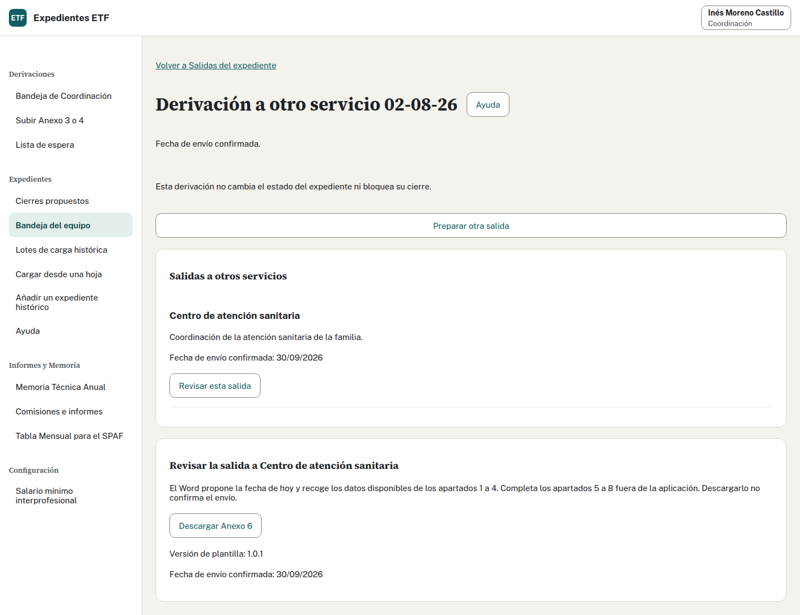

## Cómo propongo el cierre

1. Abre «Cierre» y elige el motivo de finalización.
2. Completa la derivación tras el cierre, la coordinación con recursos y los objetivos abordados y pendientes que correspondan.
3. Si la familia no ha consentido y el expediente sigue aceptado, marca «La familia no ha consentido la intervención» y elige su motivo.
4. Pulsa «Guardar datos de finalización» y comprueba la confirmación.
5. Pulsa «Proponer el cierre a Coordinación». La propuesta queda pendiente; el expediente conserva su estado hasta que Coordinación cierre.

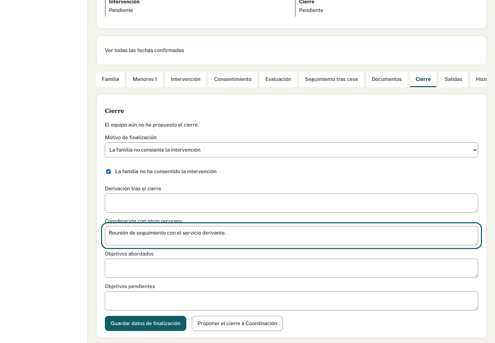

Entra en «Cierre» y guarda los datos de finalización que quieras incluir. En «Documentos de finalización», pulsa «Descargar Anexo 11» si el subprograma es riesgo social, o «Descargar Anexo 12» si es reunificación. La pantalla ofrece el documento que corresponde al expediente.

La descarga entrega un Word y queda registrada. Las casillas de escalas anotadas se rellenan; las demás quedan vacías para que puedas escribir después. Si hay varios sujetos en una casilla, cada resultado lleva sus iniciales y se separa del siguiente por «; ». No se combinan sus puntuaciones. Descargarlo no propone el cierre ni confirma una firma o un envío. La propuesta de cierre se hace con su acción propia y Coordinación confirma después el cierre. Guarda el Word sólo donde te indique el Programa: contiene datos personales.

Si has cambiado los datos de finalización, guarda antes de descargar. Ante un aviso de cambios de otra persona, revisa la versión actual antes de volver a intentarlo. Coordinación consulta esta pestaña; estas descargas corresponden al profesional del ETF.

[Ver Cierre en móvil](../capturas/equipo-gap1-cierre-movil.png).

Para corregir la finalización cuando ya hay una propuesta pendiente, pulsa «Retirar la propuesta de cierre», guarda la corrección y vuelve a proponer.

Vídeo: «Cerrar un expediente» ([guion](../recorridos/guiones/07-cierre.md)). Muestra la propuesta y la consulta del Anexo 11 ya emitido.

### Cómo elijo el motivo de finalización

Elige la opción que describe el resultado registrado: objetivos cumplidos o parcialmente cumplidos, falta de adherencia, abandono por la familia, traslado, mayoría de edad, ingreso en centro, declaración de riesgo, medida protectora, otros motivos o falta de consentimiento. Añade el detalle en su campo cuando haga falta; no cambies el motivo para evitar un bloqueo.

La aplicación adapta el motivo a las listas del Acta y del SPAF. Sus etiquetas pueden diferir. Coordinación puede escribir el motivo del Acta al confirmar; revisa el Word final. Si cambia la finalización antes de confirmar, retira la propuesta, corrige y vuelve a proponer.

## Cómo solicito un traslado o una reapertura

Para trasladar a otro ETF, guarda la finalización con el motivo de traslado y propón el cierre. Coordinación elige el destino y confirma con otra cuenta. Sigue los [pasos del traslado](coordinacion.md#cómo-traslado-un-caso-a-otro-equipo).

El expediente de origen queda cerrado. Destino recibe una derivación con familia, adultos y menores vigentes; Coordinación la acepta con número nuevo. No arrastra el consentimiento ni las fechas confirmadas de origen. Comprueba el enlace entre ambos casos antes de continuar el trabajo.

Para corregir un expediente cerrado, pide a Coordinación la reapertura indicando la actuación y la fecha que hay que revisar. El cierre anterior permanece en la historia. Si se recibe una nueva derivación de la familia, Coordinación registra un caso nuevo enlazado al anterior.

## Cómo llevo el seguimiento tras cese

1. Abre el expediente cerrado de Reunificación y entra en «Seguimiento tras cese».
2. Indica la fecha real de cese de la medida y confirma el inicio del seguimiento.
3. Comprueba la fecha prevista de fin. El plazo inicial es de 12 meses; la aplicación avisa cuando se acerca y lo termina al vencer.
4. Si procede terminar antes, indica la fecha y el motivo en «Terminar el seguimiento antes» y confirma.
5. Si hay que reabrir el seguimiento, pídelo a Coordinación. La reapertura inicia un plazo completo desde su fecha y conserva la historia anterior.

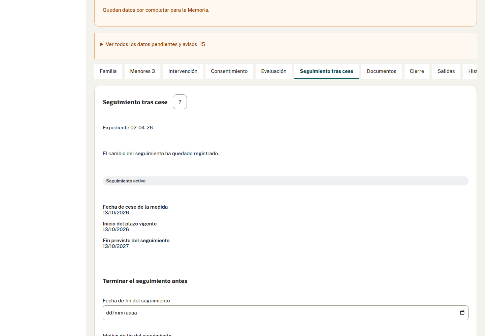

El seguimiento no cambia el cierre del periodo anterior de intervención.

## Cómo preparo la Tabla SPAF

1. Abre «Tabla Mensual para el SPAF» y elige un mes ya terminado.
2. Comprueba que consultas tu equipo. Revisa altas, bajas, total de casos y total de menores.
3. Pulsa los números de las altas o bajas para comprobar sus movimientos. Al volver se mantiene el equipo y mes.
4. Revisa la tabla; desplázate dentro de ella para ver las 14 columnas. Comprueba los «Sin dato» antes de descargar.
5. Pulsa la descarga en Word y guarda el archivo donde indique el Programa. Tramita su envío fuera de la aplicación.

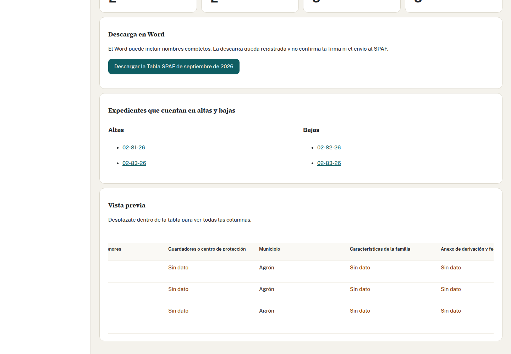

Entran los aceptados hasta el final del mes que siguen abiertos y los cerrados dentro de ese mes. La columna de motivo de cierre usa las equivalencias del SPAF; puede mostrar una etiqueta distinta de la ficha. Los cerrados antes de su primer día quedan fuera. Si hay cambios mientras revisas, vuelve a consultar la tabla antes de descargar. La columna 5 muestra el municipio de la familia. No se introduce una ZTS. Comprueba que el municipio coincide con el de la ficha; algunas capturas anteriores muestran más datos ausentes que el cálculo actual.

Vídeo: «Preparar la Tabla SPAF del mes» ([guion](../recorridos/guiones/06-spaf.md)).

## Cómo preparo y cierro la Memoria de mi equipo

1. Antes de cerrar, revisa los datos del año en las fichas, las fechas confirmadas, los menores, la intervención y los registros de comisiones e informes.
2. Abre «Memoria Técnica Anual», elige el año y pulsa «Consultar la Memoria». Sólo puedes trabajar con tu equipo.
3. Revisa sus cuatro bloques: apartados 1 a 6, 7 a 13, 14 a 21 y 22 a 28. Cada tabla indica qué cuenta, la base de su porcentaje y los «Sin dato». Los avisos permiten abrir el bloque afectado.
4. Completa «Textos de la Memoria»: datos generales del equipo, metodología, dificultades, propuestas de mejora y valoración global. Respeta el máximo indicado: 25 líneas en los textos que lo señalan y 30 en valoración global.
5. Pulsa «Guardar los textos». La descarga y el cierre quedan bloqueados mientras haya cambios sin guardar.
6. Pulsa «Descargar la Memoria en Word», revisa el documento y guarda el archivo donde indique el Programa. Descargar no cierra la Memoria.
7. Cuando hayas revisado cifras y textos con el Programa, pulsa «Cerrar la Memoria» y después «Confirmar el cierre» en el diálogo. Comprueba «Memoria cerrada» y su fecha.

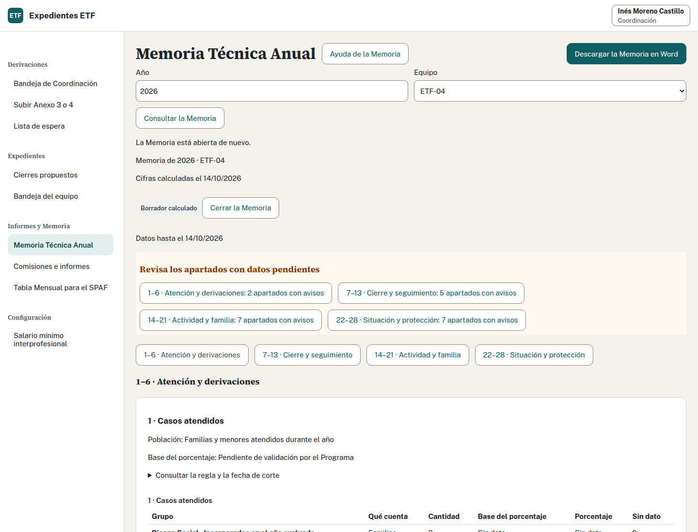

[Captura completa de la Memoria](../capturas/memoria-escritorio.png).

Una Memoria cerrada fija sus cifras y textos. Las correcciones posteriores de expedientes no cambian esa foto; pide a Coordinación que valore [reabrirla con motivo](coordinacion.md#cómo-reabro-una-memoria-para-corregirla). Sólo Coordinación puede reabrirla; después revisa el borrador y confirma un nuevo cierre. Si se pierde la respuesta de una operación, usa la recuperación que ofrece la pantalla antes de repetirla desde otro formulario.

Pulsa una cantidad, base o «Sin dato» para ver qué expedientes la forman. La lista muestra número, equipo y cantidad aportada, sin nombres. Puedes abrir la ficha si tienes acceso. «Volver a la Memoria» conserva el año, equipo y bloque. En una Memoria cerrada ves la foto de la revisión; si se cerró antes de guardar el desglose, un aviso explica que no está disponible. Las comisiones y los informes cuentan actividad del equipo y no están vinculados a expedientes. Algunos porcentajes y resultados requieren validación del Programa; no conviertas sus «Sin dato» en ceros. Vídeo: «Preparar y cerrar la Memoria» ([guion](../recorridos/guiones/09-memoria.md)).

## Cómo cargo un caso de 2026 a mano

Incluye todos los expedientes que siguen abiertos, aunque se aceptaran en 2022, 2023
u otro año anterior, los cerrados durante 2026 y las derivaciones no aceptadas de 2026.
Usa «Añadir un expediente histórico» para conservar las fechas antiguas. Puedes
partir de las actas o introducir los datos a mano.

1. Abre «Añadir un expediente histórico» y comprueba tu equipo.
2. Si tienes las actas, elige el Acta de Aceptación y, si está cerrado, su Acta de Cierre. Admite PDF, también firmado, Word (.docx) o LibreOffice (.odt), hasta 10 MB por acta. Pulsa «Leer y rellenar los datos». Esta lectura sustituye los datos del formulario; los ficheros se descartan y todavía no se guarda el expediente. Si no tienes actas, sigue a mano.
3. Revisa lo leído. Confirma el estado actual, el anexo de derivación original y su fecha. En un no aceptado, indica fecha y motivo de no aceptación y deja vacío el número.
4. Comprueba el número original, la fecha de aceptación, municipio, centro, subprograma, puesto de referencia y descripción. Si un dato obligatorio no se lee, complétalo a mano. Si desconoces el número, déjalo vacío: no se asignará uno nuevo.
5. Revisa la familia, las personas adultas y los menores. Si el nombre y los apellidos se leen juntos, pulsa «Separar nombre y apellidos» e introdúcelos en sus campos; el nombre completo del acta queda visible como referencia. Completa el sexo que falte; no se deduce del nombre. Revisa nacimientos conocidos. Conserva el cierre anterior y añade un episodio por cada reapertura, con sus fechas y motivos. Si subiste cierre, confirma la fecha y el motivo de catálogo, además del texto del acta.
6. Pulsa «Revisar el expediente». Corrige los campos señalados y comprueba número, estado y fechas. Revisar todavía no guarda.
7. Pulsa «Confirmar el expediente». Espera «Carga completada», abre la ficha y comprueba la marca «Cargado para revisión», los adultos, menores y fechas originales.

Un PDF que sólo contiene una imagen puede no aportar datos: complétalos a mano.
Una fecha leída de la firma del PDF es una propuesta para confirmar; la aplicación
no comprueba si la firma es válida. Si el antivirus no responde aparece un aviso;
si detecta una infección, la lectura se detiene.

La carga conserva números e historia y no genera documentos. Si se pierde la
conexión al confirmar, usa «Recuperar el resultado» antes de preparar otra carga.
El profesional carga sólo su equipo; Coordinación puede elegir cualquiera.
La compatibilidad [CSV/XLSX](coordinacion.md#cómo-cargo-los-casos-de-2026-desde-una-hoja)
sigue disponible, aunque el Programa no dispone de hoja.

Usa la demostración sólo con datos inventados. Introduce los expedientes de trabajo en la dirección de producción que te facilite Informática.

## Cómo uso preferencias, la app instalada y Windows

Los pasos son comunes a ambos perfiles: [idioma, tema y ayuda](comun.md#entrada-preferencias-y-ayuda), [instalación en Edge o Chrome y uso en Windows](comun.md#instalar-y-usar-la-aplicación-en-windows).

## Qué hago si algo falla

Consulta las [preguntas frecuentes comunes](comun.md#preguntas-frecuentes): acceso pendiente, conflictos, confirmaciones perdidas, ficheros rechazados, descargas y datos pendientes. El [glosario](comun.md#glosario-de-la-aplicación) explica los términos de las pantallas.
