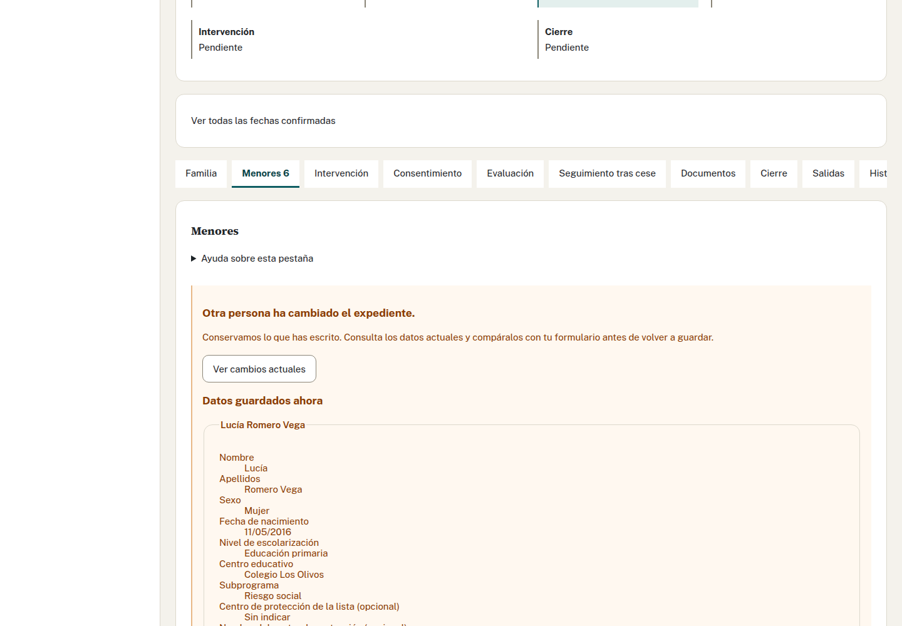

# Manuales de Expedientes ETF

Elige el manual que corresponde a tu trabajo:

- [Profesionales de los ETF](profesionales.md) · [PDF](profesionales.pdf): ficha, consentimiento, intervención, salidas, propuesta de cierre, actividad y Tabla SPAF.
- [Coordinación](coordinacion.md) · [PDF](coordinacion.pdf): recepción de anexos, decisiones, documentos, cierre, reapertura y traslado.
- [Hoja de Administración funcional](administracion.md) · [PDF](administracion.pdf): acceso del personal, opciones, plantillas, idiomas y temas.

Las capturas muestran la aplicación con personas y expedientes inventados. Algunas proceden de recorridos anteriores y pueden tener un menú más corto. Los números, fechas y nombres que ves sirven para orientarte: usa los de tu caso.

Familia permite editar los datos familiares y las personas adultas con fecha de vigencia, y conserva el formulario si otra persona guarda cambios. La Memoria ya permite consultar cifras, guardar textos, descargar, cerrar y reabrir. La carga histórica de 2026 permite añadir casos a mano y revisar y confirmar una hoja.

## Instalar la aplicación desde Edge

1. Abre Expedientes ETF en Edge, desde la red de tu entidad o con la VPN conectada.
2. Abre el menú de Edge con los tres puntos. En **Aplicaciones**, elige **Instalar este sitio como una aplicación**. Si la barra de direcciones muestra el icono para instalar, también puedes pulsarlo.
3. Comprueba que el nombre es **Expedientes ETF** y pulsa **Instalar**.
4. Abre la aplicación desde el menú Inicio. Se abrirá en su propia ventana, sin pestañas. Puedes anclarla a la barra de tareas desde las opciones que ofrece Edge.

La instalación no cambia tu acceso ni tus permisos. Necesitas conexión al servidor para trabajar. Si ves «Sin conexión con el servidor», comprueba la red o la VPN y pulsa **Volver a intentarlo**. Los expedientes no están disponibles sin conexión.

Si no aparece la opción de instalar, comprueba que has abierto la dirección segura que te dio Informática. Las restricciones de Edge de tu organización también pueden impedir instalar aplicaciones; en ese caso, puedes seguir entrando desde el navegador.

## Vídeos de demostración

Los enlaces siguientes abren el guion. Para ver la grabación, pide el MP4 por su título a quien organiza la formación. Los vídeos se guardan fuera del repositorio; el enlace al guion no reproduce el vídeo.

| Título del vídeo | Guion |
| --- | --- |
| Entrar y dar acceso a un profesional | [01-entrada](../recorridos/guiones/01-entrada.md) |
| Recibir una derivación y aceptarla | [02-coordinacion](../recorridos/guiones/02-coordinacion.md) |
| Registrar una comisión técnica y un informe | [03-actividad](../recorridos/guiones/03-actividad.md) |
| Publicar una plantilla Word nueva | [04-plantillas](../recorridos/guiones/04-plantillas.md) |
| Preparar la Tabla SPAF del mes | [06-spaf](../recorridos/guiones/06-spaf.md) |
| Cerrar un expediente | [07-cierre](../recorridos/guiones/07-cierre.md) |

En «Cerrar un expediente», el vídeo muestra la emisión del Anexo 11 en Documentos. Ahora también puedes descargarlo desde Cierre; en reunificación se ofrece el Anexo 12. La descarga y la propuesta de cierre son acciones separadas.

## Cargar expedientes desde las actas

Incluye todos los abiertos de cualquier año anterior, los cerrados durante 2026
y las derivaciones no aceptadas de 2026. El Programa no tiene hoja de cálculo.
Sube el Acta de Aceptación y, si está cerrado, el Acta de Cierre, o completa los
datos a mano. La aplicación propone lo que lee; revisa y confirma antes de guardar.
Consulta [los pasos para equipos](profesionales.md#cómo-cargo-un-caso-de-2026-a-mano)
y [la carga de Coordinación](coordinacion.md#cómo-cargo-los-casos-de-2026-desde-una-hoja).

## Glosario del Programa

| Término | Qué significa aquí |
| --- | --- |
| ETF | Equipo de Tratamiento Familiar. Atiende a las familias de su ámbito. |
| PTF | Programa de Tratamiento a Familias. |
| Servicios Sociales Comunitarios (SS.SS.CC.) | Servicio que puede derivar una familia mediante el Anexo 3. |
| SPM | Servicio de Protección de Menores. Puede derivar mediante el Anexo 4 y recibe las propuestas del Anexo 5. |
| SPAF | Servicio de Prevención y Apoyo a la Familia. Recibe la Tabla Mensual del equipo. |
| ZTS | Zona de Trabajo Social. Su correspondencia para la Tabla SPAF está pendiente de confirmar con el Programa. |
| Subprograma | Riesgo o Reunificación. Cada menor puede tener el suyo. |
| Derivación recibida | Caso registrado que Coordinación todavía no ha aceptado, no aceptado o dejado en espera. |
| Lista de espera | Caso de Servicios Sociales Comunitarios pendiente de plaza. No tiene número de aceptación ni cuenta en la Memoria mientras espera. |
| Profesional de referencia | Profesional del ETF que se indica al aceptar. No es la persona que coordina el caso en el servicio derivante. |
| Acta de Aceptación | Documento de la aceptación. Su fecha confirmada inicia los plazos del expediente. |
| Correlativo | Número que avanza con cada aceptación de un equipo dentro del año. |
| Anexos 1 y 2 | Consentimiento de Riesgo y de Reunificación, respectivamente. |
| Anexos 3 y 4 | Derivación de Servicios Sociales Comunitarios y del SPM, respectivamente. |
| Anexos 5 y 6 | Derivación al SPM y a otro servicio, respectivamente. |
| Anexos 7 y 8 | Proyecto de intervención de Riesgo y de Reunificación. Se elaboran fuera; en la aplicación anotas su fecha. |
| Anexos 11 y 12 | Finalización de Riesgo y de Reunificación. La propuesta del equipo precede al Acta de Cierre de Coordinación. |
| DSR | Declaración de Situación de Riesgo. La ficha distingue su propuesta y el plan familiar derivado de ella. |
| PIF | Plan de Intervención Familiar. |
| SMI | Salario mínimo interprofesional. Coordinación mantiene los importes por año. |
| Fecha de vigencia | Día desde el que un dato es válido. Permite conservar la situación anterior y calcular cada periodo con sus datos. |
| Emisión | Constancia de que se generó un documento: quién, cuándo y con qué plantilla y datos. No es el archivo Word ni acredita su firma o envío. |
| Hito confirmado | Fecha de una actuación real que tú confirmas, como la firma del consentimiento o el envío de una derivación. |
| Seguimiento tras cese | Seguimiento de Reunificación tras el cese de la medida. Su plazo inicial es de 12 meses. |
| Memoria cerrada | Cifras y textos fijados para un año y ámbito. Una corrección posterior de la ficha no cambia esa Memoria. |
| Sin dato | Información desconocida o que aún no llega al recuento. No equivale a cero ni a «ninguna opción». |

## Preguntas frecuentes

### ¿Qué se guarda y qué no?

Se guardan los datos que confirmas, su historia, las fechas de actuaciones, los registros de salida y la constancia de las emisiones. También se conservan las cifras y textos de cada Memoria cerrada.

Los Anexos 3 y 4 que subes se leen y se descartan. No puedes recuperarlos desde la aplicación. Tampoco se guardan los Word generados, los PDF firmados, las hojas de carga, las contraseñas ni el DNI del representante en el consentimiento. Guarda los originales y las descargas donde indique el Programa. Administración sí conserva las versiones de las plantillas, idiomas y temas que publica.

### ¿Qué hago si aparece un aviso de conflicto?

Otra persona ha guardado cambios después de que abrieras la ficha. En Menores e Intervención, tu formulario se conserva.

1. Pulsa «Ver cambios actuales» y compara los datos guardados con lo que has escrito.
2. Si conservas tu formulario, incorpora también los cambios de la otra persona que deban mantenerse. Habla con ella si afectan a la misma información.
3. Pulsa «Conservar mi formulario para guardar» y después «Guardar cambios». El guardado sustituye los datos actuales de esa pestaña.
4. Si prefieres los datos ya guardados, elige «Descartar mi formulario y usar los datos actuales». Esto descarta tu edición.

En Cierre, decisiones, descargas o configuración, usa la opción de consultar o recargar los cambios que ofrezca esa pantalla. Revisa de nuevo antes de confirmar. No cierres la pestaña si contiene texto que necesitas conservar.

### ¿Qué hago si no sé si se ha guardado?

1. Espera al resultado; no pulses varias veces ni abras otro formulario para repetirlo.
2. Si la pantalla ofrece recuperar o reintentar la operación, usa esa opción.
3. Consulta después el estado, las fechas o el historial. Si sigue sin quedar claro, avisa a Coordinación o a Informática e indica qué acción estabas haciendo, sin enviar datos de la familia por canales ajenos al Programa.

### ¿Descargar un documento confirma su firma o su envío?

No. Firma, envío y registro se hacen fuera. Después anotas la fecha real o el registro en la aplicación. Descargar de nuevo no cambia esas fechas.

### ¿Por qué sigo viendo «Sin dato» si he completado la ficha?

Puede faltar un dato del periodo consultado o su incorporación al cálculo. Comprueba el aviso y la fecha de vigencia. Si la ficha ya está completa y el aviso sigue, comunícalo a Coordinación. No sustituyas un desconocido por cero para quitar el aviso. La ZTS sigue pendiente de confirmar con el Programa.

### ¿Puedo corregir un expediente cerrado?

Puedes actuar sobre el seguimiento cuando corresponda. Para corregir otros datos, pide a Coordinación que valore la reapertura. Si la familia vuelve con una nueva derivación, Coordinación registra un caso nuevo enlazado al anterior.

### ¿Quién puede cerrar?

El equipo propone el cierre del expediente. Una persona de Coordinación distinta de quien lo propuso confirma el cierre. Para la Memoria, el equipo puede cerrar la suya; sólo Coordinación cierra la provincial y reabre una Memoria.

### ¿Por qué no puedo entrar o no veo una opción?

Si aparece «Pendiente de alta», Administración debe asignarte perfil y, si eres profesional, equipo. Si ya tienes acceso, comprueba tu perfil en la cabecera. Cada perfil muestra sus tareas; algunas pantallas aún están pendientes. Para problemas de contraseña o conexión, acude a Informática.

## Preparar e imprimir los PDF

Los tres PDF llevan sus capturas dentro. Puedes imprimirlos en A4. El glosario y las preguntas frecuentes se incluyen también al final de cada manual para que puedas consultarlos sin abrir esta página.

Para mantener los manuales, consulta [la guía de exportación y comprobación](LEEME.md).
