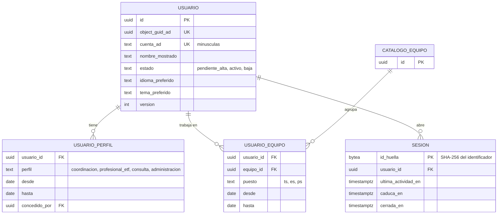
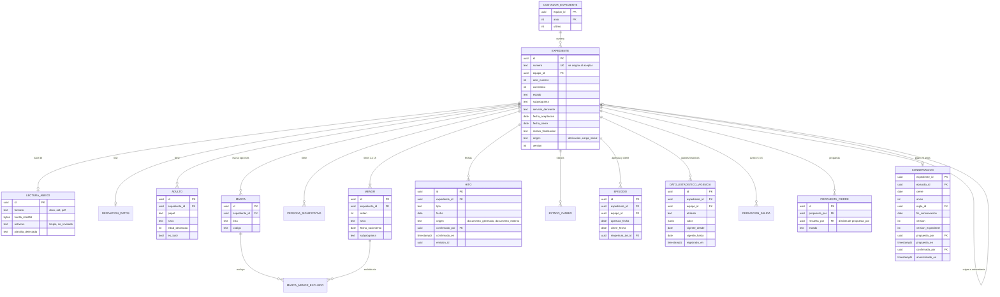
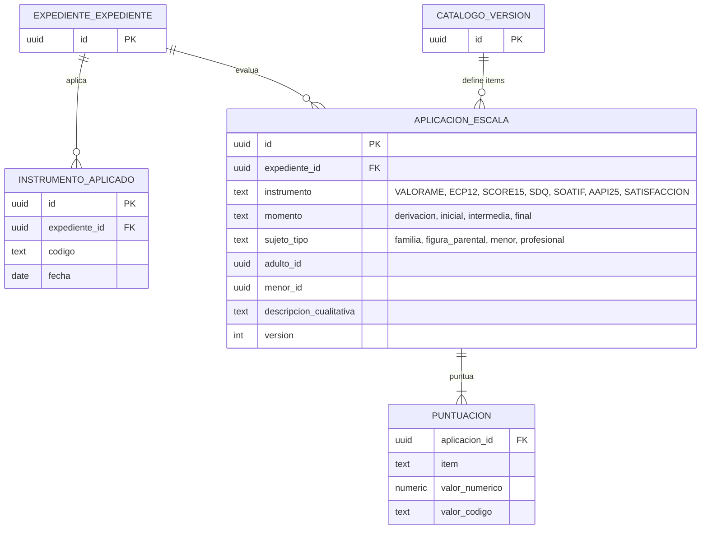
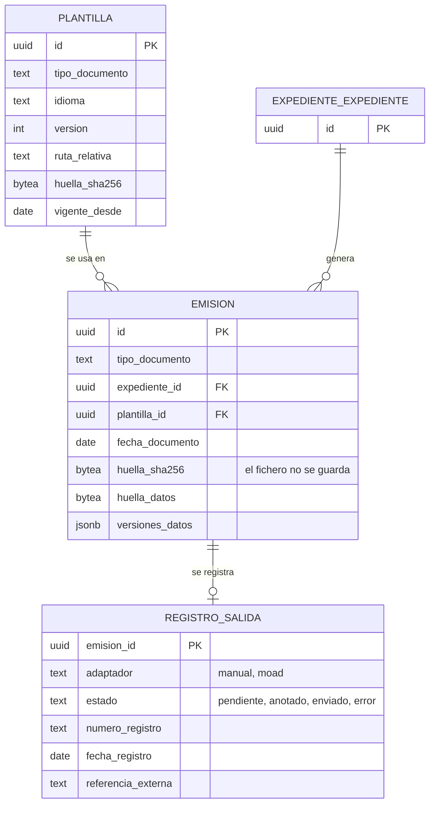
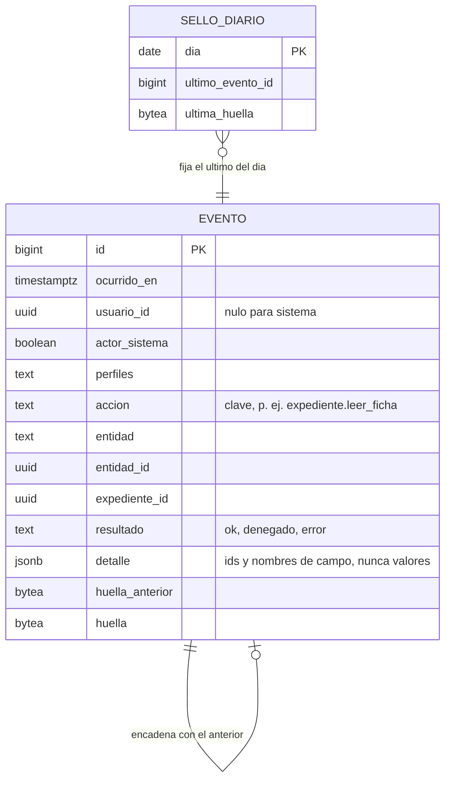

# Esquema del backend de Expedientes ETF
> Especificación de la edición pública. La entidad que la instale configura sus datos, identidad y plantillas.
> Las referencias D1–D22 se conservan en el registro de decisiones del PRD; las fuentes privadas no se distribuyen.

Este documento dice qué datos guarda Expedientes ETF, en qué tablas, quién puede
leerlas o cambiarlas dentro de la base de datos, cómo se versionan y migran, y
qué rutas ofrece el servidor. **Todavía no hay código**: todo lo que sigue está
**previsto**, y las rutas del repositorio que se citan (por ejemplo
`migraciones/expediente/` prevista) aún no existen.

Términos que salen a menudo:

- **ETF**: Equipo de Tratamiento Familiar. Cada equipo atiende unos municipios y
  lleva sus expedientes.
- **SS.SS.CC.**: Servicios Sociales Comunitarios, que derivan casos con el
  Anexo 3.
- **SPM**: Servicio de Protección de Menores de la administración competente, que deriva con el
  Anexo 4 y recibe derivaciones con el Anexo 5.
- **SPAF**: Servicio de Prevención y Apoyo a la Familia, al que cada equipo
  manda la Tabla Mensual.
- **DSR**: Declaración de Situación de Riesgo. **PIF**: Proyecto de
  Intervención Familiar (el «PIF derivado de DSR» de la ficha).
- **SMI**: Salario Mínimo Interprofesional, para pasar ingresos a tramos.
- **AD**: Active Directory, el directorio de cuentas de la entidad.
  **LDAPS**: el protocolo cifrado con el que se le pregunta.
- **RLS** (*row level security*): seguridad por filas de PostgreSQL. La base de
  datos filtra las filas que ve cada persona aunque el programa se equivoque.
- **ENS**: Esquema Nacional de Seguridad. **EIPD**: Evaluación de Impacto en la
  Protección de Datos. **DPD**: Delegado de Protección de Datos de la
  Diputación.
- **i18n** (internacionalización): preparar la app para varios idiomas sin
  tocar el código.
- **MOAD**: la plataforma de registro electrónico que usa la entidad.

Qué es la app y para quién: PRD.md. Pila, arquitectura hexagonal, sesión,
contenedores y despliegue: TRD.md. Quién hace cada paso y en qué pantalla:
FLUJO_APP.md. Cómo se ven las pantallas y los temas: DISENO_UI_UX.md. Orden de
construcción: PLAN_IMPLEMENTACION.md.

## 0. Decisiones de base

| Decisión | Elegido | Fecha y quién |
| --- | --- | --- |
| 7 · Auditoría | Se registra todo, también las lecturas (abrir una ficha, listar, descargar un documento, exportar). Registro encadenado con huella (*hash*), de sólo inserción y exportable para el DPD. Ver apartado 5. | 13/10/2026 · responsable del producto |
| 9 · Reglas que el negocio aún no ha decidido | Configurables en catálogos **versionados con fecha de vigencia**; la Memoria de un año usa la versión vigente el 31 de diciembre de ese año; nunca constantes en el código. Afecta a listas, equivalencias, plazos, tramos, numeración, escalas y plantillas. Ver apartado 1.2. | 13/10/2026 · responsable del producto |
| 13 · Base de datos y migraciones | PostgreSQL 18 con RLS. Migraciones numeradas por módulo, sólo hacia delante, ensayadas en una copia antes de aplicarlas. Ver apartado 6. | 13/10/2026 · responsable del producto |
| 17 · Idioma de documentos y comunicación | Castellano llano, sin siglas sin explicar. Nombres del dominio en castellano (tablas, columnas, rutas); términos técnicos universales en inglés. | 13/10/2026 · responsable del producto |

## 1. Mapa de datos por módulo

Cada módulo de la arquitectura hexagonal (ver TRD.md) es dueño de **un esquema
de PostgreSQL** con su mismo nombre. Todas las tablas, vistas y funciones de ese
módulo viven en su esquema y sólo las crea y cambia una migración de ese módulo.

| Esquema / módulo | Propósito | Tablas principales |
| --- | --- | --- |
| `plataforma` | Soporte técnico, migraciones y contexto; no es dominio de negocio | `migracion_aplicada`; funciones `perfiles()`, `equipos()`, `usuario_id()` |
| `identidad` | Usuarios, perfiles, equipo y sesión | `usuario`, `usuario_perfil`, `usuario_equipo`, `sesion`, `alta_administrador_inicial` |
| `catalogo` | Listas, reglas, equipos, SMI y firmantes | `version`, `equipo`, `centro_ss`, `municipio`, `municipio_asignacion`, `lista_opcion`, `equivalencia`, `parametro`, `fase_duracion`, `tramo`, `numeracion`, `escala_item`, `tipo_documento`, `smi`, `firmante` |
| `paquete` | Idiomas, temas y referencias activas | `idioma_instalado`, `tema_instalado`, `referencia_activa` |
| `expediente` | Derivación, ficha, hitos, salida, cierre, seguimiento, avisos, conservación y carga | `expediente`, `lectura_anexo`, `derivacion_datos`, `adulto`, `menor`, `persona_significativa`, `marca`, `marca_menor_excluido`, `hito`, `estado_cambio`, `episodio`, `dato_estadistico_vigencia`, `derivacion_salida`, `propuesta_cierre`, `contador_expediente`, `conservacion`, `carga_inicial` |
| `evaluacion` | Instrumentos y escalas | `instrumento_aplicado`, `aplicacion_escala`, `puntuacion` |
| `documento` | Plantillas, emisiones y registro de salida | `plantilla`, `emision`, `registro_salida` |
| `actividad` | Comisiones e informes | `comision_tecnica`, `informe_tecnico` |
| `estadistica` | SPAF, Memoria y totales | `memoria`, `memoria_revision`, proyección de cifras |
| `auditoria` | Eventos y cadena de auditoría | `evento`, `sello_diario` |

Éste es el mismo mapa de TRD §2 y PLAN §3. Para cada módulo de negocio las
rutas previstas son `internal/dominio/<módulo>/`,
`internal/aplicacion/<módulo>/`,
`internal/aplicacion/<módulo>/puertos/entrada/` (interfaces de casos de uso) e
`internal/puertos/salida/<módulo>/` (repositorios y conectores). El adaptador
HTTP importa los puertos de entrada de aplicación; los adaptadores de salida
implementan los puertos de salida. `plataforma` agrupa soporte técnico, sin
inventar un dominio de negocio. Salida, cierre, carga, conservación, SPAF y
Memoria son capacidades de los módulos indicados, no módulos nuevos.
Los módulos con operaciones repetibles añaden su `peticion_idempotente` (§4).

**Regla: ningún módulo lee ni escribe tablas de otro.** El intercambio se hace
así, de más a menos habitual:

1. **Por puertos en Go.** Un módulo llama a la interfaz (puerto) que publica el
   otro; por ejemplo, `documento` pide a `expediente` los datos para rellenar el
   Acta de Aceptación, y `expediente` le pide a `catalogo` la versión vigente de
   la numeración.
2. **Por vistas de contrato.** Cuando un cálculo necesita leer mucho de golpe
   (la Memoria, la Tabla SPAF), el módulo dueño publica en su propio esquema
   vistas con prefijo `api_` (por ejemplo `expediente.api_memoria_expediente`,
   `evaluacion.api_resumen`). Sólo esas vistas pueden leerse desde otro módulo.
   Son `security_barrier` y `security_invoker` y respetan la RLS de las tablas de debajo; una vista no concede por sí sola permiso para leer las tablas base.
3. **Claves ajenas entre esquemas, sólo hacia el identificador de la entidad
   principal**, y a las claves compuestas de pertenencia necesarias para la integridad (§3.2), del otro módulo (`expediente.expediente.id`,
   `identidad.usuario.id`, `catalogo.equipo.id`, `catalogo.version.id`), con
   `ON DELETE RESTRICT`. Una clave ajena no es «tocar la tabla»: sólo impide que
   quede un dato huérfano. Nunca se hacen `JOIN` entre esquemas en el código de
   un módulo.

Lo que **no** se guarda, por orden del cliente («Sólo datos», entrevista 2.5):
ni el Anexo 3 o 4 subido (se lee en memoria y se descarta), ni los Word
generados, ni PDF firmados. La base de datos sólo guarda datos, fechas,
huellas y referencias.

Columnas comunes de toda tabla con datos que se editan: `creado_en`,
`creado_por`, `modificado_en`, `modificado_por` (identificador de
`identidad.usuario` o la cuenta técnica `sistema`) y `version` (entero, para la
concurrencia; ver apartado 4). Las tablas del módulo `expediente` y las de
`evaluacion`, `documento` y `actividad` que cuelgan de un equipo llevan además
`equipo_id`, copiado del expediente, para que la RLS filtre sin consultas
encadenadas.

Los estados, papeles y momentos que son conceptos del programa (estado del
expediente, perfil, momento de evaluación) se guardan como `text` con una
restricción `CHECK`, no como tipos `enum` de PostgreSQL, porque cambiarlos en un
`enum` es más delicado. Los códigos que vienen de catálogos versionados (motivo
de finalización, nivel educativo…) se guardan como `text` sin clave ajena,
porque la opción puede dejar de estar vigente sin que el dato antiguo deje de
ser válido; el dominio comprueba al guardar que el código existe en la versión
vigente.

### 1.1 `identidad`: usuarios, perfiles y equipo (corrige al análisis)

SEG4 añade `revision_restauracion(id, copia_en, iniciada_en, referencia, anulada_en, confirmada_en, confirmada_por, version)` y `cambio_restauracion(id, revision_id, guid, anterior, propuesto, decision, decidido_por, decidido_en)`. La referencia completa procede del procedimiento de sistemas y queda protegida por RLS; no contiene contraseñas. Las diferencias se comparan por GUID, incluyendo personas que sólo están en una lista y perfiles o equipos futuros. Sólo hay una revisión abierta. Aplicar reutiliza el cambio de perfiles, conserva historia y revoca sesiones del destinatario; descartar deja los permisos de la copia. No se permite confirmar con pendientes ni decidir dos veces con una versión antigua. La nueva revisión anula cualquier revisión abierta anterior.

Migración `identidad/0004`, dependiente de `0003` (sin edición de permisos propios), reservada en `ETF_RESERVAS_MIGRACIONES.md`. Funciones de exportación/inicio sólo para el procedimiento de sistemas; `etf_app` no puede ejecutarlas ni escribir directamente las tablas. La aplicación usa funciones de resolución/confirmación con comprobación administrativa y auditoría transaccional. API: `GET /api/admin/restauracion`, `POST /api/admin/restauracion/{id}/cambios/{cambio}` y `POST /api/admin/restauracion/{id}/confirmar`; escrituras con CSRF y versión.

El análisis sacaba el perfil y el equipo de grupos de AD. **La entrevista lo
cambia** (3.5a): AD sólo comprueba usuario y contraseña; los permisos se dan
dentro de la app.

- `usuario(id uuid, object_guid_ad uuid único, cuenta_ad text único en minúsculas null, nombre_mostrado,
  cuenta_ad_anterior null, estado, idioma_preferido null, tema_preferido null, primer_acceso_en,
  ultimo_acceso_en, version)`. `estado` ∈ `pendiente_alta`, `activo`, `baja`.
  La primera vez que alguien con cuenta de AD entra sin perfil, se crea su fila
  en `pendiente_alta`: ve una pantalla de espera (ver FLUJO_APP.md) y
  Administración funcional le da perfil y equipo. No se guarda ninguna
  contraseña. `object_guid_ad` corresponde al `objectGUID` estable de AD: cambiar el login no crea otra identidad ni hereda permisos de una cuenta anterior. `cuenta_ad` y `nombre_mostrado` se actualizan tras autenticar contra esa identidad. Si AD reutiliza un login para otro GUID, la cuenta vigente del anterior queda nula y su último login se conserva en `cuenta_ad_anterior`; no cambia su GUID, estado ni permisos.
- `usuario_perfil(usuario_id, perfil, desde, hasta null, concedido_por)`.
  `perfil` ∈ `coordinacion`, `profesional_etf`, `consulta`, `administracion`.
  **Los perfiles se combinan**: una persona puede tener a la vez coordinación y
  administración. Lo que puede hacer es la suma de sus perfiles. Retirar un
  perfil es poner `hasta`; no se borra la fila.
- `usuario_equipo(usuario_id, equipo_id, puesto, desde, hasta null,
  asignado_por)`. `puesto` ∈ `ts` (trabajo social), `es` (educación social),
  `ps` (psicología): sirve para el «profesional de referencia» del Acta. Sólo
  tiene sentido con el perfil `profesional_etf`. **Un solo equipo activo a la vez**
  por persona: índice único parcial sobre `usuario_id` donde `hasta is null` y
  exclusión de intervalos de asignación solapados. Es una decisión firme.
- `sesion(id_huella bytea, usuario_id, creada_en, ultima_actividad_en,
  caduca_en, cerrada_en null, motivo_cierre null, ip, huella_csrf)`. La sesión
  vive en el servidor; el navegador sólo guarda un identificador opaco en una
  cookie `HttpOnly`, `Secure`, `SameSite=Strict` (decisión 6; los tiempos de
  caducidad están en TRD.md). La base de datos guarda **la huella SHA-256 del
  identificador, nunca el identificador**: quien lea la tabla no puede
  suplantar a nadie. Si AD no responde, nadie nuevo entra; las sesiones ya
  abiertas siguen hasta caducar. F0.09b crea usuario y sesión, con funciones del módulo, RLS forzada y auditoría F0.08b en la misma transacción. F0.10 añade perfiles con vigencia, adscripción única y FK al catálogo de equipos de F0.12, administración de usuarios y alta inicial única con marca persistente. El testigo CSRF se deriva mediante HMAC en el servidor, sin columna adicional en esta entrega. SEG1 conserva ese esquema: el límite de inactividad es 30 minutos y el absoluto 8 horas por defecto, configurables. La lectura pasiva de sesión no cambia `ultima_actividad_en`; la continuación sí, tras validar vigencia. Las cabeceras entregan caducidad, máximo y hora del servidor sin identidad adicional.
- **Primer administrador**: `ETF_PRIMER_ADMINISTRADOR` identifica la cuenta
  configurada para el alta inicial. Se valida su identidad estable en AD y la
  concesión se ejecuta **una sola vez**, con bloqueo y registro único en
  `alta_administrador_inicial(id, usuario_id, object_guid_ad, realizado_en)` y
  evento auditado en la misma transacción. Un reinicio o la retirada posterior
  de todos los administradores nunca vuelve a conceder el perfil. La
  recuperación se tramita de forma explícita y auditada por soporte autorizado.

- El personal de Informática administra el servidor pero no tiene perfil en la
  app.

### 1.2 `catalogo`: catálogos versionados con vigencia (decisión 9)

Todo lo que el negocio puede cambiar sin programar vive aquí: catálogos y
listas, equivalencias, plazos y tramos, numeración, escalas, tipos de documento
con su necesidad de registro de salida, firmantes y destinatarios, y el SMI
(entrevista 5.3). Lo mantiene Administración funcional; el SMI, Coordinación
(entrevista 5.4).

**Cómo se versiona.** Cada grupo de reglas (un **ámbito**: `listas`,
`equivalencias`, `plazos`, `tramos`, `numeracion`, `escalas`, `asignacion_municipios`,
`tipos_documento`) tiene versiones:

- `version(id, ambito, numero, vigente_desde date, vigente_hasta date null,
  estado, motivo, creada_por, publicada_por null, publicada_en null)`;
  `estado` ∈ `borrador`, `publicada`, `retirada`.
- Las filas de reglas (`lista_opcion`, `equivalencia`, `parametro`, …) llevan
  `version_id`. Cambiar una regla es **crear una versión nueva** que copia la
  anterior, cambiarla en borrador y publicarla con su fecha de vigencia.
- Una versión publicada **no se modifica**: un disparador impide `UPDATE` y
  `DELETE` de sus filas. Una restricción de exclusión sobre
  `daterange(vigente_desde, vigente_hasta)` impide que dos versiones publicadas
  del mismo ámbito se solapen. Publicar usa una operación controlada: bajo bloqueo de ámbito se
  cierra `vigente_hasta` de la anterior y se activa la nueva en una transacción
  auditada. Esa operación sólo ajusta la vigencia; no cambia el contenido
  publicado. Los cambios de límites conservan su historia.
- **Qué versión usa cada cálculo.** Reglas de un caso (plazo de 30 días,
  duración de las fases, formato del número): la vigente en la fecha del hecho
  (la fecha del Acta de Aceptación, el día del cálculo del aviso…). Memoria del
  año A y Tabla SPAF del mes M: la vigente el **31 de diciembre de A** o el
  último día de M. Esto concreta la decisión 9 para cuando una regla cambia a
  mitad de año y es decisión firme del responsable del producto. La Memoria cerrada guarda qué
  versión de cada ámbito usó.

**Editor de ubicaciones (UBI1).** `catalogo/0015` añade instantáneas inmutables `ubicacion_vigencia(version_id,tipo,id,activo_desde,activo_hasta)` y `municipio_ambito(version_id,municipio_id,ambito_diputacion)`. Las identidades originales permanecen inmutables. `editar_ubicacion` copia la versión anterior, modifica una entrada y publica bajo el bloqueo del ámbito; sólo Administración puede escribir. La fecha de alta de una identidad nueva no precede a su publicación, para no incorporarla a versiones antiguas. RLS limita la lectura a versiones visibles y los perfiles operativos autorizados; la app no recibe permisos de escritura directa.

`GET/PUT /api/admin/ubicaciones` exige Administración. La aplicación prepara denominaciones y variantes es/en en los directorios de idioma por huella; activa ambas referencias, guarda referencias históricas en `version_textos` y confirma la auditoría en la transacción de publicación. El lector de anexos y la bandeja consumen los nombres activados. Una baja usa intervalos abiertos por la derecha. El editor no escribe en expedientes ni en estadísticas: conserva números, equipos confirmados e instantáneas de Memorias cerradas.

La lectura conserva el contrato anterior cuando se ensaya una base sin `catalogo/0015`; no consulta las tablas nuevas hasta que existen. La publicación del editor requiere la migración completa.

**Textos de las listas.** El análisis guardaba el texto de cada opción por
idioma en una tabla `catalogo_texto`. **La entrevista lo cambia** (1.5): los
textos de listas y opciones viven en `idiomas/<código>/catalogos/`, fuera del código y
de la base de datos. La base de datos sólo guarda **códigos estables** (por
ejemplo `motivo_finalizacion.OBJ_TOTAL`); la pantalla y los Word buscan su texto
en el idioma. También los rótulos de equipos, centros y municipios, sus
variantes de búsqueda, cargos y organismos se resuelven desde ese directorio;
la base guarda sus códigos y referencias. Los nombres de personas firmantes y
sus datos de contacto son datos de negocio. Los textos libres del expediente
y los apartados narrativos de la Memoria también son datos de negocio y se
guardan en sus tablas; no son traducciones.

Tablas:

- `equipo(id, codigo '01'…'12', clave_texto, activo_desde, activo_hasta
  null)`. Los 8 equipos de hoy, con hueco hasta 12 (las plantillas de `idiomas/`).
- `centro_ss(id, codigo, clave_texto, activo_desde, activo_hasta null)`
  (las plantillas de `idiomas/`).
- `municipio(id, ine, clave_texto, tipo, matriz_id null, ambito_diputacion)`. `tipo` ∈ `municipio`, `ela` (entidad local autónoma).
  Contiene todos los municipios de la provincia (código del Instituto Nacional
  de Estadística), con la marca de si son del ámbito de la entidad [D10]. Las
  variantes de escritura del paquete de idioma sirven para encontrar el municipio en el texto del anexo.
- `municipio_asignacion(version_id, municipio_id, centro_ss_id null, equipo_id
  null, zts null)`. Dos asignaciones independientes por municipio, porque el
  centro no basta para saber el equipo (Íllora: centro Pinos Puente-Moclín,
  equipo 6) [D9]. Versionada, porque el reparto puede cambiar. `zts` se conserva en el esquema histórico, pero no se usa en la Tabla SPAF: D19 confirma el 14/10/2026 que su columna 5 contiene sólo el municipio.
- `lista_opcion(version_id, lista, codigo, orden, admite_texto, activa)`. Una
  fila por opción de cada lista del análisis, apartado 3.3: nivel de
  escolarización, composición familiar, vivienda, situación laboral y
  económica, tramo de ingresos, parentesco, papel parental [D7], subprograma,
  servicio derivante, características de la familia, finalidad, pronóstico,
  instrumentos de evaluación, fase, motivo de finalización, motivo del Acta de
  Cierre, motivo de la Tabla SPAF [D5], coordinación con recursos, factores de
  la familia y de los menores, tipologías, responsables, respuesta del SPM,
  organismos de informes, valoraciones de los anexos 3 y 4.
- `equivalencia(version_id, lista_origen, codigo_origen, lista_destino,
  codigo_destino)`. Nivel de estudios del anexo → nivel educativo de la
  Memoria; motivo de finalización → motivo del Acta de Cierre y de la Tabla SPAF
  [D5]; motivo de finalización → apartado 8 o 9 de la Memoria.
- `parametro(version_id, clave, valor_entero null, valor_texto null, unidad)`.
  Por ejemplo `plazo_consentimiento` = 30 días naturales [D3],
  `aviso_respuesta_spm` = N días (por decidir), `conservacion` = 25 años [D14],
  límites diferenciados por tipo de entrada (§1.9).
- `fase_duracion(version_id, subprograma, fase, dias_orientativos,
  dias_ampliable null)`. Duraciones orientativas de las fases para los avisos.
  F2.02 las incorpora mediante `catalogo/0012` al ámbito `plazos`, junto con
  `plazo_consentimiento` (30 días naturales). La carga expresa los meses
  orientativos de FLUJO §4.2 como periodos de 30 días. El aviso usa la duración
  orientativa, aunque exista una duración ampliable. Administración publica
  cambios por la API existente de plazos con `duracion_fase`, que contiene
  subprograma, fase, días orientativos y días ampliables opcionales. La nueva
  versión conserva todas las demás duraciones y parámetros.
- `tramo(version_id, tipo, orden, desde, hasta null, unidad)`. `tipo` ∈
  `duracion_riesgo`, `duracion_reunificacion` [D20], `ingresos_smi` [D8],
  `edad_menor` (0-5, 6-11, 12-17).
- `regla_numeracion(version_id, componentes, cifras_equipo,
  cifras_correlativo, cifras_anio, separador)`. Define el orden y la anchura
  de cada componente del número. La carga provisional D1 usa equipo,
  correlativo y año, dos cifras cada uno y separador `-`. El dominio aplica
  la regla vigente en la fecha del Acta. Un número ya asignado nunca se
  recalcula aunque cambie el formato.
- `escala_item(version_id, instrumento, item, orden, tipo_valor, lista null,
  minimo null, maximo null, sujeto, momentos text[])`. Definición de las
  escalas del apartado 1.5 de este documento: qué ítems tiene cada instrumento,
  si se puntúan con número o con una opción de lista, a quién se aplican y en
  qué momentos.
- `tipo_documento(version_id, codigo, perfil_que_genera, requiere_registro,
  plantilla_por_subprograma)`. Lista de documentos que genera la app (Acta de
  Aceptación, oficios, Anexos 1, 2, 5, 6, 11, 12, Acta de Cierre, Tabla SPAF,
  Memoria) y si su salida se registra (los oficios, en principio).
- `smi(anio, revision, importe_mensual, pagas, importe_anual, version,
  registrado_en, sustituye_revision null)` con `importe_anual` calculado. Lo
  mantiene Coordinación, por año de 2026 a 2040 y ampliable [D8]. Una corrección
  añade revisión; no borra el importe anterior. Sólo una revisión está vigente
  por año y toda Memoria cerrada referencia la revisión y el importe usados.
- `firmante(id, tipo, rol, nombre, cargo_codigo, organismo_codigo, direccion, vigente_desde,
  vigente_hasta null, version)`. Firmas («Fdo. …, Programa de Tratamiento a
  Familias con Menores») y destinatarios («A/A: … Jefe de Servicio» del SPM)
  que hoy van escritos en las plantillas; pasan a datos editables. Vigencia
  propia para que un oficio antiguo se pueda regenerar con quien firmaba
  entonces. `tipo` distingue firmantes y destinatarios. La clave es `(id, version)`;
  cada función tiene una identidad estable y sus versiones conservan nombres,
  cargos, dirección y límites de vigencia. `firmante_textos` conserva la referencia
  de cada idioma para mostrar también el cargo histórico.

El catálogo inicial (equipos, centros, municipios normalizados a mano, listas y
equivalencias sacadas de las plantillas) se carga con migraciones de datos del
módulo `catalogo` (versión 1 de cada ámbito, vigente desde el 01/01/2026).

**Implementación F0.12 (pendiente de integración).** `catalogo/0001` crea
versiones, equipos, centros, municipios, asignaciones, opciones y la historia de
publicación; `0002` carga los JSON mediante `cmd/migrar`. La carga de listas
incluye las 24 opciones explícitas del PRD §4.2; las restantes listas y reglas
siguen pendientes de sus fuentes. `etf_app` sólo lee; los borradores son
visibles únicamente para Administración. La consulta HTTP administrativa se
deniega salvo con `ETF_MODO=desarrollo`; autorización de F0.10 y auditoría
encadenada de F0.14 pendientes. Alcance y ensayo: [catálogo F0.12](../../migraciones/catalogo/LEEME.md).

### 1.3 `paquete`: idiomas, temas y referencias activas

Todo texto de interfaz, catálogo y Word vive respectivamente en
`idiomas/<código>/textos/`, `idiomas/<código>/catalogos/` y
`idiomas/<código>/plantillas/`. Los temas viven en `temas/<nombre>/`.
Administración funcional escribe esos directorios mediante versiones
inmutables; la base sólo registra referencias, huellas y activaciones.

- `idioma_instalado(id uuid, codigo, version, ruta_relativa, huella_sha256, estado,
  registrado_en, registrado_por)`, único por código y versión.
- `tema_instalado(id uuid, nombre, version, ruta_relativa, huella_sha256, estado,
  registrado_en, registrado_por)`, único por nombre y versión.
- `referencia_activa(tipo, codigo, version_contenido, version, idioma_id, tema_id, activada_por,
  activada_en)`, única por tipo y código. Incluye la selección por defecto.
- Las preferencias de cada persona guardan el código de idioma y tema. Si se
  retira uno, se usa el predeterminado. Nunca se borra contenido referenciado
  por una emisión, una Memoria o una versión de catálogo usada.

**Publicación atómica entre disco y base.** Primero se valida el paquete
(§1.9), se escribe en una ruta nueva por versión/huella y se comprueba su
contenido. Después una única transacción registra la versión, cambia la
referencia activa y confirma la auditoría. Se bloquea la referencia y se exige
su versión leída para impedir dos activaciones simultáneas. Si la transacción
falla, queda un archivo huérfano que no se sirve y se elimina mediante limpieza
controlada; nunca se sustituye un archivo activo ni se sirve por explorar el
directorio. La activación sólo publica referencias registradas y verificadas.

F0.14c-2 implementa esta publicación con `paquete/0001`. Las rutas son
`.versiones/<código>/<versión>/<huella>/<identificador exclusivo>/<código>/`
dentro del volumen correspondiente. La función `paquete.activar` bloquea la
referencia, registra la versión y llama a `auditoria.registrar` antes de
confirmar. La consulta de limpieza comparte ese bloqueo para resolver una
confirmación incierta; sólo elimina rutas no registradas. Una tarea periódica
revisa los huérfanos de más de una hora. Las versiones registradas se conservan,
aunque hayan dejado de estar activas.

El arranque público usa `paquete.referencias`, una proyección de códigos,
versiones, rutas y huellas activas que también funciona sin sesión. No entrega
actores ni contenido pendiente. Las tablas base mantienen RLS forzada y no
permiten escritura directa a `etf_app`. Los paquetes incluidos en la
distribución sirven de reserva inicial hasta la primera activación de su código;
un fallo al consultar las referencias no permite servir esa reserva.

Al crear opciones nuevas, Administración introduce los textos y la aplicación
escribe una versión nueva bajo `idiomas/<código>/catalogos/`. No se publica
una regla sin todos sus textos castellanos; para otros idiomas se admite el
recurso al castellano. El texto nunca se duplica en una tabla de traducciones.
La misma secuencia de publicación se aplica a las plantillas (§1.6).

F0.14 publica instantáneas de los textos de catálogo mediante el puerto de
`paquete`: `referencia_activa.tipo = catalogo`, código de idioma y versión
optimista independiente. La ruta es `<código>/catalogos/.versiones/<huella>.json`.
La integración INT2-b conserva `paquete/0001_versiones_activas.sql` de F0.14c-2
como base. `paquete/0002_referencias_catalogo.sql`, dependiente de esa base y
de `catalogo/0002`, amplía las restricciones sin recrear tablas: admite el tipo
`catalogo` y versiones de idioma semver o SHA-256 de 64 hexadecimales. Cada
referencia de catálogo enlaza el UUID de su entrada de idioma, con estado
`verificada`, ruta de instantánea y huella igual a su versión. Su activación
registra también un evento de paquete en la misma transacción.
`catalogo.version_textos` vincula cada versión nueva con sus textos registrados;
la carga inicial F0.12 conserva los ficheros de partida. Sólo se leen versiones
registradas y verificadas. La limpieza conserva todas las registradas y las
preparaciones de menos de 24 horas; antes de una publicación elimina los
huérfanos más antiguos bajo el mismo bloqueo de referencias. Con F0.08b,
el puerto `Registro` usa el adaptador PostgreSQL dentro de la transacción
de negocio: datos, referencias y auditoría se confirman juntos; un error
revierte los tres y un reinicio conserva los eventos confirmados.

### 1.4 `expediente`: la familia de la derivación al seguimiento

Corrige y amplía el modelo del análisis (apartado 4). Un expediente nace al
registrar una derivación y lleva un solo **estado** administrativo (ver
FLUJO_APP.md para los pasos y quién los da):

`derivacion_recibida` → `aceptada` (fase de recepción) / `no_aceptada` /
`lista_espera` → `en_intervencion` → (`derivada_spm`) → `cerrada` →
`seguimiento_tras_cese` (sólo Reunificación, 12 meses). Procesos secundarios:
no aceptar, lista de espera, derivar al SPM (Anexo 5), derivar a otro servicio
(Anexo 6, no cambia el estado), traslado entre equipos [D11] y reabrir.
Desde `aceptada` también se puede cerrar sin iniciar intervención cuando la
familia no consiente, con motivo del catálogo. Un expediente cerrado permite
editar únicamente su seguimiento; para modificar ficha, menores, factores,
evaluaciones u otros datos se exige reapertura. Los episodios anteriores se
conservan (§4). Reabrir restaura el estado coherente con los hitos: `aceptada`
si todavía no hay consentimiento, `derivada_spm` si hubo cierre forzado y
sigue pendiente la derivación al SPM, o `en_intervencion` si los hitos lo
permiten. No impone intervención a una familia que nunca consintió. El traslado
respeta las mismas reglas de cierre, hito y doble intervención del flujo §3.8;
elegir equipo de destino no cierra implícitamente el expediente de origen.

Implementación del servidor F3.02a: `catalogo/0007` publica las equivalencias
D5 y el motivo `SIN_CONSENTIMIENTO`; `expediente/0007` añade `finalizacion` y
`propuesta_cierre`; `documento/0008` activa las plantillas de Anexos 11 y 12.
Cada migración escribe únicamente en su módulo y depende de tablas ya
integradas. La finalización se guarda con `PATCH /api/expedientes/{id}/finalizacion`
y cabecera `Idempotency-Key`; `GET` en la misma ruta devuelve los datos guardados
y la versión actual, tras confirmar la auditoría. Incluye versión, motivo de catálogo, explicación
cuando procede, falta de consentimiento, derivación posterior, coordinación
con recursos y objetivos abordados y pendientes. Conserva la versión del
catálogo y los códigos equivalentes para Acta y SPAF. Desde `aceptada` sólo
admite la declaración de falta de consentimiento con el motivo habilitado;
no exige ni crea intervención.

El profesional del equipo asignado propone mediante
`POST /api/expedientes/{id}/proponer-cierre` y retira con
`POST /api/expedientes/{id}/retirar-propuesta-cierre`, enviando versión e
idempotencia. Una única propuesta pendiente por expediente conserva autor,
fecha y motivo; la retirada conserva su historia. Guardar, proponer y retirar
incrementan la versión y confirman auditoría, sin cambiar estado ni hitos.
No se edita la finalización mientras haya propuesta pendiente. Coordinación
consulta la bandeja mediante `GET /api/coordinacion/cierres`, paginada con
`limite` (máximo 200) y `desplazamiento`, sin nombres. La confirmación del
cierre y su fecha se confirman en F3.02b.

F3.02b añade `expediente/0013` y `documento/0011`.
`POST /api/expedientes/{id}/cerrar` exige Coordinación, propuesta pendiente de
otra persona, versión, fecha confirmada y clave de idempotencia. Si el SPM sigue
pendiente, exige el identificador de una excepción vigente, motivada y auditada.
El recibo avisa si no consta Anexo 11/12 emitido con los datos de la finalización.
El episodio conserva fecha y motivos de cierre, persona confirmante, propuesta
y excepción SPM cuando procede. El motivo del Acta admite texto manual; conserva
la equivalencia D5 y el motivo estadístico de la propuesta.

`POST /api/expedientes/{id}/reabrir` exige Coordinación, versión, fecha, motivo
y clave de idempotencia. Añade un episodio enlazado al anterior; una restricción
comprueba que sólo existe un episodio activo. Los episodios cerrados no se
modifican. Un expediente cerrado bloquea las escrituras de su ficha y de los
datos de intervención; la reapertura sólo cambia estado, versión y marcas
administrativas. F3.02c incorpora el servidor de traslado y seguimiento. `expediente/0021` añade
el enlace inmutable `traslado`, una copia independiente de familia, adultos y menores vigentes,
y el agregado `seguimiento` con versión propia e historia de sólo adición.
El destino nace sin número ni equipo confirmado; su equipo de destino queda
fijado para la aceptación de F1.05a. Se conservan los episodios de ambos equipos.
La nueva derivación tiene servicio `OTRO_ETF`; no copia consentimiento ni hitos.
El puerto de documentos entrega la copia inmutable dentro de la transacción de
emisión; el Acta de Aceptación del destino usa su dirección y adultos vigentes.
Al aceptar se crean los adultos y menores con identificadores nuevos y las vigencias del
destino. El equipo de origen puede consultar su cierre y el enlace, pero la RLS
no le permite leer la ficha ni los cambios del destino.
La nueva derivación recoge las altas y bajas de la colección vigente de menores;
no impone el recuento del anexo original. Los datos todavía no editados de una
identidad inicial pueden conservarse desde aquel anexo; un menor nuevo o editado
con nombre vacío mantiene ese vacío.
La ficha devuelve sus enlaces de entrada y salida en `traslados`; conserva también
el último enlace en `traslado` para los consumidores existentes. Un traslado
encadenado mantiene ambos enlaces del expediente intermedio.

El seguimiento sólo se registra para Reunificación cerrada. Su versión comienza
en 1; al iniciarlo se comprueba la versión del expediente y, para terminarlo o
reabrirlo, se usa la versión del seguimiento. Se conservan la fecha de cese, el
fin calculado y la referencia de la regla. La intervención sigue cerrada en
persistencia; la ficha presenta `seguimiento_tras_cese` mientras el seguimiento
está activo y no ha vencido. La vista `consulta_seguimientos`, con RLS del
invocante, publica cada tramo `[vigente_desde, vigente_hasta)` para la estadística.
Las lecturas y las escrituras confirman su auditoría antes de devolver datos.
La comprobación automática de vencimientos arranca con la aplicación y se
repite cada minuto; sólo termina plazos ya cumplidos, sin fecha recibida de HTTP.
`catalogo/0013` publica versiones nuevas de plazos y listas conservando su contenido
anterior: 12 meses de seguimiento, aviso 30 días antes del fin y motivo de terminación
anticipada `CAMBIO_SITUACION`, sin sustituir los parámetros u opciones que Administración
ya hubiera configurado. Las etiquetas están en `idiomas/*/catalogos/seguimiento.json`.
El puerto SQL `catalogo.fin_seguimiento` valida el plazo y la vigencia de la regla
en la segunda barrera de persistencia. Coordinación puede reabrir el seguimiento
terminado, incluso tras el vencimiento; se conserva la fecha de cese y se inicia
un tramo nuevo con el plazo completo de la regla vigente desde la reapertura.
La historia conserva las reglas y fechas de fin de cada tramo para la estadística.
La migración de catálogo exige que las versiones anteriores de plazos y listas
hayan comenzado antes del día de instalación en Madrid. Las versiones nuevas
empiezan hoy, conservando la vigencia anterior hasta esa fecha. Si se publicó una hoy,
aborta antes de escribir; se aplica al día siguiente. Así las reglas iniciales
de seguimiento están vigentes desde la instalación y las versiones publicadas
conservan su contenido.

El Acta se emite por `POST /api/expedientes/{id}/documentos/acta_cierre`, con
idioma y versión. Usa la plantilla oficial y requiere una persona de Coordinación
distinta de quien propuso. La emisión y su registro de salida manual son
independientes del cierre y no alteran fechas ni estado.

Los POST `/api/expedientes/{id}/documentos/anexo11` y `…/anexo12` reciben
idioma, versión del expediente e idempotencia. Usan la finalización guardada,
el subprograma correspondiente y plantillas inmutables por idioma. Devuelven
el Word tras confirmar la auditoría; generar no propone ni cierra y no
modifica fechas. Una versión obsoleta devuelve 409. El documento usa la
fecha del día como propuesta; la fecha real de cierre se confirma por separado.

Implementación P2 de F1.01–F1.04: `POST /api/coordinacion/derivaciones`
analiza el anexo y responde 200 con `lectura_anexo`, extracción y propuesta de
municipio, centro y equipo. No crea expediente, no devuelve `Location` ni
asigna número. El fichero sólo pasa por memoria y se descarta. La revisión
extraída permanece únicamente en memoria del proceso, ligada al usuario que
subió, durante un máximo de 30 minutos; el depósito admite 32 revisiones.
Descartar, caducar o reiniciar elimina esa revisión sin guardar datos de negocio.
La subida y su resultado antivirus se auditan antes de devolver datos, sin
identificador de expediente ni valores personales.

`POST /api/coordinacion/derivaciones/confirmar` recibe `lectura_id`, `tipo`,
`campos` revisados y `ubicacion` (`municipio_id`, `centro_id`, `equipo_id`), con
`Idempotency-Key`. Valida usuario, lectura, límites de campos y opciones del
catálogo vigente. Coordinación puede elegir municipio, centro y equipo de
forma independiente. La escritura de expediente en `derivacion_recibida`,
lectura, datos, auditoría y recibo idempotente es atómica. Devuelve 201 con
`id`, `estado`, `version` y `Location` de consulta. La misma clave y contenido
recupera el recibo; otro contenido se rechaza. Dos confirmaciones de una misma
lectura no crean dos expedientes. Tras el commit se libera el borrador.

La ubicación revisada se conserva en `derivacion_datos.ubicacion_confirmada`;
las columnas de asignación definitiva y número permanecen vacías hasta aceptar.
Se reutilizan las tablas y políticas de `expediente/0001` y `0002`, sin migración.
`DELETE /api/coordinacion/anexos/lecturas/{id}` descarta una revisión propia;
`GET /api/coordinacion/anexos/etiquetas?idioma=…` entrega etiquetas de catálogo
tras auditar la lectura. Todas estas API exigen Coordinación; las escrituras,
además, CSRF. P1 y P3 siguen consultando derivaciones confirmadas por su id.

Implementación del servidor F1.05a: `catalogo/0004` incorpora la regla de
numeración versionada, con carga provisional D1 desde el 01/01/2026.
`expediente/0002` añade la aceptación, contador, menores con orden y sexo,
episodio, hito, cambio de estado e historia inicial de sexo y subprograma.
La ficha del menor se completará en F2. La escritura usa
`POST /api/coordinacion/derivaciones/{id}/aceptar`; la ficha se lee mediante
`GET /api/expedientes/{id}`. El puesto TS/ES/PS es obligatorio. La persona es
opcional; si se indica, el puerto de identidad debe acreditar que está activa,
tiene perfil profesional y pertenece al equipo. Hasta integrar F0.10, el
adaptador de identidad no devuelve esa adscripción y la petición con persona
se rechaza. No se generan documentos en esta acción.

Implementación del servidor F1.05b: `expediente/0003` amplía los estados a
`no_aceptada` y `lista_espera`, sin equipo ni número. La no aceptación guarda
fecha confirmada, causa libre y subprograma (Anexo 3 = Riesgo por defecto);
es final. La espera sólo admite Anexo 3 y guarda la fecha civil de Madrid.
Las acciones usan `POST /api/coordinacion/derivaciones/{id}/no-aceptar` y
`POST /api/coordinacion/derivaciones/{id}/lista-espera`, con versión e
`Idempotency-Key`. Comparten con la aceptación el bloqueo, la caducidad de
24 horas y la auditoría transaccional. La aceptación desde espera exige la
fecha civil del día real en Madrid y numera con el catálogo de esa fecha.
Los hitos de espera y no aceptación tienen equipo y episodio nulos y una
referencia directa al expediente; no crean episodios ni emisiones.
`GET /api/coordinacion/lista-espera` devuelve identificador, estado, versión,
fecha de recepción y fecha de espera, sin nombres ni causa; ordena por
recepción e identificador. Admite `limite` (1–200, por defecto 50) y
`desplazamiento` (desde 0). La lectura se audita antes de entregar datos.
La autorización usa todavía sesión, perfil de Coordinación en el caso de uso
y RLS; INT4 no está integrado en la base de esta entrega.

Implementación del servidor F2.01a: `expediente/0004` añade familia, adultos
con identidad estable y revisiones estadísticas. `expediente/0011` compatibiliza
su protección de columnas con F3.02a y los hitos de F2.03: las capacidades comparten la versión,
se permite editar familia en estados activos y pasar a intervención mediante
un consentimiento confirmado; se siguen bloqueando cambios a los demás campos. La instalación incorpora `0004`, `0007` y `0008` antes de `0011`.
El control de retrocesos rechaza una base que ya registró `0007` sin `0004`
o `catalogo/0006`; ese historial exige planificar una actualización hacia
delante antes de desplegar. El ensayo prueba instalación limpia, actualización
desde el estado anterior ordenado con datos y ese rechazo sin escrituras.
`PATCH /api/expedientes/{id}`
recibe `{version, vigente_desde, familia}`; la sección de familia se reemplaza
completa, con valores desconocidos en `null`. `PUT /api/expedientes/{id}/adultos`
recibe `{version, vigente_desde, adultos}` y reemplaza la colección. Un adulto
nuevo lleva `id` vacío; el servidor genera su identificador. Un identificador
existente debe pertenecer al mismo expediente, también si se reincorpora.
Cada escritura exige `Idempotency-Key`, actualiza la versión del expediente y
confirma su auditoría encadenada en la misma transacción. Una versión antigua
recibe 409 con `version_actual`; repetir una petición devuelve su recibo sin
duplicar historia y reutilizar la clave con otros datos devuelve 422.

Sólo un profesional puede editar expedientes activos de su equipo. Coordinación
puede leer; Consulta y Administración no reciben fichas. La protección de la
base impide que la política de edición permita modificar la aceptación, el
estado o la asignación. `GET /api/expedientes/{id}/familia` devuelve la sección
actual, adultos y versión, tras confirmar la auditoría.

La familia actual vive en `expediente.expediente.familia` como objeto estructurado.
Los campos admitidos son dirección, teléfono, correo, composición y texto de
otras formas de convivencia, familia numerosa, vivienda, situación económica,
ingresos netos anuales en céntimos o tramo directo. Cantidad y tramo directo son
excluyentes. Las opciones se leen de `idiomas/<código>/catalogos/listas.json` y
`familia.json`, con códigos estables en castellano e inglés. Los límites
confirmados en D8 el 14/10/2026 están en `datos/catalogos/familia.json`, versión `2026.1`, incluida
en la imagen del servidor. Vivienda es una lista inicial ampliable; no se trata
como una respuesta confirmada del Programa.

`familia_revision` conserva sólo composición, familia numerosa, vivienda,
economía, ingresos y tramo; `adultos_revision` conserva pertenencia, incluso
una colección vacía, y `adulto_revision` papel, sexo, nacimiento o edad declarada,
educación, trabajo y condición de tutor. Ninguna historia contiene nombres,
contactos ni narrativas. Los identificadores y atributos siguen protegidos por
RLS. `adulto` conserva la identidad estable y los datos actuales; al retirar una
persona se limpian sus nombres, contactos y narrativas sin perder su identidad.
Las relaciones de adulto y revisión incluyen expediente y equipo.

Las revisiones son de sólo adición. La fecha efectiva debe estar entre la
aceptación y el día civil actual de Madrid. Para cada fecha se usa la revisión
más reciente y el límite final se deriva de la siguiente fecha distinta:
intervalos `[desde, hasta)` sin solapamiento. Una corrección retroactiva conserva
la revisión sustituida y no reemplaza los valores de fechas posteriores.
`consulta_familia_vigencia`, `consulta_adultos_vigencia` y `consulta_adulto` son
vistas con `security_invoker` y proyección estadística explícita.
`GET /api/expedientes/{id}/familia/historia?corte=AAAA-MM-DD&anio=AAAA` devuelve
los datos vigentes al corte, las revisiones y el tramo calculado con el SMI de
ese año, cuando sea conocido y accesible. Un SMI desconocido conserva el tramo
calculado en `null`; cero de ingresos es una cantidad conocida.
`catalogo/0006` permite leer el SMI a los profesionales con equipo de sesión.
La escritura del SMI sigue reservada a Coordinación por `catalogo/0005`.

Contrato para F2.05: `expediente.ConsultaAdultos` utiliza el puerto
`salida/expediente.ConsultaAdultos.AdultosVigentes(ctx, expedienteID, corte)`.
Devuelve `id`, `expediente_id`, `papel`, `sexo` y `vigencia` (`desde`, `hasta`,
`revision`) desde `consulta_adulto`. El consumidor abre su transacción con la
sesión; la lectura se audita en esa transacción. `evaluacion/consulta.go` no
existe aún en la base de F2.01a: su integración corresponde a F2.05.

Implementación del servidor F2.01b: `expediente/0014` amplía la identidad del
menor y crea `menores_revision` y `menor_revision`. La aceptación genera la
primera revisión con sexo, orden y subprograma familiar; la actualización de
una base anterior conserva la fecha de aceptación y los menores registrados.
`GET /api/expedientes/{id}/menores` devuelve la colección actual y la versión.
`PUT` en la misma ruta recibe `{version, vigente_desde, menores}` y reemplaza
la colección completa, de cero a quince menores. Una colección vacía es un dato
conocido; omitirla o enviarla como `null` se rechaza. Cada menor lleva orden
único entre 1 y 15, sexo, nacimiento opcional, escolarización opcional, centro
educativo, subprograma y Atención Temprana opcional. El subprograma omitido
hereda el de la familia. El centro de protección es opcional: texto libre o
código de catálogo, mutuamente excluyentes. Las opciones viven en
`idiomas/<código>/catalogos/menores.json`; inicialmente no hay centros de
protección publicados y se puede escribir el centro. No se usa la reserva
`catalogo/0010`, porque estos textos y opciones pertenecen al paquete de idioma.

Un menor nuevo recibe su ID en el servidor; un ID existente debe pertenecer
al mismo expediente, incluso al reincorporarlo. La colección vigente determina
el orden y la pertenencia; retirar conserva la identidad para evaluaciones y
limpia nombres y textos de centros sin uso actual. La ficha general consulta
esta colección y no cuenta identidades retiradas. El equipo no cambia.
Sólo el profesional del equipo edita estados activos; Coordinación puede leer.
Consulta, Administración y otro equipo no reciben los datos. Cada escritura
exige `Idempotency-Key`, incrementa la versión compartida y confirma historia,
auditoría y recibo en la misma transacción. Una versión obsoleta devuelve 409
con `version_actual`; misma clave y contenido devuelve el recibo durante
24 horas, y otro contenido devuelve 422.

`GET /api/expedientes/{id}/menores/historia?corte=AAAA-MM-DD` devuelve los
atributos estadísticos vigentes al corte y su intervalo `[desde, hasta)`.
La fecha efectiva va desde la aceptación hasta el día civil actual de Madrid.
Las revisiones son de sólo adición, sin nombres ni textos libres; conservan
sexo, nacimiento, escolarización, subprograma, código de protección y Atención
Temprana, distinguiendo `null` de `false`. La revisión más reciente de una misma
fecha corrige esa fecha; una corrección retroactiva conserva las posteriores.
Las vistas `consulta_menores_vigencia` y `consulta_menor` usan `security_invoker`.
El centro escrito libremente sólo se entrega en la ficha actual.

Contrato para F2.05 y F4.05: el puerto
`salida/expediente.ConsultaMenores.MenoresVigentes(ctx, expedienteID, corte)`
devuelve ID, expediente, equipo, atributos estadísticos y vigencia
(`desde`, `hasta`, `revision`). El consumidor abre la transacción con su sesión,
y confirma la auditoría de esta lectura antes de entregar datos. La colección
se consulta por expediente, sin bucles de consultas por menor. La migración
crea también las tablas `marca` y `marca_menor_excluido`: ambas referencias de
la exclusión incluyen expediente y equipo, por lo que no se puede asociar una
marca a un menor de otro expediente aunque pertenezca al mismo equipo.
La edición de marcas y sus vigencias corresponde a F2.01c. Pantalla pendiente.

Servidor F3.01a: `expediente/0005` incorpora `salida_spm` (una salida por
expediente, con versión propia), `spm_historia` (cada versión por inserción),
`spm_forzado` (motivo y autor de cada excepción) y `peticion_spm` (recibos durante
24 horas). Crear una salida compara la versión de la ficha; las acciones
posteriores comparan la versión de la salida y devuelven 409 con la vigente.
No modifica el estado ni la versión de la ficha y no depende de consentimiento.
La fecha de derivación se confirma por una acción separada de la emisión.
Las respuestas son `a_la_espera`, `inicio_desamparo_medida` y
`medida_no_necesaria`; las dos últimas requieren fecha. El inicio conocido
registra la fecha de inicio del procedimiento o de la medida. Una respuesta
habilitante no puede tener fecha anterior a la derivación.

Rutas: `GET/POST /api/expedientes/{id}/salida-spm`,
`POST /api/expedientes/{id}/salida-spm/fecha`,
`PATCH /api/expedientes/{id}/salida-spm/respuesta` y
`POST /api/expedientes/{id}/salida-spm/forzado`. Las escrituras requieren
`Idempotency-Key`; lectura y escritura se auditan. Coordinación accede a todas;
el profesional sólo a su equipo, con la segunda barrera en RLS. El forzado
requiere Coordinación y motivo escrito; conserva el bloqueo ordinario.
Puede registrarse mientras se verifica la fecha de derivación, sin confirmarla.
El motivo queda en el registro de excepción y la cadena de auditoría enlaza su
identificador, sin copiar texto libre en el evento.

El puerto `ConsultaCierreSPM.PermiteCierreOrdinarioSPM` funciona dentro de la
transacción del llamador: sin salida permite; a la espera bloquea; inicio
conocido o medida no necesaria con fecha permiten. F3.02b debe usarlo antes de
cerrar y confirmar su auditoría. `ConsultarSalidaSPM` del mismo puerto permite
leer el forzado vigente bajo el bloqueo de esa transacción: sólo devuelve la
excepción de la versión actual cuando la respuesta sigue a la espera. F3.02b
debe validar ese registro; un identificador recibido del cliente no autoriza
un cierre forzado.
El puerto toma primero el bloqueo asesor de salida, incluso si no existe,
y después el bloqueo compartido de la ficha; el cierre debe respetar este orden.
La función SQL `bloquear_lectura_spm` permite ese bloqueo únicamente con perfil
válido y equipo propio; no concede al profesional modificación de aceptación.

Tablas:

- `lectura_anexo(id, formato, tamano_bytes, huella_sha256, antivirus,
  antivirus_detalle, plantilla_detectada, campos_dudosos text[], leida_por,
  leida_en, expediente_id null)`. Rastro de cada Anexo 3 o 4 leído **sin el
  fichero ni sus datos**: sólo formato (Word o PDF), tamaño, huella, versión de
  plantilla reconocida y resultado del antivirus local ClamAV. `antivirus` ∈
  `limpio`, `no_revisado` (ClamAV no respondió: se acepta con aviso y queda
  anotado, entrevista 6.6). Un fichero infectado se rechaza y sólo deja un
  evento de auditoría. Al crear el expediente se enlaza la lectura.
- `expediente(id uuid, numero text null único, equipo_id, anio_numero null,
  correlativo null, centro_ss_id, municipio_id, estado, subprograma,
  servicio_derivante, derivante_detalle, coordinador_derivante_nombre,
  coordinador_derivante_telefono null, coordinador_derivante_email null, expediente_origen_id null,
  antecedente_expediente_id null, antecedente_programa, fechas de derivación,
  entrada en SS.SS.CC., recepción, aceptación, no aceptación, lista de espera y
  cierre, causa_no_aceptacion, profesional_referencia_puesto,
  profesional_referencia_id null, descripcion_situacion, direccion,
  telefono_contacto, email_contacto, composicion_familiar,
  composicion_otras_texto, familia_numerosa, vivienda, situacion_economica,
  ingresos_anuales null, tramo_smi, pronostico, propuesta_dsr,
  pif_derivado_dsr, propuesta_medida_protectora, respuesta_spm null,
  temporalizacion_meses null, fase_intervencion, motivo_finalizacion null,
  motivo_finalizacion_texto, motivo_acta_cierre null,
  derivacion_tras_cierre, derivacion_tras_cierre_texto, seguimiento_tras_cese,
  fecha_cese_medida null, fecha_fin_seguimiento null, observaciones, origen,
  version, …)`. Igual que en el análisis, con estos cambios: `equipo_id` en vez
  de `etf_id`; `anio_numero` y `correlativo` enteros además del número
  formateado (único por `equipo_id, anio_numero, correlativo`); `origen` ∈
  `derivacion`, `carga_inicial` (vivos, cerrados en 2026 y no aceptados en 2026 [D21]); listas múltiples (características, finalidad,
  factores…) fuera, en `marca`. El coordinador del servicio derivante tiene nombre y contacto propios y es distinto del profesional de referencia del ETF.
- `derivacion_datos(expediente_id, esquema_version, contenido jsonb)`. Lo que
  trae el anexo y no se usa para calcular (historia familiar, duración de la
  problemática, crisis, integración social, actitud, adecuación, conciencia,
  motivación, expectativas, pronóstico, otras situaciones de desprotección,
  intervenciones y resoluciones previas, observaciones). Se guardan los datos de negocio permitidos, excluido el DNI del representante [D16] también en este contenido estructurado. `esquema_version` dice con qué lector de plantilla se
  extrajo. El VALÓRAME de la derivación no va aquí: va a `evaluacion` con
  momento `derivacion`.
- `adulto(id, expediente_id, equipo_id, orden, nombre, apellidos, papel, sexo,
  fecha_nacimiento null, edad_declarada null, nivel_educativo,
  situacion_laboral, situacion_laboral_texto, es_tutor, telefono, email,
  otros_datos)`. `papel` según [D7]. No se guarda el DNI del representante: decisión firme [D16]; su hueco en el Word queda en blanco.
- `menor(id, expediente_id, equipo_id, orden 1…15, nombre, apellidos, sexo,
  fecha_nacimiento, nivel_escolarizacion, centro_educativo, subprograma,
  centro_proteccion_codigo null, centro_proteccion_texto null,
  propuesto_atencion_temprana)`. El centro de protección es opcional por menor,
  mediante catálogo o texto, y alimenta la columna 4 de SPAF. El sexo lo teclea la coordinación al aceptar
  (no viene en los anexos).
- `persona_significativa(id, expediente_id, equipo_id, nombre, apellidos,
  parentesco, telefono)`.
- `marca(id, expediente_id, equipo_id, lista, codigo, texto_otros null)`.
  Sustituye a las cinco tablas del análisis (`expediente_factor_familia`,
  `expediente_factor_menor`, `expediente_tipologia`, `expediente_responsable`,
  `expediente_coordinacion`) y a los arrays `caracteristicas_familia` y
  `finalidad`: una fila por opción marcada de una lista múltiple.
- `marca_menor_excluido(marca_id, menor_id, expediente_id, equipo_id)`. Los datos se recogen por familia
  y cuentan para todos sus menores, salvo los que se desmarquen [D4].
Implementación F2.01c: `expediente.intervencion_revision` conserva la fase,
las listas conocidas, la versión y la fecha de vigencia. `intervencion_marca`
vincula cada revisión con las identidades estables de `marca` y conserva su
explicación opcional separada de la proyección estadística;
`intervencion_exclusion` conserva sus exclusiones mediante claves compuestas
hacia la marca de esa revisión y el menor del mismo expediente y equipo.
`marca_menor_excluido` queda como vínculo inicial de F2.01b; la lectura de
intervención usa las exclusiones versionadas. Las revisiones son de sólo
inserción para la aplicación. Las vistas `consulta_intervencion_vigencia` y
`consulta_intervencion`, con `security_invoker`, eligen la última revisión de
cada fecha y calculan intervalos `[desde, hasta)`. Una corrección retroactiva
no reemplaza revisiones posteriores ni borra las sustituidas.

`GET/HEAD /api/expedientes/{id}/intervencion` devuelve la ficha actual;
`PUT` sustituye la intervención completa con `version`, `vigente_desde`,
`intervencion` e `Idempotency-Key`. La fase pertenece al expediente. Las listas
son `coordinacion`, `factor_familia`, `factor_menor` y `tipologia`; cada marca
lleva código, explicación opcional si el catálogo la admite y menores
excluidos. Las cuatro listas deben estar presentes: `null` significa dato
desconocido y `[]` confirma que no hay selecciones. Sólo el profesional del
equipo edita, en estados `aceptada` o `en_intervencion`; Coordinación también
puede leer. Un expediente cerrado requiere reapertura. Cada exclusión debe
referirse a un menor vigente al comienzo del cambio.

`GET/HEAD …/intervencion/historia?corte=AAAA-MM-DD` y el puerto
`ConsultaIntervencion.IntervencionVigente` publican fase, códigos, exclusiones,
vigencia, fecha de inicio del tramo de fase y selecciones heredadas por los
menores vigentes al corte, sin
nombres ni explicaciones libres. No tener revisión al corte devuelve vigencia
nula, sin completar con datos actuales. F4.05 y F2.02 usan este puerto en su
transacción con sesión fijada y confirman la auditoría antes de entregar datos.
La consulta HTTP confirma también su auditoría antes de responder. Cambiar
una lista no reinicia la fecha de inicio de la fase; una corrección retroactiva
de explicación no sobrescribe la explicación de una revisión posterior.

Las migraciones son `expediente/0016` y `catalogo/0011`. Esta última publica el
ámbito `intervencion` y `catalogo.intervencion_opcion`, con códigos y permisos
de lectura para equipo y Coordinación. El servidor valida con la versión
publicada vigente en la fecha del cambio. Los textos proceden de la ficha y
la Memoria del cliente y están en `idiomas/{es,en}/catalogos/intervencion-v1.json`;
la base sólo guarda su referencia y los códigos. Atención Temprana como factor
o recurso no modifica la propuesta individual guardada por F2.01b.

- `hito(id, expediente_id, equipo_id null, episodio_id null, tipo, fecha, origen,
  emision_id null, confirmado_por, confirmado_en)`. Fecha del hecho real
  confirmada por una persona («firmado el…»), tanto si se generó un Word como
  si se hizo fuera. `origen` ∈ `documento_generado`, `documento_externo`.
  Generar, descargar o regenerar una emisión no crea ni modifica este hito,
  ni cambia estados, plazos o fechas estadísticas. Las correcciones de hitos
  conservan la versión anterior y su autor.

- `estado_cambio(id, expediente_id, equipo_id null, estado_anterior, estado_nuevo,
  motivo null, cambiado_por, cambiado_en)`. Historia de estados (apartado 4).
- `derivacion_salida(id, expediente_id, equipo_id, tipo, fecha,
  servicio_destino, motivo text[], propuesta_medida, respuesta_spm null,
  fecha_respuesta null, version)`. `tipo` ∈ `spm` (Anexo 5) y `otro_servicio` (Anexo 6). El cierre ordinario con
  Anexo 5 sólo admite las respuestas de catálogo «se conoce inicio de
  procedimiento de desamparo o adopción de medida» o «el SPM no valora necesaria
  la medida». «A la espera» y ausencia de respuesta bloquean. Coordinación
  puede forzar el cierre con motivo auditado.

FX1 (`expediente/0022`) sincroniza el estado al confirmar la fecha del Anexo 5
en intervención: pasa a `derivada_spm`. Una respuesta fechada habilitante lo
devuelve a `en_intervencion`; «a la espera» conserva el estado y bloqueo.
Salida, versión de la ficha, historia del cambio, auditoría y recibo se
confirman en una transacción. La emisión Word no provoca esta transición.
Se conserva el contrato anterior que permite preparar y fechar una salida
desde `aceptada`, sin inventar consentimiento ni inicio de intervención.
F3.01b implementa la especialización de otro servicio en `salida_servicio` mediante `expediente/0006`: destino de la lista versionada `servicio_destino`, referencia del catálogo, motivo libre, fecha nula y estado `borrador` hasta confirmar. La salida conserva su equipo y su destino. `salida_servicio_hito` guarda un único hito por salida, con fecha y autor; permite varias salidas del mismo expediente. `salida_servicio_peticion` conserva los recibos idempotentes por usuario durante 24 horas. Las tres tablas aplican RLS por perfil y equipo. Crear y confirmar incrementan la versión del expediente; emitir no la cambia. Una función con permisos acotados permite bloquear e incrementar esa versión sin conceder al profesional la edición de otras columnas del expediente. Salida, hito, recibo y auditoría se confirman en la misma transacción. No depende de tablas del SPM ni modifica el estado del expediente.

La lectura del profesional usa las políticas de catálogo corregidas por `catalogo/0008`, integrada desde F3.05. No se añaden perfiles a la identidad de la transacción. El ensayo PostgreSQL comprueba lectura, escritura y descarga por equipo, además de la denegación a Consulta, Administración y equipo ajeno.

- `propuesta_cierre(id, expediente_id, equipo_id, propuesta_por, propuesta_en,
  motivo_finalizacion, estado, resuelta_por null, resuelta_en null)`. La única
  doble intervención de la app (entrevista 3.5b): el equipo propone (con el
  Anexo 11 o 12) y la coordinación cierra (Acta de Cierre). Una restricción
  comprueba que quien cierra no es quien propuso, aunque tenga los dos
  perfiles.
- `contador_expediente(equipo_id, anio, ultimo)`. Contador por equipo y año.
  La acción humana de aceptar confirma la fecha real del Acta de Aceptación;
  `anio_numero` se obtiene del año de esa fecha confirmada, no del reloj de
  generación. Aceptación, hito, número y auditoría se confirman en una sola
  transacción; generar el Word es una acción separada que no los altera.
  El contador se toma dentro de esa misma transacción:
  `INSERT … ON CONFLICT (equipo_id, anio) DO UPDATE SET ultimo = ultimo + 1
  RETURNING ultimo`, que bloquea la fila hasta el final. Si la aceptación
  falla, el contador vuelve atrás con ella y no quedan huecos. La no aceptación
  y la lista de espera no consumen número. Dos cifras dan 99 por equipo y año
  (hoy unos 40). La carga inicial conserva los números existentes y
  mantiene el contador ordinario y salta las reservas históricas ocupadas, con bloqueo transaccional del equipo/año;
  valida números originales contra los ya existentes y las altas concurrentes.
  Un conflicto aborta el lote para revisión, sin renumerar el histórico ni
  reutilizar números. Una no aceptación no recibe número artificial.
- `conservacion(expediente_id, fecha_limite, marcado_en null, revisado_por
  null, anonimizado_en null)`. **Marca de anonimización a los 25 años** del
  cierre (entrevista 6.4, [D14]). Al cerrar se calcula `fecha_limite` con el
  parámetro `conservacion` vigente. Una tarea nocturna marca los que llegan a la
  fecha; una persona los revisa y confirma; entonces cada módulo con datos
  personales anonimiza los suyos con su propia función (`expediente` borra
  nombres, apellidos, dirección, teléfonos, correos, descripción y textos
  libres de la familia, y deja sólo el año de nacimiento; las demás tablas
  conservan códigos, fechas y cifras para la estadística). Reabrir un
  expediente cerrado borra su `fecha_limite`. Quién revisa (coordinación o
  administración) y si se borra todo o sólo lo identificativo lo decide el
  Programa con el DPD, a través del responsable del producto [D14].
- `episodio` y `dato_estadistico_vigencia` (apartado 4).
- `carga_inicial(id, anio, origen, estado, huella_fuente null, cargada_por,
  cargada_en, recuentos jsonb)`. Cubre **todos los expedientes de 2026**:
  vivos, cerrados durante 2026 y no aceptados durante 2026. Hoja si existe
  [D21] o tecleo de los equipos, con número, fechas y valores históricos
  revisados. La hoja no persiste. Validación completa y confirmación todo o
  nada para cada lote, con permisos por equipo y auditoría. Se ejecuta sólo
  en producción, con la aplicación desplegada al acabar la fase 2, EIPD
  aprobada, copia y restauración probadas y revisión de seguridad previa.
  Servidor, copias y EIPD se preparan en paralelo desde el inicio. Desarrollo
  y preproducción sólo usan datos inventados; no se espera a datos reales de
  2025. Manuales, vídeo y formación se completan al final.
  F2.08a implementa `expediente/0018`: lote manual por equipo, con creador,
  recuentos y transacción de creación. Cada expediente conserva `carga_id`,
  `equipo_carga_id` y `cargado_por`; `origen=carga_inicial` publica la marca
  `cargado_para_revision` en las lecturas de ficha y bandeja. Los no aceptados
  mantienen el equipo de carga sin recibir equipo de aceptación ni número.
  Un número desconocido queda nulo; un número conocido cumple `EE-NN-AA`,
  coincide con equipo y año del Acta y debe ser único. Una aceptación histórica
  no se vincula a una regla de numeración que no consta. La aceptación ordinaria
  salta números ya ocupados, sin modificar el contador durante la carga.
  Los cierres históricos usan `episodio.cierre_historico`, sin propuesta ni
  emisión ficticia. La excepción al circuito ordinario sólo dura la transacción
  que crea el lote; después rigen las protecciones habituales de cierre.
- `peticion_idempotente` (apartado 4).

Los **avisos** (más de 30 días sin consentimiento, fase vencida, Anexo 5 sin
respuesta, cierre propuesto sin Acta, fin de seguimiento, datos que faltan para
la Memoria) no se guardan: se calculan con una consulta al abrir la bandeja,
sólo en la app (entrevista 4.5). Si con volumen real superan los 300 ms, se
guardará una tabla de avisos calculada cada noche.

F2.02 publica `GET /api/expedientes/{id}/avisos` y
`GET /api/equipos/{equipo}/avisos/recuento`, para Profesional de ETF de su
equipo y Coordinación. Consulta y Administración no acceden. La identidad
procede de la sesión y todas las proyecciones históricas conservan su RLS.
Lectura y auditoría se confirman en una transacción antes de entregar datos.
Cada aviso lleva código, clave de texto, campo, identificador del sujeto cuando
procede, apartado de Memoria y enlace `/expedientes/{id}#campo[-sujeto]` para
que la ficha de F2.06 pueda enfocar el campo. Los avisos temporales incluyen
fecha límite; la respuesta de ficha identifica el corte y la versión de plazos.
El recuento devuelve total de avisos, expedientes afectados y desglose por código,
sin filas, nombres ni textos libres. No realiza consultas por expediente.

El consentimiento vence cuando se superan los días naturales configurados;
una firma confirmada elimina el aviso. La fase usa `fase_desde` de F2.01c,
que no se reinicia al cambiar una lista. Los datos desconocidos generan avisos;
los valores «no» y las listas vacías confirmadas no los generan. La ficha
comprueba los apartados 14, 14.1, 17–27 cubiertos por familia, adultos, menores
e intervención; no exige vivienda o escolarización para la Memoria. En enero,
el recuento añade los datos faltantes al corte del 31 de diciembre de los
expedientes atendidos durante el año anterior, incluidos los cerrados. Los
avisos de consentimiento y fase sólo se mantienen en expedientes abiertos.
F3.02c publica el seguimiento y sus avisos con vigencia por expediente; su
incorporación al recuento de equipo de F2.02 sigue pendiente. Los demás
apartados de Memoria se completarán con sus contratos de F4.

La migración `catalogo/0012` publica los plazos iniciales con vigencia desde el
día de la actualización si ya existen plazos. Rechaza sin cambios una versión
publicada que empiece hoy o en una fecha futura: no puede insertar una nueva
vigencia antes de ella ni modificar su contenido inmutable. Si empieza hoy,
se puede repetir al día siguiente; si es futura, el director debe revisar la
fecha de instalación antes de actualizar.

**Listados enmascarados** (decisión 8). La vista
`expediente.api_listado` devuelve el número, el estado, el equipo, los avisos y
la familia como iniciales («Familia O. S.»), calculadas dentro de la base de
datos: los nombres completos no salen de PostgreSQL en ningún listado. El
nombre completo sólo se lee al abrir la ficha, y esa lectura queda en la
auditoría.

Implementación del servidor F2.03: `expediente/0008` amplía los hitos con
`consentimiento`, `anexo7` y `anexo8`. `POST /api/expedientes/{id}/hitos`
recibe `tipo`, `fecha` (fecha civil `YYYY-MM-DD`) y `version`, con
`Idempotency-Key`; `GET` consulta la historia y confirma su auditoría antes de
entregarla. Coordinación puede actuar en cualquier equipo y el profesional
sólo en el suyo; Consulta y Administración no acceden. La fecha no puede ser
anterior a la aceptación ni posterior al día de registro. Anexo 7 corresponde
a Riesgo y Anexo 8 a Reunificación. Confirmar el consentimiento cambia de
`aceptada` a `en_intervencion`; registrar los otros anexos conserva el estado.
Cada confirmación incrementa la versión y confirma hito, cambio de estado,
recibo de idempotencia y auditoría en una transacción. Una versión desfasada
responde 409 con `version_actual`. Un hito confirmado no se sobrescribe.

Las descargas se solicitan mediante `POST /api/expedientes/{id}/documentos/anexo1`
o `/anexo2`, con `idioma` e `Idempotency-Key`. El subprograma del expediente
valida el anexo solicitado. Las plantillas viven en
`idiomas/<código>/plantillas/consentimiento/anexo{1,2}/v1.0.0.docx`. La emisión
no cambia fechas, versión ni estado del expediente. El DNI del representante
no forma parte de la petición ni de los datos de relleno; queda vacío [D16].
`documento/0009`, reservada por el director para F2.03, activa los tipos y las
cuatro versiones de plantilla, y permite emitir al perfil `profesional_etf`
dentro de su equipo. No modifica tablas de otros módulos. La lectura publicada que necesita el consentimiento ya está autorizada en
`catalogo/0007`, integrada en main. `paquete/0003` añade sólo SELECT para
`profesional_etf` sobre las referencias activas de idioma y catálogo y los
idiomas verificados; no cambia permisos de escritura ni acceso a expedientes.
Se usa el catálogo de idioma activado, sin sustituirlo por la distribución
inicial. La reserva `catalogo/0009` no se consume porque esa lectura ya existe;
el recorrido no depende de `catalogo/0008` de F3.05.

`expediente/0008` depende de `expediente/0007` y conserva su protección de la
propuesta de cierre. Añade como única transición administrativa de la firma
`aceptada` a `en_intervencion`, después de insertar el consentimiento en la
misma transacción. Firmar permite después guardar la finalización, proponer y
retirar el cierre con sus versiones, historia e idempotencia propias.

RESP1 añade `expediente.espera_memoria` mediante `expediente/0027`. Conserva sólo identificador, tipo de anexo, equipo confirmado y fechas de recepción, entrada, salida y conocimiento; no copia nombres, contacto ni el anexo. Un trigger toma tipo y equipo desde los datos confirmados. Otro registra la entrada y salida de la espera en la misma transacción de decisión. Las fechas quedan disponibles tras aceptar o no aceptar para consultar un corte anterior. En un traslado, la espera corresponde al equipo de destino. El equipo definitivo del expediente sigue sin asignarse hasta aceptar.

La RLS sólo permite a profesionales las esperas de su equipo; las filas preparadas sin fecha de espera quedan ocultas. Coordinación consulta toda la provincia. `estadistica/0007` proporciona a la credencial de cálculo una vista sin nombres, restringida al contexto de Consulta y al equipo solicitado. El lector reconstruye la espera al corte y conocimiento pedidos, evita duplicarla con una aceptación posterior y la cuenta en el apartado 6, población `PE`. El apartado 1 no la cuenta como atendida. Los datos de menores aún sin confirmar quedan desconocidos. El aviso de discrepancia incluye entrar en espera y revisa ambos equipos si la aceptación cambia el equipo confirmado.

`catalogo/0014` completa el SMI de 2026 con 122.100 céntimos mensuales y 1.709.400 anuales, salvo edición previa de Coordinación. Publica una versión nueva de las equivalencias D5 de partida: Declaración de Riesgo se traduce a Declaración de Riesgo en SPAF, y Otros a Otros. Se conservan las versiones y cierres anteriores. `documento/0016` registra las diez nuevas versiones de D18/D19 y sustituye sólo referencias iniciales intactas, sin modificar publicaciones, activaciones o restauraciones administrativas.

#### Control de lotes históricos (SEG3)

`expediente/0028` añade `plazo_carga` (fecha de cierre, versión y días de coincidencia, inicialmente 30) y `plazo_carga_historia` (cada versión, fecha, ventana, actor e instante). La fecha inicialmente nula impide cargar hasta que Administración la fije. Administración puede leer y actualizar sólo esta configuración; no obtiene acceso a expedientes ni lotes. Las lecturas de plazo están disponibles para Coordinación y profesionales; la seguridad por filas de lotes mantiene su ámbito previo.

`carga_inicial` identifica cada lote con una referencia numérica estable, que aparece en el resultado de carga, la lista y el diálogo de anulación. Conserva estado cargado/anulado, marcador monotónico de actividad, fecha/actor de anulación y un recibo con UUID/número de las fichas retiradas. Las cargas anteriores quedan marcadas conservadoramente como protegidas. La transacción original distingue la carga de los cambios posteriores. El marcador usa una credencial privada temporal por transacción y recurso; el rol técnico de Memoria sólo puede ejecutar sus comprobadores booleanos para mantener las proyecciones estadísticas, sin acceder a fichas ni activar una anulación. El rol de aplicación no puede resetear el marcador ni borrar lotes o fichas. `anular_lote_carga` exige Coordinación, plazo abierto y ausencia de actividad, bloquea los padres, conserva la auditoría y retira sólo tablas de expediente creadas por la carga, incluida `espera_memoria`. Las FK de documentos y evaluaciones bloquean todo el lote. Los recibos de idempotencia que ya no representan fichas vigentes se retiran; reconfirmar el lote anulado no lo recrea.

Las altas históricas y la numeración ordinaria toman un bloqueo común por equipo/año. El lote debe dejar al menos un correlativo ordinario disponible por encima del contador actual. Anular libera reservas históricas; nunca rebaja el contador ni reutiliza números ordinarios. Los posibles duplicados se recalculan en confirmación dentro de ese bloqueo, también entre filas del mismo lote; la confirmación expresa forma parte de la entrada y su huella idempotente. La unicidad de números se conserva.

API: `GET /api/carga-2026/plazo` entrega fecha, versión y ventana; `PUT` requiere Administración y versión vigente. `GET /api/carga-2026/lotes` entrega lotes del ámbito autorizado en páginas de 100, con `desplazamiento` entre 0 y 100.000; `POST /api/carga-2026/lotes/{lote}/anular` requiere Coordinación y confirmación expresa, es repetible sin efectos adicionales. La carga JSON incluye `confirmar_duplicados`; la hoja usa `X-Confirmar-Duplicados: true`. La vista previa entrega avisos con fila y clave, sin datos personales. Todas las lecturas y escrituras confirman auditoría antes de responder.

### 1.5 `evaluacion`: escalas por momento (Anexos 7, 8, 11 y 12)

D17, decidido por responsable del producto el 14/10/2026: las escalas son **opcionales**. Se
guardan sólo las puntuaciones anotadas de VALÓRAME, ECP-12, SCORE-15, SDQ (versión
autoinformada y versión de las figuras parentales), SOATIF (versión familias y
versión profesionales), AAPI-2.5 y satisfacción con la intervención, en sus
momentos [D17], por decisión del responsable del producto.

Lo que dicen las plantillas (las plantillas de `idiomas/`, `Anexo 8 - …Reintegración).odt`, `Anexo 11 -
(Finalización SubPrograma de Riesgo).odt`, `Anexo 12 - - (Finalización
SubPrograma de Reintegración).odt`):

- Los Anexos 7 y 8 recogen la **evaluación inicial**, y en ella el VALÓRAME y
  el SDQ van **por menor**, y el SCORE-15 **por tutor** (Tutor 1, Tutor 2).
- Los Anexos 11 y 12 recogen **inicial, intermedia y final** en columnas, sin
  separar por menor ni por tutor; no todos los momentos tienen casilla (el
  VALÓRAME no tiene intermedia; el SOATIF sólo intermedia; la satisfacción,
  intermedia y final).
- ECP-12 sólo en Riesgo (Anexos 7 y 11); AAPI-2.5 sólo en Reunificación (Anexos
  8 y 12).

Como las plantillas no coinciden en a quién se aplica cada escala, el modelo
guarda siempre el **sujeto** y deja que la plantilla decida cómo lo muestra:

- `instrumento_aplicado(id, expediente_id, equipo_id, codigo, fecha,
  texto_otros null)`. Columna 13 de la Tabla SPAF: qué instrumentos se
  aplicaron y cuándo, se puntúen o no.
- `aplicacion_escala(id, expediente_id, equipo_id, instrumento, momento,
  sujeto_tipo, adulto_id null, menor_id null, fecha null, version_escala_id,
  descripcion_cualitativa, version)`. `momento` ∈ `derivacion` (VALÓRAME del
  Anexo 3 o 4), `inicial`, `intermedia`, `final`. `sujeto_tipo` ∈ `familia`,
  `figura_parental`, `menor`, `profesional`. Única por expediente, instrumento,
  momento y sujeto.
- `puntuacion(aplicacion_id, expediente_id, equipo_id, item, valor_numerico null, valor_codigo null)`.
  Un valor por ítem; qué ítems hay y qué tipo de valor admiten sale de una
  definición inmutable en `idiomas/<código>/catalogos/`, identificada por
  `version_escala_id`. No se calculan totales sin baremos del Programa.

F2.05 monta lectura y registro en `/api/expedientes/{id}/evaluaciones`, con
versión por aplicación, idempotencia, RLS y auditoría transaccional.
`evaluacion/0001` guarda metadatos de la aplicación en JSON y cada respuesta
en una fila de `evaluacion.respuesta`; los vínculos con expediente, equipo y
adulto son compuestos. Los instrumentos se registran sin exigir puntuación. FI2 añade al JSON del instrumento el sujeto adulto y el momento, opcionales para conservar los registros anteriores; comprueba la pertenencia y vigencia del adulto por el puerto de F2.01a. La lectura de evaluaciones incluye las definiciones inmutables del catálogo cuando están disponibles, dentro de la misma operación autorizada y auditada. No cambia tablas ni permisos.
El catálogo enumera los instrumentos oficiales; las definiciones de ítems
siguen pendientes porque los anexos disponibles no contienen cuestionarios.
Los menores se rechazan hasta conectar F2.01b y añadir su vínculo compuesto
en una migración nueva. Profesionales pendientes de adscripción histórica;
el momento `derivacion` sólo admite lectura. Puntuación según baremo: pendiente de los cuestionarios y baremos oficiales; D17 ya fija la opcionalidad.

La Memoria no usa estas puntuaciones; salen en los Word de los Anexos 11 y 12.
Si la plantilla muestra una sola columna por momento y hay varios sujetos (por
ejemplo, dos menores con SDQ), cómo se presentan está por decidir: propuesta,
una tabla por sujeto. Decidel responsable del producto, consultando al Programa si hace falta.

### 1.6 `documento`: plantillas, emisiones y registro de salida

- `plantilla(id, tipo_documento, subprograma null, idioma, version,
  ruta_relativa, huella_sha256, estado, vigente_desde, vigente_hasta null,
  subida_por, subida_en, comprobacion)`. Las plantillas Word viven en el paquete
  de su idioma (`idiomas/<código>/plantillas/<tipo>/v<n>.docx`, entrevista 1.5);
  la base de datos registra qué versión hay, desde cuándo vale y su huella.
  Administración sube una versión nueva (entrevista 5.3): la app comprueba que
  sea un Word real sin macros y que tenga todos los marcadores que el tipo de
  documento necesita, la publica siguiendo la secuencia inmutable y transaccional de §1.3. Antes de usarla,
  la app compara la huella del fichero con la registrada; si no coincide, no
  genera y avisa a Administración. Nunca se borra una versión usada.
- PLV añade `documento/0013`: registra las 28 plantillas corregidas de F3.03 (`1.0.1`/`1.1.1`) con su huella, sin modificar originales ni emisiones. En instalación limpia activa 26 referencias; el Acta de Aceptación usa `1.1.1`. La actualización incrementa la revisión sólo si sigue la referencia inicial y no hay publicaciones o activaciones administrativas. Una versión administrativa con el mismo número se conserva, aunque tenga otros bytes; no se sobrescribe ni se sustituye su referencia por el fichero del paquete. Es una carga de distribución sin autor administrativo ni declaración de antivirus; las cargas posteriores siguen exigiendo ClamAV y auditoría transaccional.
- F1.11 añade `archivo_plantilla(anterior_id, nueva_id, archivada_por, archivada_en)` mediante `documento/0004`, reservada para `f1.11-plantillas`. Es un historial inmutable de las sustituciones: conserva los metadatos y ficheros anteriores sin alterar su estado `verificada`, su versión ni su huella. Tiene RLS forzada, lectura de Administración y ningún permiso de escritura directa para `etf_app`.
- `documento.publicar_plantilla` sólo permite Administración funcional. Bloquea la referencia por tipo e idioma, exige su versión previa y confirma en la misma transacción la inserción, el registro de activación, la referencia nueva y `auditoria.registrar`. Una versión de contenido ya registrada nunca se reutiliza. La referencia permite una sola ganadora entre publicaciones concurrentes; la perdedora recibe la versión actual. Las rutas publicadas son `plantillas/<tipo>/.versiones/<UUID>/v<versión>.docx`, relativas al idioma de distribución, y no dependen de cambios posteriores del paquete de idioma. La limpieza consulta la existencia de la publicación bajo el mismo bloqueo antes de eliminar una ruta exclusiva.
- PL1 añade `documento/0012`: `plantilla.antivirus` conserva `limpio` para subidas nuevas y `no_consta` para versiones anteriores. `activacion_plantilla(tipo_documento, idioma, revision, plantilla_id, activada_por, activada_en)` es de sólo adición, con RLS forzada y lectura exclusiva de Administración. Su clave es tipo, idioma y revisión; permite activar otra vez una versión histórica sin alterar su contenido. `archivo_plantilla` conserva la historia anterior. Las funciones `guardar_version_plantilla` y `activar_version_plantilla` comprueban Administración, bloquean la referencia y auditan en la misma transacción; `etf_app` no escribe directamente. Subir no cambia la activa. Activar exige revisión previa y comprobación de la huella y el contrato en el caso de uso. La consulta del historial se audita antes de entregar datos; la pantalla obtiene nombres del puerto HTTP autorizado de Usuarios, sin leer sus tablas desde Documentos.

- `emision(id, tipo_documento, expediente_id null, equipo_id, plantilla_id,
  idioma, fecha_documento, generada_por, generada_en, huella_sha256,
  huella_datos, versiones_datos jsonb, version_motor)`. Cada
  documento generado, con versión exacta de plantilla, huella y versiones de
  los datos utilizados; no copia datos personales en el registro de emisión.
  **No se guarda el fichero** (entrevista 2.5); sí su huella,
  para comprobar una copia binariamente idéntica. Un archivo editado o
  firmado fuera puede cambiar su huella; ésta no certifica una firma externa. Tabla SPAF y Memoria no tienen expediente.
- `registro_salida(emision_id único, adaptador, estado, numero_registro null,
  fecha_registro null, referencia_externa null, anotado_por null, anotado_en
  null, error_clave null, version)`. **Registro de salida de oficios**
  (entrevista 7.3). Se crea en `pendiente` al generar un documento cuyo tipo
  tiene `requiere_registro`. Hoy el registro se hace fuera y la persona anota
  número y fecha (`adaptador = manual`, `estado = anotado`). Está preparado para
  un adaptador **MOAD** futuro detrás del puerto `RegistroSalida` (previsto en
  `internal/puertos/salida/documento/`): el mismo registro pasaría por `enviado` y
  guardaría la `referencia_externa`, sin cambiar las tablas.

El Word generado lo pide el módulo `documento`; los datos los da
`expediente` (o `estadistica`) por su puerto. La emisión registra la generación;
el hito registra la fecha real confirmada por una persona en otra acción.
Una descarga con datos o plantilla cambiados crea una emisión nueva y avisa;
nunca cambia fechas administrativas. La repetición con la misma clave de
idempotencia sólo puede devolver el mismo recibo y contenido (§4).

F1.07a conecta `FuenteDatos` al puerto de consulta de expediente, dentro de la
transacción de emisión, y registra tres tipos: `entrada/aceptacion` (Acta inicial corregida 1.1.1),
`entrada/aceptacion/oficio_sscc` y `entrada/aceptacion/oficio_spm` (iniciales corregidas 1.0.1).
`POST /api/documentos/emisiones` requiere Coordinación y clave de idempotencia.
Las cinco plantillas oficiales tienen copia idéntica en castellano e inglés;
F1.07b activa `entrada/no_aceptacion` y `entrada/no_aceptacion/lista_espera`
(1.0.0 en es/en) por el mismo POST, reservado a Coordinación. El puerto entrega
recepción, motivo, subprograma y fecha de decisión bajo el bloqueo de lectura de
la transacción de emisión. Un estado incompatible devuelve 409 con clave es/en.
El oficio usa la fecha de recepción en Madrid, crea registro pendiente y no consume número.
Antes de aceptar, F1.05b no asigna equipo ni municipio; esos campos y el número
quedan vacíos en el Word. La propuesta de municipio no se trata como confirmada.
No se inventa el sexo de los menores. La emisión no modifica datos ni hitos.
F3.01b activa `salida/anexo6` (1.0.0, es/en) con `documento/0007`. `POST /api/expedientes/{id}/documentos/anexo6` recibe `salida_id` e `idioma`. El módulo expediente entrega los datos por su puerto de entrada dentro de la transacción de emisión. La propuesta de fecha usa el día de Madrid. Los apartados 5 a 8 permanecen vacíos; los datos no recogidos de los apartados 1 a 4 también quedan vacíos. La descarga se audita antes de entregar bytes y no confirma el hito. Una repetición devuelve el mismo Word si se mantienen datos, catálogo, idioma, motor y plantilla; si cambian, requiere una nueva emisión. Los permisos nuevos de documento se limitan al Anexo 6 del equipo de la sesión. No se amplía el acceso profesional a los documentos de entrada.

AN6 consume `expediente/0006`, `documento/0007` y sus políticas RLS; `expediente/0029` añade el destino escrito cuando no hay opciones activas. Añade `GET /api/anexo6/opciones?idioma=…` para equipo y Coordinación, con destinos activos y etiquetas históricas del catálogo publicado; cuando no hay opciones activas, el destino escrito se conserva como dato del expediente, sin código ni versión de catálogo; confirma su auditoría antes de responder. El registro de pantallas INT5 incorpora `/equipo/anexo6`. La ficha auditada existente aporta lista de salidas y versiones para confirmar el hito. La confirmación rechaza fechas futuras según el día civil de Madrid.

`DatosSalida` proyecta Familia, adultos y menores vigentes bajo el mismo bloqueo y la misma transacción de emisión. `DatosParaDocumento.Anexo6` distingue la ficha aún no recogida de una colección vacía o un campo borrado: sólo el primer caso admite datos originales. Se traducen las opciones de la ficha con el catálogo de idioma. La versión del expediente participa en la huella; una nueva emisión usa los cambios guardados, mientras una repetición conserva sus garantías de idempotencia.

La emisión profesional de F3.01a usa la lectura de catálogos y firmantes
corregida en `catalogo/0007`, ya integrada con F3.02a. La descarga por
Coordinación y Profesional de ETF se ha probado sobre PostgreSQL real;
no depende de la reserva `catalogo/0008` de F3.05.

F3.01a activa `salida/spm/anexo5` mediante `documento/0006`, que depende de
`expediente/0005` y `catalogo/0007`. Usa `POST /api/documentos/emisiones`; Coordinación y los
profesionales del equipo pueden emitirlo. Conserva los apartados 1 a 4 del
Anexo 5 oficial, con filas repetibles de contactos, menores, adultos y personas
significativas; los apartados 5 a 8 quedan vacíos para cumplimentarlos después.
Los datos disponibles proceden del puerto de expediente; los que todavía no
existen en la ficha quedan vacíos. Los contactos del profesional ETF pendientes
del puerto de identidad quedan vacíos; no se atribuye al ETF el contacto del
servicio que derivó la familia. Se conserva el formato oficial castellano
en ambos paquetes es/en, igual que los documentos de entrada.
La fecha propuesta es el día civil de Madrid; una repetición idempotente
reutiliza la fecha de la primera emisión, también después de medianoche.
Generar el Word no crea una salida, no confirma fechas y no cambia estado.

F1.08 implementa `POST /api/documentos/emisiones/{id}/registro-salida`, sólo
para oficios, con versión, número, fecha y clave de idempotencia. El registro
pendiente nace junto con la emisión; anotación, repetición segura y auditoría
comparten transacción. El puerto `RegistroSalida` usa el adaptador manual.
Véanse contrato, persistencia y ensayo en `migraciones/documento/LEEME.md`.

F3.05 añade el Word mensual SPAF por
`POST /api/equipos/{etf}/tabla-spaf/{anio}/{mes}.docx`, con sesión,
CSRF e `Idempotency-Key`. El cuerpo contiene `idioma` y `versiones`:
`regla` corresponde a `version_regla` de la vista previa y `fichas` relaciona
cada `expediente_id` incluido con su `version_ficha`. Una diferencia devuelve
409 con `error.conflicto_version` y `version_actual`; no genera una emisión.
Profesional sólo puede emitir la de su equipo; Coordinación, la de cualquiera.

El cálculo transaccional de F3.04 y la emisión comparten contexto y auditoría.
`documento/0005` permite `expediente_id IS NULL` sólo para el tipo `spaf`,
con equipo obligatorio y fecha de documento igual al último día del mes.
La emisión guarda versiones de regla, fichas, catálogo y textos, huellas,
plantilla, idioma y motor. `documento.peticion_spaf` reserva la clave por autor
durante 24 horas. La repetición usa la plantilla y el idioma originales,
comprueba la huella y no duplica la emisión; una petición distinta con la misma
clave se rechaza con 422. Si la reproducción exacta falla, devuelve conflicto
con el recibo, sin otro Word. Una nueva clave con datos cambiados genera otra
emisión con `documento.regenerado`. No escribe estados, hitos ni registros de salida.

Plantilla oficial SPAF 1.0.0 en `idiomas/es/plantillas/spaf/` y su copia en `en`:
conserva textos fijos, referencias antiguas, instrucciones y estilos del cliente.
Las etiquetas de datos se resuelven por idioma. Las versiones nuevas aplican D19 (14/10/2026): sólo municipio, sin ZTS ni aviso pendiente. Se admiten hasta 1.000 casos;
el límite de quince menores de las plantillas de entrada se conserva.
`catalogo/0008` corrige las políticas de lectura de estructura y edición:
el perfil válido es `profesional_etf`, sustituyendo `equipo`; no modifica el SMI.
La reserva `documento/0005` se aplica en instalación limpia o antes de las
reservas posteriores. Una base que ya tenga `documento/0008` sin `0005`
rechaza incorporarla con `migracion.retroceso`; el director comprueba el
historial antes del despliegue. El ensayo integrado usa una base anterior a
estas entregas y no acredita ese caso de actualización.
El adaptador persistente de ficha SPAF está conectado a expediente/0010.
El lector reúne episodios, estados y revisiones de familia y adultos en una
instantánea SQL, limitada por el conocimiento solicitado; no usa la ficha
actual para años anteriores. Las fuentes todavía ausentes permanecen
desconocidas. Hay pruebas con productor sintético y con persistencia real,
RLS y auditoría.

### 1.7 `actividad`, `estadistica` y `auditoria`

SEG1 protege la proyección de Consulta antes de API y Word. El umbral se obtiene del parámetro versionado `umbral_privacidad_consulta`, unidad `casos`, mínimo e inicial 3; usa la vigencia actual, también al leer una Memoria cerrada. `catalogo/0016` conserva reglas y referencias publicadas y crea una versión nueva; si la anterior empieza hoy o después, la nueva empieza al día siguiente de aquella. Hasta su vigencia se aplica el valor seguro 3. La RLS sólo abre a Consulta ese parámetro de versiones publicadas; las demás reglas siguen protegidas. Los valores suprimidos se entregan como `null`; el marcador interno no se guarda en fotos ni modifica cifras de equipos o Coordinación. La supresión secundaria se aplica por las dimensiones de cada tabla; los márgenes y porcentajes de la respuesta se retiran cuando permiten reconstrucción.


- `actividad.comision_tecnica(id, equipo_id, fecha, observaciones, version)` y
  `actividad.informe_tecnico(id, equipo_id, fecha, organismo, organismo_otros,
  version)`. Memoria, apartados 15 y 16. F2.04 añade `retirada` a ambas tablas;
  la retirada conserva el registro y lo excluye de consultas y recuentos.
  `actividad.organismo` conserva los ocho códigos iniciales, sus claves de
  texto y la versión 1 inmutable; las etiquetas están en los idiomas.
  Profesional de ETF escribe sólo su equipo; Coordinación consulta todos.
  La API usa `/api/comisiones`, `/api/informes` y `/api/actividad/organismos`;
  la consulta exige `anio` y admite `etf` como UUID de equipo. PUT y DELETE
  comprueban la versión; DELETE recibe `version_esperada` en la consulta.
  El puerto `ConsultaMemoria.Recontar` entrega cifras por año y equipo o
  provinciales, con desglose de informes emitidos por organismo, sin textos
  libres ni identificadores de registros. Escrituras, lecturas y recuentos
  confirman auditoría antes de devolver datos. Migración `actividad/0001`.
- **Lectura SPAF (F3.04a).** `GET /api/estadistica/spaf?anio=&mes=&etf=`
  calcula la tabla de un equipo para un mes vencido, sin emitir documentos ni
  modificar hitos. Coordinación debe indicar el equipo; Profesional de ETF
  puede omitirlo para usar el de su sesión y nunca consultar otro. Consulta y
  Administración no acceden. La lectura y su auditoría se confirman en la
  misma transacción, con la identidad RLS de la sesión; si falla la fuente,
  la auditoría o la confirmación, no se entrega ninguna fila.
  El dominio `CalcularSPAF` recibe historias de ficha y equivalencias de cierre
  versionadas: selecciona ambas al último día del mes y conserva sus versiones
  y el instante de conocimiento. Incluye los episodios aceptados y abiertos
  durante el mes, incluidos los cerrados en él; excluye los cerrados antes y
  las reaperturas posteriores al mes. Cada expediente cuenta una vez en casos,
  altas por Acta de Aceptación y bajas por cierre del mes; conserva todos los
  cierres del mes aunque haya reapertura. Un traslado aporta baja en origen y
  alta en destino, mediante expedientes distintos, sin reasignar el origen.
  La respuesta contiene las 14 columnas, las cuatro cifras de la plantilla,
  los casos sin relación de menores y avisos por clave. No calcula porcentajes.
  Una relación desconocida no se convierte en cero conocido. El último anexo
  de derivación es el más reciente entre 3, 4, 5 y 6 hasta el fin del mes;
  fechas empatadas de anexos distintos se declaran ambiguas. La columna 5 contiene sólo el municipio de la familia, sin dato ni aviso de ZTS (D19, respuesta del 14/10/2026). Se toma el municipio confirmado al aceptar; el puerto de Catálogo resuelve su código en una lectura conjunta, sin deducirlo del centro.
  El puerto `expediente.LecturaSPAF` está conectado a la proyección persistente
  de `expediente/0010`, que lee episodios e hitos confirmados y vigencias con
  el instante de conocimiento. Las vistas usan `security_invoker` y la RLS
  de las tablas originales. El puerto `expediente.LecturaMemoria` entrega
  dimensiones estadísticas sin nombres ni textos libres. Familia y adultos se reconstruyen desde sus revisiones de F2.01a: se
  selecciona la última revisión conocida de cada fecha efectiva y después
  se calculan intervalos, de modo que una corrección retroactiva posterior
  no altere una emisión anterior. La proyección excluye nombres y contactos.
  Los estados conservan su cronología operativa de registro; las cifras
  usan las fechas de los hitos y episodios confirmados. El consentimiento
  se conoce desde su fecha de firma confirmada, con corte de conocimiento.
  Los estados registrados en un mismo instante sin orden causal quedan desconocidos; no se ordenan por UUID para atribuir un estado final. FX1 conecta las revisiones de menores e intervención mediante las vistas invocadoras de `expediente/0022`. Conserva sexo, nacimiento, subprograma individual, Atención Temprana, fase, factores, tipologías y recursos con sus exclusiones. Cada lista mantiene su valoración independiente: `null` es desconocido y `[]` es ausencia confirmada. Las revisiones se filtran por fecha de conocimiento antes de calcular sus vigencias. SPAF obtiene menores, nacimientos, códigos de centro de protección y fase al último día del mes; los nombres y apellidos históricos y las demás columnas todavía sin fuente no se completan desde la ficha actual. Una propuesta de cierre no cuenta como un cierre confirmado. Los episodios
  conservan fecha y categoría de cierre sólo desde su confirmación conocida;
  una reapertura enlaza el episodio anterior y conserva el Acta de Aceptación.
  El consentimiento del episodio cerrado no se aplica al nuevo episodio.
  Las no aceptaciones sin equipo no se atribuyen a un equipo por deducción;
  el apartado 5 se declara indisponible hasta disponer de esa fuente y
  del alcance provincial compatible con el contrato de cálculo. La aplicación añade
  control de equipo incluso si la fuente devuelve filas ajenas. El ensayo PostgreSQL prueba la RLS entre equipos y perfiles y el límite
  de conocimiento de una aceptación. Pantalla y Word quedan
  para las siguientes entregas; las equivalencias siguen el catálogo y D5.
- `estadistica.tabla_spaf_emision(id, equipo_id, anio, mes, emision_id,
  versiones jsonb, expedientes uuid[])`. Qué expedientes salieron en cada Tabla
  Mensual y con qué versiones de catálogo.
- `estadistica.memoria(id, anio, equipo_id null, estado, revision_actual,
  version)`. `equipo_id` vacío = provincial; `estado` ∈ `borrador`, `cerrada`.
  Unicidad por año y equipo con `NULLS NOT DISTINCT`, incluida la provincial.
- **Narrativas y Word (F4.05).** `estadistica.memoria` conserva `textos`,
  `modificado_por` y `modificado_en`; `memoria_narrativa_historia` añade una
  copia de cada versión, sin UPDATE ni DELETE para la aplicación. GET y PUT
  `/api/estadistica/memoria/narrativas?anio=&etf=` recuperan o editan A, D, E,
  F y G. PUT lleva la versión leída; un conflicto devuelve 409 y la versión
  actual. D, E y F admiten 25 líneas explícitas; G, 30. Los recuentos manuales
  de A distinguen un valor desconocido de un cero conocido. Coordinación
  accede a equipo o provincia; el profesional, sólo a su equipo. Consulta y
  Administración no reciben las narrativas ni la Memoria completa.
  POST `/api/estadistica/memoria/word`, con `Idempotency-Key`, recibe año,
  equipo e idioma. `documento.emision_memoria` conserva autor, instante,
  plantilla, paquete, versión de motor y huellas; no guarda el Word ni los
  textos. La repetición usa el instante de la primera emisión y sus narrativas
  históricas; si cambian las fuentes o la plantilla y no se puede reproducir
  la misma huella, falla sin entregar una versión nueva silenciosamente.
  El SMI se consume por el puerto de su módulo; un cambio posterior que
  impida reproducir una emisión exige otra clave. Generar no cierra la
  Memoria, ni confirma hitos. La auditoría se confirma antes de entregar.
  Las tablas de la administración competente se conservan en las plantillas de español e inglés.
  Se añaden A y D–G; G sigue incluido según PRD, pendiente de confirmación.
  Los códigos de filas y textos fijos están en cada idioma. Los parámetros
  numéricos iniciales, como los de familia, están en el catálogo de datos
  `datos/catalogos/memoria/`, con versión, vigencia e instante de publicación;
  otra versión añade otro fichero al índice. La inicial 2026.1 incorpora los
  tramos de la administración competente confirmados el 14/10/2026 (D20) y el contrato de códigos de factores,
  recursos y responsables. Intervención debe producir esos mismos códigos.
  Un SMI, dato o denominador desconocido se mantiene separado; un catálogo
  ausente no se presenta como un cero. Cierre y fotos inmutables implementados en F4.06.
- **Cierre de Memoria (F4.06).** `estadistica.memoria_revision(id,
  memoria_id, revision, informe jsonb, huella, motor, cerrada_por, cerrada_en)`
  conserva cada foto inmutable. El informe contiene cifras y avisos,
  narrativas A y D–G, composición por celda, las proyecciones estadísticas
  históricas usadas, su huella, la versión de reglas y sus parámetros exactos,
  incluidos el catálogo de códigos, los tramos y el SMI aplicado. La versión
  de reglas identifica también la versión del SMI cuando está disponible.
  Las fuentes no contienen nombres ni contactos. La huella SHA-256 cubre el
  informe completo y la versión del motor. La aplicación no puede actualizar
  ni borrar revisiones, bases de equipo, actos, recibos o avisos.
- `estadistica.memoria_base_equipo(memoria_id, revision, equipo_id, informe)`
  conserva una base numérica por equipo de cada cierre. La provincial se
  calcula directamente sobre todos los datos; sus bases sirven para detectar
  cambios propios que la afectan. `estadistica.bases_equipo` devuelve sólo
  la base del equipo autorizado, con reglas y huellas de composición, sin
  narrativas, fuentes ni identificadores de expedientes. Esta función no
  permite leer cifras de otros equipos ni la foto provincial completa.
- `estadistica.memoria_acto(memoria_id, version, accion, motivo, usuario_id,
  ocurrido_en)` añade cierre y reapertura con versión, autor y fecha; reabrir
  requiere un motivo no vacío. La auditoría encadenada identifica la Memoria
  afectada en la misma transacción. Reabrir mantiene la última revisión y
  habilita otra; no borra ni modifica la anterior.
- `estadistica.peticion_idempotente` conserva durante al menos 24 horas los
  recibos de cerrar y reabrir. La misma clave, actor y petición recuperan el
  resultado; reutilizarla con otra entrada, acción o ámbito devuelve 409.
  Toda escritura lleva la versión leída. Un borrador sin fila devuelve versión
  0; leerlo no crea datos. Su primer cierre crea la fila y su acto de cierre.
- `estadistica.memoria_discrepancia` guarda revisión, equipo, expediente,
  evento de auditoría, fecha y apartados afectados. El registro transaccional
  observa las escrituras estadísticas de expediente: compara el resultado
  anterior y el actual, y los apartados que siguen diferentes de la base
  cerrada. También compara huellas de composición. Una corrección sin impacto
  estadístico no crea aviso. Corregir, auditar y avisar se confirman juntos;
  un fallo del aviso revierte la corrección. Sólo Coordinación lee los avisos.
  Cierre y observador comparten un bloqueo transaccional; el instante efectivo
  del cierre se toma después de adquirirlo.
- API de F4.06, todas bajo `/api/estadistica/memoria/`, con `?anio=&etf=`:
  GET `estado`; POST `cerrar` y `reabrir`; GET `instantanea`, con `revision`
  opcional para recuperar una foto anterior; GET `discrepancias`. Los POST
  requieren CSRF, `Idempotency-Key` y JSON con `version`; reabrir añade
  `motivo`. La respuesta de escritura incluye estado, versión y revisión;
  cerrar añade ID y huella de la foto. Sin `etf`, Coordinación consulta la
  provincial y el profesional trabaja en su equipo. Reabrir y discrepancias
  son exclusivos de Coordinación. Consulta y Administración no acceden a
  estos objetos. Los conflictos de versión incluyen `version_actual`.
  `discrepancias` devuelve `avisos` persistidos y `diferencias` comprobadas
  por apartado, con celdas y totales cerrados y actuales. Para la provincial
  compara también los equipos cerrados mediante cálculo directo, sin sumar
  sus fotos. Un aviso provincial señala la contribución del equipo afectado;
  la comparación provincial directa permite comprobar si cambios de otros
  equipos la compensan. Una corrección que restaura la foto deja el aviso
  histórico, aunque ya no haya diferencia actual. Los cálculos de comparación
  mantienen corte, reglas y SMI del cierre y usan el conocimiento actual.
  El Word de una Memoria cerrada utiliza su foto, sin recalcularla. Repetir
  una emisión usa el estado y la revisión conocidos en el instante de su
  primera solicitud, aunque después se haya reabierto o cerrado otra vez. Las
  narrativas permanecen bloqueadas mientras esté cerrada.
- **Consulta (F4.07, decisión del director del 14/10/2026).** No hay fotos
  periódicas. La tabla `foto_totales` de F4.02 se conserva para su lectura de agregados,
  pero la vista de Consulta utiliza exclusivamente el cálculo al momento o la foto cerrada. Si la Memoria del año y ámbito está
  cerrada, `estadistica.api_cifras_consulta(integer, uuid)` proyecta únicamente
  los campos numéricos de su revisión vigente. Si está abierta, se calcula al
  momento con el mismo motor Go que Equipo y Coordinación. La respuesta
  `CifrasConsulta` tiene tipos anidados propios y campos enumerados; no es un
  informe completo al que se hayan borrado campos. Incluye `fecha_cifras`,
  `corte` y `definitivas`; los 28 apartados se representan mediante 33 códigos
  por sus subapartados. Celdas: dimensiones codificadas, unidad, numerador,
  denominador nullable, porcentaje en centésimas nullable, aviso y sin dato.
  No contiene fuentes, composición, identificadores de expediente, narrativas,
  parámetros internos ni huellas de composición. El Word recibe este mismo
  tipo numérico, muestra fecha y carácter provisional o definitivo y deja
  fuera los apartados manuales A y D–G. Su generación se audita, no guarda el
  archivo ni crea una emisión del documento completo.
- **Ejecutor interno de cálculo.** `etf_calculo_memoria` tiene credencial
  independiente de `etf_app`, sin membresías, propiedad ni BYPASSRLS. Sólo lee
  las proyecciones técnicas `estadistica.calculo_*` (columnas estadísticas
  explícitas), el SMI y los códigos de equipos. Las vistas aplican perfil
  Consulta y ámbito solicitado; el contexto conserva usuario y perfiles de
  sesión. Sus fuentes nunca se entregan al usuario Consulta. `etf_app` no
  puede leer estas vistas ni asumir el rol técnico; Consulta sigue sin filas
  de expedientes o Memorias completas mediante esa conexión. La migración
  `estadistica/0005` añade estas proyecciones, incluidos menores e intervención de FX1,
  y la función de foto cerrada; depende de `expediente/0022`.
  FX4 (`estadistica/0006`) elimina el bloqueo asesor de esta lectura. Estado
  cerrado y revisión vigente se leen juntos en una sentencia MVCC; las revisiones
  son inmutables. La transacción de `etf_app` termina antes del cálculo técnico,
  sin ocupar una conexión mientras éste trabaja. La respuesta conserva la foto
  observada o el cálculo provisional iniciado con la Memoria abierta, aunque
  cierre o reapertura ocurran durante la petición. La siguiente lectura observa
  el estado confirmado nuevo. El Word y la auditoría se resuelven en otra
  transacción sin bloqueo de Memoria; sólo se entregan tras confirmar el apunte.
  Sin credencial técnica, las fotos cerradas siguen
  disponibles; el cálculo abierto devuelve 503, nunca cifras inventadas.
  La actualización de una instalación existente exige dar de alta el rol
  mediante `despliegue/base/habilitar_calculo_memoria.sh` antes del migrador.


**Provincial.** Se calcula siempre directamente sobre los datos de todos los
equipos, con el mismo motor y las mismas reglas por apartado. No suma Memorias
de equipo. Si una foto cerrada de equipo difiere del cálculo vigente para ese
equipo, se muestra la diferencia con un aviso; no se altera la foto ni se oculta
la discrepancia.

- `auditoria.evento` y `auditoria.sello_diario`: apartado 5.

### 1.8 Índices previstos para la rapidez

Lecturas por debajo de 300 ms en el percentil 95 con volumen real y Memoria por
debajo de 3 s (entrevista 11.1). Con unos 300 expedientes al año y 25 años de
conservación, hablamos de decenas de miles de filas, nada grande. Índices de
partida: `expediente(equipo_id, estado)`, `expediente(fecha_aceptacion)`,
`expediente(fecha_cierre)`, `menor(expediente_id)`, `adulto(expediente_id)`,
`marca(expediente_id, lista)`, `hito(expediente_id, tipo)`,
`auditoria.evento(expediente_id, id)` y un índice BRIN sobre
`auditoria.evento(ocurrido_en)`. La Memoria se calcula con pocas consultas sobre
las vistas `api_` (nunca una consulta por expediente). Antes de añadir un índice
se mira el plan con `EXPLAIN` en la copia local.

F4.04 añade una medición reproducible del lector histórico de Memoria y SPAF
y de ambas bandejas con 3.000 expedientes inventados, nueve equipos y tres
años. El SQL provincial tiene un p95 local de unos 409 ms; SQL y motor de
Memoria, de unos 1.067 ms. Los índices existentes bastan para esta carga;
no se añade una migración. Las pruebas negativas HTTP y RLS se amplían, pero
F4.07 completa la respuesta positiva de Consulta y su API de cifras.
Alcance, comandos, tiempos y límites de la medición original
en [la evidencia de F4.04](../evidencias/F4.04.md).

### 1.9 Entradas de ficheros y persistencia

Los límites y tipos se validan por contenido y extensión; el antivirus es
ClamAV local. No se envían ficheros, datos ni código a IA, reconocimiento de
texto o análisis de seguridad externos. Para paquetes se comprueba cada
entrada antes de publicar: rutas confinadas, sin enlaces ni ejecución, sin
macros, recursos remotos ni archivos anidados que eludan los límites.

| Entrada | Límite y tipo | Antivirus y persistencia |
| --- | --- | --- |
| Anexo | 10 MB, DOCX, ODT o PDF | Sólo memoria en aplicación, proxy y ClamAV; nunca temporales, caché o cuarentena en disco. Se descarta tras leerlo. Si cae ClamAV, sólo este tipo puede aceptarse con aviso auditado según decisión vigente |
| Plantilla | 10 MB, DOCX | Revisión local obligatoria antes de publicar; archivo inmutable en el idioma, referencia y huella en base |
| Tema | 20 MB, ZIP con JSON, PNG y WOFF2 | Revisión local obligatoria; recursos exclusivamente PNG y WOFF2, sin SVG. Versión inmutable en `temas/<nombre>/` |
| Idioma | 20 MB, ZIP con JSON y DOCX | Revisión local obligatoria; versión inmutable de textos, catálogos y plantillas en `idiomas/<código>/` |
| Hoja de carga | 10 MB, XLSX o CSV | Revisión local obligatoria antes de importar; se procesa en memoria y no persiste; se guardan los datos validados y el recibo del lote |

RESP4 añade ODT al análisis y a la revisión temporal. `expediente/0026` amplía el CHECK de `lectura_anexo.formato` a `docx`, `odt` y `pdf`; conserva RLS y permisos. La confirmación guarda el formato del análisis, sin admitirlo desde la petición del navegador. La migración `0001` aplicada permanece intacta. [Ensayo y evidencia](../recorridos/RESP4.md#confirmación-y-actualización-sql).

Cada paquete admite como máximo 100 MB descomprimidos y 1.000 entradas. Si
ClamAV no está disponible, plantillas, temas, idiomas y hojas no se publican ni
importan hasta revisarlos. La política concreta del proxy y del proceso del
antivirus se valida antes de datos reales, especialmente para impedir que el
anexo acabe en disco. Los Word generados tampoco persisten.

MEMDES añade `GET /api/memoria/{anio}/desglose/{apartado}` con `etf` opcional,
`celda` (índice o −1 para total), `medida`, `clave` (grupo y unidad estables)
y `revision` opcional. La pantalla envía la clave de la celda; un grupo nuevo
no desplaza la selección a otra categoría con el mismo valor. Sólo admite
Coordinación o Profesional de ETF dentro de su ámbito; Consulta recibe 403.
El motor calcula aportes por expediente con los mismos cortes y reglas y comprueba
su suma. Para la base entrega el criterio `poblacion_base` de su contrato, no el
grupo del numerador. Cada fila contiene número, equipo, cantidad y acceso actual a la ficha,
sin nombres. La lectura de números para comprobar acceso usa la RLS del llamador
una sola vez; las fuentes conservan el número en la foto. La auditoría
`estadistica.memoria_desglose` se confirma antes de responder; un fallo revierte
la lectura y no entrega filas. Las revisiones JSON guardan `VersionDesglose` y
`Desglose`; no requieren migración. Las bases de equipo excluyen estos aportes.
Una foto anterior sin esa versión avisa de la ausencia; nunca se recalcula con
fuentes actuales. Las comisiones e informes (15 y 16), sin relación con
expedientes, devuelven la explicación de ese límite.

### 1.10 Contrato estadístico por apartado

El motor recibe los datos con vigencia del año A y las reglas del 31/12/A;
SPAF usa el último día del mes. Para años en curso, los hechos posteriores a
la fecha de cálculo no existen todavía. Se conserva la fecha de corte del
cálculo. La edad se calcula a 31/12/A; quien cumple 18 en A sigue en 12–17
según la nota 43. Las fuentes son los episodios e hitos confirmados y las historias de
valores (§4), nunca sólo la ficha actual.

**Poblaciones.** `AT` son familias aceptadas hasta el fin de A con algún periodo
abierto durante A, más Reunificación en seguimiento tras cese durante A.
`ME` son sus menores computables, con vigencia en la población correspondiente;
cada menor usa su propio subprograma. `CI` son familias con cierre confirmado
en A, desglosadas en concluidas (`CO`) y no concluidas (`NC`). El cierre de un
episodio se conserva aunque después se reabra; una familia no se duplica en
un mismo apartado por tener varios episodios. Si hay varios cierres de la misma
familia en A con motivos distintos, se conservan todos los episodios y se solicita al Programa el criterio de
clasificación y duración por apartado antes de aceptar la fase 4; no se elige
un cierre arbitrariamente ni se impone el último como regla de negocio.

Cada celda guarda numerador, denominador, recuento sin dato, población y
versión de regla. «Sin dato» se presenta aparte, visible; nunca se convierte
silenciosamente en cero ni se asigna a una categoría conocida. Un divisor cero
produce **0,00 y un aviso**. Los porcentajes usan dos decimales y el denominador
explícito de su apartado; en listas múltiples pueden superar 100 % al sumar.
Los apartados de sólo recuento no inventan porcentajes. Si la plantilla pide
un porcentaje cuya base no fija la fuente, la base queda pendiente del Programa,
no se copia la de otro apartado.

| Apartado | Población y medida | Denominador cuando se presenta porcentaje; tratamiento sin dato |
| --- | --- | --- |
| A | Datos generales y profesionales del convenio | Datos introducidos por personas; faltantes señalados, no derivados de expedientes |
| 1 | AT y ME, por subprograma y aceptación anterior/nueva | Recuentos; base de porcentaje pendiente si se solicita; fechas y subprograma faltantes se declaran |
| 2 | ME por sexo y subprograma | Recuento; base de porcentaje pendiente de validación; sexo desconocido en sin dato |
| 3 | AT con antecedente de otro expediente cerrado antes de A | Recuento; base de porcentaje pendiente de validación; antecedente desconocido separado de no |
| 4 | AT por servicio derivante | Recuento; base de porcentaje pendiente de validación; servicio desconocido separado |
| 5 | No aceptados con fecha de no aceptación en A, familias y menores | Recuento; base de porcentaje pendiente de validación; causa, servicio o subprograma desconocidos separados |
| 6 | Casos en lista de espera y aceptados que superan 30 días naturales sin consentimiento en la fecha de corte [D2c/D3, 14/10/2026] | Recuento de familias y menores; falta de fecha impide clasificar y genera sin dato y aviso |
| 7 | CI, familias y menores, por aceptación anterior/nueva | Recuento; base de porcentaje pendiente de validación; fecha de aceptación desconocida separada |
| 8 | CO: objetivos satisfechos total o parcialmente | Recuento; base de porcentaje pendiente de validación; motivo desconocido no se asigna a CO |
| 9 | NC: resto de motivos conocidos de finalización | Recuento; base de porcentaje pendiente de validación; motivo sin dato visible fuera del reparto y de la igualdad de control hasta corregirlo |
| 10 | CI derivados a SS.SS.CC. tras cierre | Recuento; base de porcentaje pendiente de validación; destino desconocido separado |
| 11.1 / 11.2 | AT de Riesgo con propuesta DSR / PIF derivado de DSR, y sus menores | Familias/menores de Riesgo del apartado 1, según la fila; desconocido separado de no |
| 12.1 | AT de Riesgo con propuesta de medida protectora, y sus menores | Familias/menores de Riesgo del apartado 1; propuesta desconocida separada |
| 12.2 | Casos del 12.1 por respuesta SPM | Familias/menores del 12.1; espera conocida se cuenta «a la espera»; si no consta ni estado de espera ni respuesta, sin dato |
| 13.1 / 13.2 | CO, meses completos de aceptación a cierre del episodio, por subprograma | Recuento; base de porcentaje pendiente de validación; fechas faltantes separadas, tramos versionados [D20] |
| 13.3 | AT de Reunificación con seguimiento tras cese que cruza A | Reunificación del apartado 1; fechas de seguimiento faltantes señaladas |
| 14 | ME con cada recurso de coordinación de su familia y sin exclusión individual | Recuento; base de porcentaje pendiente de validación; marcas múltiples, sexo o marca desconocidos separados |
| 14.1 | ME propuestos para Atención Temprana, por sexo | Recuento; base de porcentaje pendiente de validación; propuesta desconocida separada de no |
| 15 | Comisiones con fecha en A | Sólo recuento; recibe agregado anual de `actividad.ConsultaMemoria`; fechas faltantes se señalan en su origen |
| 16 | Informes emitidos en A por organismo | Recuento; base de porcentaje pendiente de validación; recibe agregado anual por organismo de `actividad.ConsultaMemoria`; organismo desconocido separado |
| 17 | AT por composición familiar vigente | Recuento; base de porcentaje pendiente de validación; composición desconocida separada |
| 18 | AT con condición de familia numerosa vigente | Recuento; base de porcentaje pendiente de validación; desconocido separado de no |
| 19 | Adultos con funciones parentales vigentes en AT, por sexo y edad | Recuento; base de porcentaje pendiente de validación; fecha, edad o sexo desconocidos separados [D7] |
| 20 / 21 | Misma población parental, por educación / trabajo | Recuento; base de porcentaje pendiente de validación; categoría desconocida separada |
| 22 / 23 | AT por situación económica / ingresos netos anuales en tramos SMI | Recuento; base de porcentaje pendiente de validación; ingresos o situación sin dato separados, SMI y pagas versionados [D8] |
| 24 | AT con cada factor familiar vigente | Total de familias distintas atendidas, una vez por expediente, también con lista valorada vacía o desconocida; cada factor cuenta sus marcas y desconocidos por separado. Selección múltiple; base de porcentaje pendiente de validación [D24] |
| 25 | ME por sexo, edad y subprograma | Recuento; base de porcentaje pendiente de validación; fecha o sexo desconocidos separados. Nota 43: quien cumple 18 durante A sigue contando en 12–17 |
| 26 / 27 | ME con cada factor de menores / tipología, aplicando exclusiones | Recuento; base de porcentaje pendiente de validación; selección múltiple y valores desconocidos separados |
| 28 | AT con cada responsable de desprotección | Recuento; base de porcentaje pendiente de validación; selección múltiple y responsable desconocido separado |
| D / E / F / G | Narrativa de la Memoria, G según PRD | Datos de negocio, sin denominador; no accesibles a Consulta |

Los desconocidos de un reparto siguen en su población total; por eso la suma
de categorías conocidas puede ser menor que el total. Para la comprobación
7 = 8 + 9 se exige motivo informado; si falta, se muestra la diferencia sin
repartirla arbitrariamente. En los porcentajes que la fuente aún no concreta,
la regla versionada y los resultados esperados por apartado los valida el
Programa antes del cierre de fase 4.

Las pruebas usan datos inventados con valores calculados y validados **por
apartado**, no una reproducción ciega de totales de 2025. [D22], resuelta el 14/10/2026, confirma la nota 43 y descarta como referencia las cifras citadas en la pregunta. Quien cumple 18 durante el año evaluado cuenta en el tramo de 12 a 17 del apartado 25. Se conserva el sexo registrado de cada menor.
El diseño del modelo, estos cálculos y sus pruebas empiezan en fase 0 y se
integran en fase 4 según PLAN.

F5.04 incorpora `expediente/0023`: `conservacion` guarda episodio, cierre, años, referencia de regla, fecha límite, versión de expediente, propuesta, segunda persona y fecha de retirada. No se permite leerla directamente desde `etf_app`: las funciones publican sólo número, fechas y estado. La marca se confirma al cerrar; la consulta incorpora cierres históricos y actualiza los plazos según la regla vigente. Un cambio de plazo o versión invalida la propuesta. La retirada se bloquea mientras hay seguimiento activo y el expediente retirado no se puede reabrir ni editar.

La función de retirada usa una credencial privada ligada a la transacción y al expediente para actualizar datos personales aun estando cerrado, sin abrir esa excepción al rol de aplicación. Retira los textos de actuales, copias e históricos y los recibos que los reproducen; las revisiones estructuradas y las proyecciones estadísticas permanecen. La escritura y la auditoría se confirman juntas. Llama a los puertos SQL privados `evaluacion.api_anonimizar_expediente` (`evaluacion/0002`) y `documento.api_anonimizar_expediente` (`documento/0014`), sin acceso directo a tablas ajenas. Cada módulo guarda su marca `retirada_personal` con RLS y bloquea la reposición. Evaluación conserva puntuaciones, sujetos y códigos; Documentos conserva las emisiones inmutables, sus versiones y huellas, y retira los campos libres de registro y sus recibos. Los puertos no conceden ejecución a `etf_app`. No modifica eventos de auditoría ni revisiones de Memoria cerradas. D14 explica los vínculos y las fechas que siguen sujetos al DPD.

## 2. Diagrama por módulo principal

Nombres sin tildes porque los diagramas no las admiten bien. Las entidades de
otro módulo aparecen con su esquema delante y sólo con su identificador.

### 2.1 `identidad`



### 2.2 `catalogo`

```mermaid
erDiagram
  VERSION ||--o{ LISTA_OPCION : "contiene"
  VERSION ||--o{ EQUIVALENCIA : "contiene"
  VERSION ||--o{ PARAMETRO : "contiene"
  VERSION ||--o{ FASE_DURACION : "contiene"
  VERSION ||--o{ TRAMO : "contiene"
  VERSION ||--o| REGLA_NUMERACION : "contiene"
  VERSION ||--o{ ESCALA_ITEM : "contiene"
  VERSION ||--o{ TIPO_DOCUMENTO : "contiene"
  VERSION ||--o{ MUNICIPIO_ASIGNACION : "contiene"
  MUNICIPIO ||--o{ MUNICIPIO_ASIGNACION : "se asigna"
  CENTRO_SS ||--o{ MUNICIPIO_ASIGNACION : "atiende"
  EQUIPO ||--o{ MUNICIPIO_ASIGNACION : "atiende"
  MUNICIPIO ||--o{ MUNICIPIO : "matriz de ELA"
  VERSION {
    uuid id PK
    text ambito
    int numero
    date vigente_desde
    date vigente_hasta
    text estado "borrador, publicada, retirada"
  }
  LISTA_OPCION {
    uuid version_id FK
    text lista
    text codigo "texto en idiomas"
    int orden
    bool admite_texto
  }
  EQUIVALENCIA {
    uuid version_id FK
    text lista_origen
    text codigo_origen
    text lista_destino
    text codigo_destino
  }
  PARAMETRO {
    uuid version_id FK
    text clave
    int valor_entero
    text unidad
  }
  TRAMO {
    uuid version_id FK
    text tipo
    int orden
    numeric desde
    numeric hasta
  }
  ESCALA_ITEM {
    uuid version_id FK
    text instrumento
    text item
    text tipo_valor
    text sujeto
  }
  MUNICIPIO {
    uuid id PK
    text ine UK
    text clave_texto
    text tipo "municipio, ela"
    bool ambito_diputacion
  }
  EQUIPO {
    uuid id PK
    text codigo UK
    text clave_texto
  }
  CENTRO_SS {
    uuid id PK
    text clave_texto
  }
  SMI {
    int anio PK
    int revision PK
    numeric importe_mensual
    int pagas
  }
  FIRMANTE {
    uuid id PK
    text rol
    text nombre
    text cargo_codigo
    date vigente_desde
  }
```



### 2.3 `expediente`



### 2.4 `evaluacion`



### 2.5 `documento`



### 2.6 `auditoria`



## 3. Roles y permisos de la base de datos

| Rol | Entra | Para qué | Qué no puede |
| --- | --- | --- | --- |
| `etf_propietario` | No | Dueño de todos los esquemas, tablas, vistas y funciones | Nadie se conecta como él |
| `etf_migrador` | Sí, sólo durante el despliegue | Miembro de `etf_propietario`; aplica las migraciones | No lo usa la app; su contraseña no está en el contenedor de la app |
| `etf_app` | Sí | La conexión de la aplicación | No es dueño de nada (así la RLS le aplica siempre); sin `BYPASSRLS`; sin `UPDATE`, `DELETE` ni `TRUNCATE` en `auditoria`; sin `INSERT` directo en `auditoria.evento` (sólo por función); sin escritura en versiones publicadas de catálogo; sin `CREATE` en ningún esquema |
| `etf_calculo_memoria` | Sí, sólo el ejecutor interno de Memoria | Proyecciones estadísticas para el motor de Consulta; credencial independiente | Sin tablas personales, membresías, propiedad, escritura ni BYPASSRLS |
| `etf_copia` | Sí, sólo el contenedor de copias | Copia diaria cifrada (ver TRD.md) | Sólo lectura; tiene `BYPASSRLS` porque la copia debe ser completa; nunca lo usa la app |

Reglas:

- `REVOKE ALL ON SCHEMA public FROM PUBLIC` y nada en `public`. Por defecto
  (`ALTER DEFAULT PRIVILEGES`) ninguna tabla ni función nueva da permisos a
  `PUBLIC`; cada migración concede a `etf_app` sólo lo que su módulo necesita,
  tabla a tabla.
- Toda función `SECURITY DEFINER` fija `SET search_path = pg_catalog,
  <su esquema>` y se revoca `EXECUTE` a `PUBLIC` antes de concederlo a
  `etf_app`.
- Todas las tablas con datos de personas o de equipos tienen `ENABLE` y `FORCE
  ROW LEVEL SECURITY`.
- Secretos (contraseñas de los roles) fuera del repositorio, en la
  configuración del despliegue (TRD.md).

### 3.1 Seguridad por filas por equipo y perfil

SEG2 añade `identidad/0003_impedir_cambios_propios.sql`. `identidad.cambiar_perfiles(uuid,bigint,text,jsonb,jsonb)` mantiene la revalidación de Administración bajo bloqueo y devuelve ahora booleano. Si actor y destinatario coinciden, sólo inserta `identidad.perfiles_cambiar` con resultado `denegado` y devuelve `false`; no cambia estado, versión, perfiles ni equipos. El llamante SQL debe confirmar ese rechazo para conservar el apunte. El caso de uso rechaza antes de llamar al repositorio y confirma la auditoría del intento por separado; la API devuelve 403 con `identidad.cambio_propio_denegado`. RLS permanece forzada y `etf_app` carece de DML directo en las tablas de permisos. El listado incluye `propio`, calculado con la identidad de sesión para mostrar los controles en consulta. El alta inicial conserva la función separada, la marca única y su auditoría atómica.

La app toma la identidad y los permisos vigentes sólo de la sesión del servidor, nunca de lo que mande
el navegador. Al empezar **cada transacción** fija el contexto con variables
locales a esa transacción:

```sql
SELECT set_config('app.usuario_id', $1, true),   -- true = SET LOCAL
       set_config('app.perfiles',   $2, true),   -- p. ej. 'coordinacion,administracion'
       set_config('app.equipos',    $3, true);  -- p. ej. '{<uuid del equipo>}'
```

Al ser `SET LOCAL`, el contexto muere con la transacción y no puede pasar a otra
petición que reutilice la conexión del grupo de conexiones. Las funciones
`plataforma.usuario_id()`, `plataforma.perfiles()` y `plataforma.equipos()` leen
esas variables con `current_setting(…, true)`; si falta alguna devuelven vacío y
**las políticas no dejan ver nada** (se deniega por defecto).

| Datos | Coordinación | Profesional de ETF | Consulta | Administración | `sistema` (tareas nocturnas) |
| --- | --- | --- | --- | --- | --- |
| `expediente.*`, `evaluacion.*`, `documento.emision`, `documento.registro_salida` | Todos los equipos; lee y escribe | Sólo filas de su único equipo; no puede cambiar `equipo_id` | Nada | **Nada** (entrevista 3.5: no ve expedientes) | Lee para avisos, conservación y foto de totales; escribe sólo `conservacion` |
| `actividad.*` | Todos; lee | Sólo su equipo; lee y escribe | Nada | Nada | Lee |
| `estadistica.memoria`, `memoria_revision` | Todas; cierra y reabre | Las de su equipo; puede cerrarlas; no cierra la provincial | **Nada directo**: sólo proyección de cifras | Nada | — |
| `estadistica.api_cifras_consulta` | Sin uso; consulta completa por su puerto | Sin uso; consulta completa por su puerto | Sólo cifras de la revisión cerrada; abiertas por ejecutor técnico, sin composición ni textos | Nada | — |
| `catalogo.*` | Lee; escribe `smi` | Lee | Lee lo necesario para mostrar totales | Lee y escribe (salvo `smi`) | Lee |
| `documento.plantilla`, `paquete.*` | Lee | Lee | Lee | Lee y escribe | Lee |
| `identidad.usuario` y perfiles | Lee los profesionales (vista `api_profesionales`, sin datos de sesión) | Se lee a sí mismo | Se lee a sí mismo | Lee y escribe todos | — |
| `identidad.sesion` | Sólo la app, por funciones del módulo | | | | Borra caducadas |
| `auditoria.evento` | Sólo por funciones (apartado 5) | | | | |

El rol Consulta no recibe permisos sobre tablas base de Memoria ni sus
columnas JSON con composición o textos. Su vista/función de cifras tiene una
proyección explícita y permisos propios; una RLS de filas no basta para ocultar
columnas. Las funciones de auditoría comprueban el perfil, no sólo el permiso
SQL de `etf_app`. El contexto de sesión no puede otorgarse desde parámetros
HTTP. El equipo del expediente se deriva en el servidor y se mantiene
inmutable: pertenecer al equipo de destino no autoriza a mover una fila.

Las acciones de cada perfil (aceptar, cerrar, proponer cierre…) las comprueba
también el dominio en Go antes de llegar a la base de datos; la RLS es la
segunda barrera, la que no depende de que el código acierte.

### 3.2 Integridad de expediente, equipo y sujeto

- `expediente.expediente` publica clave única `(id, equipo_id)`. Cada tabla
  hija referencia `(expediente_id, equipo_id)`; no basta copiar `equipo_id`.
- `menor`, `adulto` y `marca` tienen claves únicas
  `(id, expediente_id, equipo_id)`. `marca_menor_excluido` tiene dos claves
  ajenas compuestas a marca y menor usando el mismo expediente y equipo.
- Una evaluación referencia el expediente/equipo y su menor o adulto mediante
  claves compuestas. Una restricción exige exactamente el sujeto compatible:
  menor para `menor`, adulto para `figura_parental`, ninguno de esos dos para
  `familia` o `profesional`. La identidad profesional se refiere explícitamente
  y su pertenencia se valida en la fecha de aplicación. `puntuacion` hereda la
  pertenencia mediante clave compuesta hacia su aplicación.
- Hitos y episodios, salidas, propuestas, emisiones y vínculos entre ellos
  comprueban la misma pertenencia. Las emisiones estadísticas sin expediente
  usan su alcance autorizado de equipo/provincia. Ningún identificador ajeno
  puede enlazar un menor, marca o evaluación de otro expediente del mismo equipo
  ni de otro equipo.
- Las políticas llevan `USING` y `WITH CHECK`; los campos de pertenencia no se
  modifican por edición ordinaria. El traslado cierra y crea un expediente
  nuevo enlazado, sin cambiar la pertenencia del antiguo.

## 4. Historia, versiones e idempotencia

**Historia con vigencia.** La ficha actual no basta para calcular otro año.

- `expediente.episodio(id, expediente_id, equipo_id, apertura_fecha,
  cierre_fecha null, motivo_cierre null, reapertura_de_id null,
  creado_por, creado_en)` conserva cada aceptación/apertura, cierre y
  reapertura. Reabrir añade un episodio; nunca borra la fecha de cierre anterior.
  Los cambios de estado y sus motivos quedan también en `estado_cambio`.
- `expediente.dato_estadistico_vigencia(id, expediente_id, equipo_id,
  entidad_tipo, entidad_id, atributo, valor jsonb, vigente_desde,
  vigente_hasta null, registrado_en, registrado_por, sustituye_id null)`
  conserva valores estructurados de composición familiar, ingresos y tramo,
  economía, familia numerosa, pertenencia de adultos/menores, papel parental,
  sexo, nacimiento/edad declarada, educación/trabajo, subprogramas, factores,
  tipologías, responsables, recursos, exclusiones por menor, DSR/PIF y
  propuesta/respuesta protectora. No almacena nombres, contactos ni narrativas.
  Los sujetos se vinculan con las claves de pertenencia de §3.2; el esquema de
  `valor` valida el tipo de cada atributo y diferencia desconocido de no.
- La vigencia de negocio y la fecha en que se registró son distintas. Una
  corrección retroactiva conserva la revisión sustituida; no sobrescribe la
  historia conocida. Las restricciones impiden solapamientos entre revisiones
  activas del mismo atributo y sujeto. Insertar la revisión, cerrar la vigencia
  anterior y auditar forma una sola transacción.
- Memoria selecciona los valores vigentes al corte del año; los apartados
  referidos al cierre o a otro hecho usan la fecha de ese hecho y el episodio
  correspondiente. Sus revisiones cerradas guardan qué versiones exactas usaron,
  aunque posteriormente se corrija la historia. SPAF aplica el mismo criterio
  a su mes. La carga inicial recoge la historia necesaria; un valor desconocido
  no se rellena con el actual ni con una fecha inventada.
- Catálogos, plantillas, firmantes, idiomas y temas conservan sus versiones o
  vigencias. No se borra contenido usado. Cada cierre de Memoria conserva una
  revisión; una reapertura habilita otra sin destruir la anterior.
- La auditoría registra quién, cuándo y qué campos cambió, sin valores de la
  ficha. Las historias estadísticas son datos protegidos: RLS, acceso por
  expediente, política de conservación y revisión de anonimización con el DPD.
  El estado cerrado sólo admite la edición del seguimiento; para corregir el
  resto se exige reapertura, con motivo auditado.

**Concurrencia (versión optimista).** Tres profesionales pueden tener abierta la
misma ficha. Cada entidad que se edita (el expediente y lo que cuelga de él,
`derivacion_salida`, `aplicacion_escala`, catálogos en borrador, `smi`,
`firmante`, `memoria`, `usuario`) lleva `version`. Toda escritura va con la
versión leída:

```sql
UPDATE expediente.expediente
   SET …, version = version + 1, modificado_en = now(), modificado_por = plataforma.usuario_id()
 WHERE id = $1 AND version = $2;
```

Si no cambia ninguna fila, otra persona guardó antes: el servidor responde 409
con la clave `error.conflicto_version` y la pantalla ofrece ver los cambios.
Cambiar un menor, un adulto o una marca también sube la `version` del
expediente: el expediente es la unidad que se bloquea, así nadie pisa la ficha
de otro aunque cambien partes distintas.

**Idempotencia.** Las acciones que no se pueden repetir sin efecto (aceptar,
que consume número; generar un documento, que crea emisión; confirmar un hito; cerrar;
anotar el registro de salida) llevan la cabecera `Idempotency-Key` que genera
la pantalla. Cada módulo guarda en su `peticion_idempotente(clave, usuario_id,
ruta, huella_peticion, respuesta jsonb, creada_en)` la respuesta durante 24
horas. Si llega la misma clave con la misma petición, devuelve la misma
respuesta (el mismo número de expediente, el mismo recibo) sin repetir nada; si
llega con otra petición, responde 422 con `error.idempotencia_reutilizada`.
Además, cada acción comprueba el estado: aceptar un expediente que ya no está
en `derivacion_recibida` o `lista_espera` se rechaza con
`error.estado_no_permite`.

Para documentos, la petición fija versión del expediente/datos, plantilla e
idioma. Se reserva la clave de forma única por usuario y operación, evitando
que dos peticiones simultáneas creen emisiones distintas. Una repetición sólo
regenera bytes idénticos con esas versiones inmutables y generación
determinista, verificando la huella de la emisión; no se guardan los bytes.
Si no puede reproducirse exactamente, se devuelve el recibo y un conflicto de
reproducción, sin entregar otro contenido bajo esa clave. Con datos cambiados
se exige una clave nueva, aviso y una emisión nueva. Nunca se repite el hito.

## 5. Auditoría en datos

F2.06 añade `auditoria.historial_expediente(uuid)`, una función de lectura con proyección limitada y un máximo de 100 acciones recientes. Consulta el puerto `expediente.api_ambito_historial`; la política del propietario sin inicio de sesión exige perfil autorizado y respeta cualquier equipo fijado en la sesión, incluido el perfil doble. La función comprueba también el equipo de forma explícita, para conservar el límite cuando otra capacidad añade políticas permisivas del propietario. No concede lectura directa ni escritura sobre los eventos a `etf_app`. La apertura y el listado se auditan en la misma transacción antes de responder. El formato v1 conserva el recuento del listado en la acción `equipo.bandeja_consultada.filas_<N>` (0–100), sin valores personales ni cambios en la forma de la cadena.

Decisión 7: se registra todo, también lo que sólo se lee; encadenado y
exportable.

**Qué se registra.** Inicio y cierre de sesión (también los fallidos), alta y
cambio de perfiles y equipos, cada lectura de ficha (con nombre completo),
cada listado (un evento por listado, con el número de filas, no con su
contenido), cada cambio de datos, cada documento generado, cada subida de
anexo (con el resultado del antivirus), cada cambio de catálogo, plantilla,
idioma o tema, cada exportación, cada intento denegado y cada acción de las
tareas nocturnas (autor `sistema`).

**Qué no se registra.** Valores de datos personales: el `detalle` lleva
identificadores, códigos de acción, nombres de campos y claves de error, nunca
nombres, direcciones ni textos libres. Aun así, los identificadores de usuario
y expediente y su vínculo permiten relacionar personas: siguen siendo datos
personales. La conservación y la exportación de esos vínculos deben acordarse
con el DPD en la EIPD y constar en el registro de decisiones del PRD; no se declara exenta la
auditoría por omitir nombres.

**Cómo se encadena.** `auditoria.evento` sólo se escribe con la función
`auditoria.registrar(…)` (`SECURITY DEFINER`). Dentro de la función:

1. toma un bloqueo de transacción (`pg_advisory_xact_lock`) para que los
   eventos entren de uno en uno;
2. lee la `huella` del último evento;
3. calcula `huella = SHA-256(huella_anterior ‖ forma canónica del evento)`;
4. inserta.

Con el volumen de la app (decenas de personas) el bloqueo no se nota. Los
cambios se auditan **en la misma transacción** que el cambio, así no queda un
cambio sin evento ni un evento de algo que no pasó. **La auditoría debe estar
confirmada antes de entregar datos**, también fichas, listados, cifras,
descargas y exportaciones. Las lecturas reúnen el resultado en memoria,
confirman su evento y sólo entonces responden: si falla la auditoría, no se
entregan datos. No se inicia una descarga antes de ese punto.
Los errores o intentos denegados se registran en otra transacción **después de
revertir** la operación fallida; no se pierden con su reversión. Si tampoco se
puede registrar el fallo, se devuelve un error sin datos y se anota sólo el
fallo técnico mínimo, sin datos personales, para intervención de soporte.

**Cómo se protege.**

- `etf_app` sólo tiene `EXECUTE` sobre `registrar`, `exportar` y
  `verificar`; ningún permiso directo sobre la tabla.
- Un disparador rechaza `UPDATE`, `DELETE` y `TRUNCATE` sobre
  `auditoria.evento` aunque lo intente el propietario.
- Como el propietario podría quitar el disparador, cada noche se calcula
  `auditoria.sello_diario` (último evento y su huella) y esa huella se escribe
  en el registro técnico y en la copia que sale del servidor. Reescribir la
  cadena después dejaría de coincidir con los sellos guardados fuera.
- `auditoria.verificar(desde, hasta)` recalcula la cadena y dice el primer
  evento roto. Se ejecuta cada noche y desde la pantalla de administración.

**Persistencia F0.08b.** `migraciones/auditoria/0001` depende de
`plataforma/0001` y conserva la forma binaria v1 de F0.08a. El actor automático
se representa con `actor_sistema = true` y `usuario_id IS NULL`; para una persona,
el indicador es falso y el UUID obligatorio. No se crea un usuario ficticio.
Actor y perfiles se toman del contexto autorizado del servidor. Un contexto
vacío permite registrar accesos sin identidad y tareas automáticas; no permite
exportar. La exportación exige el código de perfil `administracion`.
`registrado_en`, asignado por la base, delimita los días UTC ya terminados del
sello; `ocurrido_en` conserva la fecha del acto, incluso si es anterior. El sello
fija un extremo de la cadena por ID y nunca se sustituye. El adaptador devuelve
ese punto confirmado para su custodia externa. La orden nocturna y su conexión
con registro técnico y copias quedan pendientes de integración. El adaptador
`RegistroAuditoria` confirma lecturas y exportaciones antes de devolverlas;
`RegistrarEnTransaccion` comparte la transacción de escritura. Aún no se añade
`detalle`: requiere una nueva versión canónica que también lo firme.

**AUD1: exportación en flujo.** `auditoria/0004` añade un índice por `ocurrido_en,id` y las funciones `delimitar_exportacion(desde,hasta)` y `pagina_exportacion(despues,final)`. Ambas exigen identidad y Administración, fijan `search_path`, revocan ejecución pública y conservan la RLS forzada y la ausencia de permisos directos sobre eventos. El tramo se fija por ID y fecha del acto (no por orden de fechas); las páginas tienen como máximo 256 eventos. Las filas intermedias se conservan para la prueba contigua. Sin coincidencias de fecha, los dos puntos son iguales. No añade tablas ni amplía acceso a fichas.

`POST /api/admin/auditoria/exportaciones`, sesión y CSRF, recibe `desde` y `hasta` como días ISO incluidos (UTC), `tipo_evento` por ámbito de entidad, `usuario_id`, `expediente_id`, `formato` (`csv`/`json`) e `idioma` para instrucciones. Admite además `accion` exacta. Preparación: 30 segundos, 100.000 eventos del tramo y 64 MiB de registro más prueba sin comprimir; ZIP máximo 64 MiB. Dos plazas limitan preparación y descarga, con 30 segundos de escritura. Archivo temporal privado (directorio 0700, archivos 0600), borrado al cerrar o fallar. No reúne arrays de todo el registro. El primer byte se entrega sólo tras comprobar el tramo y confirmar un evento `auditoria.exportar_<formato>.filas_<N>` en otra transacción. El evento de exportación queda después del tramo elegido. Los errores se registran en otra transacción tras revertir la lectura. Compose dispone de tmpfs privado de 320 MiB y memoria de 512 MiB para las dos plazas.

El ZIP contiene `registro.csv` o `registro.json`, `cadena.json` (formato v1), `manifiesto.json` (filtros, recuentos, SHA-256 y extremos) y `LEEME.txt` traducido. `cmd/verificar-exportacion` comprueba archivos, cadena y selección completa dentro del tramo; puede contrastar ambos puntos externos. Sin referencias externas acredita coherencia interna, no origen ni eventos fuera del tramo. El CSV conserva perfiles como array JSON y fechas UTC con microsegundos. La forma canónica existente no cambia.

**Exportación para el DPD.** `auditoria.exportar(desde, hasta)` devuelve los
eventos con sus huellas, en JSON o CSV (valores separados por comas), para
comprobarlos en el entorno autorizado de la entidad. **Administración
funcional** puede exportar; la función valida su perfil. El evento de
exportación se confirma antes de entregar el contenido. El DPD define el
alcance y conservación de identificadores y vínculos, aunque no haya nombres.

**Cuánto tiempo se guarda.** No está decidido. Propuesta: lo mismo que los
expedientes (25 años), particionando la tabla por año. Lo decide el Programa
con el DPD, a través del responsable del producto, en la EIPD.

La pestaña «Historial» de la ficha lee los eventos de ese expediente con
`auditoria.historial_expediente(id)`, que sólo devuelve algo si quien pregunta
puede ver el expediente.

## 6. Migraciones

- **Dónde viven**: `migraciones/<módulo>/NNNN_descripcion.sql` (previstas), un
  directorio por esquema: `plataforma`, `identidad`, `catalogo`, `paquete`,
  `auditoria`, `expediente`, `evaluacion`, `documento`, `actividad`,
  `estadistica`. Numeración de cuatro cifras por módulo, creciente; una reserva ajena nunca se reutiliza. Los datos
  iniciales del catálogo son migraciones de datos del módulo `catalogo`. Los
  datos de prueba inventados (verosímiles y sin la palabra «ejemplo»,
  decisión 8) **no** son migraciones: se cargan sólo en desarrollo y
  preproducción con una orden aparte (prevista en `herramientas/sembrar/`).
- **Registro**: `plataforma.migracion_aplicada(modulo, numero, nombre,
  huella_sha256, aplicada_en, aplicada_por)`. El aplicador (`cmd/migrar/`, F0.03, ejecutado con `etf_migrador`) se niega a seguir si una
  migración ya aplicada ha cambiado (su huella no coincide) o si falta una
  dependencia declarada. Es un ejecutor separado del servidor: el despliegue
  lo ejecuta con `etf_migrador` y termina antes de arrancar la aplicación. La
  aplicación nunca migra ni recibe credenciales de migración; sólo comprueba
  compatibilidad de versión y falla con diagnóstico si no es compatible.
- **Implementación F0.03**: `internal/plataforma/migracion/` lee
  `migraciones/<módulo>/manifiesto.json`, una lista de objetos con `numero`,
  `archivo` y `depende_de` (lista de pares `modulo`, `numero`, obligatoria incluso
  vacía). Todo SQL debe estar declarado. `plataforma/0001` crea esquema y tabla
  de control; los roles se crean antes por el bootstrap de PostgreSQL, sin
  contraseñas en SQL versionado. Las demás migraciones dependen transitivamente
  de esa primera; no se admiten dependencias a números iguales o posteriores
  del mismo módulo. FX2 prepara los roles también al actualizar: el servicio
  idempotente `preparar-roles` termina antes del migrador, sin cambiar datos ni
  registros de migraciones. Crea `etf_calculo_memoria` incluso si su contraseña
  no está configurada; en ese caso no permite inicio de sesión. Las credenciales
  privadas se aplican por el socket local del instalador, nunca por la app.
  La huella es SHA-256 de los bytes SQL, un byte cero y el JSON
  canónico de las dependencias ordenadas; también se valida el nombre registrado.
  `psql` de PostgreSQL 18 ejecuta una sola sesión con bloqueo asesor, rol efectivo
  `etf_propietario` y una transacción por migración. Valida todo el historial antes
  de escribir, rechaza versiones retiradas/modificadas y retrocesos, y registra
  `session_user` como `etf_migrador`. La tabla técnica tiene RLS forzada y sólo
  lectura para `etf_app`/`etf_copia`; no guarda datos de personas o equipos.

- **Reserva de número**: antes de crear una migración se reserva en
  `RESERVAS_MIGRACIONES.local.md` (propio de ETF), fuera de
  Git, por orden vigente del responsable del producto para todos los proyectos. Se identifica
  proyecto, módulo, número y rama. Nunca se reutiliza una reserva ajena.

- **Sólo hacia delante**: no hay migraciones de vuelta atrás. Un error se
  corrige con otra migración. La vuelta atrás de un despliegue es restaurar la
  copia previa (TRD.md).
- **Comprobaciones de estado previo**: cada migración empieza comprobando que la
  base está como espera (por ejemplo, que existe la columna que va a cambiar y
  que no hay filas que violen la restricción nueva) y aborta con un mensaje
  técnico claro si no. Cada migración corre en una sola transacción.
- **Ensayo en copia**: toda migración se ensaya antes de fusionar en un
  PostgreSQL 18 local con una copia de la base de preproducción (datos
  inventados), nunca con datos reales. Se revisa también con una segunda
  revisión independiente de SQL y permisos (ver PLAN_IMPLEMENTACION.md).
- **Dependencias por migración**: un manifiesto declara identificadores
  `(módulo, número)` requeridos por cada migración. El ejecutor ordena ese grafo,
  rechaza ciclos y dependencias ausentes y aplica cada migración una vez.
  `catalogo.equipo` se crea antes de `identidad.usuario_equipo`. Si catálogo
  necesita autores de identidad, primero se crean las tablas mínimas de ambos
  módulos y después, en migraciones distintas, se añaden relaciones, RLS y
  permisos. Igual con el vínculo emisión/hito: se separan tablas y relaciones.
  No se impone una lista rígida de módulos que finja resolver ciclos reales.
  Ninguna tabla queda expuesta a `etf_app` hasta completar sus restricciones y
  políticas. Los puertos Go no sustituyen dependencias SQL.

- **Permisos**: cada migración que crea una tabla, vista o función incluye en el
  mismo fichero sus `GRANT` a `etf_app`, su RLS y sus políticas. Una tabla sin
  RLS ni permisos explícitos no pasa la revisión.

## 7. API

Un solo servidor (el ejecutable Go, que también sirve la interfaz en React;
ver TRD.md). Formato JSON. No hay superficie pública: sólo se llega desde la
red corporativa, la red provincial o la VPN (entrevista 3.3).

| Superficie | Prefijo | Autenticación | Formato de errores y recibos |
| --- | --- | --- | --- |
| Interfaz de la app (todos los perfiles) | `/api/` | Cookie de sesión opaca + cabecera anti-falsificación (CSRF) en toda escritura; perfil y equipo desde la sesión | Errores con clave i18n; recibo en las acciones |
| Administración funcional | `/api/admin/` | Igual, y perfil `administracion` | Igual |
| Inicio de sesión | `/api/sesion` | Usuario y contraseña de AD contra LDAPS | Igual; un fallo nunca dice si el usuario existe |
| Salud para Informática | `/salud` | Sin sesión; sólo desde la red de Informática (configurable) | `{"estado":"ok"}` o qué pieza falla (base de datos, ClamAV, AD), sin datos personales |

VOZ añade una capacidad editorial sin tablas ni migraciones: `GET /api/ayuda/manuales` devuelve los manuales construidos de los perfiles de la sesión activa; Consulta recibe una lista vacía. `GET`/`HEAD /voz/{grupo}/{recurso}` admite únicamente grupos `ayuda` y `manuales`, manifiestos y nombres MP3 de huella SHA-256. Un manifiesto omite ficheros ausentes. `GET`/`HEAD /manuales/recursos/{recurso}` sólo lee imágenes y PDF de una lista construida. Las tres rutas exigen sesión. La SPA `/ayuda` aparece en el registro y el menú de los cuatro perfiles. No se consulta PostgreSQL ni se sintetiza voz en estas lecturas.

Las grabaciones de manual se filtran por los perfiles de la sesión, tanto en el manifiesto como al pedir el MP3. Las imágenes y PDF sólo se sirven cuando los referencia uno de sus manuales. Los enlaces a otro manual de personas usuarias conservan su referencia mediante el PDF editorial; esa referencia concede su lectura desde el manual que lo enlaza. Consulta no recibe recursos de manuales. Este contenido contiene datos inventados y no amplía el acceso a expedientes.

El registro INT5 reúne handler, patrón, métodos, regla de permiso y SPA asociada
por capacidad. Cada módulo aporta `Rutas() []Ruta`; `cmd/etf/modulos.go` fija la
composición y el orden. El arranque devuelve error si hay rutas duplicadas por
método, métodos vacíos, permisos incompletos, escrituras sin CSRF o referencias
SPA inexistentes. La autorización y las pantallas publicadas en la sesión se
derivan del mismo registro; una ruta desconocida sigue denegada.

Para añadir un módulo: crear `cmd/etf/<m>.go` +
`web/src/<m>/pantallas.ts` + `idiomas/*/textos/<m>.json`, y añadir su entrada en
las listas de composición del servidor y de la web. La lista web incluye ruta,
perfiles, clave de menú y componente; el menú exige además que la sesión publique
esa pantalla como permitida. Una prueba contrasta rutas, perfiles, claves y orden
con las SPA del servidor. Las pruebas negativas comprueban anónimo, perfil
incorrecto, equipo ajeno, método prohibido, escritura sin CSRF y ruta desconocida.
El perfil del equipo es `profesional_etf`; el campo JSON de adscripción sigue
siendo `equipo`.

**Errores: claves, no textos.** El servidor nunca devuelve un texto para
personas; la pantalla busca la clave en `idiomas/<código>/` (entrevista 1.5).

```json
{
  "error": {
    "clave": "expediente.cierre_bloqueado_anexo5",
    "parametros": { "numero": "08-01-26" },
    "campos": [
      { "campo": "fecha_cierre", "clave": "validacion.obligatorio" }
    ],
    "referencia": "c3f1…"
  }
}
```

`referencia` enlaza con el registro técnico (sin datos personales) para que
soporte encuentre el fallo. Códigos HTTP: 400 datos mal formados, 401 sin
sesión, 403 sin permiso, 404 no existe **o no se puede ver** (para no revelar
que existe), 409 conflicto de versión o de estado, 413 fichero demasiado
grande, 415 tipo de fichero no admitido, 422 regla de negocio, 503 AD no
responde.

**Recibos.** Cada acción que cambia algo devuelve lo que hizo:

```json
{
  "recibo": {
    "accion": "expediente.aceptar",
    "expediente_id": "…",
    "version": 4,
    "numero": "08-01-26",
    "evento_auditoria": 18234,
    "en": "2026-10-13T10:42:11+02:00"
  }
}
```

### 7.1 Rutas principales por módulo

F2.06 añade `GET /api/equipo/expedientes`, `GET /api/equipo/expedientes/{id}` y `GET /api/equipo/etiquetas/{idioma}`, para Profesional de ETF y Coordinación. La primera acepta `q`, `estado`, `subprograma`, `fase`, `limite` (1–100) y `desplazamiento`; devuelve filas enmascaradas y `hay_mas`. La segunda devuelve la ficha, sus capacidades, hitos, emisiones y actividad reciente. La última proyecta las etiquetas activas de subprogramas y motivos de finalización, con respaldo del idioma predeterminado. Consulta y Administración quedan denegadas. Los avisos calculados reutilizan el puerto y las reglas de F2.02 dentro de la misma transacción; sólo se proyectan los expedientes visibles de la página y los campos faltantes se agrupan por tipo de aviso.

P3 añade dos consultas para Coordinación: `GET /api/coordinacion/decision/opciones?idioma=` devuelve ubicaciones, subprogramas y etiquetas del catálogo activo; `GET /api/coordinacion/derivaciones/{id}/documentos` devuelve la última emisión por tipo y el registro de cada oficio. Ambas toman la identidad de la sesión y confirman su auditoría antes de entregar datos. Consumen los puertos de catálogo, paquetes y documentos existentes, sin migraciones ni SQL nuevos.

Corrigen y amplían la lista del análisis (apartado 10.1). Las rutas que generan
un documento pasan de `GET` a `POST`, porque crean una emisión y deben
llevar la protección anti-falsificación.

| Módulo | Ruta | Quién | Qué hace |
| --- | --- | --- | --- |
| expediente | `GET/HEAD /api/coordinacion/bandeja` · `POST /api/coordinacion/bandeja/buscar` | Coordinación | F1.10: filas paginadas y enmascaradas, totales por estado, filtros por equipo, municipio y fechas de recepción. POST lleva la búsqueda en el cuerpo y exige CSRF; GET no admite términos de búsqueda. Auditoría confirmada antes de responder; RLS existente, sin migración nueva |
| identidad | `POST /api/sesion` · `DELETE /api/sesion` · `GET /api/sesion/yo` | Todos | Entrar, salir, quién soy con mis perfiles, equipo, idioma y tema |
| identidad | `GET /api/admin/usuarios?estado=pendiente_alta` | Administración | Personas pendientes de alta y resto |
| identidad | `PUT /api/admin/usuarios/{id}/perfiles` | Administración | Dar o quitar perfiles, asignar equipo y puesto, dar de baja a otra persona; el cambio propio devuelve 403 auditado |
| identidad | `PUT /api/sesion/yo/preferencias` | Todos | Idioma y tema propios |
| catalogo | `GET /api/catalogos?fecha=` | Todos | Códigos vigentes en una fecha (el texto lo pone el idioma) |
| catalogo | `GET /api/admin/catalogos/{ambito}/versiones` · `POST …/versiones` · `PUT …/versiones/{id}` · `POST …/versiones/{id}/publicar` | Administración | Ver, crear borrador, cambiar, publicar con vigencia |
| catalogo | `GET/PUT /api/admin/firmantes` · `GET /api/admin/municipios` | Administración | Firmantes, destinatarios, municipios y asignaciones |
| catalogo | `GET/HEAD /api/coordinacion/smi` · `PUT /api/coordinacion/smi` (año en el cuerpo) | Coordinación | Tabla del SMI [D8] |
| paquete | `GET /api/idiomas` · `GET /api/idiomas/{codigo}/textos` | Todos | Idiomas activos y sus textos (leídos del disco) |
| paquete | `GET /api/temas` · `GET /api/temas/{nombre}/tokens` | Todos | Temas activos y sus variables |
| paquete | `POST /api/admin/idiomas/recargar` · `POST /api/admin/temas` · `POST /api/admin/temas/{nombre}/activar` · `PUT /api/admin/idiomas/{codigo}/catalogos` | Administración | Releer `idiomas/`, subir y activar temas, publicar nuevas versiones inmutables de textos de catálogo (§1.3) |
| expediente | `POST /api/coordinacion/derivaciones` | Coordinación | Sube Anexo 3 o 4 (Word o PDF, máx. 10 MB); valida, pasa por ClamAV, lee en memoria y devuelve los datos extraídos, los campos dudosos y el municipio, centro y equipo propuestos, con un `lectura_id`; no guarda el fichero |
| expediente | `POST /api/expedientes` | Coordinación | Crea el expediente en `derivacion_recibida` con los datos revisados y el `lectura_id` |
| expediente | `POST /api/expedientes/{id}/aceptar` · `…/no-aceptar` · `…/lista-espera` | Coordinación | Decide la derivación; aceptar confirma fecha real del Acta y asigna número con el año de esa fecha; generar va separado |
| expediente | `GET /api/expedientes?equipo=&estado=&subprograma=&anio=&q=` | Coordinación, Profesional | Listado enmascarado |
| expediente | `GET /api/expedientes/{id}` | Coordinación, Profesional | Ficha completa; queda auditada |
| expediente | `PATCH /api/expedientes/{id}` · `PUT /api/expedientes/{id}/menores` · `…/adultos` · `…/personas-significativas` · `…/marcas/{lista}` | Coordinación, Profesional | Editar la ficha, con `version` |
| expediente | `POST /api/expedientes/{id}/hitos` | Coordinación o Profesional según tipo de hito | Confirmar fecha real de firma/hecho, incluso documentos generados y Anexos 7/8; separado de la emisión |
| expediente | `POST /api/expedientes/{id}/derivaciones-salida` · `PUT …/derivaciones-salida/{d}/respuesta-spm` | Profesional | Anexo 5 o 6; respuesta del SPM |
| expediente | `POST /api/expedientes/{id}/proponer-cierre` | Profesional | Propone el cierre |
| expediente | `POST /api/expedientes/{id}/cerrar` · `…/reabrir` · `…/trasladar` | Coordinación | Confirma fecha real de cierre, reabre con motivo, traslada [D11]; generar el Acta es otra acción |
| catalogo | `GET /api/seguimiento/opciones?idioma=…` | Profesional de ETF con equipo, Coordinación | Motivos activos de fin y etiquetas publicadas de motivos históricos; consulta auditada antes de entregar datos |
| expediente | `GET/POST /api/expedientes/{id}/seguimiento` | Profesional, Coordinación | Editar seguimiento aun cerrado; las demás correcciones exigen reabrir |
| expediente | `GET /api/avisos` | Coordinación, Profesional | Avisos calculados de la bandeja |
| expediente | `GET /api/conservacion/pendientes` · `POST /api/conservacion/{id}/proponer` · `POST /api/conservacion/{id}/anonimizar` | Administración; dos personas distintas [D14] | Marcas de 25 años y anonimización revisada |
| expediente | `POST /api/carga-2026` · `POST /api/carga-2026/{lote}/confirmar` | Coordinación; Profesional en su equipo | Validar y confirmar todos los abiertos de cualquier año anterior, los cerrados y no aceptados de 2026, sólo en producción al final de fase 2 [D21] |

| expediente | `POST /api/expedientes/historicos` | Coordinación; Profesional en su equipo | Alta asistida de un expediente histórico de 2026 con número y fechas originales, sin colisionar con altas nuevas |
| evaluacion | `GET /api/expedientes/{id}/evaluaciones` · `PUT /api/expedientes/{id}/evaluaciones/{instrumento}/{momento}` · `PUT …/instrumentos` | Profesional | Escalas por momento y sujeto; instrumentos con fecha |
| documento | `POST /api/expedientes/{id}/documentos/{tipo}` | Según `tipo_documento` | Genera el Word, confirma emisión y auditoría antes de devolverlo; crea registro pendiente si procede, sin modificar hitos |
| documento | `PUT /api/emisiones/{id}/registro-salida` | Quien generó el documento | Anota número y fecha de registro del oficio |
| documento | `GET /api/admin/plantillas` · `POST /api/admin/plantillas` · `POST /api/admin/plantillas/{id}/activar` | Administración | Subir y activar plantillas por idioma y versión |
| actividad | `GET /api/actividad/equipos` · `GET /api/actividad/organismos` · `GET /api/actividad/etiquetas` | Profesional de ETF y Coordinación | Etiquetas de catálogo para la pantalla; equipos limitados al ámbito de la sesión, textos de versiones activas de idiomas y lectura auditada |
| actividad | `GET/POST/PUT /api/comisiones` · `GET/POST/PUT /api/informes` | Profesional (su equipo); Coordinación lee | Comisiones e informes técnicos |
| estadistica | `GET /api/estadistica/spaf/opciones` | Profesional (su equipo), Coordinación | Equipos del ámbito y etiquetas de las versiones publicadas de idiomas; sesión, transacción y auditoría confirmada antes de responder |
| estadistica | `GET /api/estadistica/spaf?anio=&mes=&etf=` | Profesional (su equipo), Coordinación | Calcula y lee la tabla de un equipo para un mes vencido; F3.04a, proyección persistente conectada y pantalla SP1 |
| documento | `POST /api/equipos/{etf}/tabla-spaf/{anio}/{mes}.docx` | Profesional (su equipo), Coordinación | Word SPAF con versiones de vista previa, CSRF, idempotencia, emisión y auditoría; lector persistente y pantalla SP1 conectados |
| estadistica | `GET /api/consulta/memoria/{anio}?equipo=` | Consulta | F4.07: tipo numérico propio, fecha y definitivas; foto cerrada o cálculo al momento |
| estadistica | `POST /api/consulta/memoria/{anio}/word?equipo=` | Consulta | JSON con `idioma`, CSRF; Word exclusivo de cifras, sin composición ni textos libres |
| estadistica | `GET /api/memoria/{anio}?etf=` y `/api/memoria/{anio}/cifras/{apartado}?etf=` | Equipo / Coordinación | F4.07: año/ámbito y composición por números, sin nombres ni UUID de expediente |
| estadistica | `GET /api/estadistica/memoria?anio=&etf=` · `PUT /api/estadistica/memoria/narrativas?anio=&etf=` · `POST /api/estadistica/memoria/word` | Coordinación, Profesional (su equipo) | Ver, escribir textos de negocio A, D, E, F, generar Word con nueva emisión |
| estadistica | `GET /api/estadistica/memoria?anio=&etf=` | Consulta | Alias de F4.07: tipo numérico propio desde la foto cerrada o el cálculo al momento; sin composición, identificadores de expediente ni textos libres |
| estadistica | `POST /api/estadistica/memoria/cerrar?anio=&etf=` · `POST /api/estadistica/memoria/reabrir?anio=&etf=` | Profesional cierra la de su equipo; Coordinación cierra o reabre cualquiera | Congelar nueva revisión o reabrir conservando las anteriores |
| auditoria | `GET /api/expedientes/{id}/historial` | Coordinación, Profesional | Pestaña Historial |
| auditoria | `POST /api/admin/auditoria/exportar` · `GET /api/admin/auditoria/verificacion` | Administración funcional | Exportar para el DPD con evento confirmado antes de responder y comprobar la cadena |

Contrato F2.08a: `POST /api/carga-2026` valida estructura, fechas, alcance, catálogos, números y vigencias mediante
los mismos servicios, revierte el ensayo y audita la validación y devuelve un UUID de lote y el número de casos, sin
persistir datos de personas. La confirmación recibe el mismo contrato completo
con `Idempotency-Key`; repite las validaciones y comprueba catálogos, números y
vigencias dentro de una única transacción. No conserva datos de la vista previa; confirmar
un UUID nuevo siempre exige validar de nuevo toda la entrada.

Cada lote contiene `equipo_id` y hasta 100 `casos`. Un caso indica `numero`
(vacío si se desconoce), `fecha_derivacion`, `estado`, `derivacion_datos`,
`aceptacion` o `no_aceptacion`, `episodios`, `familia` y `menores`.
Los episodios incluyen apertura, cierre y motivo, y motivo de reapertura si
corresponde. Familia y menores usan los contratos de edición existentes, con
vigencias ordenadas por colección (familia, adultos y menores); el servidor
asigna sus versiones. Familia y adultos pueden empezar en la misma fecha. Los UUID de adultos y
menores de entrada identifican personas dentro del caso, no filas preexistentes;
se traducen a identificadores nuevos del servidor. Si se omiten, el orden
identifica a la persona durante la carga. La respuesta contiene identificadores
y la clave de marca para revisión. El cuerpo JSON admite hasta 2 MiB.


`POST /api/expedientes/historicos` confirma un único caso con el mismo cuerpo
(`casos` de longitud uno) e `Idempotency-Key`. El servidor deriva un UUID de lote
estable de usuario y clave, de modo que la recuperación devuelve el mismo recibo.
La escritura requiere Coordinación o pertenencia al equipo del lote.


### 7.1b Lectura de actas para alta histórica (RESP2)

`POST /api/carga-2026/actas/leer/{tipo}`, con `tipo` igual a `aceptacion` o
`cierre`, recibe una única parte multipart `anexo` y `X-Equipo-Carga` con el UUID
del equipo elegido. Sesión y perfiles salen del servidor; exige CSRF.
Coordinación puede elegir cualquier equipo y el profesional sólo el suyo.
El servidor admite hasta 10 MB por PDF, DOCX u ODT, valida contenido real, ZIP/XML,
macros y expansión, pasa ClamAV y ejecuta PDF en el trabajador efímero acotado.
El modo actas está separado del lector de derivaciones. No admite formatos Word
con macros ni Word binario antiguo.

Respuesta: `contenido` con tipo, versión, reconocimiento y campos propuestos
(número, fecha, equipo, municipio, centro, subprograma, familia, figuras parentales,
menores y motivo de cierre), más `antivirus` (`limpio` o `no_revisado`). Cada valor
leído requiere revisión. Si no reconoce el acta o el PDF carece de texto devuelve
campos vacíos para completarlos a mano. Una fecha explícita tiene prioridad; en
su ausencia propone la fecha declarada en un campo de firma PDF. Firmas con fechas
distintas no proponen fecha. Esto no valida firmas, certificados ni sellos de tiempo.
No interpreta el año del número como fecha ni completa el estado de un caso abierto.
La persona confirma los datos obligatorios desconocidos, incluido el sexo de adultos.
Los adultos confirmados usan el contrato `CambioFamilia.Adultos` de CA1.

La auditoría se confirma antes de la respuesta. Infección bloquea la lectura;
caída del antivirus permite continuar con aviso visible y evento específico,
como en anexos. El fichero se transmite por tuberías/memoria y se descarta, sin
persistir nombre, contenido, borrador ni huella de archivo. Sólo la confirmación
histórica existente guarda los datos revisados. No añade tablas ni migraciones.
La carga admite todos los no cerrados de cualquier año anterior, cerrados durante
2026 y no aceptados de 2026 [D21, 14/10/2026]. El año de numeración se obtiene de
la fecha real de aceptación; la reserva ordinaria por equipo/año salta números
históricos ocupados y mantiene la restricción única en concurrencia.


En la revisión de actas, los nombres completos leídos deben separarse a mano en nombre y apellidos antes de validar. La referencia leída permanece visible y no se envía al guardar. Si ya hay datos, leer otras actas exige confirmar la sustitución; cancelar conserva el formulario y devuelve el foco. La vista previa agrupa adultos y menores por iniciales y muestra ubicación, subprograma y motivos de cierre. La entrada de compatibilidad se llama «Cargar desde una hoja».

### 7.2 Compatibilidad de carga por hoja: formato v1 (F2.08b)

No se ha recibido una hoja del cliente. Este formato permite preparar un lote
con los campos del alta histórica de F2.08a. La hoja es otra entrada del mismo
servicio: no añade decisiones, numeración ni emisiones de documentos.

Cada hoja contiene entre 1 y 100 casos de un único equipo. Cada fila representa
un caso completo, con su historia. El límite del fichero es de 10.000.000 bytes.
Para más casos se preparan hojas independientes; cada una se confirma completa
o se rechaza completa. El servidor nunca divide ni guarda parcialmente una hoja.

CSV: UTF-8, con BOM opcional, separador coma o punto y coma y primera fila de
cabeceras. Los valores que contienen separadores, comillas o saltos de línea se
entrecomillan según CSV; una comilla interior se duplica. XLSX: una sola hoja
visible, cabeceras en su primera fila con datos y fechas como texto ISO, nunca
como números de fecha de Excel. No se admiten fórmulas, macros, filas ocultas,
enlaces externos ni objetos incrustados. El lector admite cadenas compartidas
y texto en línea; el ZIP tiene un máximo de 64 entradas y 40 MB descomprimidos.
Antes de crear estructuras se comprueban los límites XML: 50.000 tokens por
parte, etiquetas de 16 KiB, 32 atributos por etiqueta, 64 fragmentos de texto
rico por celda o cadena, 1.818 cadenas compartidas y 18 celdas por fila.

Las cabeceras son identificadores del contrato, independientes del idioma. Su
orden puede cambiar. Se rechazan cabeceras desconocidas o repetidas; deben
figurar `fecha_derivacion`, `estado` y `tipo_anexo`. Las demás pueden omitirse si
no corresponden al caso. Una celda vacía conserva el dato desconocido; no se
convierte en cero ni en una fecha inventada.

| Columna | Contenido y condición |
| --- | --- |
| `numero` | Número original EE-NN-AA, o vacío si se desconoce. Vacío en no aceptados. |
| `fecha_derivacion` | Fecha real, AAAA-MM-DD. |
| `estado` | `aceptada`, `en_intervencion`, `cerrada` o `no_aceptada`. |
| `tipo_anexo` | `anexo3` o `anexo4`, según la derivación original. |
| `fecha_aceptacion` | Fecha real del Acta, AAAA-MM-DD, para aceptados. |
| `municipio_id` | UUID del municipio de catálogo, para aceptados. |
| `centro_ss_id` | UUID del centro de catálogo, para aceptados. |
| `subprograma` | `RIESGO_SOCIAL` o `REUNIFICACION`, también para no aceptados. |
| `profesional_referencia_puesto` | `TS`, `ES` o `PS`, para aceptados. |
| `profesional_referencia_id` | UUID del profesional, opcional. |
| `descripcion_situacion` | Descripción de negocio exigida por la aceptación. |
| `sexos_menores` | Lista JSON de `{ "orden": 1, "sexo": "M" }`, para aceptados. Sexo `H` o `M`; una entrada por menor de la derivación. |
| `fecha_no_aceptacion` | Fecha real de 2026, AAAA-MM-DD, sólo para no aceptados. |
| `causa_no_aceptacion` | Motivo confirmado, sólo para no aceptados. |
| `campos_derivacion` | Lista JSON de campos de la derivación: `codigo`, `valor`, `pagina`, `dudoso`, `motivos`. Los campos no conocidos se omiten. No incluir DNI ni escalas VALÓRAME. |
| `episodios` | Lista JSON con `apertura_fecha`, `cierre_fecha`, `motivo_cierre`, `motivo_acta_texto` y `motivo_reapertura`; obligatoria para aceptados. |
| `familia` | Lista JSON de cambios de F2.01a: `vigente_desde`, `familia` o `adultos`. Incluye composición, ingresos y personas con sus vigencias. |
| `menores` | Lista JSON de cambios de F2.01b: `vigente_desde`, `menores`, con datos y vigencias de cada menor. |

Las listas se escriben como JSON válido, sin `null` como lista ni como
elemento, y sin propiedades ajenas al contrato. Los campos opcionales de los
datos de familia y menores sí pueden usar `null` para datos desconocidos. Las columnas de familia y menores usan exactamente los contratos del
alta asistida descritos en §7.1; el servidor asigna las versiones y traduce las
identidades internas del caso a UUID nuevos. El primer episodio abre en la
fecha de aceptación. Cada reapertura conserva el cierre anterior y su motivo.
Las vigencias se ordenan por colección; familia y adultos pueden empezar el
mismo día. Un caso cerrado termina con un cierre, y los casos vivos tienen un
último episodio abierto. Se aplica el alcance temporal y de catálogo de F2.08a.

Un aceptado requiere al menos un campo `menores.persona.nombre` por menor,
además de `sexos_menores`. En los no aceptados se dejan vacías las columnas de
aceptación y las listas de episodios, familia y menores. Los nombres y el resto
de la información se conservan en sus datos de negocio; nunca se incluyen en
el informe de errores ni en la auditoría.

#### API de la hoja

CA1 publica `GET /api/carga-2026/opciones?idioma=es` para Coordinación y Profesional de ETF: equipos con código y etiqueta publicada, municipios, centros, subprogramas y textos de catálogo. El profesional recibe sólo su equipo y sus municipios; la lectura confirma auditoría antes de entregar. El permiso de la consulta de decisiones de Coordinación se conserva.

- `POST /api/carga-2026/hoja`: bytes del CSV/XLSX, con `Content-Type: text/csv`
  (se admite `charset=utf-8`) o
  `application/vnd.openxmlformats-officedocument.spreadsheetml.sheet`.
  `X-Equipo-Carga` identifica el equipo destinatario, no el equipo de sesión:
  Coordinación puede elegirlo; Profesional sólo puede usar el suyo.
- La vista previa devuelve `valida`, `casos`, `huella`, `lote_id` e
  `incidencias`. CA1 añade `filas`, con `fila`, `numero` sólo si tiene el formato EE-NN-AA, `estado` sólo si está reconocido e `iniciales`; nunca nombres completos ni otros valores de celdas. Cada incidencia tiene `fila`, `columna`, `clave` y `mensaje`
  en llano, traducido por `Accept-Language` a es/en. En CSV, fila es el número
  de línea donde comienza el registro, incluidos los saltos dentro de celdas;
  en XLSX, el número de fila original. Una incidencia global de validación usa fila cero. Los
  errores de formato, tamaño, antivirus, acceso o servicio siguen la respuesta
  habitual de la API (`error` con su clave y el estado HTTP correspondiente). Un
  lote inválido devuelve 422 y no ofrece identificador para confirmar.
- `POST /api/carga-2026/hoja/{lote}/confirmar`: se reenvían los mismos bytes,
  tipo y `X-Equipo-Carga`, junto con `X-Huella-Hoja` de la vista previa e
  `Idempotency-Key`. La identidad viene exclusivamente de la sesión y se exige
  CSRF. El servidor comprueba otra vez el antivirus y todas las validaciones.
  Una hoja o un equipo distintos devuelven 409.
- La respuesta de confirmación es el recibo de F2.08a. Repetir la clave con la
  misma petición devuelve el recibo original, también tras reiniciar el
  servidor. Reutilizarla con otra petición devuelve conflicto. Un conflicto
  de número o un fallo de auditoría revierte todo el lote.

La vista previa ensaya los servicios históricos y revierte la transacción,
como F2.08a; sólo confirma su evento de auditoría. No se guarda la hoja, su
nombre, sus celdas ni un borrador. Al confirmar, `carga/0001` amplía
`expediente.carga_inicial` con `huella_fuente` (SHA-256), `formato_fuente`,
`bytes_fuente` y `antivirus='limpio'`, con `origen='hoja'`. La procedencia y el
recibo se confirman junto con los casos y la auditoría. Se conserva la RLS por
equipo y perfil de expediente/0018; no se concede actualización ni borrado de
la procedencia. El identificador de reserva `carga` se reconoce en el ejecutor
de migraciones; los datos siguen perteneciendo al módulo `expediente`.

ClamAV debe acreditar limpieza antes de leer o aplicar la hoja; infección o
servicio caído bloquean. Una vista previa ya validada puede dejar de ser válida
por cambios concurrentes: la confirmación vuelve a comprobar números,
catálogos y vigencias dentro de la transacción. La importación de datos reales
mantiene las condiciones de producción y EIPD del PRD; los ensayos sólo usan
datos inventados.

## 8. Contradicciones encontradas

Resueltas por las decisiones del responsable del producto del 13/10/2026:

1. **Mapa y rutas divergentes.** Un único mapa en TRD §2, este §1 y PLAN §3;
   puertos de entrada en aplicación y de salida fuera del dominio. `plataforma`
   es soporte técnico. No hay módulos independientes de cierre, salida o Memoria.
2. **Identidad por grupos o login mutable.** AD autentica con `objectGUID`
   estable; los permisos combinables se dan en la app. Un profesional sólo
   tiene un equipo activo. El administrador inicial se concede una única vez.
3. **Textos en tablas y edición pendiente.** Interfaz, catálogo y Word en
   `idiomas/<código>/{textos,catalogos,plantillas}/`. Administración publica
   versiones inmutables con activación y auditoría transaccionales. La narrativa
   de expedientes y Memorias permanece como dato de negocio.
4. **DNI del representante [D16].** No se guarda en ninguna estructura; el
   hueco del Word queda blanco. No es provisional. Las escalas sí se guardan [D17].
5. **Carga sólo de vivos, en fase 4 o esperando 2025.** Se cargan vivos,
   cerrados en 2026 y no aceptados en 2026 sólo en producción, con aplicación
   desplegada al terminar fase 2 y requisitos previos cumplidos. Servidor,
   copias y EIPD se preparan desde el inicio; nunca datos reales en desarrollo
   o preproducción. [D21] sólo mantiene pendiente la disponibilidad de hoja.
6. **Generar equivale a firmar.** Una emisión no establece un hito ni cambia
   fechas/estados. La fecha real la confirma una persona; la idempotencia nunca
   devuelve contenido diferente bajo una misma clave.
7. **Ficha actual como única historia.** Episodios y valores estadísticos con
   vigencia conservan composición, menores, ingresos y demás datos necesarios.
   Reabrir no elimina un cierre anterior. Cerrado sólo permite editar seguimiento.
8. **Cierre sin consentimiento y Anexo 5.** `aceptada` permite cierre sin
   intervención por falta de consentimiento con motivo de catálogo. Sólo las
   dos respuestas concluyentes del SPM permiten cierre ordinario; «a la espera»
   bloquea. Coordinación puede forzar con motivo auditado.
9. **Consulta sobre Memoria completa.** Sólo recibe una proyección de cifras;
   composición, identificadores y textos libres quedan fuera de SQL y API.
   Claves compuestas impiden mezclar menores, marcas y evaluaciones de expedientes.
10. **Provincial como suma y cierres sólo por coordinación.** Provincial se
    calcula directamente con las mismas reglas; avisa si difiere de una foto
    de equipo. El equipo cierra su Memoria; sólo Coordinación la provincial.
    Reglas del 31/12, nota 43, denominadores y sin dato explícitos por apartado.
11. **Migraciones al arrancar y orden imposible.** Ejecutor separado con
    `etf_migrador`, dependencias por migración y creación de catálogo antes de
    la asignación de equipo de identidad; ciclos separados en tablas/relaciones.
12. **Auditoría sin nombres considerada anónima.** Sus vínculos siguen siendo
    personales; el DPD decide conservación/exportación. Administración funcional
    exporta. No se entrega ningún dato hasta confirmar el evento; los fallos se
    auditan tras revertir la operación.
13. **Una política de fichero para todo.** Límites, tipos, antivirus y
    persistencia separados (§1.9); nunca anexo en disco y nunca SVG en temas.
14. **D22, respuesta del 14/10/2026:** las cifras citadas no coinciden con la Memoria del Programa. Se confirma la nota 43 para el apartado 25. Las pruebas usan datos inventados y resultados calculados aparte.

Pendientes del Programa o del DPD, a través del responsable del producto:

- D1–D15, D18–D20 y D22 tienen respuesta del Programa del 14/10/2026. Siguen abiertas las preguntas de uso de dos motivos de D5 y de la referencia numérica de las actas de D18. D17 espera decisión del responsable del producto; D21 se aplica en otra rama. D23 y D24 siguen pendientes.
- Quién revisa la anonimización y alcance final [D14]; conservación/exportación
  de vínculos de auditoría e historias estadísticas en la EIPD.
- Frecuencia de actualización de cifras de Consulta, presentación de varios
  sujetos por escala en las plantillas y bases estadísticas no fijadas por las
  fuentes, a validar por apartado antes de aceptar fase 4.
- Si el cierre forzado exige también propuesta previa del equipo. Mientras no
  se resuelva, no se elimina la doble intervención; el traslado sigue el cierre
  ordinario del flujo §3.8, sin excepción por seleccionar equipo de destino.

Las rutas generadoras son `POST` por decisión firme. Las medidas descritas son
requisitos del diseño, no una certificación de seguridad de código todavía
inexistente.

## 9. Cómo mantener este documento

Se actualiza en el mismo cambio cuando varía una tabla principal, una columna
que use otro módulo, una política de seguridad por filas, un rol de base de
datos, una convención de migraciones o una ruta de API. Cuando el código
exista, cada «prevista» se cambia por la ruta real y se quita la marca. Si el
código y este documento no coinciden, manda el código y la diferencia se anota
en la entrega. Las respuestas del Programa a las dudas [Dn] se reflejan aquí
sólo si cambian el modelo o su contrato; [D16] ya está resuelta y no
justifica añadir una columna de DNI. [D1] cambia una versión del catálogo de numeración. Nunca se pegan aquí secretos,
rutas privadas ni datos personales; los nombres de los ejemplos son inventados.
