# Flujo de la aplicación Expedientes ETF
> Especificación de la edición pública. La entidad que la instale configura sus datos, identidad y plantillas.
> Las referencias D1–D22 se conservan en el registro de decisiones del PRD; las fuentes privadas no se distribuyen.

F0.04 incorpora sólo el esqueleto, la página con título, salud y lectura de textos
y tokens. Salvo `/salud`, las rutas de pantalla y de API de este documento son
**previstas**, y el estado de cada pantalla, paso y regla es **falta**. Las rutas
del repositorio que se citan ya tienen su esqueleto cuando pertenecen a F0.04;
las implementaciones de negocio siguen previstas.

Siglas que aparecen en este documento:

- **ETF**: Equipo de Tratamiento Familiar. Hay 8 en la provincia y la app está preparada para 12.
- **SS.SS.CC.**: Servicios Sociales Comunitarios (los centros que derivan con el Anexo 3).
- **SPM**: Servicio de Protección de Menores de la administración competente (deriva con el Anexo 4 y recibe el Anexo 5).
- **SPAF**: Servicio de Prevención y Apoyo a la Familia de la administración competente, que recibe la Tabla Mensual.
- **DSR**: Declaración de Situación de Riesgo. **PIF**: Proyecto de Intervención Familiar.
- **SMI**: Salario Mínimo Interprofesional. **UTS**: Unidad de Trabajo Social. **ZTS**: Zona de Trabajo Social.
- **AD**: Active Directory, el directorio de cuentas de la entidad; **LDAPS** es la conexión cifrada con él.
- **RLS**: seguridad por filas de PostgreSQL; la base de datos sólo devuelve las filas que el perfil puede ver.
- **ENS**: Esquema Nacional de Seguridad. **EIPD**: Evaluación de Impacto en Protección de Datos. **DPD**: Delegado de Protección de Datos.
- **i18n**: internacionalización; los textos de pantalla viven en `idiomas/<código>/`, nunca en el código.
- **ClamAV**: antivirus libre que corre en un contenedor local, junto a la app.
- **MOAD**: el sistema de registro electrónico que usa la entidad; hoy no se conecta (ver 3.17).

Este documento dice quién hace qué, en qué orden y en qué pantalla. Para el
porqué y la prioridad, ver `PRD.md`; para la pila, la sesión y la seguridad
técnica, `TRD.md`; para el aspecto de cada pantalla y sus textos, `DISENO_UI_UX.md`;
para tablas, roles de base de datos y el detalle de cada ruta de API,
`ESQUEMA_BACKEND.md`; para el orden de construcción, `PLAN_IMPLEMENTACION.md`.

## Decisiones de base

De la tabla de decisiones de la skill `documentos-producto`, la única cuyo destino
incluye este documento es la 17. Las demás que condicionan el flujo (6 identidad y
sesión, 7 auditoría, 8 datos personales, 12 ayuda en pantalla) se aplican aquí,
pero se anotan en su documento.

| # | Decisión | Elegida | Fecha | Decide |
| --- | --- | --- | --- | --- |
| 17 | Idioma de documentos y comunicación | Castellano llano, sin siglas sin explicar | 13/10/2026 | responsable del producto |

## 1. Superficies y entrada

Hay una sola aplicación web. Coordinación y equipos no tienen «dos programas»,
como pedía el documento del cliente (las plantillas de `idiomas/`):
tienen menús distintos según el perfil.

| Superficie | Quién entra | Cómo se identifica | Dirección | Estado |
| --- | --- | --- | --- | --- |
| Pantalla de entrada | Cualquier persona con cuenta de AD | Usuario y contraseña de AD, validados por LDAPS; la app no guarda contraseñas | `/entrar` · `POST /api/sesion` | hecho en F0.09b con auditoría F0.08b |
| Pantalla «pendiente de alta» | Quien entra con cuenta de AD válida y sin perfil en la app | Sesión abierta sin perfil | `/pendiente` · `GET /api/sesion` | hecho en F0.09b; perfiles en F0.10 |
| Aplicación de trabajo | Coordinación, Profesional de ETF, Consulta, Administración funcional | Sesión en el servidor; el navegador sólo guarda un identificador opaco en cookie HttpOnly, Secure, SameSite=Strict | `https://etf.example.org/` (a confirmar con Informática) | falta |
| Página de salud | Informática y la monitorización | Sin sesión; no muestra datos personales ni de expedientes | `/salud` | hecho en F0.04: proceso y avisos de paquetes; conectores pendientes |

Sólo se llega desde la red corporativa, la red provincial de ayuntamientos o la
VPN. La app nunca se publica en Internet.

### 1.1 Entrar

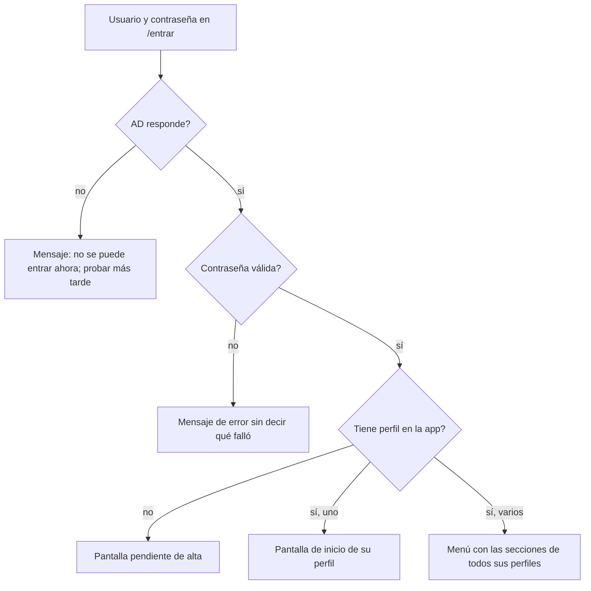

| Paso | Quién | Qué hace | Estado antes → después | Pantalla / API | Estado |
| --- | --- | --- | --- | --- | --- |
| 1 | Cualquiera | Escribe usuario y contraseña de la entidad | sin sesión → validando | `/entrar` · `POST /api/sesion` | hecho en F0.09b con auditoría F0.08b |
| 2 | Sistema | Valida contra AD por LDAPS; si AD no responde, no deja entrar | validando → sesión abierta o error | conector `Directorio` (puerto `internal/puertos/salida/identidad/`) | hecho en F0.09a/b |
| 3 | Sistema | Identifica a la persona por el identificador estable `objectGUID` de AD, además del nombre de acceso; lee sus perfiles y su único equipo en la app (no en grupos de AD) | sesión abierta → con perfil o pendiente de alta | `GET /api/sesion` | GUID y sesión en F0.09a/b; perfiles y equipo implementados en F0.10 |
| 4 | Sistema | Lleva a la pantalla de inicio que toca (ver apartado 2) | — | `/` redirige según perfil | navegación implementada en F0.10; módulos de negocio pendientes |

Errores y vueltas atrás:

- Si AD no responde, nadie puede entrar. Las sesiones ya abiertas siguen hasta que caducan.
- Si la sesión caduca, la persona vuelve a `/entrar` y, tras entrar, a la pantalla donde estaba.
- Salir: `DELETE /api/sesion` borra la sesión en el servidor.

### 1.2 Pendiente de alta

Cualquiera con cuenta de AD que entra sin perfil queda **pendiente de alta**.

| Paso | Quién | Qué hace | Estado antes → después | Pantalla / API | Estado |
| --- | --- | --- | --- | --- | --- |
| 1 | Persona nueva | Entra por primera vez | sin registro → pendiente de alta | `/pendiente` | hecho en F0.09b |
| 2 | Sistema | Muestra un mensaje que dice que su acceso está pendiente y que lo da Administración funcional; no enseña ningún dato | — | `/pendiente` | hecho en F0.09b |
| 3 | Sistema | Avisa en la app a Administración funcional (contador en su inicio) | — | `GET /api/avisos` | falta |
| 4 | Administración funcional | Asigna uno o varios perfiles y, si es Profesional de ETF, su equipo | pendiente de alta → activa | `/admin/usuarios` · `PUT /api/admin/usuarios/{id}/perfiles` | hecho en F0.10 |
| 5 | Persona nueva | Vuelve a entrar (o recarga) y ve su menú | — | `/` | hecho en F0.10 |

El primer administrador funcional no pasa por aquí: su nombre de usuario de AD se
fija en la configuración al instalar y se vincula a su `objectGUID` en una operación única y auditada (ver `TRD.md`). Si se le retira el perfil, entrar de nuevo no se lo devuelve. Dar de baja a alguien es
quitarle los perfiles en la app; la cuenta de AD no se toca.

## 2. Mapa de navegación por perfil

Común a todos los perfiles con sesión: cabecera con el nombre de la app, buscador
«Buscar expediente» (por número; los resultados salen enmascarados y sólo los que
el perfil puede ver), selector de idioma (lee los idiomas instalados en `idiomas/`),
nombre y perfiles de la persona, equipo, botón «?» de ayuda y salir. UI1 obtiene las pantallas permitidas del registro HTTP por módulos. INT5 compone las pantallas web y su menú en una lista ordenada; sólo muestra entradas autorizadas también por la sesión. En ancho reducido, «Menú» abre la navegación recogida; «Persona» reúne identificación, preferencias y salida. El buscador sólo aparece para Coordinación y Profesional de ETF. La ayuda sólo se abre
desde «?» (ver `DISENO_UI_UX.md`).

Regla de datos en todas las pantallas: los listados enseñan la familia enmascarada
(«Familia O. S.») y el número de expediente; el nombre completo sólo aparece en la
ficha, y abrir la ficha queda registrado en la auditoría.

### 2.1 Coordinación

Hasta 3 personas (el coordinador y, en el futuro, personal administrativo). Ven
todos los equipos.

- Menú: Inicio · Derivaciones recibidas · Lista de espera · Cierres propuestos ·
  Expedientes de la provincia · Comisiones e informes · Memoria anual ·
  Salario mínimo (SMI) · Carga de expedientes de 2026.
- UI3 agrupa las entradas disponibles en Derivaciones, Expedientes, Informes y Memoria, y Configuración; cada sección conserva las rutas y permisos de sus módulos.
- Pantallas:

| Pantalla | Para qué | Ruta de interfaz | Ruta de API | Estado |
| --- | --- | --- | --- | --- |
| Inicio | Bandeja provincial: pendientes de revisar, aceptados recientes, no aceptados y lista de espera; filtros por estado, equipo, municipio y fechas de recepción | `/coordinacion` | `GET /api/coordinacion/bandeja`, `POST /api/coordinacion/bandeja/buscar` | F1.10 entregada; cierres, avisos y carga por equipo pendientes |
| Derivaciones recibidas | Lista de derivaciones sin decidir | `/coordinacion/derivaciones` | `GET /api/expedientes?estado=derivacion_recibida` | falta |
| Nueva derivación | Subir el Anexo 3 o 4 (ver 3.16) | `/coordinacion/anexos/nuevo` | `POST /api/derivaciones` | falta |
| Revisar derivación | Comprobar lo extraído, confirmar municipio, centro y equipo; aceptar, dejar en espera o no aceptar | `/coordinacion/derivaciones/{id}` | `GET /api/expedientes/{id}`, `POST /api/expedientes/{id}/aceptar`, `/lista-espera`, `/no-aceptar` | falta |
| Lista de espera | Casos en espera por fecha de recepción, con subprograma y municipio | `/coordinacion/lista-espera` | `GET /api/expedientes?estado=lista_espera` | falta |
| Cierres propuestos | Expedientes con propuesta de cierre del equipo, también aceptados sin consentimiento; el Anexo 11/12 puede faltar con aviso | `/coordinacion/cierres` | `GET /api/expedientes?cierre_propuesto=si` | falta |
| Expedientes de la provincia | Buscador con filtros (equipo, estado, subprograma, año) | `/expedientes` | `GET /api/expedientes?etf=&estado=&subprograma=&anio=&q=` | falta |
| Ficha del expediente | La misma que ve el equipo, más Acta de Cierre, reabrir y traslado | `/expedientes/{id}/{pestaña}` | `GET /api/expedientes/{id}` | falta |
| Comisiones e informes | Consulta de los registros de todos los equipos | `/comisiones` | `GET /api/comisiones`, `GET /api/informes` | falta |
| Memoria anual | Por equipo o provincial; vista previa, textos libres, descargar, cerrar y reabrir | `/memoria/{anio}?etf=` | `GET /api/memoria/{anio}?etf=` y siguientes (ver 3.13) | falta |
| Salario mínimo (SMI) | Tabla año → importe | `/coordinacion/smi` | `GET/HEAD/PUT /api/coordinacion/smi` | implementada con autorización de Coordinación (F1.09); PUT exige CSRF |
| Carga de expedientes de 2026 | Importar la hoja del Programa, si existe (ver 3.15) | `/coordinacion/carga-2026` | `POST /api/carga-2026`, `POST /api/carga-2026/hoja/{lote}/confirmar` | CA1 disponible |

### 2.2 Profesional de ETF

Trabajador/a social, educador/a social y psicólogo/a; 3 por equipo hoy, hasta 5.
Sólo ven su equipo; la base de datos lo impone con RLS, no sólo la pantalla.

- Menú (como en la maqueta): Bandeja del equipo · Expedientes · Tabla mensual SPAF ·
  Comisiones e informes · Memoria anual. No ven «Derivaciones recibidas» ni
  «Nueva derivación»: el equipo no acepta derivaciones.
- Pantallas:

| Pantalla | Para qué | Ruta de interfaz | Ruta de API | Estado |
| --- | --- | --- | --- | --- |
| Bandeja del equipo | Indicadores (activos por subprograma, sin consentimiento tras 30 días, derivados al SPM sin respuesta, cerrados en el año) y lista con avisos | `/equipo` | `GET /api/equipo/bandeja`, `GET /api/avisos` | falta |
| Expedientes | Lista de los del equipo con filtros por subprograma y fase | `/expedientes` | `GET /api/expedientes?…` (RLS limita al equipo) | falta |
| Ficha · Familia | Contacto, composición, adultos, vivienda, economía e ingresos con tramo SMI calculado, familia numerosa, antecedente, factores de riesgo, responsables | `/expedientes/{id}/familia` | `PATCH /api/expedientes/{id}`, `PUT /api/expedientes/{id}/adultos`, `/factores` | falta |
| Ficha · Menores | Hasta 15, con sexo, fecha, escolarización, subprograma, Atención Temprana y centro de protección opcional (texto o catálogo) | `/expedientes/{id}/menores` | `PUT /api/expedientes/{id}/menores` | falta |
| Ficha · Intervención | Características, finalidad, pronóstico, fase, temporalización, instrumentos con fecha, propuesta DSR, PIF derivado de DSR, factores de los menores, tipologías, VALÓRAME de la derivación (sólo lectura) | `/expedientes/{id}/intervencion` | `PATCH /api/expedientes/{id}` | falta |
| Ficha · Coordinación y derivaciones | Recursos coordinados, nombre y contacto de quien coordina el caso en el servicio derivante (distinto del profesional de referencia ETF), Anexo 5 con respuesta del SPM, Anexo 6 | `/expedientes/{id}/coordinacion` | `POST/PATCH /api/expedientes/{id}/derivaciones-salida` | falta |
| Ficha · Cierre | Motivo de finalización, derivación tras cierre, escalas de evaluación, seguimiento tras cese, proponer cierre | `/expedientes/{id}/cierre` | `PATCH /api/expedientes/{id}`, `POST /api/expedientes/{id}/proponer-cierre` | falta |
| Ficha · Documentos | Botones para generar los documentos que tocan en ese estado y fechas de hitos; ninguna subida de ficheros | `/expedientes/{id}/documentos` | `POST /api/expedientes/{id}/documentos/{tipo}`, `POST /api/expedientes/{id}/hitos` | falta |
| Ficha · Historial | Quién hizo qué en el expediente | `/expedientes/{id}/historial` | `GET /api/expedientes/{id}/historial` | falta |
| Tabla mensual SPAF | Elegir mes, vista previa, descargar | `/equipo/tabla-spaf` | `GET /api/equipos/{etf}/tabla-spaf/{anio}/{mes}`; `POST /api/equipos/{etf}/tabla-spaf/{anio}/{mes}.docx` | falta |
| Comisiones e informes | Alta rápida de una comisión (fecha) o un informe (fecha y organismo) | `/equipo/comisiones` | `POST /api/comisiones`, `POST /api/informes` | servidor y pantalla entregados |
| Memoria anual | La de su equipo; sin acceso a la provincial | `/memoria/{anio}` | `GET /api/memoria/{anio}?etf={suyo}` | falta |
| Alta histórica de 2026 | Teclear un expediente vivo, cerrado o no aceptado de 2026 (ver 3.15) | `/equipo/expedientes/alta-historica` | `POST /api/carga-2026` para revisar y `POST /api/carga-2026/{lote}/confirmar` para guardar | CA1 disponible |

La ficha lleva arriba una línea de tiempo (derivación → aceptación → consentimiento
→ proyecto → intervención → cierre) y el aviso «Faltan N datos para la Memoria»
con enlaces a cada campo vacío.

### 2.3 Consulta

Pocas personas. Ven totales y nunca un nombre ni un número de expediente.

- Menú: Memoria anual.
- Pantallas:

| Pantalla | Para qué | Ruta de interfaz | Ruta de API | Estado |
| --- | --- | --- | --- | --- |
| Memoria anual | Cifras por equipo o provinciales, de años cerrados y del año en curso | `/memoria` | `GET /api/consulta/memoria/{anio}?equipo=` (tipo exclusivo de cifras, sin composición, identificadores de expediente ni textos libres) | implementada en F4.07 |

Consulta usa una vista y una descarga exclusivas de cifras: nunca recibe la composición de los recuentos, identificadores de expedientes ni textos libres. Los apartados narrativos A, D, E, F y los demás textos de negocio se excluyen tanto de la respuesta como del Word de Consulta; ocultarlos en pantalla no basta.

### 2.4 Administración funcional

Una o dos personas. Mantienen la configuración y **no ven expedientes**: ninguna
ruta de expedientes, Memoria, Tabla SPAF ni comisiones les responde.

- Menú: Usuarios y permisos · Catálogos · Plazos y tramos · Plantillas Word ·
  Firmantes y destinatarios · Temas · Idiomas · Auditoría.
- Pantallas:

| Pantalla | Para qué | Ruta de interfaz | Ruta de API | Estado |
| --- | --- | --- | --- | --- |
| Usuarios y permisos | Pendientes de alta arriba; asignar o quitar perfiles y equipo | `/admin/usuarios` | `GET /api/admin/usuarios`, `PUT /api/admin/usuarios/{id}/perfiles` | hecho en F0.10 |
| Catálogos | Equipos, centros, municipios (con su centro y su equipo, que son independientes [D9]), listas de opciones y equivalencias | `/admin/catalogos/{tipo}` | `GET/POST/PUT /api/admin/catalogos/{tipo}` | listas implementadas con autorización de Administración (F0.14a); ubicaciones y equivalencias pendientes |
| Plazos y tramos | 30 días, duraciones de fase, días de espera del SPM, tramos de duración [D20], tramos SMI; cada versión con fecha de vigencia | `/admin/reglas` | `GET/POST/PUT /api/admin/reglas?ambito=plazos` o `tramos` | implementada con autorización de Administración (F0.14a) |
| Plantillas Word | Consultar activa e historial por documento e idioma, subir y revisar una versión y activarla con confirmación | `/admin/plantillas` | `GET /api/admin/plantillas`, `POST /api/admin/plantillas/versiones`, `POST /api/admin/plantillas/{id}/activar` | disponible (PL1) |
| Firmantes y destinatarios | Quién firma y a quién van los oficios, con vigencia | `/admin/firmantes` | `GET/POST/PUT /api/admin/firmantes` | implementada con autorización de Administración (F0.14b) |
| Temas | Ver los temas instalados en `temas/`, activar uno | `/admin/temas` | `GET /api/admin/temas`, `PUT /api/admin/temas/activo` | falta |
| Idiomas | Ver los idiomas instalados en `idiomas/`, claves que faltan, recargar | `/admin/idiomas` | `GET /api/admin/idiomas`, `POST /api/admin/idiomas/recargar` | falta |
| Conservación | Revisar expedientes cuyo plazo ha terminado; primera propuesta y confirmación de otra persona de Administración, sin ficha | `/admin/conservacion` | `GET /api/conservacion/pendientes`, `POST /api/conservacion/{id}/proponer`, `POST /api/conservacion/{id}/anonimizar` | F5.04 |
| Auditoría | Exportar el registro para el DPD, con constancia de la exportación y sin acceso a fichas | `/admin/auditoria` | `POST /api/admin/auditoria/exportar` | falta |

La tabla del SMI no está aquí: la mantiene Coordinación. Los textos de interfaz,
catálogos y Word viven respectivamente en `idiomas/<código>/textos/`,
`idiomas/<código>/catalogos/` y `idiomas/<código>/plantillas/`; la base de datos
conserva códigos y referencias, nunca textos traducibles de catálogo. Los datos
libres del expediente y los textos narrativos de la Memoria son datos de negocio.

Al guardar un catálogo traducible o subir una plantilla, un tema o un idioma,
Administración prepara una versión inmutable, la valida y la publica. Se escribe
el archivo por versión y huella; su registro, referencia activa y auditoría se
confirman en una sola transacción. Si falla, sigue activa la versión anterior y
el archivo huérfano no se usa: se limpia. Dos activaciones simultáneas no se pisan;
la segunda recibe conflicto y debe revisar la versión vigente. Los límites y la
revisión antivirus por tipo están en 3.16 y `TRD.md`.

F0.14c-2 añade la instalación de idiomas y temas en `/admin/idiomas` y
`/admin/temas`. Se indica el código y se sube el ZIP; la pantalla muestra
«subiendo» y «revisando con el antivirus». Tras comprobar el formato y el
antivirus se presenta la versión revisada. Un diálogo confirma la activación.
La API es `GET /api/admin/paquetes/{tipo}/{código}`,
`POST /api/admin/paquetes/{tipo}/{código}/revisar` y
`POST /api/admin/paquetes/activar`; el descarte usa
`DELETE /api/admin/paquetes/preparaciones/{ticket}`. Estas rutas requieren una sesión activa con perfil de Administración.
INT3 conecta la autorización de F0.10 y la protección CSRF; el modo de
desarrollo conserva los mismos permisos. Las preparaciones
caducan a los diez minutos y admiten un máximo de dos paquetes simultáneos.
El conflicto devuelve 409 y permite consultar la versión actual antes de
preparar de nuevo. La prueba de tema sólo en la sesión, la retirada y el
recuento de claves pendientes siguen fuera de esta entrega.

### 2.5 Combinación de perfiles

Una persona puede tener varios perfiles (por ejemplo, Coordinación y Administración
funcional). Reglas:

- El menú junta las secciones de todos sus perfiles, agrupadas por perfil, con secciones de trabajo dentro de Coordinación y en el
  orden del apartado 2. La pantalla de inicio es la del primer perfil del grupo
  (Coordinación, Profesional de ETF, Consulta, Administración funcional).
- Cada acción se autoriza por el perfil que la permite, nunca por la suma: sumar
  Consulta a otro perfil no da más vistas de las que da ese otro perfil.
- Profesional de ETF va siempre ligado a un solo equipo en cada momento. Cambiar de equipo sustituye la adscripción anterior; nunca concede acceso simultáneo a dos ETF.
- Cierre con dos personas: quien propuso el cierre de un expediente no puede
  generar su Acta de Cierre aunque tenga también el perfil de Coordinación. Es la
  única acción que exige dos personas (entrevista, 3.5b).
- Coordinación más Profesional de ETF: puede trabajar en la ficha de su equipo y,
  como coordinación, en todas; la regla anterior sigue valiendo.

## 3. Recorridos de punta a punta

Regla común de documentos: **generar una emisión no confirma un hito**. Cada
petición de generación usa `POST` y registra autor, fecha de emisión, versión y
huella de la plantilla y huella de los datos, sin guardar el fichero generado.
Una persona confirma aparte la fecha real del hito («firmado el…», consentimiento,
derivación o cierre). Regenerar no modifica fechas de hitos ni estados. Si los
datos cambiaron, se avisa y se crea otra emisión; una misma clave de idempotencia
nunca devuelve contenido distinto. La auditoría debe estar confirmada antes de
entregar el documento. Los hitos hechos fuera también se anotan por una persona.

El recorrido de demostración es el 3.1 → 3.4 → 3.5 → 3.8 → 3.12 → 3.13: la
coordinación sube un Anexo 3, acepta y genera Acta y oficio; el equipo hace
consentimiento, ficha y Anexo 11; la coordinación cierra; salen la Tabla SPAF y
la Memoria.

La bandeja provincial de F1.10 muestra familias con iniciales. La búsqueda por número o familia viaja en el cuerpo de una petición protegida con CSRF, sin nombres en la URL. La espera se ordena por recepción ascendente; los aceptados, por fecha de aceptación descendente. El municipio propuesto se marca «Por confirmar» y no asigna equipo. Cada fila enlaza a `/coordinacion/derivaciones/{id}`; «Subir Anexo» enlaza a `/coordinacion/anexos/nuevo`. Estas pantallas de destino corresponden a P3 y P2.

### 3.1 Derivación → aceptación con Acta y oficio

P3 reúne las decisiones y los documentos en `/coordinacion/derivaciones/{id}`. Muestra el número tras aceptar, sin reservarlo antes. La lista de espera se consulta en `/coordinacion/lista-espera`; las descargas usan `POST /api/documentos/emisiones` y el registro se anota por emisión. El puesto del profesional se elige en la ficha; no se pide un identificador técnico a la persona. La consulta de profesionales por nombre sigue pendiente.

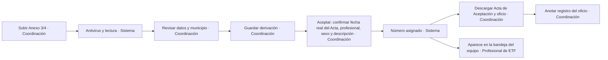

| Paso | Quién | Qué hace | Estado antes → después | Pantalla / API | Estado |
| --- | --- | --- | --- | --- | --- |
| 1 | Coordinación | Sube el Anexo 3 (de SS.SS.CC.) o el Anexo 4 (del SPM) en Word o PDF | — | `/coordinacion/anexos/nuevo` · `POST /api/coordinacion/derivaciones` | entregado en P2 |
| 2 | Sistema | Valida, pasa el antivirus y lee los 7 apartados del anexo; descarta el fichero (detalle en 3.16) | — | conectores `Antivirus` y `LectorAnexo`; análisis sin guardar derivación | entregado en P2 |
| 3 | Sistema | Busca el municipio en «Dirección» y, si no está, en «Valoración y diagnóstico»; propone centro de SS.SS.CC. y equipo por separado [D9]; marca la frase de donde lo sacó | — | `/coordinacion/anexos/nuevo`; extracción sólo en memoria | entregado en P2 |
| 4 | Coordinación | Revisa los bloques plegables; confirma o corrige municipio, centro y equipo (si hay varios candidatos o ninguno, el campo queda vacío y obligatorio); municipio fuera del ámbito: aviso y decide la coordinación [D10] | — | misma pantalla | entregado en P2 |
| 5 | Coordinación | Guarda la derivación | (nada) → DERIVACIÓN RECIBIDA | `POST /api/coordinacion/derivaciones/confirmar`; navega a `/coordinacion/derivaciones/{id}` | entregado en P2 |
| 6 | Coordinación | Pulsa «Aceptar»: elige profesional de referencia del equipo, sexo de cada menor (no viene en el anexo) y recorta la descripción de la situación (copiada del anexo [D13]); confirma la fecha real del Acta y ve el número que se asignará | — | misma pantalla | CA1 disponible |
| 7 | Sistema | Asigna número equipo-correlativo-año (`08-01-26` [D1]) con el año de la fecha del Acta confirmada; registra ese hito y la aceptación en la misma transacción, sin deducir fechas de la generación | DERIVACIÓN RECIBIDA → ACEPTADA (fase recepción) | `POST /api/coordinacion/derivaciones/{id}/aceptar` | servidor y pantalla P3 disponibles |
| 8 | Coordinación | Descarga el Acta de Aceptación y el oficio: al Centro de SS.SS.CC. si vino por Anexo 3, al SPM si vino por Anexo 4; la app registra cada emisión sin alterar la fecha del Acta confirmada ni dar por firmado el oficio | — | `POST /api/expedientes/{id}/documentos/acta_aceptacion`, `/oficio_sscc` o `/oficio_spm` | falta |
| 9 | Coordinación | Anota número y fecha de registro del oficio tras su firma y registro fuera (3.17); cualquier corrección de un hito es una acción expresa auditada, nunca efecto de regenerar | — | `POST /api/expedientes/{id}/registro-salida` | falta |
| 10 | Sistema | El expediente aparece en la bandeja desde la aceptación; el plazo de consentimiento usa la fecha del Acta confirmada | — | `/equipo` | falta |

La revisión P2 muestra el progreso real de subida y una espera conjunta de
antivirus y lectura, porque la API responde al terminar ambas comprobaciones.
Los campos vacíos y dudosos llevan texto además de color; un dato dudoso correcto
se puede confirmar sin cambiarlo. La propuesta identifica la frase del anexo;
municipio, centro y equipo se pueden modificar. Descartar elimina la revisión
sin crear derivación. La revisión caduca a los 30 minutos o al reiniciar.
Si se pierde la respuesta al confirmar, «Recuperar confirmación» repite la misma
petición y clave, con la edición bloqueada, para recuperar el id sin duplicar.

Errores y vueltas atrás:

- Faltan datos para aceptar (fecha real del Acta, profesional, sexo de algún menor, municipio): el botón
  «Aceptar» no avanza y la pantalla lista lo que falta con enlaces al campo.
- Otra persona de coordinación acepta a la vez: el contador por equipo y año se
  bloquea en la transacción; la segunda recibe un conflicto y ve el estado nuevo.
- El Acta se puede volver a descargar mientras no haya Acta de Cierre; cada
  descarga queda en la auditoría.
- La descripción de la situación no se resume con IA: no puede salir ningún dato a
  servicios externos [D13].
- El cliente dice que el Acta se rellena con «los Anexos 1, 2, 3 y 4»; al aceptar
  sólo existe el 3 o el 4 [D15].

### 3.2 No aceptación

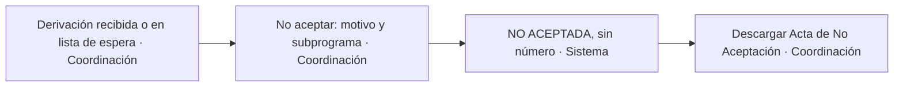

| Paso | Quién | Qué hace | Estado antes → después | Pantalla / API | Estado |
| --- | --- | --- | --- | --- | --- |
| 1 | Coordinación | Pulsa «No aceptar» en la revisión o en la lista de espera | — | `/coordinacion/derivaciones/{id}` | falta |
| 2 | Coordinación | Escribe el motivo; el subprograma sale del anexo (Anexo 3 = Riesgo [D12]) | — | misma pantalla | CA1 disponible |
| 3 | Sistema | Guarda fecha y motivo; no consume número | DERIVACIÓN RECIBIDA o LISTA DE ESPERA → NO ACEPTADA | `POST /api/coordinacion/derivaciones/{id}/no-aceptar` | servidor F1.05b y pantalla P3 disponibles |
| 4 | Coordinación | Descarga el Acta de No Aceptación | — | `POST /api/documentos/emisiones`, tipo `entrada/no_aceptacion` | servidor F1.07b y pantalla P3 disponibles |

NO ACEPTADA es final: cuenta en el apartado 5 de la Memoria. Si la familia vuelve
a ser derivada, es una derivación nueva.

### 3.3 Lista de espera

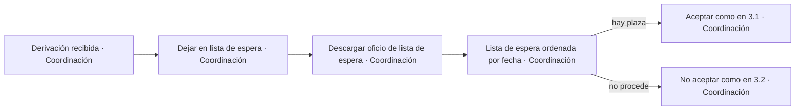

| Paso | Quién | Qué hace | Estado antes → después | Pantalla / API | Estado |
| --- | --- | --- | --- | --- | --- |
| 1 | Coordinación | Pulsa «Dejar en lista de espera» | DERIVACIÓN RECIBIDA → LISTA DE ESPERA | `POST /api/coordinacion/derivaciones/{id}/lista-espera` | servidor F1.05b y pantalla P3 disponibles |
| 2 | Coordinación | Descarga el oficio de lista de espera para el Centro de SS.SS.CC. y anota su registro de salida | — | `POST /api/documentos/emisiones`, tipo `entrada/no_aceptacion/lista_espera`; registro por `POST /api/documentos/emisiones/{id}/registro-salida` | servidor F1.07b/F1.08 y pantalla P3 disponibles |
| 3 | Coordinación | Consulta la lista por fecha de recepción | — | `GET /api/coordinacion/lista-espera` | servidor F1.05b y pantalla P3 disponibles |
| 4 | Coordinación | Acepta (pasos 6 a 10 de 3.1) o no acepta (3.2) | LISTA DE ESPERA → ACEPTADA o NO ACEPTADA | `/coordinacion/derivaciones/{id}` | falta |

Reglas provisionales [D2]: sólo entran en lista de espera casos de SS.SS.CC.
(el oficio sólo habla de su informe de derivación); al aceptar, número y fecha son
los del día de la aceptación real; mientras esperan no cuentan en la Memoria.

### 3.4 Consentimiento y plazo de 30 días

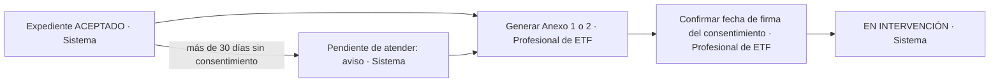

| Paso | Quién | Qué hace | Estado antes → después | Pantalla / API | Estado |
| --- | --- | --- | --- | --- | --- |
| 1 | Profesional de ETF | En Consentimiento, descarga el Anexo 1 (Riesgo) o el 2 (Reunificación; las plantillas dicen «Reintegración»); la app elige el que toca por el subprograma | — | `/equipo/expediente?id={id}&pestana=consentimiento` · `POST /api/expedientes/{id}/documentos/anexo1` o `/anexo2` | disponible en la pestaña Consentimiento |
| 2 | Sistema | Rellena la fecha del día y deja en blanco el DNI del representante [D16] | — | — | disponible en la pestaña Consentimiento |
| 3 | Profesional de ETF | Tras la firma fuera de la app, confirma la fecha real del consentimiento; entonces pasa a intervención | ACEPTADA → EN INTERVENCIÓN | `POST /api/expedientes/{id}/hitos` | disponible en la pestaña Consentimiento |
| 4 | Sistema | Si pasan más de 30 días naturales desde el Acta de Aceptación sin consentimiento [D3], marca el expediente como «pendiente de atender» y avisa en la bandeja del equipo y en el inicio de coordinación | ACEPTADA (sin cambio) + marca pendiente de atender | `GET /api/expedientes/{id}/avisos` | disponible en Consentimiento |

«Pendiente de atender» es una condición calculada, no un estado: desaparece al
anotar el consentimiento y cuenta en el apartado 6 de la Memoria. El plazo de 30
días está en «Plazos y tramos», no en el código. Generar el Word no equivale a obtener el consentimiento ni elimina el aviso. El DNI del representante nunca se guarda; el hueco del Word queda en blanco, decisión firme [D16].

Los Anexos 7 y 8 se hacen fuera de la aplicación. El equipo anota su fecha
mediante el mismo `POST /api/expedientes/{id}/hitos`, con `tipo` igual a `anexo7`
o `anexo8`; no se generan documentos. Las confirmaciones llevan la versión
leída e `Idempotency-Key`, y la historia se consulta mediante `GET` en esa
ruta. La fecha debe quedar entre la aceptación y el día de registro. El
servidor rechaza un anexo de otro subprograma o una edición con versión
anterior. La pestaña Consentimiento permite estas confirmaciones con la versión leída y una clave de petición que se conserva al reintentar.

### 3.5 Ficha del expediente

La bandeja de F2.06 está en `/equipo`; su lectura usa `GET /api/equipo/expedientes` con búsqueda, filtros y paginación. El enlace del número abre la ficha, cuya lectura y auditoría se confirman juntas. Las pestañas muestran Familia, Menores, Intervención, Consentimiento, Evaluación, Documentos, Cierre, Salidas e Historial. FI1 permite al profesional del ETF editar Menores e Intervención y a Coordinación consultarlas. Cierre conecta con la finalización y propuesta de F3.02a; Salidas permite preparar la derivación al Servicio de Protección de Menores, descargar el Anexo 5 y confirmar por separado su envío y respuesta. Cambiar de pestaña con una edición pendiente usa la guardia común de cambios sin guardar. GAP1 permite al profesional editar Familia con F2.01a: contacto, composición, vivienda, economía, ingresos o tramo del SMI, y personas adultas. Los datos familiares y las personas adultas se guardan por separado, con fecha de vigencia. Un conflicto conserva el borrador y permite comparar los datos actuales antes de conservarlo o sustituirlo. Los avisos abren la pestaña y enfocan el campo pendiente; Coordinación consulta sin editar.

Evaluación permite registrar el instrumento aplicado a cada adulto en su momento inicial, intermedio o final. Las respuestas se editan por ítem cuando existe una definición publicada; el catálogo actual no contiene cuestionarios oficiales, pendientes de D17. La pantalla lo explica y no calcula puntuaciones totales.

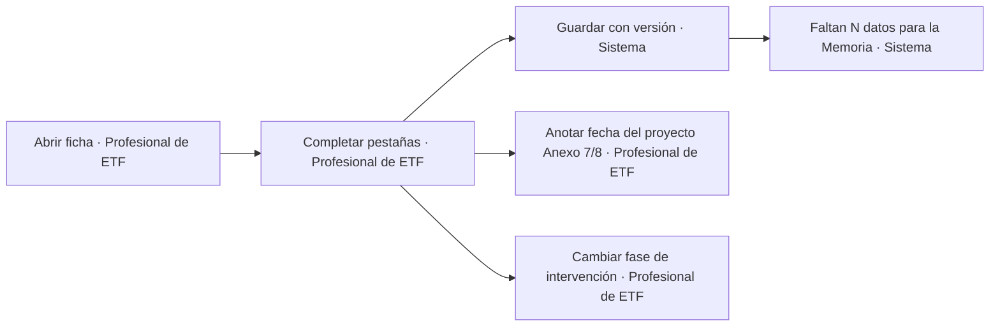

| Paso | Quién | Qué hace | Estado antes → después | Pantalla / API | Estado |
| --- | --- | --- | --- | --- | --- |
| 1 | Profesional de ETF | Abre la ficha desde la bandeja; el nombre completo se ve aquí y la apertura queda auditada | — | `/equipo/expediente?id={id}` · `GET /api/equipo/expedientes/{id}` | disponible en desarrollo (F2.06) |
| 2 | Profesional de ETF | Completa Familia, Menores, Intervención (pantallas en 2.2); lo que se recoge por familia (factores de menores, tipologías, coordinación) se aplica a todos los menores con opción de desmarcar alguno [D4]; cada adulto con papel y sexo [D7]; ingresos en cantidad o tramo [D8] | — | `PATCH /api/expedientes/{id}`, `PUT …/menores`, `…/adultos`, `…/factores` | falta |
| 3 | Profesional de ETF | Anota la fecha del proyecto de intervención (Anexo 7 u 8, que se hace fuera) | — | `POST /api/expedientes/{id}/hitos` | disponible en Consentimiento |
| 4 | Profesional de ETF | Elige la fase de intervención (recepción, evaluación, intervención, cierre y devolución, seguimiento); la app propone una por las fechas | fase X → fase Y | `PATCH /api/expedientes/{id}` | falta |
| 5 | Sistema | Muestra «Faltan N datos para la Memoria» con enlaces | — | revisión previa y resultado de carga | CA1 disponible |

Errores y vueltas atrás:

- Tres profesionales pueden tener la ficha abierta. Cada guardado lleva la versión
  leída; si otra persona guardó antes, el servidor responde conflicto (409) y la
  pantalla ofrece ver los cambios del otro antes de volver a guardar.
- Un expediente CERRADO no se edita desde la ficha salvo los datos de seguimiento
  (3.9); para lo demás hay que reabrir (3.11).

F2.01c incorpora el servidor de Intervención y FI1 su pestaña de ficha: consulta y guardado
completo en `/api/expedientes/{id}/intervencion`, con versión e idempotencia,
y consulta histórica en `…/intervencion/historia?corte=AAAA-MM-DD`. La fase se
elige para el expediente. Coordinación, factores y tipologías se recogen por
familia y se aplican a cada menor salvo exclusión expresa. Una lista desconocida
se conserva como desconocida; seleccionar ninguna opción es un dato distinto.
El historial devuelve los menores y las selecciones que eran vigentes al corte.
FI1 usa los guardados completos de Menores e Intervención con fecha de vigencia.
Ante un conflicto mantiene el formulario y muestra los datos actuales para
compararlos; permite conservar el formulario para volver a guardar o descartarlo
expresamente. Los avisos de F2.02 enlazan al campo de estas pestañas y le dan el
foco, también cuando la ficha se está consultando sin permiso de edición.

Las modificaciones de composición, adultos, menores, ingresos, factores y
subprogramas conservan su vigencia e historia. La Memoria consulta los valores
que correspondían al año evaluado, no los actuales sobrescritos. Cada menor,
marca y evaluación debe pertenecer al expediente y equipo de la ficha; el
servidor y las claves compuestas de la base de datos rechazan cruces.

### 3.6 Derivar al SPM (Anexo 5) y respuesta

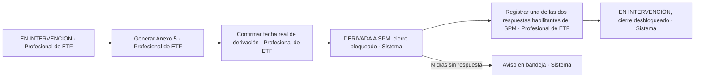

| Paso | Quién | Qué hace | Estado antes → después | Pantalla / API | Estado |
| --- | --- | --- | --- | --- | --- |
| 1 | Profesional de ETF | Pulsa «Derivar al SPM» (botón de la cabecera de la ficha o pestaña Coordinación y derivaciones); indica motivo y propuesta de medida | — | `/expedientes/{id}/coordinacion` · `POST /api/expedientes/{id}/derivaciones-salida` (tipo `spm`) | falta |
| 2 | Sistema | Genera el Anexo 5 con fecha del día, apartados 1 a 4 rellenos y 5 a 8 en blanco | emisión registrada; aún sin hito confirmado | `POST /api/expedientes/{id}/documentos/anexo5` | falta |
| 3 | Profesional de ETF | Confirma la fecha real de la derivación; el sistema marca la salida EMITIDA y bloquea el cierre ordinario | EN INTERVENCIÓN → DERIVADA A SPM | `POST /api/expedientes/{id}/hitos` | falta |
| 4 | Sistema | Si pasan N días sin respuesta (N en «Plazos y tramos»), avisa | — | `GET /api/avisos` | falta |
| 5 | Profesional de ETF | Registra con fecha una respuesta que habilita el cierre ordinario: «se conoce inicio de procedimiento de desamparo o adopción de medida» o «el SPM no valora necesaria la medida» | EMITIDA → RESPONDIDA; DERIVADA A SPM → EN INTERVENCIÓN | `PATCH /api/expedientes/{id}/derivaciones-salida/{did}` | falta |

«A la espera de respuesta» es el valor de la lista mientras no hay respuesta, no
una respuesta: mantiene el bloqueo del cierre ordinario. La coordinación puede forzar el cierre sin respuesta dejando el
motivo escrito (queda en la auditoría).

Implementación del servidor F3.01a, sin pantallas en esta entrega: el contrato de
salida está disponible sin depender del consentimiento ni del estado de
intervención. Se crea con `POST /api/expedientes/{id}/salida-spm` (motivo,
propuesta de medida y versión de la ficha); la fecha real se confirma mediante
`POST /api/expedientes/{id}/salida-spm/fecha`. Las respuestas se registran por
`PATCH /api/expedientes/{id}/salida-spm/respuesta`, con versión de la salida.
El Word se obtiene mediante `POST /api/documentos/emisiones`, tipo
`salida/spm/anexo5`, sin cambiar fechas ni estado. Coordinación puede registrar
la excepción en `/salida-spm/forzado`, con motivo y auditoría.
FX1 conecta los cambios de estado con la confirmación de fecha y la respuesta:
desde EN INTERVENCIÓN, confirmar pasa a DERIVADA A SPM; una respuesta fechada
habilitante devuelve EN INTERVENCIÓN. La espera conserva el bloqueo. El servidor
mantiene el contrato de F3.01a desde ACEPTADA, sin inventar consentimiento.
F3.02b aplica el bloqueo al cierre ordinario y conserva el forzado por separado. CO2 incorpora la pantalla de Coordinación en `/coordinacion/expedientes/{id}/salidas`: registra respuesta fechada o excepción motivada. Los avisos y la vista de pendientes del SPM siguen pendientes; la API actual de bandeja no ofrece ese filtro.

### 3.7 Derivar a otro servicio (Anexo 6)

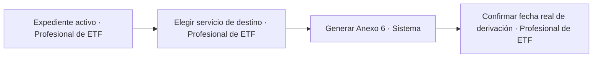

| Paso | Quién | Qué hace | Estado antes → después | Pantalla / API | Estado |
| --- | --- | --- | --- | --- | --- |
| 1 | Profesional de ETF | Elige el servicio de destino y el motivo | — | `/expedientes/{id}/coordinacion` · `POST /api/expedientes/{id}/derivaciones-salida` (tipo `otro_servicio`) | servidor implementado; pantalla pendiente |
| 2 | Sistema | Genera el Anexo 6 con fecha del día, apartados 1 a 4 rellenos y 5 a 8 en blanco | emisión registrada; aún sin hito confirmado | `POST /api/expedientes/{id}/documentos/anexo6` | servidor implementado; pantalla pendiente |

Tras realizar la derivación fuera, el profesional confirma su fecha mediante `POST /api/expedientes/{id}/hitos`: la salida pasa a EMITIDA. El Anexo 6 no cambia el estado del expediente ni bloquea el cierre.

El cuerpo de la propuesta lleva `tipo: otro_servicio`, `servicio_destino` (código activo de la lista `servicio_destino`), `motivo` y `version` del expediente. Administración publica los destinos y sus nombres en los catálogos de idioma antes de usarlos. El recibo identifica la salida y devuelve la nueva versión del expediente.

La emisión recibe `salida_id` e `idioma`. Propone la fecha del día en Madrid; rellena los datos disponibles de los apartados 1 a 4 y deja del 5 al 8 vacíos. Los campos aún no recogidos en el expediente quedan vacíos. Los contactos del servicio de origen no se atribuyen al ETF. La fecha propuesta no modifica la fecha real confirmada.

La confirmación recibe `tipo: derivacion_otro_servicio`, `salida_id`, `version` del expediente, `version_salida` y `fecha`. Cada POST exige `Idempotency-Key` y protección CSRF. Un conflicto de versión devuelve 409. Profesional sólo actúa sobre su equipo; Coordinación puede actuar sobre todos. Consulta y Administración no acceden. No se crean ni cambian estados de cierre.

La lectura del profesional usa las políticas de catálogo corregidas por `catalogo/0008`. La ruta compartida de hitos conserva los tipos de consentimiento y escalas de F2.03 y despacha `derivacion_otro_servicio` al caso de uso de la salida.

### 3.8 Propuesta de cierre por el equipo y Acta de Cierre por coordinación

GAP1 añade la descarga Word desde Cierre: Anexo 11 en riesgo social y Anexo 12 en reunificación. Cada descarga es una acción separada, disponible para el profesional del ETF, con aviso de que no propone el cierre ni confirma firma o envío. Si hay cambios de finalización sin guardar, la descarga espera a que se guarden.

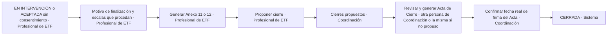

| Paso | Quién | Qué hace | Estado antes → después | Pantalla / API | Estado |
| --- | --- | --- | --- | --- | --- |
| 1 | Profesional de ETF | En la pestaña Cierre: motivo de finalización (lista del Anexo 11/12, con «Otros» desdoblado en Declaración de Riesgo, Medida protectora o desamparo y cualquier otro), derivación tras el cierre, coordinación con recursos y puntuaciones de las escalas (VALÓRAME, ECP-12, SCORE-15, SDQ, SOATIF, AAPI-2.5, satisfacción) en sus momentos inicial, intermedio y final | — | `/expedientes/{id}/cierre` · `PATCH /api/expedientes/{id}` | falta |
| 2 | Profesional de ETF | Genera el Anexo 11 (Riesgo) o 12 (Reunificación) con la fecha del día | — | `POST /api/expedientes/{id}/documentos/anexo11` o `/anexo12` | falta |
| 3 | Profesional de ETF | Pulsa «Proponer cierre»; también desde ACEPTADA si la familia no consiente, con motivo del catálogo | ACEPTADA o EN INTERVENCIÓN → mismo estado con cierre propuesto | `POST /api/expedientes/{id}/proponer-cierre` | falta |
| 4 | Sistema | Lo pone en «Cierres propuestos» de coordinación | — | `/coordinacion/cierres` | falta |
| 5 | Coordinación | Revisa; el motivo del Acta de Cierre sale traducido del Anexo 11/12 y se puede cambiar a mano [D5] | — | `/expedientes/{id}/cierre` | falta |
| 6 | Coordinación (persona distinta de quien propuso) | Genera el Acta de Cierre, sin cerrar aún | emisión registrada; sin cambio de estado | `POST /api/expedientes/{id}/documentos/acta_cierre` | falta |
| 7 | Coordinación (persona distinta de quien propuso) | Confirma la fecha real de firma del Acta y el cierre | ACEPTADA o EN INTERVENCIÓN → CERRADA; DERIVADA A SPM sólo con cierre forzado motivado | `POST /api/expedientes/{id}/cerrar` | falta |

Servidor F3.02a disponible; las pantallas esperan a INT5. El profesional del
ETF guarda motivo y datos de finalización en
`PATCH /api/expedientes/{id}/finalizacion`, con la versión leída y una clave
de idempotencia. Después puede generar el Anexo 11 o 12 y proponer el cierre.
Las emisiones reciben idioma y versión, y no cambian estado ni hitos. Desde
ACEPTADA se exige confirmar la falta de consentimiento y escoger su motivo
de catálogo. La propuesta conserva el estado, aumenta la versión y aparece
en `GET /api/coordinacion/cierres`. El equipo puede retirarla; para cambiar la
finalización debe retirar primero una propuesta pendiente. F3.02b añade la confirmación por una persona distinta de quien propuso, en
`POST /api/expedientes/{id}/cerrar`, con versión, fecha confirmada y clave de
idempotencia. El motivo del Acta se puede sustituir por un texto de Coordinación.
El Anexo 5 pendiente exige indicar el identificador del forzado ya motivado y
auditado; sin Anexo 11/12 emitido, el recibo avisa y permite cerrar.
`POST /api/expedientes/{id}/documentos/acta_cierre` descarga el Acta oficial por
idioma, antes o después de confirmar el cierre; la emisión no cambia hitos,
estado ni versión. Requiere Coordinación y una persona distinta de quien propuso.
CO2 incorpora la vista `/coordinacion/cierres`, accesible desde la bandeja, y el detalle `/coordinacion/expedientes/{id}/salidas`, accesible también desde la revisión del expediente. Muestra los motivos del catálogo, confirma la fecha real de firma y el cierre con una persona distinta de quien propuso y descarga el Acta mediante otra acción. Los conflictos ofrecen recargar los cambios; un resultado incierto conserva la petición y su clave para reintentar.

Errores y vueltas atrás:

- Cerrar exige fecha y motivo de finalización. Si falta el Anexo 11/12, avisa pero
  no impide.
- Con Anexo 5 sin respuesta, «Cerrar» no está disponible salvo que la coordinación
  fuerce el cierre con motivo escrito (3.6).
- Si la coordinación no está de acuerdo con la propuesta, no hay todavía una acción
  «devolver al equipo» decidida. Mientras, la coordinación no cierra y lo habla con
  el equipo; el equipo puede retirar la propuesta (`POST /api/expedientes/{id}/retirar-propuesta-cierre`).
  Lo decidel responsable del producto.
- Las escalas se guardan y se rellenan en el Word según la decisión vigente del responsable del producto [D17].

### 3.9 Seguimiento tras cese

Sólo en Reunificación (Ley 4/2021 de Infancia y Adolescencia de Andalucía, art. 97.3).

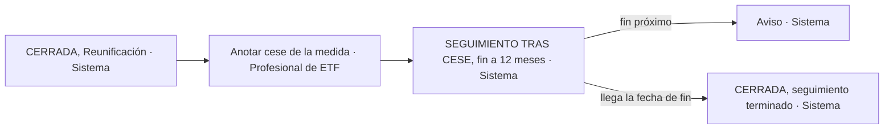

| Paso | Quién | Qué hace | Estado antes → después | Pantalla / API | Estado |
| --- | --- | --- | --- | --- | --- |
| 1 | Profesional de ETF | En la pestaña Seguimiento indica la fecha de cese de la medida | CERRADA → SEGUIMIENTO TRAS CESE | `POST /api/expedientes/{id}/seguimiento` | servidor y pantalla disponibles |
| 2 | Sistema | Calcula la fecha de fin (12 meses después del cese; plazo en «Plazos y tramos») y avisa cuando se acerca | — | `GET /api/avisos` | servidor y pantalla disponibles |
| 3 | Sistema | Al llegar la fecha de fin, termina el seguimiento | SEGUIMIENTO TRAS CESE → CERRADA | comprobación al arrancar y cada minuto | servidor y pantalla disponibles |

Cuenta en los apartados 1 y 13.3 de la Memoria.

**Decisión de Dirección para F3.02c, pendiente de confirmar con el Programa [D23]:**
el seguimiento termina automáticamente al cumplirse su plazo. El plazo se guarda
por versión en el catálogo de reglas y Administración puede cambiarlo sin
programar; el valor inicial es de 12 meses. El equipo puede terminarlo antes
con un motivo del catálogo, y el acto queda auditado. Coordinación puede
reabrirlo en cualquier momento, incluso tras el vencimiento. El plazo completo
de la regla vigente vuelve a contar desde la fecha de reapertura. La antelación
del aviso se mantiene también en el catálogo; inicialmente es de 30 días.
Las terminaciones y reaperturas conservan la historia del seguimiento;
no cambian el cierre del episodio de intervención.

### 3.10 Traslado entre equipos

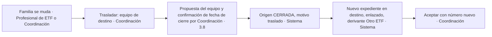

| Paso | Quién | Qué hace | Estado antes → después | Pantalla / API | Estado |
| --- | --- | --- | --- | --- | --- |
| 1 | Coordinación | En la ficha, elige el equipo de destino; completa la propuesta del equipo y confirma fecha y cierre con una persona distinta en Coordinación, según 3.8 | — | `/expedientes/{id}` · `POST /api/expedientes/{id}/trasladar` | servidor y pantalla disponibles |
| 2 | Sistema | Valida el cierre de 3.8 y conserva su episodio con motivo «traslado»; elegir destino por sí solo no cierra | ACEPTADA o EN INTERVENCIÓN → CERRADA | mismo | servidor y pantalla disponibles |
| 3 | Sistema | Crea uno nuevo en el equipo de destino con servicio derivante «Otro ETF», los datos copiados y enlace al de origen | (nada) → DERIVACIÓN RECIBIDA | mismo | servidor y pantalla disponibles |
| 4 | Coordinación | Lo acepta como en 3.1 (número nuevo del equipo de destino, Acta) | DERIVACIÓN RECIBIDA → ACEPTADA | `POST /api/coordinacion/derivaciones/{id}/aceptar` | servidor y pantalla entregados |

Decisión provisional [D11]: se cierra en origen y se abre con número nuevo, enlazados.
Para F3.02c, Dirección fija que Coordinación acepta en destino como en 3.1:
número nuevo del equipo de destino y Acta de Aceptación. La nueva derivación
copia los datos y mantiene el enlace; no hereda el número, los hitos ni el
consentimiento del origen. Esta decisión queda pendiente de confirmar con el Programa.
Quién inicia el traslado (el equipo de origen lo pide, la coordinación lo hace)
es la lectura del análisis; también está pendiente de confirmar.

TR1 publica el traslado en `/coordinacion/expedientes/{id}/traslado`, enlazado desde Salidas y cierre. Muestra el motivo propuesto por el equipo, pide destino, motivo para el Acta de Cierre y fecha, y confirma la consecuencia antes de guardar. El resultado enlaza con la aceptación del destino y con el Acta del origen. Si se pierde la respuesta, recupera el resultado con la misma petición y clave, sin repetir el traslado.

La ficha del equipo ofrece la pestaña Seguimiento y acceso directo `/equipo/seguimiento?id=…`. Muestra cese, inicio del tramo vigente, fin previsto, terminación y motivos. El equipo puede terminar antes con fecha y motivo activo de catálogo; Coordinación puede reabrir con motivo. Los avisos se consultan aparte: su fallo no impide consultar o cambiar el seguimiento. La historia permanece en la pestaña Historial.

### 3.11 Reabrir

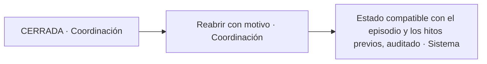

| Paso | Quién | Qué hace | Estado antes → después | Pantalla / API | Estado |
| --- | --- | --- | --- | --- | --- |
| 1 | Coordinación | Pulsa «Reabrir» y escribe el motivo; restaura el estado compatible con los hitos y el episodio anterior, sin inventar consentimiento | CERRADA → ACEPTADA sin consentimiento; EN INTERVENCIÓN con consentimiento; DERIVADA A SPM si sigue pendiente | `POST /api/expedientes/{id}/reabrir` | falta |
| 2 | Sistema | Abre un nuevo episodio activo y conserva fechas y motivos de todos los cierres y reaperturas anteriores; la historia de negocio no depende sólo de la auditoría | — | — | falta |

El servidor F3.02b permite `POST /api/expedientes/{id}/reabrir` con versión,
fecha, motivo y clave de idempotencia. Crea un episodio activo enlazado al
anterior, que conserva fecha y motivos del cierre. La reapertura restaura
ACEPTADA sin consentimiento, EN INTERVENCIÓN con consentimiento o DERIVADA A
SPM si sigue pendiente. Los cambios y su auditoría se confirman juntos. CO2 ofrece fecha y motivo de reapertura desde la pantalla de salidas del expediente cerrado, con confirmación previa.

La reapertura conserva también el bloqueo del SPM si se cerró de forma forzada y sigue sin respuesta habilitante. Sólo coordinación. Si una Memoria ya cerrada contaba ese expediente, no cambia (3.13).
Si la familia vuelve a ser derivada más adelante no se reabre: es una derivación
nueva marcada como «antecedente en el Programa» y enlazada a la anterior.

### 3.12 Tabla mensual para el SPAF

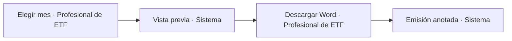

| Paso | Quién | Qué hace | Estado antes → después | Pantalla / API | Estado |
| --- | --- | --- | --- | --- | --- |
| 1 | Profesional de ETF | Elige mes y año (a mes vencido) | — | `/equipo/tabla-spaf` | implementado en SP1; mes anterior por defecto |
| 2 | Sistema | Calcula: entran los aceptados antes del fin del mes que no estén cerrados antes del día 1; columnas 1 a 14 y resumen (altas, bajas, total de casos, total de menores) | — | `GET /api/estadistica/spaf?anio=&mes=&etf=` | cálculo, auditoría, lector persistente y vista previa implementados; datos de ficha no recogidos visibles como «Sin dato» |
| 3 | Profesional de ETF | Revisa la vista previa y descarga el Word | — | `POST /api/equipos/{etf}/tabla-spaf/{anio}/{mes}.docx` | servidor, lector persistente y pantalla implementados; aviso de descarga y revisión ante 409 |
| 4 | Sistema | Anota quién y cuándo la emitió | — | — | implementado en la transacción de emisión |

El motivo de cierre (columna 14) sale traducido a la lista del SPAF [D5]; la
columna 5 pide la ZTS [D19]. Coordinación puede sacar la tabla de cualquier equipo
desde la misma ruta. La tabla no tiene estados: se puede volver a generar.
La descarga envía las versiones de regla y fichas de la vista previa. Si han
cambiado, devuelve 409 con las versiones actuales para revisar de nuevo.
Repetir la misma petición y clave devuelve el mismo Word y recibo; una clave
nueva genera otra emisión y avisa si cambian datos o plantilla. No cambia hitos.
El lector persistente está conectado. Los datos que aún no recoge su proyección
se muestran como «Sin dato». Un fallo de lectura o auditoría devuelve 503.
SP1 enlaza los números de expedientes que cuentan en altas y bajas a una
consulta acotada en `/equipo/tabla-spaf/expedientes/{id}`. Abre el expediente por
su API auditada y consulta de nuevo la tabla del mismo mes para mostrar las
fechas y motivos de sus movimientos. No presenta descripciones libres. Volver
conserva equipo y mes.

### 3.13 Memoria anual por equipo y provincial, con cierre

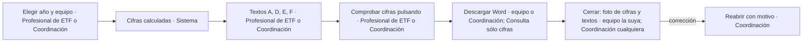

| Paso | Quién | Qué hace | Estado antes → después | Pantalla / API | Estado |
| --- | --- | --- | --- | --- | --- |
| 1 | Profesional de ETF (su equipo) o Coordinación (cualquiera o provincial) | Elige año y equipo; muestra el cálculo sin crear un borrador narrativo y publica el agregado permitido para Consulta | publicación de cifras, sin cambiar el estado de la Memoria | `/memoria` · `GET /api/estadistica/memoria?anio=&etf=` | API y pantalla implementadas en F4.02; Consulta utiliza el cálculo al momento o la foto cerrada de F4.07 |
| 2 | Sistema | Calcula los 28 apartados en el servidor con las reglas vigentes el 31/12 del año y los datos históricos correspondientes; en menos de 3 s | — | mismo | Cálculos existentes conectados en F4.02 |
| 3 | Mismo | Escribe los apartados de texto: A (equipos, profesionales por sexo, observaciones), D (metodología), E (dificultades), F (propuestas), hasta 25 líneas | — | `PUT /api/estadistica/memoria/narrativas?anio=&etf=` | Servidor F4.05 y pantalla F4.02; incluye G con 30 líneas |
| 4 | Profesional de ETF o Coordinación | Pulsa una cifra y ve los números de expediente que la forman (nunca nombres) | — | `GET /api/memoria/{anio}/cifras/{apartado}?etf=` | servidor F4.07; vista Equipo/Coordinación pendiente |
| 5 | Profesional de ETF o Coordinación; Consulta con salida exclusiva de cifras | Genera y descarga la Memoria; Consulta no recibe textos libres ni composición de cifras | — | `POST /api/estadistica/memoria/word`; Consulta: `POST /api/consulta/memoria/{anio}/word?equipo=` | Equipo y Coordinación: servidor F4.05 y pantalla F4.02. Consulta: servidor y vista F4.07 |
| 6 | Profesional de ETF (la suya) o Coordinación (cualquiera; sólo ella la provincial) | Cierra la Memoria: guarda una foto de las cifras y los textos | BORRADOR → CERRADA | `POST /api/estadistica/memoria/cerrar?anio=&etf=` | servidor F4.06 y pantalla F4.02 conectados |
| 7 | Coordinación | Si hay que corregir, la reabre con motivo; queda auditado | CERRADA → BORRADOR | `POST /api/estadistica/memoria/reabrir?anio=&etf=` | servidor F4.06 y pantalla F4.02 conectados |

La pantalla agrupa las tablas en 1–6, 7–13, 14–21 y 22–28. Los avisos del conjunto permiten abrir el bloque correspondiente. Cambiar de ámbito o recuperar textos avisa antes de descartar cambios. La descarga exige guardar los textos y mantiene la misma clave de emisión cuando se reintenta una respuesta perdida. Consulta muestra la fecha y el carácter definitivo o provisional de las cifras: foto cerrada o cálculo al momento mediante su contrato F4.07.

F4.07 expone para Consulta `GET /api/consulta/memoria/{anio}?equipo=` y
`POST /api/consulta/memoria/{anio}/word?equipo=` (JSON con `idioma` y CSRF).
Sin equipo se pide la provincia. Ambas salidas contienen sólo las cifras de
los 28 apartados; una Memoria cerrada usa su foto definitiva y una abierta
se calcula al momento. Indican fecha y carácter definitivo o provisional.
No admiten parámetros para incluir composición, narrativas o revisiones.
Los números que forman una cifra son exclusivos de Equipo/Coordinación.
F4.07 conecta la vista de Consulta en `/memoria`, con filtros y bloques de tablas de F4.02; no muestra desglose, narrativas ni acciones de cierre.

Una Memoria cerrada no cambia aunque luego se corrija un expediente. La provincial
se calcula siempre directamente de los datos con las mismas reglas, sin sumar
Memorias de equipo. Si difiere de la foto cerrada de un equipo, se muestra qué
cifra difiere y en cuánto; no se sustituye silenciosamente ninguna foto.
Tramos de duración: [D20]. Cada apartado indica su población, denominador y «sin
dato» por separado; con divisor cero muestra 0,00 y un aviso. Quien cumple 18 en
el año se cuenta en 12–17 conforme a la nota 43. Los resultados esperados se
validan por apartado con el Programa: no se copian repartos incoherentes de 2025
(apartado 2: 294 niños/284 niñas; apartado 25: 290/288, pendiente [D22]).

F4.06 expone estado, instantánea por revisión y discrepancias mediante GET
`/api/estadistica/memoria/{estado,instantanea,discrepancias}?anio=&etf=`.
Cerrar y reabrir requieren versión e idempotencia; reabrir exige motivo y sólo
lo permite Coordinación. El Word usa la foto cuando la Memoria está cerrada.
Una corrección estadística posterior genera en su propia transacción un aviso
para Coordinación con los apartados afectados; las fotos anteriores se conservan.
La consulta provincial compara también las fotos de los equipos cerrados y
muestra cifras anteriores y actuales. Los avisos quedan como historia aunque
una corrección posterior elimine la diferencia. Estas API no incluyen pantallas.

### 3.14 Comisiones técnicas e informes técnicos

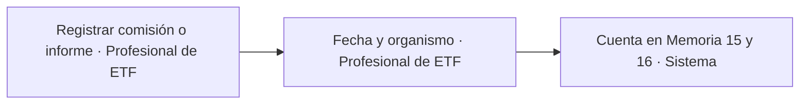

| Paso | Quién | Qué hace | Estado antes → después | Pantalla / API | Estado |
| --- | --- | --- | --- | --- | --- |
| 1 | Profesional de ETF | Abre «Comisiones e informes» en el menú y pulsa «Registrar comisión técnica» o «Registrar informe técnico» | — | `/equipo/comisiones` | entregado |
| 2 | Profesional de ETF | Comisión: fecha y observaciones. Informe: fecha y organismo (juzgados, fiscalía, SPAF, SPM, centros educativos, sanitarios, servicios sociales, otros) | — | `POST /api/comisiones`, `POST /api/informes` | servidor y pantalla entregados |
| 3 | Profesional de ETF | Corrige o borra un registro propio de su equipo; queda en la auditoría | — | `PUT/DELETE /api/comisiones/{id}`, `/api/informes/{id}` | servidor y pantalla entregados |
| 4 | Coordinación | Consulta los de todos los equipos | — | `/equipo/comisiones` · `GET /api/comisiones?anio=&etf=`; igual para informes | servidor y pantalla entregados |

La pantalla permite filtrar por año, intervalo de fechas y equipo; en informes,
también por organismo. Profesional de ETF escribe en su equipo; Coordinación
consulta todos los equipos. Consulta recibe sólo cifras de Memoria y no accede
a estos registros ni a sus textos libres. Los conflictos conservan lo escrito
y ofrecen consultar los registros actuales antes de repetir el cambio.

Son registros del equipo, no de un expediente. Si un año tiene la Memoria cerrada,
los cambios no la alteran.

### 3.15 Carga de todos los expedientes de 2026

Al acabar la fase 2 se cargan en **producción**, con la app desplegada, los vivos,
los cerrados durante 2026 y los no aceptados de 2026. Las unas 180 familias en
tratamiento son sólo una parte. Servidor, copias y EIPD se preparan en paralelo
desde el inicio; antes de cargar deben estar aprobada la EIPD, probada la
restauración y superada la revisión de seguridad. Desarrollo y preproducción
sólo usan datos inventados. No se espera a recibir datos reales de 2025.

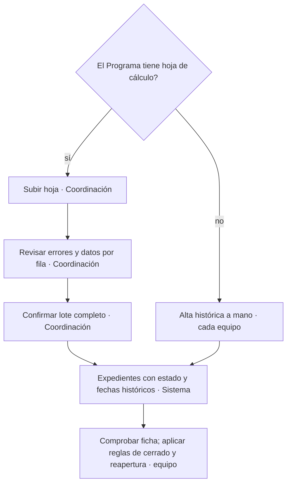

| Paso | Quién | Qué hace | Estado antes → después | Pantalla / API | Estado |
| --- | --- | --- | --- | --- | --- |
| 1a | Coordinación | Sube la hoja del Programa, si existe [D21]; validación y antivirus local, sin conservar el fichero | — | `/coordinacion/carga-2026` · `POST /api/carga-2026/hoja` | CA1 disponible |
| 2a | Sistema y Coordinación | Valida número, equipo, fechas, menores y estado; muestra errores por fila y datos para revisar, sin crear expedientes | — | misma pantalla | CA1 disponible |
| 3a | Coordinación | Confirma el lote validado; entra completo o ninguno | (nada) → estado histórico, incluidos CERRADA y NO ACEPTADA | `POST /api/carga-2026/hoja/{lote}/confirmar` | CA1 disponible |
| 1b | Profesional de ETF | Teclea los expedientes de su equipo con fechas, datos y estado históricos | (nada) → estado histórico | `/equipo/expedientes/alta-historica` · `POST /api/carga-2026` para revisar y `POST /api/carga-2026/{lote}/confirmar` para guardar | CA1 disponible |
| 4 | Profesional de ETF | Revisa y completa antes de confirmar; después se aplican las reglas ordinarias de edición y reapertura | — | revisión previa y resultado de carga | CA1 disponible |

Se conservan los números originales, fechas y episodios sin consumir números
nuevos; una no aceptación no recibe número. La carga evita duplicados y colisiones
con la numeración posterior. Los registros quedan identificados como cargados.
La hoja y el borrador no persisten. El navegador conserva los datos sólo en memoria
y reenvía el mismo contenido al confirmar; el servidor lo valida de nuevo. El formato y la existencia de hoja siguen en
[D21]; si no existe, cargan los equipos a mano. Manuales, vídeo y formación se
completan al final del plan.

### 3.16 Subida del Anexo 3 o 4 con antivirus y aviso «revisando»

Es la subida del recorrido de derivación. También se suben plantillas, temas,
idiomas y hojas de carga, cada uno con su política:

| Tipo | Límite y formato | Persistencia y antivirus |
| --- | --- | --- |
| Anexo de derivación | 10 MB; DOCX o PDF | Sólo memoria; nunca persistido por proxy, aplicación, temporales ni ClamAV. Única excepción: si ClamAV no responde se permite con aviso auditado |
| Plantilla | 10 MB; DOCX | Versión inmutable tras validación y antivirus local; sin revisión no se publica |
| Tema | 20 MB; ZIP con JSON, PNG y WOFF2, sin SVG | Versión inmutable; sin revisión antivirus no se publica |
| Idioma | 20 MB; ZIP con JSON y DOCX | Versión inmutable; sin revisión antivirus no se publica |
| Hoja de carga | 10 MB; XLSX o CSV | No se conserva el fichero; sin revisión antivirus no se importa |

Los paquetes tienen además un máximo de 100 MB descomprimidos y 1.000 entradas.
Los límites y controles de tipo real se aplican en el servidor (detalle en `TRD.md`).

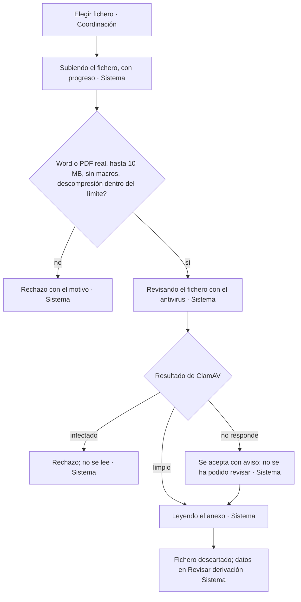

| Paso | Quién | Qué hace | Estado antes → después | Pantalla / API | Estado |
| --- | --- | --- | --- | --- | --- |
| 1 | Coordinación | Elige el fichero (o lo arrastra) | — | `/coordinacion/anexos/nuevo` | falta |
| 2 | Sistema | Muestra «Subiendo el fichero…» con el avance de la subida | — | `POST /api/coordinacion/derivaciones` (multipart, una sola petición) | falta |
| 3 | Sistema | Comprueba tipo real (Word `.docx` o PDF; `.docm` rechazado), tamaño máximo 10 MB, límite de descompresión y lector XML sin entidades externas | — | conector `ValidadorFichero` | falta |
| 4 | Sistema | Al terminar la subida y hasta la respuesta, muestra «Revisando el fichero con el antivirus…» | — | conector `Antivirus` (ClamAV en su contenedor) | falta |
| 5 | Sistema | Si está infectado, lo rechaza y lo apunta en la auditoría | — | — | falta |
| 6 | Sistema | Si ClamAV no responde, lo acepta, muestra un aviso visible («No se ha podido revisar con el antivirus») y anota en la derivación y en la auditoría que no se revisó | — | — | falta |
| 7 | Sistema | Lee los datos en memoria (Word con fiabilidad; PDF peor; un escaneo no se lee y la coordinación teclea [D6]), descarta el fichero sin escribirlo en disco ni en la base de datos | — | conector `LectorAnexo` | falta |
| 8 | Sistema | Abre «Revisar derivación» con los campos dudosos marcados (sigue en 3.1, paso 3) | — | `/coordinacion/derivaciones/{id}` | falta |

El aviso de antivirus no revisado se ve también en la lista de derivaciones
recibidas hasta que se decide sobre ella.

### 3.17 Registro de salida manual

Hoy los oficios se registran fuera de la app. La app tiene un conector
`RegistroSalida` con un adaptador manual; en el futuro se podrá añadir un adaptador
MOAD sin tocar el resto.

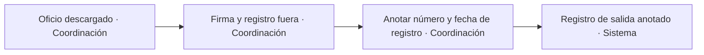

| Paso | Quién | Qué hace | Estado antes → después | Pantalla / API | Estado |
| --- | --- | --- | --- | --- | --- |
| 1 | Coordinación | Descarga el oficio (aceptación a SS.SS.CC., aceptación al SPM o lista de espera) | emisión registrada, sin confirmar firma ni registro | `POST /api/documentos/emisiones` | API de aceptación disponible; pantalla y lista de espera pendientes |
| 2 | Coordinación | Lo firma y registra fuera, como hoy | — | — | falta |
| 3 | Coordinación | En la pestaña Documentos, junto al oficio, anota número y fecha de registro de salida | registro de salida anotado | `POST /api/documentos/emisiones/{id}/registro-salida` | API disponible; pantalla pendiente |

Mientras falte el registro, el oficio sale con la marca «sin registro de salida»
en la pestaña Documentos. El alcance vigente de F1.08 es sólo para oficios;
las Actas no admiten registro de salida. Si se aplica además a los Anexos 5 y 6
lo decidel responsable del producto. Con MOAD, el paso 3 lo haría el adaptador.
La anotación envía la versión leída y una clave de idempotencia; no modifica
fechas ni hitos del expediente.

## 4. Estados de los objetos principales

### 4.1 Expediente

| Estado | Entra por | Quién lo cambia | Sale a |
| --- | --- | --- | --- |
| DERIVACIÓN RECIBIDA | Guardar derivación (3.1) o traslado (3.10) | Coordinación | ACEPTADA, LISTA DE ESPERA, NO ACEPTADA |
| LISTA DE ESPERA | «Dejar en lista de espera» (3.3) | Coordinación | ACEPTADA, NO ACEPTADA |
| NO ACEPTADA | «No aceptar» (3.2) o carga histórica (3.15) | Coordinación; equipo sólo en carga histórica | (final) |
| ACEPTADA (fase recepción) | «Aceptar» con número (3.1) o carga de 2026 (3.15) | Coordinación; carga | EN INTERVENCIÓN, CERRADA (familia no consiente, con propuesta y motivo) |
| EN INTERVENCIÓN | Consentimiento (3.4), respuesta del SPM (3.6), reabrir (3.11) | Profesional de ETF; Coordinación al reabrir | DERIVADA A SPM, CERRADA |
| DERIVADA A SPM | Fecha real de derivación confirmada del Anexo 5 (3.6) | Profesional de ETF | EN INTERVENCIÓN (con respuesta), CERRADA (cierre forzado por Coordinación) |
| CERRADA | Confirmación del cierre y fecha real de firma del Acta (3.8), traslado (3.10) o carga histórica (3.15) | Coordinación; equipo sólo en carga histórica | SEGUIMIENTO TRAS CESE; ACEPTADA, EN INTERVENCIÓN o DERIVADA A SPM al reabrir según los hitos y el episodio previo |
| SEGUIMIENTO TRAS CESE | Cese de la medida en Reunificación (3.9) | Profesional de ETF; fin por fecha | CERRADA |

Marcas que no son estados:

- **Pendiente de atender**: ACEPTADA y más de 30 días sin consentimiento (3.4). La calcula el sistema.
- **Cierre propuesto**: el equipo propuso el cierre (3.8). Lo pone el equipo y lo quita el cierre o la retirada.
- **Antivirus no revisado**: la derivación entró con ClamAV caído (3.16).
- **Pendiente de anonimizar**: 25 años desde el cierre. Una tarea programada lo marca y, tras revisión humana, borra nombres y contactos y deja los datos estadísticos [D14]. Quién hace esa revisión no está decidido (Administración funcional no ve expedientes); lo decidel responsable del producto con el DPD.

### 4.2 Fase de intervención

Recepción → Evaluación → Intervención → Cierre y devolución → Seguimiento. La
elige el Profesional de ETF; la app propone una por las fechas y avisa cuando
una fase supera su duración orientativa:

| Fase | Riesgo | Reunificación |
| --- | --- | --- |
| Recepción | hasta 30 días | hasta 30 días |
| Evaluación | 3 meses | 1,5 meses |
| Intervención | 15 meses, ampliable a 18 | 6 meses, ampliable a 12 |
| Cierre y devolución | 1,5 meses | 1 mes |
| Seguimiento | a los 4 meses | a los 4 meses del cierre y a los 12 meses del cese de la medida |

Las duraciones viven en «Plazos y tramos», versionadas. La fase sale en la
columna 10 de la Tabla SPAF.

### 4.3 Derivación de salida

| Tipo | Estados | Quién |
| --- | --- | --- |
| Anexo 5 (al SPM) | EMITIDA al confirmar el hito («a la espera de respuesta») → RESPONDIDA («se conoce inicio de procedimiento de desamparo o adopción de medida» o «el SPM no valora necesaria la medida») | Confirma la derivación y registra la respuesta el Profesional de ETF. Mientras está EMITIDA, el expediente no se puede cerrar salvo cierre forzado por Coordinación |
| Anexo 6 (a otro servicio) | EMITIDA al confirmar el hito | Profesional de ETF. No tiene respuesta ni bloquea nada |

### 4.4 Memoria anual

| Estado | Entra por | Quién lo cambia | Sale a |
| --- | --- | --- | --- |
| BORRADOR | Vista calculada sin foto cerrada; primer guardado de textos o reapertura para persistir | Profesional de ETF (textos de la suya) y Coordinación | CERRADA |
| CERRADA | «Cerrar»: foto de cifras y textos | Equipo la suya; Coordinación cualquiera y sólo ella la provincial | BORRADOR (reabrir con motivo, auditado) |

## 5. Avisos

Todos los avisos están **sólo en la app**: en la bandeja o el inicio de cada
perfil y en la ficha del expediente. No hay correo. Se calculan al leer, sin
tabla de avisos. F2.02 publica `GET /api/expedientes/{id}/avisos` y
`GET /api/equipos/{equipo}/avisos/recuento`; F2.06 los mostrará. Los textos
viven en `idiomas/<código>/`. En enero, el recuento de datos faltantes usa
la ficha histórica al 31 de diciembre del año anterior de los expedientes
atendidos ese año. Los plazos se leen del catálogo vigente al consultar.

| Aviso | A quién | Dónde | Cuándo |
| --- | --- | --- | --- |
| Sin consentimiento tras 30 días (pendiente de atender) | Equipo del expediente; Coordinación | Bandeja, inicio de coordinación, ficha | Día 31 desde el Acta de Aceptación sin consentimiento confirmado [D3] |
| Fase de intervención por encima de su duración | Equipo | Bandeja, ficha | Al superar la duración de 4.2 |
| Anexo 5 sin respuesta del SPM | Equipo; Coordinación | Bandeja, ficha | N días después del Anexo 5 (N configurable) |
| Motivo de finalización sin Acta de Cierre | Equipo; Coordinación | Bandeja, «Cierres propuestos», ficha | Al proponer el cierre, hasta confirmar el cierre y la fecha real del Acta |
| Fin del seguimiento tras cese próximo | Equipo | Bandeja, ficha | Antes de la fecha de fin (antelación configurable) |
| Faltan N datos para la Memoria | Equipo | Ficha; bandeja en enero para los del año anterior | Siempre en la ficha; en enero en la bandeja |
| Derivaciones recibidas sin decidir y lista de espera | Coordinación | Inicio (contadores del menú) | Mientras existan |
| Derivación entrada sin revisar por el antivirus | Coordinación | Derivaciones recibidas, revisión | Desde la subida hasta la decisión |
| Oficio sin registro de salida | Coordinación | Ficha · Documentos | Desde la emisión hasta anotar el registro |
| Personas pendientes de alta | Administración funcional | Inicio de administración | Mientras existan |
| Claves de idioma que faltan | Administración funcional | Idiomas | Al arrancar o recargar idiomas |

## 6. Reglas de acceso por paso

Denegación por defecto: lo que no está en esta tabla no se permite. El permiso se
comprueba en el servidor en cada petición y, para los expedientes, también en la
base de datos con RLS (un expediente de otro equipo no existe para el Profesional
de ETF). Toda acción, también abrir una ficha, queda en la auditoría. Antes de
entregar datos o descargas debe confirmarse ese registro; si falla, no se entregan.
Los fallos de una operación se registran después de revertir su transacción.
Administración funcional exporta la auditoría para el DPD sin obtener permiso de
lectura de expedientes. La conservación y exportación de los vínculos entre
usuarios y expedientes quedan por concretar con el DPD en la EIPD y el registro de decisiones del PRD.

| Acción | Coordinación | Profesional de ETF | Consulta | Administración funcional |
| --- | --- | --- | --- | --- |
| Subir anexo, guardar derivación | sí | no | no | no |
| Aceptar, lista de espera, no aceptar | sí | no | no | no |
| Actas de Aceptación y No Aceptación, oficios, registro de salida | sí | no | no | no |
| Ver listados de expedientes (enmascarados) | todos | su equipo | no | no |
| Abrir la ficha (nombre completo, auditado) | todos | su equipo | no | no |
| Editar la ficha, fase, hitos de Anexo 7/8 (cerrados: sólo seguimiento; el resto exige reabrir) | sí | su equipo | no | no |
| Anexos 1, 2, 5, 6, 11 y 12; respuesta del SPM | sí | su equipo | no | no |
| Proponer o retirar cierre | no | su equipo | no | no |
| Acta de Cierre, cerrar | sí, salvo quien propuso ese cierre | no | no | no |
| Forzar cierre con Anexo 5 sin respuesta | sí, con motivo | no | no | no |
| Reabrir expediente, trasladar | sí, con motivo | no | no | no |
| Seguimiento tras cese | sí | su equipo | no | no |
| Tabla SPAF | cualquier equipo | su equipo | no | no |
| Comisiones e informes: registrar | no | su equipo | no | no |
| Comisiones e informes: consultar | todos | su equipo | no | no |
| Memoria: ver y descargar | todas | la de su equipo | todas, sólo totales | no |
| Memoria: pulsar una cifra y ver números de expediente | sí | su equipo | no | no |
| Memoria: textos libres | sí | la de su equipo | no | no |
| Memoria: cerrar | todas; sólo Coordinación la provincial | la de su equipo | no | no |
| Memoria: reabrir con motivo | sí | no | no | no |
| Carga de expedientes de 2026 por hoja | sí | no | no | no |
| Alta histórica de 2026 a mano | sí | su equipo | no | no |
| SMI | sí | no | no | no |
| Usuarios, catálogos, plazos y tramos, plantillas, firmantes, temas, idiomas | no | no | no | sí |
| Exportar la auditoría para el DPD | no | no | no | sí |

Qué ve quien no tiene el permiso:

- El menú y los botones de acciones no permitidas no aparecen. Un botón que se
  permite pero aún no se puede usar (por ejemplo «Cerrar» con Anexo 5 sin
  respuesta) se ve desactivado con el motivo al lado.
- Si alguien llama a la API sin permiso, recibe 403 con un mensaje genérico y el
  intento queda en la auditoría. Si pide un expediente de otro equipo, recibe 404,
  porque la base de datos no se lo devuelve.
- Persona pendiente de alta: sólo `/pendiente` y salir.

## 7. Contradicciones encontradas

Resueltas por la entrevista y el consenso del responsable del producto del 13/10/2026:

1. **Identidad:** permisos en la app, nunca por grupos de AD; identidad estable por `objectGUID`; primer administrador concedido una sola vez y un solo equipo simultáneo por profesional (1 y 2.5).
2. **Administración funcional:** mantiene usuarios, catálogos, plazos, plantillas, firmantes, temas e idiomas y exporta auditoría para el DPD; no ve fichas (2.4 y 6).
3. **Ficheros:** el anexo admite DOCX/PDF hasta 10 MB y no persiste en ningún componente. Plantillas, temas, idiomas y hojas tienen políticas propias; la excepción por caída del antivirus sólo vale para anexos (3.16).
4. **Escalas y DNI:** se guardan las escalas [D17]; no se guarda el DNI del representante y el Word lleva el hueco blanco [D16]. Ambas decisiones son firmes.
5. **Emisión e hito:** generar usa `POST`, también SPAF y Memoria; registra emisión, nunca firma ni hito automático. La persona confirma la fecha real; regenerar no altera estados (3).
6. **Cierre del expediente:** ACEPTADA permite cierre si la familia no consiente, con motivo de catálogo y doble intervención. El Anexo 5 sólo desbloquea cierre ordinario con las dos respuestas válidas; Coordinación puede forzar con motivo. Un cerrado sólo admite seguimiento sin reabrir; los episodios anteriores se conservan (3.5 a 3.11).
7. **Memoria:** el equipo cierra la suya y sólo Coordinación la provincial; reabre Coordinación. La provincial se calcula directamente; las diferencias frente a fotos de equipo se avisan. Reglas vigentes el 31/12 e historia de datos; Consulta recibe sólo cifras (3.13).
8. **Carga:** todos los expedientes de 2026, vivos, cerrados y no aceptados; producción al terminar fase 2 tras EIPD, restauración y seguridad, con hoja o tecleo de equipos. No se espera a 2025 (3.15).
9. **Textos y publicación:** textos traducibles sólo en directorios de idioma; versiones inmutables y activación con auditoría atómica. Los textos libres de negocio siguen siendo datos (2.4).
10. **Auditoría:** se confirma antes de entregar datos, incluidas lecturas y descargas (6). Avisos sólo en la app; registro de salida manual con conector futuro MOAD (3.17 y 5).

Sin resolver (decidel responsable del producto, el Programa a través de él o el DPD):

11. Devolver una propuesta de cierre al equipo (3.8).
12. Confirmar con el Programa el traslado con aceptación y Acta en destino [D11] (3.10).
13. Confirmar con el Programa el fin automático del seguimiento, su terminación anticipada por el equipo y su reapertura por Coordinación [D23] (3.9).
14. Quién revisa antes de anonimizar [D14], y política de conservación y exportación de vínculos usuario-expediente para la EIPD (4.1 y 6).
15. Orden del número de expediente [D1]: provisional equipo-correlativo-año, `08-01-26`.
16. Reparto por sexo incoherente entre apartados 2 y 25 de la Memoria oficial de 2025 [D22]: Programa valida cuál corresponde y por qué, apartado por apartado (3.13).
17. Existencia y formato de hoja para cargar 2026 [D21]; el alcance y la alternativa manual ya están decididos.

## 8. Cómo mantener este documento

- Se actualiza en el mismo cambio cuando varía un paso, una pantalla, una ruta, un
  estado o quién actúa. Cambio pequeño, edición pequeña: no se reescribe el documento.
- Al construir una pantalla o un paso, su columna «Estado» pasa de **falta** a
  **en curso**, **hecho** y **en uso**; la ruta deja de ser «prevista» cuando existe
  en el código.
- Cuando el Programa conteste una duda [Dn], se cambia el paso que la cita y se
  quita la marca; la respuesta se anota en el registro de decisiones del PRD.
- Las decisiones pendientes del apartado 7 se pasan al paso correspondiente y salen de esa lista cuando se resuelven.
- Los detalles de cada ruta de API van en `ESQUEMA_BACKEND.md`; el aspecto y los
  textos de cada pantalla, en `DISENO_UI_UX.md`. Aquí sólo el orden, el perfil y
  la ruta.
- Nunca se escriben aquí datos personales reales ni textos de pantalla definitivos:
  los textos viven en `idiomas/<código>/`.
