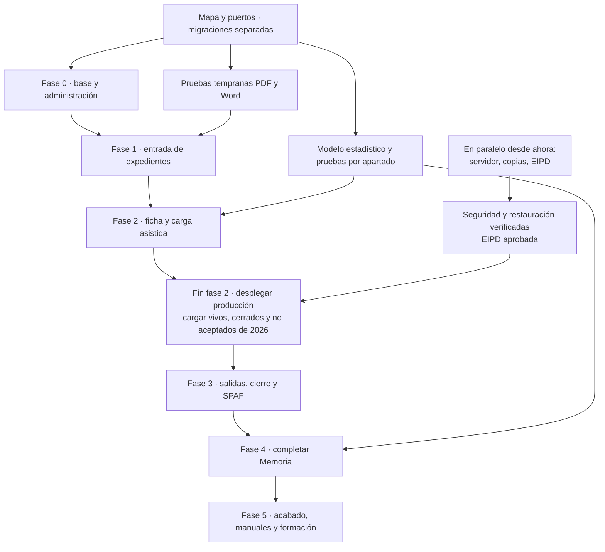

# Plan de implementación de Expedientes ETF
> Especificación de la edición pública. La entidad que la instale configura sus datos, identidad y plantillas.
> Las referencias D1–D22 se conservan en el registro de decisiones del PRD; las fuentes privadas no se distribuyen.

Este documento dice qué falta, en qué orden se construye, quién hace cada cosa y cómo se comprueba. El alcance está en `PRD.md`; la arquitectura, en `TRD.md`; los recorridos, en `FLUJO_APP.md`; el diseño, en `DISENO_UI_UX.md`; los datos y permisos, en `ESQUEMA_BACKEND.md`.

Siglas utilizadas: ETF, Equipo de Tratamiento Familiar; SS.SS.CC., Servicios Sociales Comunitarios; SPM, Servicio de Protección de Menores; SPAF, Servicio de Prevención y Apoyo a la Familia; SMI, Salario Mínimo Interprofesional; AD, Active Directory; LDAPS, conexión cifrada al directorio; RLS, seguridad por filas de PostgreSQL; EIPD, evaluación de impacto en protección de datos; DPD, delegado de protección de datos; CI, integración continua; PR, petición de integración de una rama; WCAG 2.1 AA, nivel de accesibilidad previsto. ClamAV es el antivirus local.

## 0. Decisiones de base

| Decisión | Elegido | Fecha y quién |
| --- | --- | --- |
| 14. Pruebas | Proporcionales al riesgo. En local se prueba lo cambiado; la CI comprueba todas las capacidades existentes. Se incorporan nuevas puertas al entregar cada capacidad. Estadística con pruebas por apartado; permisos y aislamiento contra PostgreSQL real. | 13/10/2026 · responsable del producto |
| 16. Forma de trabajo | Entregas pequeñas de una capacidad completa: dominio, aplicación, puertos, adaptadores, HTTP, pantalla y textos. Los preparativos técnicos tienen una salida comprobable y una entrega consumidora. Revisión independiente de SQL, permisos y seguridad. El equipo de desarrollo implementa; el de mantenimiento revisa e integra. | 13/10/2026 · responsable del producto |
| 17. Comunicación | Castellano llano y siglas explicadas. | 13/10/2026 · responsable del producto |
| Carga inicial y producción | Todos los expedientes de 2026: vivos, cerrados y no aceptados. Sólo en producción, con la aplicación desplegada al finalizar la fase 2. Hoja si existe [D21]; si no, alta asistida por los equipos. | 13/10/2026 · responsable del producto |
| Preparación paralela | Servidor, copias y EIPD se preparan desde ahora. Su aprobación y las pruebas de restauración y seguridad preceden a los datos reales. Manuales de usuario, vídeo y formación al final. | 13/10/2026 · responsable del producto |

## 1. Estado actual

A 13/10/2026 el avance aproximado es del 37 %. Hechas e integradas en `main`: Docker Compose con la aplicación, PostgreSQL 18 y ClamAV y el migrador aparte; la integración continua; idiomas por directorio y temas instalables; la auditoría encadenada; la entrada con Active Directory, la sesión y «pendiente de alta»; los perfiles y la autorización por tabla única; los catálogos versionados con su edición y los firmantes; la instalación de paquetes con antivirus; el lector de Anexos 3 y 4 en Word y PDF; la propuesta de municipio; la subida del anexo con antivirus y la derivación recibida; la aceptación con numeración; la emisión de Word sin guardarlo; y el modelo estadístico de la Memoria (apartados 1, 2, 7, 8, 9, 13 y 25). En esta rama está implementado el mantenimiento del SMI por año (F1.09). En curso: actas y oficios, el armazón visual. El resto sigue pendiente; una tarea escrita aquí no significa que se haya ejecutado.

| Pieza | Estado | Falta |
| --- | --- | --- |
| Seis documentos de producto | Unificación de los acuerdos del 13/10/2026 | Revisión conjunta de coherencia y visto bueno del responsable del producto |
| Fuentes del cliente y maqueta | Disponibles en las plantillas de `idiomas/` y referencia de la maqueta | Anexos 3 y 4 cumplimentados con datos inventados en el formato habitual [D6] |
| Dudas del Programa | En el registro de decisiones del PRD | Respuestas pendientes, formato de una posible hoja de 2026 [D21] y discrepancia de la Memoria de 2025 [D22] |
| Repositorio y CI | Repositorio público con comprobaciones locales y CI; sólo datos inventados | El equipo de mantenimiento define la revisión y la integración de contribuciones |
| Guías de contribución | Reglas de SQL, seguridad, interfaz, recorridos y redacción en los documentos de producto | Revisar cuando cambie la pila o una regla |
| Servidor, copias y acceso a AD | Por preparar con Informática | P.01 y P.02 desde ahora |
| EIPD | responsable del producto la tramita con el DPD | P.03; aprobación antes de datos reales |
| Arranque y migraciones | F0.03 hecha e integrada en `main`; evidencia en `despliegue/base/EVIDENCIA.md` | Suministro local de firmas ClamAV antes de producción |
| Código y pruebas | Integrado en `main`: base técnica (F0.04 a F0.07), auditoría, entrada y perfiles, catálogos y paquetes, lector de anexos, subida, aceptación, emisión de Word y modelo estadístico parcial. En esta rama está implementado el mantenimiento del SMI por año (F1.09) y el cálculo de dominio de los apartados 3–6, 10–12.2, 13.3 y 17–24; faltan validación del Programa e integración. En curso: actas y oficios, armazón visual | Resto de las fases 1 a 5 |

La demostración local integra estas capacidades con siete usuarios inventados,
perfiles y firmante sembrados por API. `make demo-recorrido` valida entrada en
Chrome del sistema y Anexo 3 → aceptación → descarga del Acta por API.
Las pantallas de coordinación siguen pendientes. Instrucciones en
[despliegue/demo/LEEME.md](../../despliegue/demo/LEEME.md).

## 2. Orden de construcción

Primero se fijan el mapa de módulos, los puertos y las migraciones. La fase 0 entrega entrada, administración básica y pruebas tempranas de los tres riesgos principales: cálculo estadístico, lectura de PDF y generación de Word. Las fases 1 y 2 permiten registrar y completar expedientes. Al final de la fase 2 se despliega producción y se cargan todos los casos de 2026. Las fases 3 y 4 completan salidas, cierres, SPAF y Memoria sobre esos datos. La fase 5 termina accesibilidad, conservación, documentación y formación.

No se espera a recibir datos reales de 2025 para calcular o validar. Desarrollo, CI y preproducción utilizan siempre datos inventados. Los resultados esperados por apartado los valida el Programa; las contradicciones de la Memoria oficial de 2025 no se copian a las pruebas.

### Preparación paralela: empieza ahora, termina antes de F2.09

| Código | Entrega y comprobación | Responsable | Zona exclusiva |
| --- | --- | --- | --- |
| P.01 | Servidores, dominio interno, certificados, LDAPS, red provincial y VPN; verificar acceso interno y ausencia de publicación en Internet | Informática, a petición del responsable del producto | Infraestructura fuera del repositorio |
| P.02 | Copia diaria cifrada fuera del servidor; copia previa al despliegue y vuelta atrás; ensayo documentado de restauración de base de datos y versiones de idiomas, temas y plantillas | el equipo de desarrollo con Informática | `despliegue/copias/`, `despliegue/publicacion/`; coordinar con F0.03 |
| P.03 | EIPD con el DPD: datos tratados, conservación y exportación de vínculos entre usuarios y expedientes en auditoría, anonimización [D14]; aprobación antes de cargar datos reales | responsable del producto y DPD | Fuera del repositorio; decisiones sin datos personales en el registro de decisiones del PRD |
| P.04 | Prueba de seguridad exhaustiva antes de abrir producción, con evidencias locales, auditoría completa `security-audit` (seis fases) sobre todo el código, Semgrep, gitleaks, govulncheck y auditoría de dependencias en local, inventario de componentes de las imágenes y prueba de intrusión sobre preproducción con datos inventados (sesión, permisos entre perfiles y equipos, inyección, ficheros maliciosos, cabeceras). Ningún fallo crítico ni alto abierto; repetir la prueba de lo corregido; informe para el Comité de Seguridad en el informe de seguridad de cada instalación (Markdown y PDF). Cubre el alcance de fases 0 a 2 y se repite en F5.02 con la versión completa | Revisor independiente, dirigido por el equipo de mantenimiento | Alcance y ficheros del informe fijados en el encargo; correcciones en tareas separadas |

## 3. Fases y criterio de cierre

### Mapa único y reparto de ficheros

Este mapa es el mismo que el de `TRD.md` §2 y `ESQUEMA_BACKEND.md` §1. Los nombres no crean módulos distintos para usuarios, derivación, cierre, SPAF o Memoria.

| Módulo | Responsabilidad |
| --- | --- |
| `plataforma` | Soporte técnico: contexto de seguridad y ejecución de migraciones. No es dominio de negocio |
| `identidad` | Usuarios, perfiles, equipo y sesión |
| `catalogo` | Listas, reglas, equipos, centros, municipios, SMI, firmantes y destinatarios |
| `paquete` | Idiomas, temas y referencias activas |
| `expediente` | Derivación, ficha, hitos, salida, cierre, seguimiento, avisos, conservación y carga |
| `evaluacion` | Instrumentos y escalas |
| `documento` | Plantillas, emisiones y registro de salida |
| `actividad` | Comisiones e informes |
| `estadistica` | SPAF, Memoria y totales |
| `auditoria` | Eventos y cadena |

Rutas por módulo de negocio: `internal/dominio/<módulo>/`, `internal/aplicacion/<módulo>/`, interfaces de casos de uso en `internal/aplicacion/<módulo>/puertos/entrada/`, repositorios y conectores en `internal/puertos/salida/<módulo>/`. El adaptador HTTP importa puertos de entrada de aplicación; los adaptadores externos implementan puertos de salida. `plataforma` vive como soporte en `internal/plataforma/`. El dominio no importa HTTP, bases de datos ni ficheros.

En las tablas, **V(módulo, capacidad)** asigna exclusivamente los ficheros de esa capacidad dentro de las cuatro rutas anteriores, `internal/adaptadores/http/<módulo>/`, `internal/adaptadores/postgres/<módulo>/`, `web/src/<módulo>/<capacidad>/`, `idiomas/<código>/textos/<módulo>/<capacidad>.json` y sus migraciones nuevas en `migraciones/<módulo>/`. El encargo enumera los nombres exactos antes de empezar. Una fila V incluye backend, pantalla, textos y prueba del recorrido; no se abre una tarea posterior sólo para conectar su HTTP o su pantalla. Las capacidades que usan otro módulo llaman a sus puertos; no añaden tablas ajenas.

Las tareas son secuenciales salvo que el equipo de mantenimiento compruebe que sus ficheros son distintos. Arranque, composición, contratos comunes y archivos compartidos tienen un único integrador; ninguna tarea paralela los modifica. Las rutas son previstas hasta que exista código; cualquier cambio se refleja a la vez en los tres documentos del mapa.

**Responsables:** desarrollo implementa, mantenimiento revisa e integra y el el responsable del producto decide el alcance. SQL, permisos, identidad, subidas y HTTP requieren revisión independiente; las pantallas requieren revisión de aspecto y usabilidad. Cada tarea lee PRD y PLAN.

### Fase 0: base y pruebas tempranas

**Objetivo:** entrada con AD de pruebas, alta por Administración funcional, menú según perfil, catálogos iniciales, idioma y tema configurables; cada paso auditado. Estadística, PDF y Word tienen pruebas útiles antes de construir la ficha.

| Código | Entrega y resultado visible o verificable | Zona exclusiva | Leer además |
| --- | --- | --- | --- |
| F0.01 | Verificar repositorio remoto; preparar Repositorio público y CI sin datos reales y protección de `main`, sólo integración por el responsable del producto | Configuración de GitHub; responsable del producto | TRD, §4 de este plan |
| F0.02 | Adaptar skills de SQL, seguridad, interfaz, recorridos y redacción al proyecto | Guías de contribución; el equipo de mantenimiento | TRD, §4.2 de este plan |
| F0.03 | Compose con app, PostgreSQL 18 y ClamAV, salud y registros sin datos personales; comando de despliegue `cmd/migrar/` separado con rol `etf_migrador`; la app no migra ni recibe esas credenciales | `compose.yaml`, `Dockerfile`, `despliegue/base/`, `cmd/migrar/`, `internal/plataforma/`, `migraciones/plataforma/` | TRD, ESQUEMA (migraciones) |
| F0.04 | Fijar mapa y puertos antes de implementar módulos; esqueleto Go y React, composición y prueba de dependencias; `catalogo` precede a las migraciones de `identidad`; dependencias por migración, ciclos resueltos separando tablas y relaciones | `cmd/etf/`, esqueletos de `internal/` y `web/`, `go.mod`; terminar antes de tareas de módulos | TRD §2, ESQUEMA §1 y §6 |
| F0.05 | CI mínima ejecutable de lo que ya existe, ampliada con cada entrega; dependencias Go/npm fijadas con sus sumas | `.github/workflows/`, `scripts/ci/` salvo textos y temas | TRD (CI), §4.3 |
| F0.06 | Selección de idioma con respaldo en castellano, detección y recarga; textos de interfaz y catálogos sólo en `idiomas/<código>/{textos,catalogos,plantillas}/`; comprobación de claves y literales | V(paquete, idiomas), adaptador de ficheros del idioma, `scripts/ci/textos/` | TRD (idiomas), DISENO |
| F0.07 | Selección de tema por tokens, predeterminado y alto contraste; validar recursos PNG y WOFF2, sin SVG ni código; prueba anti-colores fijos | V(paquete, temas), `temas/expedientes-etf/`, `temas/alto-contraste/`, `scripts/ci/temas/` | TRD (temas), DISENO |
| F0.08 | Cadena de auditoría y comprobador; Administración funcional exporta para el DPD desde su pantalla. Confirmar auditoría antes de devolver lecturas o descargas; fallo al auditar impide entregar; registrar fallos después de revertir la operación | V(auditoria, eventos), `cmd/comprobar-auditoria/` | TRD (auditoría), ESQUEMA §5 |
| F0.09 | F0.09a/b implementados y ensayados; dependencia explícita de F0.08b (`auditoria/0001`). Entrar, ver pendiente de alta y salir; LDAPS, sesión opaca, caducidad y protección de peticiones; identidad estable `objectGUID` además del login; AD caído impide nuevas entradas | V(identidad, sesion), adaptador LDAPS | TRD (identidad), FLUJO |
| F0.10 | Integrado en `int3-perfiles` desde `f0.10-perfiles`: alta y retirada de perfiles desde Administración; un profesional en un solo equipo a la vez; primer administrador concedido una única vez con marca persistente y auditoría, nunca recupera el permiso automáticamente | V(identidad, perfiles) | PRD (perfiles), ESQUEMA (RLS), FLUJO |
| UI2 | Retoques de Catálogos (etiquetas según idioma, identificadores secundarios), acceso único de idiomas y temas, ayuda desplegable, fechas numéricas y SMI legible en móvil. Recorrido real con Chrome y capturas 1440/390 en los dos temas; revisión independiente de usabilidad | `web/src/catalogo/`, armazón, CSS compartido del SMI, textos y `docs/capturas/` | DISENO §5.9 y §10 |
| UI1 | Armazón integrado con main: entrada, pendiente, Usuarios, Catálogos, Plazos y tramos, Firmantes, Paquetes y SMI; menú alimentado por la tabla declarativa de rutas; personal con nombre completo, tabla accesible, cabecera móvil de una fila y menús recogidos. Pruebas Chrome y capturas 1280/390 en ambos temas | `web/src/`, `web/tests/`, proyecciones mínimas de identidad/HTTP, textos de interfaz y `docs/capturas/` | DISENO §1, §4, §6 y §7; FLUJO §2 |
| F0.11 | Implementado el recorrido de entrada, pendiente y alta con Chrome del sistema contra `make demo`; matriz de todos los métodos del registro INT5 con seis perfiles y RLS de tablas pobladas con PostgreSQL. Integrado en CI tras un ensayo de 55,6 segundos. Pantallas ya entregadas por F0.09/F0.10. Ejecución y límites en [la guía de pruebas](../recorridos/F0.11.md) | `make ci` y `make recorridos`; pruebas de identidad y permisos; integración secuencial | FLUJO, DISENO |
| F0.12 | Consultar catálogo y vigencias desde Administración; códigos estables en BD y etiquetas sólo en ficheros de idioma; reglas de un año vigentes a 31/12 de ese año. Integrada desde `f0.12-catalogo-bd`; consulta HTTP autorizada por el perfil Administración en INT3; carga inicial de ubicaciones y seis listas confirmadas | V(catalogo, consulta) | ESQUEMA (catálogos), PRD; [alcance y ensayo](../../migraciones/catalogo/LEEME.md) |
| F0.13 | Cargar y verificar equipos, centros, municipios, variantes y listas; Íllora en Pinos Puente-Moclín y ETF 6 [D9]; territorios fuera del ámbito marcados [D10] | `datos/catalogos/`, `idiomas/<código>/catalogos/` iniciales; después de F0.12 | ESQUEMA y listados del cliente |
| F0.14a | Crear y editar una opción, plazo o tramo con vigencia desde Administración. Escribir nueva versión inmutable del fichero; referencia activa y auditoría en una transacción; impedir carreras de activación | V(catalogo, edicion); integrada en `int2-f014`; referencias de paquete por puerto sobre `paquete/0001` de F0.14c-2 y ampliación `paquete/0002`; auditoría PostgreSQL de F0.08b en la misma transacción; [entrega](../entregas/F0.14ab.md) | TRD, ESQUEMA, FLUJO |
| F0.14b | Mantener firmantes y destinatarios desde Administración con vigencia y textos en el idioma | V(catalogo, firmantes); integrada en `int2-f014`; autorización de Administración conectada en INT3 | PRD, FLUJO |
| F0.14c | Implementado en F0.14c-2, con autorización de Administración conectada en INT3 y migración `paquete/0001`. Instalar y activar versiones de idiomas y temas desde Administración: ZIP hasta 20 MB, máximo 100 MB descomprimido y 1.000 entradas, antivirus obligatorio y tipos permitidos según TRD; archivo por versión y huella antes de registrar/activar con auditoría en una transacción. Si falla, queda huérfano no utilizable y se limpia; activación concurrente controlada | V(paquete, instalacion), adaptador de almacenamiento de paquetes | TRD (políticas por fichero), DISENO |
| F0.15 | Datos inventados verosímiles para desarrollo, CI y preproducción, incluidas fronteras entre equipos y fechas; sin la palabra «ejemplo» | `datos/prueba/` | PRD (datos personales) |
| F0.16 | Adelanto de F4.01: modelo de datos estadísticos con vigencias y episodios; contrato de población, denominador, desconocidos y fecha por apartado; primer cálculo comprobable con datos sintéticos y resultados manuales revisados. Pruebas de mayoría de edad, divisor cero y cambios retroactivos antes de diseñar la ficha | `internal/dominio/estadistica/pruebas/`, contratos de entrada estadísticos; coordinar cambios de contrato con expediente | PRD (Memoria), ESQUEMA (historia), documentos de Memoria [D22] |
| F0.17a | Prueba local del lector PDF con Anexos 3 y 4 inventados: extracción, campos dudosos, PDF sin texto y límites; evidencia para elegir implementación de F1.03, sin OCR externo | `internal/adaptadores/anexos/pdf/` y pruebas tempranas | TRD (ficheros), anexos del cliente [D6] |
| F0.17b | Prueba del motor Word: tablas repetidas, caracteres especiales, controles editables y apertura en Word/LibreOffice; evidencia para F1.06 | `internal/adaptadores/docx/` y pruebas tempranas | TRD (plantillas), documentos del cliente |

**Cierre:** CI de todas las capacidades entregadas en verde; recorrido de entrada/alta/idioma/tema en Chrome del sistema; RLS probado con dos equipos; auditoría detecta alteración y su fallo bloquea la respuesta; `objectGUID`, alta inicial única y cambio de login probados; catálogos contrastados con los listados; pruebas tempranas estadísticas/PDF/Word ejecutadas. No se exige aún el recorrido completo hasta Memoria. F0.04 fija mapa y puertos antes de implementar F0.03 y los módulos; esos preparativos preceden a sus consumidores; F0.12/F0.13 preceden a identidad cuando sus tablas necesitan equipos.

### Fase 1: coordinación y documentos de entrada

**Objetivo:** Coordinación registra la derivación, revisa lo leído, acepta, no acepta o deja en espera; genera documentos y anota su registro de salida. La generación y la confirmación de un hito son acciones distintas.

| Código | Entrega vertical | Zona exclusiva | Leer además |
| --- | --- | --- | --- |
| F1.01 | Subir Anexo 3/4 con validación y antivirus, pantalla de revisión y descarte en memoria; 10 MB, DOCX/PDF. No persistir en proxy, ClamAV ni temporales. Sólo estos anexos admiten caída del antivirus con aviso auditado. Servidor y pantalla P2 implementados: análisis sin alta, revisión temporal en memoria y confirmación idempotente auditada | V(expediente, lectura), adaptador ClamAV compartido una vez | TRD (políticas de ficheros), FLUJO |
| F1.02 | Leer DOCX por versión de plantilla y mostrar campos extraídos para confirmación humana; pantalla P2 implementada | V(expediente, lectura_docx), `internal/adaptadores/anexos/docx/` | Anexos 3 y 4 del cliente, ESQUEMA |
| F1.03 | Servidor implementado: lector PDF de F0.17a conectado a la subida, campos dudosos y vacíos para completar manualmente; escaneados admitidos con aviso para teclear. Máximo 10 MB y 20 páginas, trabajador limitado y datos sólo en memoria. Ensayo HTTP con ClamAV de compose activable; pantalla P2 implementada | V(expediente, lectura_pdf), `internal/adaptadores/anexos/pdf/` | TRD, FLUJO [D6] |
| F1.04 | Proponer municipio por coincidencia más larga, centro y equipo independientes; Coordinación confirma en pantalla P2. Guardar nombre y contacto del coordinador del servicio derivante, distinto del profesional ETF | V(expediente, propuesta) | ESQUEMA, FLUJO [D9, D10] |
| F1.05a | Servidor entregado: aceptar y asignar número de equipo/año concurrente e idempotente; confirmar fecha del hito separada de generar el Word. Pantalla P3 disponible: revisión, confirmación y número asignado | V(expediente, aceptacion) | FLUJO (estados), ESQUEMA [D1] |
| F1.05b | No aceptar con motivo y subprograma; lista de espera y posterior aceptación. Servidor implementado y probado por HTTP/PostgreSQL; pantalla P3 disponible: motivo, subprograma y aceptación desde espera | V(expediente, no_aceptacion_espera) | PRD, FLUJO [D2, D12] |
| F1.06 | Integrar motor Word y emisión por POST: versión de plantilla y huella de datos, sin fichero persistido; cada regeneración con datos cambiados crea emisión y aviso. Misma clave de idempotencia nunca entrega contenido distinto | V(documento, emision), `internal/adaptadores/docx/` tras F0.17b | TRD, ESQUEMA (emisiones e idempotencia), DISENO |
| F1.07a | Servidor entregado: Acta de Aceptación y oficios de SS.SS.CC./SPM con datos del puerto de expediente, plantillas oficiales y firmantes de catálogo. Pantalla P3 disponible: descargas separadas de la decisión | V(documento, entrada_aceptada), `idiomas/<código>/plantillas/entrada/aceptacion/` | Acta y oficios del cliente [D15, D18] |
| F1.07b | Servidor entregado: Acta de No Aceptación y Oficio de Lista de Espera activos por el POST de emisiones, con lectura transaccional de la decisión y errores de estado en es/en. Pantalla P3 disponible: descarga de Acta y oficio | V(documento, entrada_no_aceptada), `idiomas/<código>/plantillas/entrada/no_aceptacion/` | Plantillas del cliente, FLUJO |
| F1.08 | Servidor entregado: anotar número y fecha de registro de cada oficio, con versión, idempotencia y auditoría; puerto manual preparado para MOAD. Pantalla P3 disponible: consulta y anotación de registros, con recuperación al volver | V(documento, registro_salida), adaptador de registro manual | TRD (conectores), FLUJO |
| F1.09 | Mantener SMI por año desde Coordinación. Implementado; pantalla y API declaradas en la tabla única de autorización HTTP, con CSRF en la escritura | V(catalogo, smi) | ESQUEMA [D8] |
| F1.10 | Bandeja provincial entregada en `/coordinacion`: lectura paginada, filtros y búsqueda enmascarada; pendientes, aceptados recientes, no aceptados y espera. Enlaces a anexos y decisión; pantallas de destino en P2/P3 | V(expediente, bandeja_coordinacion) | FLUJO, DISENO |
| F1.11 | Servidor y pantalla de Administración entregados: listado por documento e idioma con activa e historial; subida DOCX de hasta 10 MB sin activar, antivirus obligatorio y detalle de marcadores faltantes o sobrantes; activación confirmada, autor y fecha, restauración de versiones anteriores y conflicto de revisión. Versiones y huellas inmutables; auditoría transaccional | V(documento, plantillas), almacenamiento de plantillas | TRD, ESQUEMA, DISENO |

**Cierre:** recorridos de las tres decisiones con ambos anexos inventados y Word contrastados con las plantillas; aceptación simultánea sin números repetidos; regenerar sin cambiar fecha ni estado; misma clave de idempotencia con datos diferentes rechazada; EICAR, macros, ZIP disfrazado y bomba de descompresión rechazados; comprobación de ausencia de persistencia en toda la cadena; revisión independiente sin fallos graves. La caída de ClamAV permite sólo el anexo con aviso; bloquea publicar plantilla, tema o idioma e importar hoja hasta revisión.

### Fase 2: ficha, carga de 2026 y puesta en producción

**Objetivo:** cada equipo completa y revisa sus expedientes; se conservan datos históricos suficientes para contar 2026. Con la aplicación desplegada y las condiciones P.01–P.04 cumplidas, se cargan en producción todos los vivos, cerrados y no aceptados de 2026.

| Código | Entrega vertical | Zona exclusiva | Leer además |
| --- | --- | --- | --- |
| F2.01a | Servidor de familia, adultos, composición, vivienda, economía e ingresos con vigencias, versión, RLS, auditoría e idempotencia; lectura SMI del equipo en `catalogo/0006`; lectura de adultos publicada para F2.05 y protección SQL compatible con F3.02a. GAP1 añade edición completa en Familia con vigencia, guardados separados, comparación ante conflicto y avisos al campo | V(expediente, familia) | ESQUEMA, ficha del cliente [D7, D8] |
| F2.01b | Servidor entregado: edición de hasta 15 menores, subprograma, centro de protección opcional, vigencias, versión, RLS, auditoría e idempotencia; vínculos compuestos de menores y marcas; consulta publicada para F2.05/F4.05. FI1 añade la pestaña Menores, con edición del ETF, vigencia y consulta de Coordinación | V(expediente, menores) | ESQUEMA, PRD [D4] |
| F2.01c | Servidor entregado: fase, coordinación, factores familiares y de menores, tipologías y exclusiones por menor, con vigencias, versión 409, RLS, auditoría e idempotencia; consulta al corte para F4.05/F2.02 y catálogos versionados. FI1 añade la pestaña Intervención, excepciones por menor, comparación ante conflicto y avisos F2.02 enlazados al campo | V(expediente, intervencion) | PRD, ESQUEMA, FLUJO |
| F2.02 | Servidor entregado: avisos calculados al leer por expediente y recuento por equipo; consentimiento, fase y campos faltantes de familia, adultos, menores e intervención por apartado, con enlace al campo. Plazos versionados y editables por Administración. Sin pantallas; seguimiento condicionado a F3.02c, todavía pendiente | V(expediente, avisos) | PRD, FLUJO [D3] |
| F2.03 | Descargar Anexos 1/2 y confirmar por separado «firmado el…»; no guardar DNI del representante, hueco Word en blanco por decisión firme [D16]; registrar fechas de Anexos 7/8 sin generarlos. Servidor, descargas reales y fechas entregados; plantillas activadas por documento/0009, lectura activa de idioma por paquete/0003; pestaña Consentimiento entregada en FI2 | V(expediente, hitos), V(documento, consentimiento), `idiomas/<código>/plantillas/consentimiento/`; secuencial | FLUJO, ESQUEMA, Anexos 1/2 |
| F2.04a | Registrar, corregir, retirar y consultar comisiones por fecha/equipo; servidor y pantalla entregados | V(actividad, comisiones) | ESQUEMA, FLUJO |
| F2.04b | Registrar, corregir, retirar y consultar informes por fecha/organismo; servidor, pantalla y puerto de recuentos 15/16 entregados | V(actividad, informes) | ESQUEMA, FLUJO |
| F2.05 | Servidor de registro y respuestas por ítem con versión, idempotencia, RLS, auditoría y rutas INT5; adulto vigente por F2.01a y claves compuestas. Catálogo de instrumentos disponible; cuestionarios e ítems oficiales pendientes de D17, sin totales ni baremos inventados. Menores preparados, pendientes de F2.01b; pestaña Evaluación de FI2 con instrumentos por adulto y momento, edición preparada para definiciones publicadas y aviso sin baremo | V(evaluacion, escalas) | ESQUEMA, Anexos 11/12 |
| F2.06 | Disponible en desarrollo: bandeja por equipo, búsqueda enmascarada, filtros y ficha; Familia (edición GAP1 con F2.01a), Menores e Intervención (FI1), Consentimiento y Evaluación (FI2), Documentos, Cierre (F3.02a), Salidas (F3.01a) e Historial; emisiones separadas de hitos, avisos calculados de F2.02 y lecturas auditadas. Sólo se muestran capacidades ya incorporadas | V(expediente, bandeja_equipo) | FLUJO, DISENO, maqueta |
| F2.07 | Recorrido integrado disponible en `make recorridos`: nueve pestañas, conflicto 409 sin perder el formulario, idempotencia, aislamiento HTTP/RLS y cuatro cortes históricos. Matriz por apartado de Memoria. No acredita datos completos: menores y fase no llegan a SPAF; campos de ficha pendientes. [Evidencia y pasos](../recorridos/F2.07.md) | Pruebas de recorrido de ficha y RLS, sin nueva capa HTTP pendiente | ESQUEMA, DISENO |
| F2.08a | Servidor de alta asistida de casos históricos vivos, cerrados y no aceptados de 2026: lote por equipo, confirmación atómica e idempotente; números y fechas reales, episodios de cierre/reapertura y vigencias en los servicios de aceptación, cierre, familia y menores. Marca de carga para revisión en ficha y bandeja, auditada. Sin consumir correlativos ni inventar emisiones. CA1 añade alta asistida con revisión previa, datos básicos, menores y episodios, y resultado con la marca de revisión | V(expediente, carga_manual) | PRD (carga), ESQUEMA [D21] |
| F2.08b | Servidor de hoja CSV/XLSX sobre F2.08a: hasta 10 MB y 100 casos por equipo, validación previa revertida, ClamAV obligatorio, incidencias por fila traducidas y confirmación atómica e idempotente. Sin persistir hoja ni borrador. Formato provisional D21 en ESQUEMA §7.2; procedencia en carga/0001. CA1 añade subida, aviso de antivirus, filas enmascaradas e incidencias, confirmación completa, recuperación idempotente y hoja CSV inventada descargable | V(expediente, carga_hoja), adaptador de lectura de hoja | TRD (políticas), ESQUEMA [D21] |
| F2.09 | responsable del producto despliega el alcance aprobado y carga todos los casos de 2026 en producción; equipos revisan cobertura y faltantes. Comprobar P.01–P.04 antes de introducir datos reales | Operación de producción por el responsable del producto y equipos; sin datos personales en Git ni artefactos de pruebas | TRD (despliegue), P.01–P.04 |

**Cierre previo a producción:** recorrido de ficha y consentimientos con datos inventados; días 30/31 probados; conflicto de versión sin pérdida; aislamiento de filas y relaciones entre menores/marcas/evaluaciones comprobado; historia de composición/ingresos/subprograma reconstruible; hoja inválida no importa nada; alta histórica permite cerrados y no aceptados sin ejecutar el futuro circuito de cierre. Auditoría confirmada antes de entregar datos. EIPD aprobada, seguridad sin fallos graves, copias y restauración ensayadas.

**Cierre de fase:** aplicación desplegada y todos los expedientes de 2026 cargados en producción, revisados por los equipos. Una hoja inexistente no bloquea: se usa el alta asistida. Datos desconocidos quedan señalados para completar, nunca convertidos silenciosamente en ceros. Desarrollo y preproducción siguen exclusivamente con datos inventados.

### Fase 3: salidas, cierre y Tabla SPAF

| Código | Entrega vertical | Zona exclusiva | Leer además |
| --- | --- | --- | --- |
| F3.01a | Servidor verificado con PostgreSQL y descarga HTTP por ambos perfiles: Anexo 5 oficial, salida SPM con fecha confirmada aparte, respuesta fechada e historia, versión e idempotencia. Consulta de cierre ordinario: espera bloquea; inicio conocido/medida no necesaria permiten; sin salida permite. Forzado de Coordinación con motivo auditado; cierre efectivo en F3.02b. CO2 añade pantalla de Coordinación para respuesta fechada y excepción motivada desde el detalle | V(expediente, salida_spm), V(documento, anexo5), plantillas es/en; expediente/0005 y documento/0006 | FLUJO, PRD, Anexo 5 |
| F3.01b | Servidor implementado y probado: salida con servicio de catálogo y motivo, Anexo 6 es/en por POST, confirmación de fecha separada, versiones, idempotencia y auditoría; permisos de profesional y Coordinación. Pantalla pendiente | V(expediente, salida_servicio), V(documento, anexo6), su plantilla | FLUJO, Anexo 6 |
| F3.02a | Servidor implementado: guardar finalización, generar Anexos 11/12 y proponer o retirar cierre; propuesta desde ACEPTADA por falta de consentimiento con motivo D5, sin intervención. Bandeja de Coordinación disponible; confirmación F3.02b y pestaña Cierre disponibles; GAP1 añade descarga separada del Anexo 11 para riesgo y del Anexo 12 para reunificación | V(expediente, propuesta_cierre), V(documento, finalizacion), plantillas 11/12 | PRD, FLUJO [D5] |
| F3.02b | Servidor implementado: Coordinación confirma cierre y fecha desde la propuesta de otra persona; Acta oficial por POST separado es/en; reapertura añade episodio y conserva cierre anterior. Bloqueo SPM y excepción motivada auditada; cerrado exige reabrir para editar otros datos. CO2 añade bandeja de propuestas y pantalla de Coordinación para confirmar fecha y cierre, descargar el Acta por separado y reabrir con motivo | V(expediente, cierre), V(documento, acta_cierre), plantillas es/en; expediente/0013 y documento/0011 | ESQUEMA, FLUJO |
| F3.02c | Servidor de traslado y seguimiento disponible. TR1 añade traslado desde Salidas de Coordinación, aceptación del destino por la pantalla existente con número nuevo y Acta, y pestaña Seguimiento de la ficha: cese, plazo, aviso, fin anticipado con motivo y reapertura por Coordinación | V(expediente, traslado_seguimiento) | PRD, ESQUEMA [D11] |
| F3.03 | Revisión de 28 plantillas es/en y 28 candidatas nuevas: formato oficial, marcadores y accesibilidad básica; conversiones sólo en desarrollo. Históricos intactos. PLV resuelve la publicación: campos de paginación y enlaces HTTPS por lista cerrada; SPAF sin ActiveX. Las 28 corregidas se registran mediante documento/0013 y las 26 referencias iniciales quedan activas, sin sustituir decisiones administrativas. [Evidencia por plantilla](../../internal/adaptadores/docx/REVISION_PLANTILLAS.md) | Pruebas de documentos y revisión manual; secuencial tras sus plantillas | Documentos del cliente |
| F3.04 | Tabla SPAF del equipo por mes. F3.04a: cálculo puro y API de lectura con permisos, auditoría y pruebas manuales; puerto `expediente.LecturaSPAF` conectado al adaptador persistente de `expediente/0010`, con episodios e hitos confirmados y datos ausentes declarados desconocidos. SP1 añade pantalla UI1 con selección de mes y equipo, resumen, 14 columnas y desglose de altas y bajas con consulta auditada de sus expedientes; ZTS sin dato hasta resolver D19 | V(estadistica, spaf) | ESQUEMA, Tabla SPAF [D19] |
| F3.05 | Servidor de Word SPAF por POST, plantilla oficial es/en, versiones, idempotencia, RLS y auditoría implementados; cálculo F3.04 y emisión transaccional. Lectura persistente conectada a expediente/0010, con datos de ficha todavía ausentes marcados desconocidos; SP1 añade descarga desde la vista previa con versiones, aviso, recuperación por la misma clave y revisión ante 409. Corrige lectura de catálogos con profesional_etf en catalogo/0008 | V(documento, spaf), `idiomas/<código>/plantillas/spaf/` | TRD, Tabla SPAF |
| F3.06 | Regresión integrada con Playwright y Chrome contra `make demo`, en `make recorridos`: SPM, Anexos 11/12, cierre por segunda persona, Acta, reapertura, traslado y seguimiento; permisos por acción, bloqueo y excepción motivada. En esta rama, FX1 corrige el estado tras confirmar SPM y F4.07 completa las cifras de Consulta: recorrido completo comprobado con respuesta 200 sin identificadores ni textos personales. [Ejecución y límites](../recorridos/F3.06-F3.07.md) | Pruebas de recorrido de cierre | FLUJO, DISENO |
| F3.07 | Regresión de seis tablas SPAF con datos preparados por API y expectativas manuales, límites de mes, traslado y dos cierres conservados tras reapertura. FX1 conecta los menores históricos: seis más tres deben sumar nueve en julio. La integración de F4.07 comprueba las seis tablas y la respuesta positiva de Consulta. [Cifras y evidencia](../recorridos/F3.06-F3.07.md) | Pruebas estadísticas de SPAF | ESQUEMA |

**Cierre:** el equipo y Coordinación recorren salidas, cierre y reapertura; bloqueo del Anexo 5 y excepción motivada probados; cierre desde ACEPTADA probado; expediente cerrado sólo admite seguimiento; SPAF coincide con cálculo manual, incluidos cierres en el último día del mes anterior y primero del mes. Regeneraciones no alteran hitos ni estados.

### Fase 4: completar Memoria

El modelo y primeras pruebas empezaron en F0.16. Esta fase completa los 28 apartados, optimiza consultas y entrega la Memoria por equipo y provincial. La provincial se calcula directamente sobre los datos con las mismas reglas, nunca sumando Memorias cerradas de equipos.

| Código | Entrega vertical | Zona exclusiva | Leer además |
| --- | --- | --- | --- |
| F4.01 | Completar el juego sintético empezado en F0.16; cálculos comprobables y resultados manuales para apartados 14, 15, 16, 26, 27 y 28 añadidos. Falta validar resultados esperados con el Programa. Declarar población, denominador y desconocidos; no reproducir repartos incoherentes de 2025 [D22] | `internal/dominio/estadistica/` y `pruebas/` tras F0.16 | PRD, Memoria de la administración competente y oficial de 2025 |
| F4.02a | API y pantalla `/memoria`: apartados 1–6: atención, sexo, antecedentes, servicio, no aceptados y pendientes, con cálculo y prueba propios | V(estadistica, memoria_1_6) | PRD, ESQUEMA [D2, D3] |
| F4.02b | API y pantalla `/memoria`: apartados 7–13: cierre, duración, propuestas y seguimiento, conservando episodios y vigencias | V(estadistica, memoria_7_13) | PRD, ESQUEMA [D20] |
| F4.03a | API y pantalla `/memoria`: apartados 14–21: coordinación, actividad, composición y datos parentales | V(estadistica, memoria_14_21) | PRD, ESQUEMA [D4, D7] |
| F4.03b | API y pantalla `/memoria`: apartados 22–28: economía, ingresos, factores, edades, tipologías y responsables; quien cumple 18 durante el año cuenta en 12–17 (nota 43); «sin dato» separado y visible | V(estadistica, memoria_22_28) | PRD, ESQUEMA [D4, D8] |
| F4.04 | Medición local con 3.000 expedientes, nueve equipos y tres años: SQL y motor provincial menor de 2 s; ambas bandejas menor de 300 ms. Índices actuales suficientes. Pruebas negativas HTTP y RLS ampliadas. La medición se hizo antes del contrato de cifras de Consulta y las fuentes históricas de FX1 conectadas en F4.02; su aislamiento se acredita por separado en las pruebas HTTP y RLS de F4.02. [Evidencia y límites](../evidencias/F4.04.md) | `internal/adaptadores/postgres/estadistica/`, nuevas migraciones `estadistica` sólo si la medición lo requiere, pruebas de permisos; secuencial sobre entregas anteriores | ESQUEMA, TRD (rendimiento) |
| F4.05 | Servidor: apartados A, D, E, F y G editables por año y equipo, con versión e historia auditada; descarga Word por POST desde plantilla de la administración competente, con idempotencia, textos fijos por idioma y cálculos de los 28 apartados. Pantalla conectada en F4.02. Fuente histórica de expediente, familia, menores e intervención conectada por FX1; revisiones al corte y al momento de conocimiento, listas valoradas por separado y exclusiones por menor | V(estadistica, narrativas), V(documento, memoria), `idiomas/<código>/plantillas/memoria/` | PRD (A, D, E, F, G), plantilla de la administración competente |
| F4.06 | Servidor implementado: cierre por equipo o Coordinación, reapertura con motivo, revisiones inmutables, idempotencia, RLS, avisos transaccionales y comparación provincial directa. Pantalla conectada en F4.02 | V(estadistica, cierre_memoria) | PRD, ESQUEMA, FLUJO |
| F4.07 | Implementado: navegación año/equipo/provincia y composición por números en el servidor sólo para Equipo/Coordinación. API, Word y vista de Consulta con tipo numérico propio, fecha y carácter provisional o definitivo; sin composición, identificadores de expediente ni textos libres. Pruebas HTTP, RLS y Chrome integradas | V(estadistica, navegacion_memoria) | FLUJO, DISENO |
| F4.09 | Recorrido integrado con Chrome y datos preparados por API: 28 apartados, cifras manuales por equipo y provincia, Word, cierres, corrección, aviso por API, aislamiento y reapertura. Integrado en `make recorridos`. [Alcance y evidencia](../recorridos/F4.09.md) | Pruebas de recorrido y aceptación de Memoria | PRD, FLUJO |

F4.02 incorpora filtros de año y equipo, cuatro bloques de tablas, población, base de porcentaje, «sin dato» y avisos visibles. Usa los cálculos del dominio sin duplicarlos y los servicios de narrativas y Word de F4.05. F4.07 conecta Consulta a su tipo numérico, con fecha y carácter provisional o definitivo: cálculo al momento o foto cerrada. No recibe narrativas ni composición. Estado, cierre y reapertura con motivo usan F4.06. F4.07 expone el desglose por números sólo para Equipo/Coordinación; su conexión visual queda pendiente.

FX3 corrige el total de familias del apartado 24: cada expediente atendido cuenta una vez, en lugar de una vez por factor del catálogo. La regresión reproduce las tres familias y seis menores de F4.09 con 23 factores; conserva los recuentos de selección múltiple y las valoraciones desconocidas. La interpretación del total y la base de porcentajes se consultan al Programa en D24.

F4.08 se trasladó a F2.08a/F2.08b y F2.09: la carga real ya debe estar terminada.

**Cierre comprobable:**

1. Cada apartado tiene población y denominador documentados, datos inventados y resultado manual validado por el Programa; coherencias entre apartados con la misma población (incluido 7 = 8 + 9).
2. Divisor cero muestra 0,00 con aviso; desconocidos se muestran aparte; nota 43 probada; reglas vigentes al 31/12 y datos históricos del año, no estado actual de la ficha.
3. Memoria provincial en menos de 3 segundos con volumen sintético de varios años; lecturas dentro del objetivo del TRD.
4. Comparación documental con 2025 por apartado, sin exigir datos personales reales ni copiar cifras contradictorias. D22 explica los 294 niños/284 niñas del apartado 2 frente a 290/288 del apartado 25; Programa confirma cuál es correcto y por qué antes de aceptar esos resultados.
5. Memoria cerrada inmutable ante correcciones; reapertura auditada; provincial calculada de los datos y aviso cuando difiere de una Memoria de equipo cerrada.
6. Consulta nunca recibe composición, números de expediente ni texto libre. Exportaciones y lecturas se auditan antes de entregar.

### Fase 5: acabado, documentación y formación

Producción y carga no esperan a esta fase. Se revisa la versión completa y se termina su entrega a los equipos.

| Código | Entrega | Responsable y zona | Leer además |
| --- | --- | --- | --- |
| F5.01 | Revisar la EIPD con el alcance final y cerrar pendientes del DPD; aprobación inicial ya exigida en P.03 | responsable del producto y DPD; fuera del repositorio | PRD, TRD |
| F5.02 | Revisión de seguridad de la versión completa antes del hito; no sustituye P.04 ni las revisiones focales de cada cambio. **Hecha el 14/10/2026** en la rama `f5.02-seguridad`: auditoría completa en seis fases, herramientas locales y prueba de intrusión contra la demo; sin fallos críticos ni altos, los hallazgos medios y bajos corregidos con su prueba y el resto en el registro de riesgos del informe para el Comité (informe específico de cada instalación). Queda repetir la intrusión sobre preproducción (P.04) | Revisor independiente, el equipo de mantenimiento dirige; skill `security-audit` | TRD |
| F5.03 | Comprobar WCAG 2.1 AA en todas las pantallas y Word; corregir por tareas pequeñas. Revisión web por pantalla y perfil, matriz axe en ambos idiomas, temas y tamaños, y correcciones de foco disponibles; pendientes de ficha, lector de pantalla y Word en [F5.03](../accesibilidad/README.md). No acredita conformidad completa | el equipo de desarrollo y revisor independiente; ficheros por pantalla | DISENO |
| F5.04 | Implementada en `f5.04-conservacion`: conservación de 25 años configurable, lista sin datos personales, dos personas de Administración y retirada transaccional en Expediente, Evaluación y Documentos. Fechas simuladas, cambio de catálogo, invalidación de propuestas, concurrencia, reversión y Memoria anterior estable ensayados; validación del DPD pendiente [D14] | V(expediente, conservacion), el equipo de desarrollo y revisor independiente | ESQUEMA, TRD |
| F5.05 | Manual de sistemas y ensayo actualizado de copias/restauración; los mecanismos ya operan desde P.02 | el equipo de desarrollo, `docs/sistemas/LEEME.md`; ensayo en `scripts/ensayar-restauracion.py` y evidencia en `docs/sistemas/EVIDENCIA.md` | TRD |
| F5.06 | Manuales de profesionales y Coordinación y hoja breve de Administración funcional: pasos por tareas, capturas reales con datos inventados, glosario, preguntas frecuentes y títulos de los seis vídeos; PDF locales con LibreOffice. Incluyen CA1 a mano y por hoja y F4.02: consulta, textos, descarga, cierre y reapertura de Memoria. GAP1 actualiza Familia editable y descarga de Anexos 11/12 desde Cierre con capturas; el desglose de cifras sigue pendiente | el equipo de desarrollo con `humanizer`, [docs/manuales/usuario.md](../manuales/usuario.md) | FLUJO |
| F5.07 | Vídeo «Del Anexo a la Memoria», de 8–12 minutos, con un único caso inventado y revisión de fotogramas; guion repetible. Material de sesión de 150 minutos por perfiles, ejercicios con soluciones, preparación del aula con Chrome y calendario de práctica, y recursos; sesión pendiente de impartir | el equipo de desarrollo, [guion 11](../recorridos/guiones/11-ciclo-completo.md), [formación](../formacion/LEEME.md) y [evidencia](../recorridos/EVIDENCIA-11.md); MP4 fuera de Git en la carpeta `ETF_VIDEOS_SALIDA` | PRD |
| F5.08 | Comprobar operación, red, certificados, copias y soporte con Informática; servidor ya entregado por P.01 | Informática y responsable del producto | TRD |

**Cierre:** recorrido completo en preproducción con datos inventados, revisión de seguridad sin fallos graves, accesibilidad comprobada, expedientes de 2026 ya cargados, manuales, vídeo y formación entregados. responsable del producto da el visto bueno.

VID1 aporta la herramienta de vídeos en `scripts/recorridos/`, los guiones en `docs/recorridos/` y los comandos `make videos` y `make video RECORRIDO=01-entrada`. La introducción dura 12–18 segundos: título durante 3,5 segundos y vista previa con movimiento sobre capturas reales. Las acciones se graban durante sus frases, con ratón visible y rótulos breves. El cierre dura 4–6 segundos sobre la última pantalla difuminada. Se revisan fotogramas en los segundos 2, 6 y 12 y a mitad de cada paso, además de la hoja de control. Las grabaciones se guardan fuera de Git. Arranca el entorno local de demostración y usa sus cuentas inventadas para el recorrido de entrada y asignación de perfil; también ofrece una prueba sintética del montaje. VID2 añade el guion `02-coordinacion`: bandeja, subida del Anexo 3 inventado, revisión, creación y aceptación, número de expediente, descarga del Acta y regreso a «Aceptados recientes». Cada grabación conserva un expediente nuevo y su emisión; permite repetir sin modificar los anteriores. VID3 añade `03-actividad`: Marta Cabrera, del ETF 02, registra una comisión y un informe para Juzgados, corrige la fecha de su informe e Inés Moreno consulta los registros de todos los equipos. Añade también `04-plantillas`: Elena Salas consulta la activa y su historial, comprueba el aviso de marcador sobrante, sube la versión correcta y la activa con confirmación y autoría. Cada ejecución conserva sus registros nuevos, versiones y activaciones; no cambia los registros de grabaciones anteriores. Los fotogramas de VID3 se revisan en los segundos 1, 3, 6 y 10 y a mitad de cada paso. VID4 añade `06-spaf`: Inés Moreno elige equipo y mes terminado, revisa altas y bajas, consulta un expediente contado como alta y descarga el Word; prepara dos casos históricos nuevos y comprueba el incremento de cifras. Añade `07-cierre`: Marta propone desde Cierre, Inés revisa la bandeja y Javier confirma fecha y cierre y descarga el Acta. Cada ejecución conserva un expediente nuevo y sus emisiones. El Anexo 11 se genera por API local y se consulta su emisión en Documentos; la ficha aún no ofrece botón para generarlo. Los fotogramas se revisan en los segundos 1, 3, 6 y 10 y a mitad de cada paso. VID5 añade `05-ficha`: Marta consulta su bandeja y los avisos, completa un nacimiento pendiente, registra la fase de evaluación, descarga el Anexo 1, confirma la firma y registra un instrumento inicial sin baremos oficiales. Regraba `06-spaf` con dos menores históricos y comprueba su incremento en el resumen. Añade `08-traslado`: Javier traslada un caso nuevo de Reunificación del ETF 02 al ETF 04 y acepta el destino; Pablo consulta el número nuevo y Marta inicia el seguimiento tras cese del origen. Cada ejecución conserva sus expedientes nuevos y sus cambios. Los fotogramas de VID5 se revisan en los segundos 1, 3, 6 y 10 y a mitad de cada paso. F5.07 completa el recorrido continuo con el vídeo 11 y prepara el material de formación.

VID6 añade la selección opcional `make videos RECORRIDOS="09-memoria 10-carga-2026"` y los vídeos `09-memoria` y `10-carga-2026`: revisión de avisos, texto narrativo, Word, cierre de equipo y provincial y reapertura motivada; alta histórica manual e importación de una hoja inventada, con incidencias por fila y confirmación del lote. Las repeticiones conservan revisiones cerradas y crean casos nuevos. La prueba RLS de F0.11 calcula también las filas de Memoria del ETF 02 y usa una Memoria del ETF 04 para comprobar escrituras ajenas; sigue funcionando después de grabar un cierre del equipo. Las grabaciones no acreditan la validación de cifras por el Programa ni autorizan datos reales. Rutas, duraciones y revisión de fotogramas en [EVIDENCIA-09-10](../recorridos/EVIDENCIA-09-10.md).

PWA1 incorpora la instalación de Expedientes ETF en Edge y Chrome como ventana de escritorio. El manifiesto sigue el idioma y tema seleccionados; los iconos se regeneran desde los tokens. El service worker no guarda respuestas de la aplicación ni datos personales y sólo ofrece un aviso fijo cuando falla la conexión. Su prueba con Chrome del sistema queda incorporada a F0.11. El preparador del recorrido renueva sólo los recursos PWA1 de distribución en los volúmenes de la demo, que no se sustituyen al recompilar; Go rechaza con 503 los catálogos incompletos. Contrato en TRD §8b, aspecto en DISENO y pasos de instalación en el manual de usuario. No cambia el despliegue de Windows.

## 4. Cómo se trabaja

### 4.1 Reparto de papeles

El equipo de desarrollo implementa las tareas; el de mantenimiento revisa e integra. El el responsable del producto decide el alcance y consulta al Programa, a Informática y al DPD. Cada contribución usa la rama y el procedimiento de integración acordados por el proyecto. La rama pública se mantiene separada de la instalación de referencia.

### 4.2 Qué lleva cada encargo

1. Código de tarea y capacidad comprobable, dependencias ya terminadas y resultado esperado.
2. PRD y PLAN siempre, más documentos y apartados pertinentes de la tabla.
3. Ficheros exactos exclusivos, integrador y contratos compartidos que no puede cambiar a la vez otra tarea.
4. Pruebas proporcionales al riesgo y recorrido visible de esa entrega, sin aplazar HTTP o pantalla.
5. Herramientas adecuadas al cambio: análisis local de seguridad y SQL; revisión de usabilidad y aspecto; Playwright con Chrome del sistema; redacción clara para las personas usuarias.
6. Revisión independiente cuando corresponda. No se audita contra servicios reales: SQL se ensaya con PostgreSQL 18 local y datos inventados.

### 4.3 Puertas para fusionar: CI progresiva

Repositorio público y CI sin datos reales y GitHub Actions están autorizados. No se envían datos personales fuera de la entidad ni código o datos a IA, OCR o análisis de seguridad en la nube. Las dependencias pueden descargarse de registros Go/npm con versiones y sumas fijadas; Semgrep y demás análisis se ejecutan localmente, sin subida a sus servicios. Esta tarea documental no necesita conexión externa.

| Desde la entrega | Puertas obligatorias para todas las capacidades ya presentes |
| --- | --- |
| Documentación y esqueleto | Coherencia de documentos; enlaces; compilación y formato sólo de lenguajes presentes; detección de secretos |
| F0.03–F0.05 | Go/TypeScript, tipos, pruebas existentes, reglas de arquitectura, imagen, migraciones sobre PostgreSQL limpio y versión anterior; dependencia por migración; app sin credenciales de migrador |
| F0.06–F0.14 | Claves e idiomas, ausencia de textos y colores fijos, validación de paquetes, RLS/perfiles, auditoría, sesión, instalación concurrente y recorrido de entrada/administración |
| F0.16–F1 | Pruebas de cálculo presentes, lectores PDF/DOCX, motor Word, validaciones de carga, aceptación y emisiones, idempotencia y recorridos de coordinación |
| F2 | Ficha histórica, relaciones entre expediente/equipo, conflictos de edición, carga sintética todo o nada y recorrido de equipo; puertas operativas P.01–P.04 para producción |
| F3–F4 | Añadir salidas, cierres y SPAF; después todos los apartados de Memoria y recorrido completo derivación→Memoria |

No se exige una prueba de una capacidad inexistente ni se marca como aprobada por omitirla. Cuando se entrega, su puerta se incorpora en esa misma PR y permanece activa. Además, toda PR requiere revisión independiente en SQL/permisos/identidad/cargas/HTTP, revisión focal de seguridad y Semgrep local sobre lo cambiado cuando aplique; revisión visual de pantallas; migraciones nuevas sólo hacia delante; documentos actualizados; ausencia de datos personales reales y secretos; lectura y fusión del responsable del producto.

FX5 corrige la espera de los ensayos de migraciones: exige TCP autenticado con `etf_migrador` y evita aceptar el servidor provisional de initdb. Todos los ensayos usan diagnósticos comunes con stdout y stderr acotados y credenciales ocultas. La CI incluye una reproducción controlada del arranque. El trabajo de GitHub dispone de 25 minutos tras comprobar que la compilación en frío y la matriz HTTP superan el presupuesto anterior de 15 minutos, sin cambiar los límites internos de pruebas; resultados y repeticiones en [FX5](../evidencias/FX5.md).

UI3 corrige los avisos de Menores, los identificadores de la bandeja, el plegado de datos ausentes en la decisión y la cabecera y secciones del menú. La demostración incluye nombres distintos, sexo y escolarización coherentes, menores históricos e intervención en los casos vivos. FX1 conecta la lectura histórica de menores e intervención de F4.05; F4.07 conserva esa lectura y la incorpora al ejecutor técnico de Consulta. Los catálogos y datos que falten siguen separados como «sin dato».

FX6 recupera los ensayos completos de Catálogo y del Expediente inicial y los incorpora a `make ci`, al durar menos de un minuto cada uno. Actualiza las expectativas de listas y versiones y completa las dependencias de los cortes históricos, sin cambiar los catálogos ni las migraciones. Evidencia y repeticiones en [FX6](../evidencias/FX6.md).

### 4.4 Formato de entrega

Rama y commits; tarea y lo que ya puede hacer una persona; ficheros tocados; pruebas realmente ejecutadas y resultado, con enlace a CI si existe; migraciones y ensayo; revisiones SQL y seguridad pertinentes; documentos actualizados; dudas nuevas y trabajo pendiente. No se presentan pruebas previstas como ejecutadas.

### 4.5 Despliegues

Preproducción sólo con datos inventados. responsable del producto despliega producción tras comprobar copia previa, ejecutor separado de migraciones, salud y vuelta atrás automática. La app nunca ejecuta migraciones ni recibe `etf_migrador`. Una configuración nueva no impide arrancar las funciones que sigan disponibles. Antes del primer dato real, EIPD aprobada y pruebas de seguridad/restauración superadas.

### 4.6 Trabajo en paralelo sin pisarse

- **Enganches por módulo (INT5).** Un registro único de rutas, permisos y pantallas que valida duplicados, métodos y reglas incompletas; cada módulo aporta lo suyo con un tipo propio (sin registros por `init()`); la composición en `cmd/etf/` es explícita y tipada. Implementado: handlers y permisos se declaran juntos; el arranque devuelve error ante duplicados, métodos vacíos o reglas ausentes, y las pruebas conservan la autorización existente. Para añadir un módulo: crear `cmd/etf/<m>.go` + `web/src/<m>/pantallas.ts` + `idiomas/*/textos/<m>.json`; añadir su entrada, con orden explícito, en `cmd/etf/modulos.go` y `web/src/pantallas.ts`. Las pruebas comparan las pantallas web con las SPA del servidor. Los ficheros de composición tienen un único integrador: las tareas aportan sus ficheros y el integrador añade la entrada.
- **Reservas antes de lanzar.** El director fija dueño, rutas y contrato de cada tarea; sólo crea esqueletos que compilen. El número de migración se reserva siempre en `RESERVAS_MIGRACIONES.local.md`.
- **Contrato antes que pareja.** Si un módulo consume a otro, el puerto (firmas, errores, permisos, versiones y límites de transacción) se fija en `main` antes de lanzar a ambos; el adaptador en memoria sólo sirve para pruebas.
- **Tamaño.** Unas 1.000 líneas como alerta, no como tope; cada capacidad termina con descarga real y recorrido integrado.
- **Pantallas.** Hasta que el armazón (UI1) y la INT5 estén en `main` no se integran pantallas nuevas; servidor, plantillas y contratos siguen en paralelo.
- **Carriles** por dependencias reales, no sólo por carpetas. Los lectores (PDF, Word) son adaptadores del módulo que los usa.
- **Textos:** espacio de nombres por módulo y capacidad, sin claves repetidas en un idioma, paridad entre idiomas y claves usadas existentes (lo vigila la CI). `INDICE.md` se regenera al integrar y lo vigila la CI.
- **Seguridad:** pruebas negativas independientes del registro (anónimo, perfil incorrecto, equipo ajeno, método prohibido, CSRF, ruta desconocida); autorización también en aplicación y en la seguridad por filas; revisión independiente en lo sensible y prueba sobre el resultado ya integrado.
- **Cada tarea** integra `main` en su rama antes de entregar y actualiza en el mismo commit los documentos y el README que cambien.

## 5. Riesgos y bloqueos

| Riesgo | Impacto y siguiente acción | Responsable |
| --- | --- | --- |
| Plazo de Memoria de 2026 (enero-febrero de 2027) | Priorizar F0.16, ficha histórica y carga al final de fase 2; informar retrasos de inmediato | el equipo de mantenimiento y responsable del producto |
| Falta de hoja de 2026 [D21] | Carga asistida por equipos; no reduce el alcance: vivos, cerrados y no aceptados | responsable del producto y equipos |
| Servidor, copias o EIPD sin terminar | Impide F2.09 y datos reales; P.01–P.03 empiezan ahora | Informática, responsable del producto y DPD |
| Repartos contradictorios de la Memoria 2025 [D22] | Programa fija resultado por apartado y explica diferencia; no hacer pruebas que reproduzcan ambos repartos | Programa vía responsable del producto |
| Formato habitual Anexo 3/4 [D6] | Obtener muestras inventadas, ejecutar pruebas tempranas F0.17; sin texto legible se completa a mano | Programa vía responsable del producto |
| Dudas de número, espera, datos por familia/menor [D1, D2, D4] | Pueden afectar datos; mantener reglas versionadas y decisiones provisionales de el registro de decisiones del PRD | Programa vía responsable del producto |
| Resto de reglas pendientes [D3, D5, D7–D15, D18–D20] | Revisar sólo dudas aún abiertas; adaptar catálogos, textos o plantillas al responder | Programa vía responsable del producto |
| Conservación de datos y vínculos de auditoría [D14] | Incluir retención/exportación y anonimización en EIPD antes de producción; no borrar relaciones sin criterio del DPD | responsable del producto y DPD |
| Conversión de ODT y referencias antiguas [D18] | Pruebas tempranas Word y revisión manual de cada plantilla convertida | el equipo de desarrollo, el equipo de mantenimiento y responsable del producto |
| Dependencias entre migraciones y ficheros compartidos | Dependencias explícitas por migración, tablas antes de relaciones cíclicas y un único integrador | el equipo de mantenimiento |

Ni datos reales de 2025 ni una nueva decisión sobre DNI, escalas, equipo único o alcance de carga son bloqueos: esas decisiones están resueltas.

## 6. Hitos

1. **H0 · Base y riesgos tempranos probados:** fase 0, incluidas primeras pruebas estadísticas/PDF/Word.
2. **H1 · Coordinación probada:** fase 1 con anexos inventados.
3. **H2 · Equipo piloto y carga preparada:** ficha y carga asistida probadas con datos inventados; P.01–P.04 cumplidas.
4. **H2P · Producción y carga de 2026:** final de fase 2, aplicación desplegada, todos los vivos/cerrados/no aceptados cargados en producción y revisados por los equipos.
5. **H3 · Cierre y SPAF:** fase 3 probada por equipo y Coordinación.
6. **H4 · Memoria calculada:** todos los apartados contrastados con resultados esperados validados; discrepancia D22 resuelta para aceptar los apartados afectados.
7. **H5 · Versión 1 terminada:** recorrido completo en preproducción, seguridad sin fallos graves, WCAG comprobado, documentación, vídeo y formación; responsable del producto firma.
8. **H7 · Memoria de 2026 desde la aplicación, enero-febrero de 2027:** Coordinación la da por buena sin contar a mano.

El antiguo H6 de producción se adelanta a H2P; no queda un segundo arranque de producción al final.

## 7. Contradicciones encontradas

| Contradicción anterior | Resolución vigente del 13/10/2026 |
| --- | --- |
| Módulos distintos entre TRD, datos y plan; pantallas y HTTP al final | Mapa único de diez módulos; puertos de entrada de aplicación separados de salida; tablas de tareas con entregas verticales y zonas exclusivas |
| App ejecutaba migraciones y orden fijo por módulos | Ejecutor separado con `etf_migrador`, nunca accesible a la app; dependencias por migración, `catalogo` antes de `identidad`, ciclos separados |
| F0.14 y F2.01 demasiado grandes | F0.14a/b/c para catálogos, firmantes y paquetes; F2.01a/b/c para familia, menores e intervención |
| Estadística, PDF y Word aparecían tarde | F0.16 y F0.17a/b prueban el riesgo desde la base; fases posteriores completan su integración |
| Sólo vivos en fase 4; producción en fase 5; posible espera a datos de 2025 | Todos los casos de 2026 en producción al final de fase 2. Servidor, copias y EIPD en paralelo desde ahora. Nunca datos reales en desarrollo/preproducción |
| DNI provisional y escalas pendientes | No guardar DNI y dejar hueco Word en blanco [D16]; escalas se guardan [D17] |
| Profesional en dos equipos o exportador de auditoría sin decidir | Un solo equipo activo; Administración funcional exporta auditoría |
| Textos de catálogo en BD y activación de ficheros no transaccional | Textos en directorios de idioma; versiones inmutables; referencia y auditoría transaccionales tras escribir archivo; huérfanos no servidos y limpieza; activación concurrente protegida |
| Generar documento cambiaba fechas o estado | Emisión independiente del hito confirmado por persona; POST, huellas e idempotencia que impiden devolver contenido distinto |
| Provincial como suma de Memorias de equipo | Cálculo directo con mismas reglas y vigencias; diferencias con equipos cerrados visibles |
| Validar contra todos los repartos de 2025 | Resultados esperados por apartado validados por Programa; contradicción 2/25 registrada en D22, sin copiarla a pruebas |
| CI exigía recorrido completo desde el primer esqueleto | Puertas activadas al entregar cada capacidad y mantenidas después |
| «Sin servicios externos» parecía impedir repositorio o dependencias | Repositorio público y CI sin datos reales y Actions autorizados, dependencias Go/npm fijadas; ningún dato personal fuera ni envío de código/datos a IA/OCR/análisis de seguridad en nube |
| Antivirus caído aceptaba cualquier fichero | Excepción únicamente para Anexo 3/4 con aviso auditado; plantillas, temas, idiomas y hojas esperan revisión |
| Consulta podía obtener composición o texto libre; historia incompleta | Respuesta sólo numérica para Consulta; ficha y cierres con vigencia/episodios y pruebas de aislamiento por relaciones |

Pendientes reales: los de el registro de decisiones del PRD, infraestructura/EIPD y preparación de skills en F0.02. No se reabren las decisiones resueltas.

## 8. Cómo mantener este documento

- Actualizar estado, rama y pruebas al cambiar una tarea; sólo marcar terminada con evidencia y revisión. Conservar su código para seguir referencias.
- el equipo de mantenimiento comprueba cada tanda, dependencias y exclusividad de ficheros antes de delegar. Un único integrador cambia los puntos comunes.
- Cambios de mapa o rutas se reflejan juntos aquí, en TRD §2 y ESQUEMA §1.
- Respuestas del Programa se reflejan aquí si cambian tareas, riesgo o aceptación; la regla detallada va al documento correspondiente y a el registro de decisiones del PRD.
- No crear planes paralelos. No incluir datos personales reales, secretos ni material de producción.
