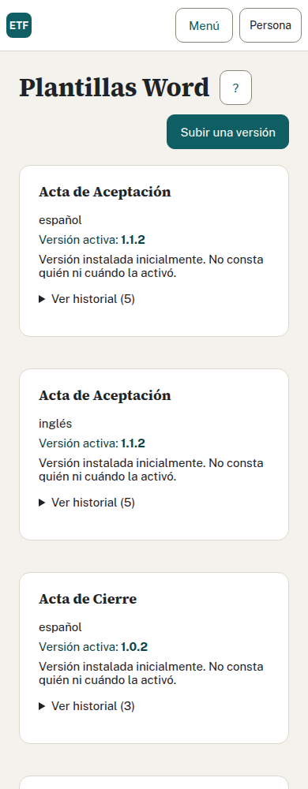

## Anexo A. Configuración de producción

Autor: Expedientes ETF. Revisión: 14 de octubre de 2026.

[Volver al manual](LEEME.md). Este anexo se usa con la función `componer` del
manual, que fija proyecto, repositorio y archivos externos. El Compose base no
incluye el proxy de producción ni la conectividad con AD.

### A.1 Preparar entorno y secretos

Informática conserva `/etc/etf/entorno.env` fuera de Git, con permiso 0600 y
propietario de servicio. Añade las variables de identidad a las contraseñas de
[la plantilla base](../../.env.plantilla). El origen, los límites de sesión, el DN, el
formato de bind y el nombre de administrador deben tener los valores aprobados.
Las variables LDAP son `ETF_AD_URL`, `ETF_AD_BASE_DN`, `ETF_AD_FORMATO_BIND` y
`ETF_AD_CA_RUTA`. No hay contraseña de cuenta de servicio AD configurable en la
implementación actual: el acceso usa la contraseña de quien entra y no la guarda.

Genera cada contraseña de base por separado, con `openssl rand -hex 32`, y guárdala
en el gestor o archivo privado. No reutilices la del instalador. Evita mostrar el
entorno completo, utilizar `set -x` o pegar una salida de `compose config` en soporte.
Si se opta por secretos Docker, hay que adaptar su lectura: esta versión consume
variables, no ofrece variantes `_FILE` para contraseñas. Montar un secreto sin
esa adaptación no configura la aplicación.

### A.2 Archivo adicional de Compose

Este contenido corresponde al archivo `/etc/etf/compose.interno.yaml` del manual.
Los valores se leen del entorno privado; no escribas las contraseñas en él.
La CA pública debe existir en `/etc/etf/certificados/ad-ca.pem`.

```yaml
services:
  app:
    environment:
      ETF_HTTP_ORIGEN: ${ETF_HTTP_ORIGEN:?}
      ETF_HTTP_PROXIES: ${ETF_HTTP_PROXIES:?}
      ETF_AD_URL: ${ETF_AD_URL:?}
      ETF_AD_BASE_DN: ${ETF_AD_BASE_DN:?}
      ETF_AD_FORMATO_BIND: ${ETF_AD_FORMATO_BIND:?}
      ETF_AD_CA_RUTA: /certificados/ad-ca.pem
      ETF_SESION_MAXIMA: ${ETF_SESION_MAXIMA:-8h}
      ETF_SESION_INACTIVIDAD: ${ETF_SESION_INACTIVIDAD:-30m}
      ETF_PRIMER_ADMINISTRADOR: ${ETF_PRIMER_ADMINISTRADOR:?}
    volumes:
      - type: bind
        source: /etc/etf/certificados/ad-ca.pem
        target: /certificados/ad-ca.pem
        read_only: true
        bind:
          create_host_path: false
      - type: bind
        source: /srv/etf/paquetes/idiomas
        target: /datos/idiomas
        bind:
          create_host_path: false
      - type: bind
        source: /srv/etf/paquetes/temas
        target: /datos/temas
        bind:
          create_host_path: false
```

Compose combina montajes por destino: estos dos sustituyen los de sólo lectura
de la base. El archivo todavía necesita la solución de red hacia AD aprobada por
Informática. No basta con añadir una URL LDAPS. No se usa el archivo de la demo
para proporcionar esa red ni para desactivar HTTPS en producción.

### A.3 Inicializar idiomas, temas y plantillas

Antes del primer arranque, crea ambos directorios persistentes vacíos y copia el
contenido completo de `idiomas/` y `temas/` de la versión autorizada. Requiere
administración del host; ejecuta estas órdenes sólo en la instalación nueva:

```sh
sudo install -d -m 0750 -o 10001 -g 10001 /srv/etf/paquetes
sudo install -d -m 0750 -o 10001 -g 10001 /srv/etf/paquetes/idiomas
sudo install -d -m 0750 -o 10001 -g 10001 /srv/etf/paquetes/temas
sudo cp -a idiomas/. /srv/etf/paquetes/idiomas/
sudo cp -a temas/. /srv/etf/paquetes/temas/
sudo chown -R 10001:10001 /srv/etf/paquetes
componer config --quiet
```

Comprueba el permiso de lectura y escritura del UID 10001 y, si el host aplica
controles adicionales a los montajes, su política específica. No uses `chmod 777`.
Estos comandos de copia inicial no son un procedimiento de actualización: en un
almacenamiento ya usado podrían reemplazar versiones administradas.

Administración publica idiomas y temas desde Paquetes, y Word desde Plantillas.
Cada publicación crea una versión inmutable; su activación y autoría se registran
en la base. No edites el archivo activo ni borres versiones antiguas que una
emisión o Memoria pueda necesitar. La base guarda referencias; restaurarla sin
los archivos de la misma copia puede dejar descargas inutilizables.

Al actualizar, conserva todas las versiones locales y añade sólo los recursos
que exija esa entrega, siguiendo sus notas. Comprueba que las rutas previstas en
las migraciones están presentes antes de ejecutarlas. Las reservas de la imagen
sirven para recuperaciones limitadas de textos y temas; no sustituyen una copia
de plantillas administradas ni garantizan recuperar todas las referencias.




### A.4 LDAPS y certificado

Sólo se admite `ldaps://`; el directorio utiliza TCP 636 y un certificado válido
para el nombre configurado. El archivo PEM debe contener la autoridad de confianza.
Confirma DNS, ruta y hora desde el servidor y desde la red que usará app. Para
comprobar la cadena desde el servidor, sustituye las variables de esta sesión por
el host y certificado aprobados:

```sh
openssl s_client -connect "$ETF_AD_HOST:636" \
  -servername "$ETF_AD_HOST" -verify_hostname "$ETF_AD_HOST" \
  -CAfile /etc/etf/certificados/ad-ca.pem -verify_return_error < /dev/null
```

`ETF_AD_HOST` es una variable de esta orden de diagnóstico, no una opción de app.
Exige validación correcta y confirma después el acceso real con una cuenta
habilitada. Esta prueba del host no demuestra conectividad desde el contenedor.
El formato de bind usa `{usuario}`; el adaptador busca `sAMAccountName` y exige
una única entrada y `objectGUID`. Informática debe confirmar con desarrollo que
la búsqueda corresponde al principal autenticado (riesgo R-06). No desactives
la comprobación TLS para salvar una CA incorrecta.

Al renombrar una cuenta, los perfiles siguen su `objectGUID`. Una cuenta nueva
con un login reutilizado no debe heredar permisos. Comprueba ambos casos en
preproducción. Si AD deshabilita una cuenta, retira también el acceso en la app:
una sesión ya abierta puede durar hasta el máximo configurado.

SEG1 fija 30 minutos sin actividad y 8 horas de duración absoluta por defecto. Ambos plazos se configuran con las variables anteriores. La inactividad debe superar dos minutos y no superar el máximo; el máximo tiene un tope técnico de 24 horas. La pantalla avisa dos minutos antes, permite continuar dentro del máximo y vuelve a la entrada al caducar. Los datos guardados se conservan.

### A.5 Proxy HTTPS

El navegador debe usar el origen HTTPS exacto de `ETF_HTTP_ORIGEN`, sin ruta.
El proxy termina TLS y reenvía a la publicación local de app. Conserva `Host`,
`Origin`, cookies y cabeceras CSRF; sustituye `X-Forwarded-For` por la dirección
real del cliente. Declara sólo las redes del proxy en `ETF_HTTP_PROXIES`, como
CIDR separados por comas. No confíes en todas las redes ni en cabeceras del cliente.

Restringe acceso a red corporativa, provincial y VPN. Configura el certificado,
HSTS y los límites por cliente en el proxy acordado; excluye la caché de respuestas
de API, sesiones, cifras y descargas. Las cookies son `Secure`, `HttpOnly` y
`SameSite=Strict`. El puerto 18083 queda en loopback si proxy y app comparten host.
Un proxy remoto requiere conexión privada revisada, sin abrir ese puerto al público.

Coordina los límites de cuerpo y tiempos con las subidas admitidas por app: un
límite menor en el proxy produce un rechazo antes del mensaje del antivirus o
lector. Verifica subida y descarga de un Word inventado, petición de modificación
con origen correcto y rechazo desde origen distinto. No guardes cuerpos de
peticiones, tokens ni contraseñas en registros del proxy.

### A.6 Puesta en servicio

Tras preparar roles, migrar y arrancar, comprueba por HTTPS la entrada del primer
administrador, el alta de perfiles, un expediente de cada equipo y una descarga.
Prueba que Administración no accede a fichas y que Consulta sólo obtiene cifras.
Usa datos inventados en preproducción. El login del primer administrador sólo se
aplica una vez: no recupera permisos retirados al cambiar la variable o reiniciar.

No hay envío de correo ni variables SMTP. No se conecta con un registro externo
ni con firma electrónica. Sus actuaciones se hacen fuera de esta aplicación.
La [lista de puesta en producción](LEEME.md#10-lista-de-comprobación-para-producción)
debe quedar aceptada antes de introducir datos reales.
