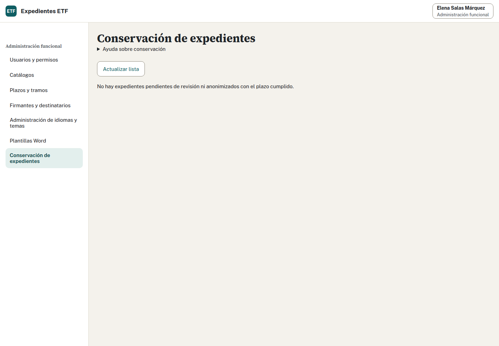

## Anexo D. Evidencia del manual de sistemas

Autor: Expedientes ETF. Fecha: 14 de octubre de 2026.
Rama: `manual-sistemas`. [Volver al manual](LEEME.md).

### D.1 Alcance

Manual ampliado y contrastado con TRD, Compose, Dockerfile, configuración real,
comprobador de auditoría, conservación y catálogos de errores. Incluye anexos de
configuración, cifrado y operación, diagnóstico y este registro; PDF con autoría
y enlaces locales. Las evidencias anteriores [F5.05](EVIDENCIA.md), [FX2](FX2.md)
y [WIN1](WIN1.md) se conservan.

Diferencia respecto al arranque previsto en TRD: la salud actual comprueba la
conexión PostgreSQL, no una versión mínima del esquema ni todos los conectores.
El migrador controla historial y huellas antes de arrancar. El manual distingue
las funciones presentes de las previstas.

No se ha accedido a producción, AD corporativo ni otros proyectos de datos.
Todas las personas y expedientes usados son inventados. No se ha ensayado el
proxy corporativo, la recepción de una copia fuera del servidor ni su custodia de
claves. Se ha comprobado el cifrado y descifrado local con GnuPG AES256 del volcado y
paquetes inventados, con clave temporal privada y comparación exacta del conjunto.
Es una opción local para Informática; la recuperación corporativa completa sigue
pendiente.

Configuración del anexo A renderizada con Compose y variables inventadas, sin
crear servicios de producción ni mostrar valores de entorno:

```text
MANSIS-COMPOSE-OK: archivo adicional válido; paquetes escribibles, CA de sólo lectura y preparación previa conservadas.
```

### D.2 Restauración

```sh
ETF_DEMO_PUERTO=18653 make demo
python3 -B scripts/ensayar-restauracion.py
```

El primer ensayo confirmó datos y secuencias idénticos, pero detectó una diferencia
de permisos de paquetes: BusyBox `tar` aplica la máscara del proceso incluso
con `-p`, pasando archivos 0664 a 0644 y directorios 0775 a 0755. No hubo pérdida
de contenido. La copia privada se conservó y se recuperó
con su contenido y permisos originales antes de repetir.

Tras integrar las mejoras de la demo, otra repetición detectó doce recursos
anteriores con UID/GID 1000 que la extracción como app convertía en 10001. La base,
el contenido y los permisos coincidían. Se conservó la copia y se recuperaron
los propietarios originales antes de repetir.

El ensayo ahora usa el servicio puntual `incorporar` para recuperar paquetes:
no tiene red, sólo monta sus dos volúmenes y dispone de las capacidades de
propiedad de archivos ya previstas por la demo. La app sigue como UID 10001
sin privilegios. Fija `umask 000` únicamente durante la extracción de su propio
archivo privado recién creado. Mantiene la comparación estricta de contenidos,
propietarios y permisos; no oculta la diferencia. El ajuste no cambia los permisos
que lleva la copia ni admite archivos externos. Resultado de la repetición:

```text
RESTAURACION-OK: datos, secuencias y paquetes idénticos
F5.05-OK: copia, borrado, restauración, siete accesos y recorrido Chrome
```

Prueba local de cifrado de ese conjunto, con GnuPG, clave temporal privada y
comparación SHA-256 tras descifrar:

```text
MANSIS-CIFRADO-OK: GnuPG AES256; descifrado, dump y paquetes idénticos; sólo datos inventados locales.
```

### D.3 Capturas

Con la demo recuperada y las cuentas iniciales:

```sh
node docs/sistemas/capturar.mjs
```

Chrome del sistema y Playwright; Elena Salas, Administración funcional. El script
lee el puerto y credenciales privados de esta demo, consulta Plantillas a 1440 y
390 píxeles, comprueba ausencia de desbordamiento y captura Conservación a 1440.
La lista de conservación está vacía porque ningún caso de la demo ha cumplido
el plazo; no se adelanta el reloj ni se simula una confirmación. No se publican
credenciales ni expedientes reales.

```text
MANSIS-CAPTURAS-OK: Plantillas 1440/390; Conservación 1440; salud 200; sin errores JavaScript.
```



### D.4 PDF, enlaces y regresión

```sh
TMPDIR=/dev/shm/etf/tmp python3 -B docs/manuales/exportar.py \
  --manual sistemas --salida docs/sistemas
python3 -B scripts/ci/enlaces.py
make ci
```

El exportador permite seleccionar Sistemas y mantiene por defecto los tres PDF
anteriores. La selección repetible de Administración y Sistemas, incluida una
repetición de Administración, generó cada PDF una sola vez. La comprobación compara sus documentos ODT con el exportador previo
y genera esos PDF en una carpeta temporal, sin modificar los otros manuales.
Sistemas incorpora anexos, capturas, líneas de órdenes sin unir y metadatos de
Expedientes ETF. Los enlaces a los anexos incluidos son internos; los enlaces a
otros archivos conservan rutas relativas al árbol entregado. Resultado:

```text
EXPORTADOR-REGRESION-OK: contenido ODT idéntico para profesionales, coordinación y administración.
EXPORTADOR-SISTEMAS-OK: XML, anexos, tablas, órdenes, autor, enlaces internos y textos alternativos.
PDF-OK: sistemas.pdf
MANSIS-PDF-ENLACES-OK: 18 enlaces externos relativos, todos con destino local existente.
MANSIS-PDF-OK: anexos, órdenes, mensajes reales y capturas incluidos; autor Expedientes ETF.
Markdown: 173 documentos, 949 enlaces locales, 15 enlaces externos sin consulta de red, 0 errores.
CI mínima completada.
```

Se ejecutó `make ci` completo antes y después de integrar las actas ODT; ambas
ejecuciones terminaron correctamente. Tras integrar la actualización de la demo
y resolver el exportador compartido se repitió la CI completa, también verde.
La CI incluye `go vet ./...`, `go test ./...`, frontend, textos, temas, migraciones
PostgreSQL y recorridos con Chrome. La revisión local de los procedimientos cubre
secretos fuera de Git, separación de roles, restauración sin sesiones válidas,
reconciliación de permisos y conservación, y límites del sello de auditoría.
No cierra los riesgos que necesitan infraestructura y validación de Informática.

`main` integrado antes de la entrega: `5dd23bc`; conflicto del exportador resuelto conservando ambas capacidades. La demo se para
conservando los datos inventados y se retiran los temporales de estas pruebas.
